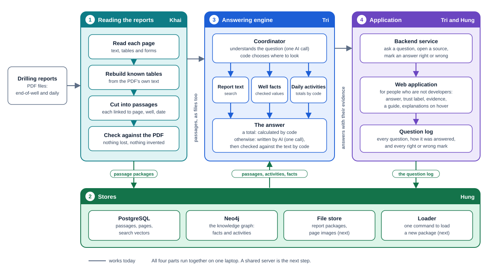

# Secure LLM and Knowledge Graph Platform

A capstone project for the Vietnam Petroleum Institute (VPI): ask a question about a well's drilling reports and get an answer with the page it comes from.

- It reads end-of-well and daily drilling reports (PDF), and keeps their text, tables and a knowledge graph of facts and daily activities.
- A total such as "hours of non-productive time" is calculated by code. Other answers are written by an AI model and checked against the report text.
- It uses **open-weight models of about 8B parameters or smaller, run by the team**. Commercial models are never used, because the real documents are private.



## Status

25 November 2026. Detail: [plan, current status](docs/DEVELOPMENT_PLAN.md#current-status).

| | |
|---|---|
| **Works** | All four parts, connected, and run end to end with the real model (Qwen3-8B) on one machine: one command loads a report package into the stores, and the application answers from them behind a password. A model can be swapped by naming a [profile](configs/graphrag/models/README.md) |
| **Measured in part** | The earlier baseline is reproduced. Answers about causes were measured once: they find the cause the reports state and over-state ([E34](docs/experiments/E34-reasoning-probe.md)). The coordinator against choosing by hand is not measured in full |
| **Not done** | A server others reach; a GPU for the one long measurement. The team has neither, and has asked for a [small budget](docs/reports/RESOURCE_REQUEST_2026-11-24.md) to rent them |
| **Caveat** | Every test question was written by the team. No domain expert has reviewed one or used the application |

## Try it

No model, GPU or database needed: the application runs on prepared example answers.

```powershell
cd frontend
npm install
npm run dev:examples
```

To run the tests (Python 3.12):

```powershell
py -3.12 -m venv .venv
.\.venv\Scripts\python -m pip install -r requirements.lock.txt
.\.venv\Scripts\python -m pip install -e . --no-deps
.\.venv\Scripts\python -m unittest discover -s tests
```

Tests that need a database, the source PDFs or optional packages skip by themselves.

## Where things are

| Folder | What it is | Guide |
|---|---|---|
| `src/graph_builder/` | Reading the reports: PDFs to passages, tables and forms with stable IDs | [Operating guide](docs/components/track-a-operation.md), [ingestion](docs/components/corpus-ingestion.md) |
| `platform/` | The stores: PostgreSQL with pgvector, Neo4j, and the command that loads them | [platform/README.md](platform/README.md) |
| `graphrag/` | The answering engine: retrieval, the two graphs, the coordinator, checked answers | [graphrag/README.md](graphrag/README.md) |
| `backend/`, `frontend/` | The application: a FastAPI service and a React web page | [backend](backend/README.md), [frontend](frontend/README.md) |
| `deploy/` | Running it all on a server | [deploy/README.md](deploy/README.md) |
| `docs/` | Design, plan, records and reports | [Documentation index](docs/README.md) |
| `prototype/` | An earlier prototype, kept as the baseline to beat | [prototype/README.md](prototype/README.md) |
| `configs/`, `schemas/`, `scripts/`, `tests/` | Settings, record formats, utilities, tests | — |
| `explorations/` | Side explorations, not part of the system | — |

Three documents explain the project, in this order: the [specification](docs/PROJECT_DESIGN.md) (what is built and why), the [plan](docs/DEVELOPMENT_PLAN.md) (who does what next), and the latest [stint report](docs/reports/stints/STINT_REPORT_2026-11-27.md) (the system in pictures).

## Team

| | |
|---|---|
| Thai Huu Tri | Answering engine and web application |
| Nguyen Le Hung | Stores and backend |
| Tran Quang Khai | Reading the reports |
| Advisors | Dr. Le Duy Dung; MSc. Nguyen Anh Tuan (VPI) |

## Working on it

- Run the tests before pushing. Text files use UTF-8 and LF line endings.
- Never commit downloads, caches, credentials or anything under `data/raw/` and `data/interim/`.
- A change in behaviour updates its guide in the same commit. A change in scope goes into the specification first ([conventions](docs/README.md#conventions)).
- A new measurement is recorded as an [experiment](docs/experiments/README.md).
- Some packages have licence terms to know before deploying (PyMuPDF is AGPL): see [dependencies](docs/components/dependencies.md).

## Data

Development uses public data only ([data sources](docs/DATA_SOURCES.md)).

- **Drilling reports:** authored by Geothermal Resource Group, Inc., published in the U.S. DOE [Geothermal Data Repository](https://gdr.openei.org) under [CC BY 4.0](https://creativecommons.org/licenses/by/4.0/): Akutan well AK-3 ([submission 882](https://gdr.openei.org/submissions/882)), Utah FORGE wells 56-32 ([1295](https://gdr.openei.org/submissions/1295)) and 68-32 ([1153](https://gdr.openei.org/submissions/1153)). The [source registry](configs/sources/gdr_end_of_well.json) pins each file's address and digest.
- **Well identity data:** the [BSEE Data Center](https://www.data.bsee.gov/Main/Well.aspx), under the [BSEE disclaimer](https://www.bsee.gov/bsee.gov/privacy-disclaimer). Downloaded locally, never redistributed here.
