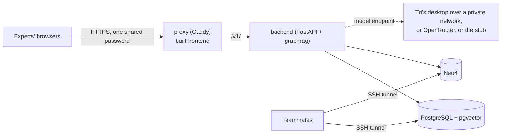

# deploy: from a new server to the running application

The runbook for the shared server (backend design [§1](../docs/tracks/C-storage/backend-design.md#1-shared-hosting-b1) and [§8](../docs/tracks/C-storage/backend-design.md#8-the-compose-file-and-the-access-gate-b8)). Written for Hung, who owns the hosting; anyone on the team can follow it. Every command runs on the server unless it says otherwise.

**Status (24 November 2026):** the images were built and the stack ran on a Windows laptop with Docker Desktop, behind the password, with the stub model, and `smoke_test.py` passed through the proxy. The steps on a real Ubuntu server and with a real domain have not been run yet; mark here what differed when you run them.

**Two runbooks, one server.** Hung's [server runbook](../docs/tracks/C-storage/server-runbook.md) covers the server itself and the stores: creating it, `platform/server/setup.sh`, the passwords, the SSH tunnel, the backup, and loading a release through the tunnel. This file adds the application on top: the backend, the proxy with the password gate, and the model endpoint. Sections 1 to 3, 6, 7 and 10 below overlap with his and are kept so the whole path can be read in one place; where the two differ on the stores or the server, follow his: it is the one that was run. Until a server exists, the stores run on a team machine over Tailscale (Track C log C-D06); the application can run there the same way, for the team only.

## What runs



| Service | Compose profile | Reachable from |
|---|---|---|
| `postgres`, `neo4j` | none (always) | the server itself (`127.0.0.1`), and teammates through an SSH tunnel |
| `backend` | `app` | the proxy only |
| `proxy` | `app` | the internet, ports 80 and 443 |
| `stub-model` | `demo` | the backend only. **Not a model:** every answer starts with "[stub model]" |

Files in this folder:

| File | For |
|---|---|
| `Caddyfile` | The proxy: HTTPS, the password gate, the frontend, `/v1/` to the backend. Built into the proxy image |
| `models/endpoints.stub.json` | Default endpoints file: every local endpoint is the stub model |
| `models/endpoints.desktop.json` | Template: Tri's desktop over a private network |
| `models/roles.openrouter.json` | Template: the answer and frame roles on an open-weight model at OpenRouter |
| `requirements-runner.txt` | Python packages on the host for loading a release |
| `smoke_test.py` | Checks a running deployment from outside: gate, frontend, health, one question, one feedback |

## 1. The server

Hung's `platform/server/setup.sh` does this section and the next in one run ([server runbook §3](../docs/tracks/C-storage/server-runbook.md#3-first-setup-as-root)); the commands below are the same steps by hand.

| Choice | Value |
|---|---|
| Size | 4 vCPU, 8 GB memory, 80 GB disk (resource request, 24 November) |
| System | Ubuntu 24.04 LTS (its Python is 3.12, which the runner needs) |
| Access | Your SSH key only; password login off |
| Domain (recommended) | A DNS `A` record pointing at the server, e.g. `kg.<your domain>`. Without one, see "No domain" below |

First login, as root or with `sudo`:

```sh
apt update && apt -y upgrade
adduser --disabled-password --gecos "" kg       # the account that runs the application
usermod -aG sudo kg
mkdir -p /home/kg/.ssh && cp ~/.ssh/authorized_keys /home/kg/.ssh/ && chown -R kg:kg /home/kg/.ssh
# In /etc/ssh/sshd_config: PasswordAuthentication no, PermitRootLogin no; then:
systemctl restart ssh
```

**Firewall: only ports 22, 80 and 443.** Set it in two places:

1. The provider's cloud firewall (DigitalOcean "Cloud Firewalls", Azure "Network security group"): inbound TCP 22, 80, 443 only. `setup.sh` opens 22 and 443; add 80 so the proxy can send plain HTTP on to HTTPS. Caddy gets its certificate over 443 either way.
2. On the server:

   ```sh
   ufw default deny incoming && ufw default allow outgoing
   ufw allow 22/tcp && ufw allow 80/tcp && ufw allow 443/tcp
   ufw enable
   ```

Docker writes its own firewall rules for published ports and goes around `ufw`. That is why the compose file binds PostgreSQL, Neo4j and MinIO to `127.0.0.1`: keep it so. Only the proxy is published on `0.0.0.0`, and only when `.env` says `PROXY_BIND=0.0.0.0`. The cloud firewall is the real outer wall.

## 2. Docker

Docker's own packages, as in [its documentation](https://docs.docker.com/engine/install/ubuntu/):

```sh
sudo apt -y install ca-certificates curl git
sudo install -m 0755 -d /etc/apt/keyrings
sudo curl -fsSL https://download.docker.com/linux/ubuntu/gpg -o /etc/apt/keyrings/docker.asc
echo "deb [arch=$(dpkg --print-architecture) signed-by=/etc/apt/keyrings/docker.asc] https://download.docker.com/linux/ubuntu $(. /etc/os-release && echo $VERSION_CODENAME) stable" | sudo tee /etc/apt/sources.list.d/docker.list
sudo apt update && sudo apt -y install docker-ce docker-ce-cli containerd.io docker-buildx-plugin docker-compose-plugin
sudo usermod -aG docker kg            # log out and in again
```

Keep container logs from filling the disk: write `/etc/docker/daemon.json` with

```json
{"log-driver": "json-file", "log-opts": {"max-size": "10m", "max-file": "3"}}
```

then `sudo systemctl restart docker`.

## 3. The repository and folders

As `kg`:

```sh
sudo mkdir -p /srv/kg /srv/k1 && sudo chown kg:kg /srv/kg /srv/k1
git clone https://github.com/thaitri2005/Secure-O-G-LLM-and-Knowledge-Graph.git /srv/kg/repo
mkdir -p /srv/kg/models /srv/kg/pages /srv/backups
cd /srv/kg/repo
```

| Folder | Holds |
|---|---|
| `/srv/kg/repo` | The clone. Never commit from it |
| `/srv/k1/<release>/` | K1 releases, copied with `rsync` (they replace the zip in chat) |
| `/srv/kg/models/` | The server's own endpoints and roles files |
| `/srv/kg/pages/` | Page images |
| `/srv/backups/` | Nightly database dumps |

## 4. The settings file

```sh
cp platform/.env.example platform/.env
chmod 600 platform/.env
openssl rand -hex 24        # run three times: POSTGRES_PASSWORD, NEO4J_PASSWORD, and the shared password
docker run --rm caddy:2.11.9-alpine caddy hash-password --plaintext '<the shared password>'
nano platform/.env
```

Fill in every line of `platform/.env`; each has a one-line explanation. In particular:

- `POSTGRES_PASSWORD`, `NEO4J_PASSWORD`: new ones, letters and digits only. **They take effect on the stores' first start only**; to change them later see section 11.
- `APP_PASSWORD_HASH`: the line `caddy hash-password` printed, **in single quotes** (it contains `$`). Without a valid hash the proxy refuses to start; it never runs without the gate.
- `SITE_ADDRESS`: the domain. `PROXY_BIND=0.0.0.0`.
- `COMPOSE_PROFILES=app`, so `docker compose up -d` starts the application with the stores.

The shared user name and password go to the experts with the link, by a channel other than the repository.

## 5. The model endpoint

The backend reads two files, `configs/graphrag/endpoints.json` (addresses) and `roles.json` (which model serves which role), and `graphrag/client.py` takes them only from those paths. So the compose file mounts the server's own copies over them, named by `MODEL_ENDPOINTS_FILE` and `MODEL_ROLES_FILE` in `.env`. Choose one:

### A. A team machine with the GPU over a private network (not available now: the desktop is borrowed, Track C log C-D07)

The desktop serves Qwen3-8B with llama.cpp, as for every run (CLAUDE.md, "Setting up a machine"). Tailscale is the simplest private network: no port is opened to the internet.

1. Install Tailscale on the server (`curl -fsSL https://tailscale.com/install.sh | sh && sudo tailscale up`) and on the desktop; note the desktop's address (`100.x.y.z`).
2. On the desktop, start `llama-server` as usual but with `--host 0.0.0.0 --api-key <a long random key>`, and allow ports 8080 and 8081 in the Windows firewall from `100.64.0.0/10` only.
3. On the server:

   ```sh
   cp deploy/models/endpoints.desktop.json /srv/kg/models/endpoints.json    # then put the desktop's 100.x address in it
   cp configs/graphrag/roles.json /srv/kg/models/roles.json
   ```

   and set `DESKTOP_MODEL_KEY=<the same key>` in `.env`.

When the desktop is off, questions get a `503` that says the model did not answer; the rest of the application keeps working.

### B. OpenRouter with an open-weight model (for the demo; public data only)

Only public reports (AK-3, Utah FORGE) may be served this way, and only open-weight models: commercial models are never used (CLAUDE.md). The client refuses non-public data on a hosted endpoint by itself.

```sh
cp configs/graphrag/endpoints.json /srv/kg/models/endpoints.json
cp deploy/models/roles.openrouter.json /srv/kg/models/roles.json             # frame and answer: qwen/qwen3-8b
```

Set `OPENROUTER_API_KEY` in `.env`, and a monthly spending cap on the OpenRouter account. The embedding role stays on `local-embed`, which the server cannot reach, so questions naming several wells use BM25 per well instead of fusion. Hosted results are not the project's measured results (resource request, "Limits").

### C. The stub (no model; wiring only)

Leave both variables unset and add `demo` to the profiles: `COMPOSE_PROFILES=app,demo`. Answers then start with "[stub model]". Use it to check the stack, never to show anyone answers.

## 6. Start the stores

```sh
docker compose -f platform/docker-compose.yml up -d postgres neo4j
docker compose -f platform/docker-compose.yml ps
```

Compose refuses to start until `platform/.env` holds the two store passwords (Track C log C-C13). PostgreSQL creates its tables from `platform/sql/` on this first start. Neo4j takes about a minute to install APOC.

## 7. Load a release

There are two ways, and they load the same thing. **Through the tunnel, from a teammate's machine** ([server runbook §6](../docs/tracks/C-storage/server-runbook.md#6-loading-a-release)): the server needs no Python, and the machine has the embedding model, so vectors are loaded too. The runner works that way as well: set `BACKEND_DSN`, `NEO4J_URI` and `NEO4J_PASSWORD` to the tunnel's addresses and run `python platform/run_release.py <release>`. **On the server**, as below: no tunnel, but no vectors.

From your machine, copy the release:

```sh
rsync -av <release folder>/ kg@<server>:/srv/k1/<release>/
```

On the server, once, a Python environment for the runner (packages for the host, not Docling or torch: a release is already parsed):

```sh
sudo apt -y install python3.12-venv
python3 -m venv /srv/kg/venv
/srv/kg/venv/bin/pip install -r deploy/requirements-runner.txt
```

Then, each time a release is loaded:

```sh
cd /srv/kg/repo
set -a; . platform/.env; set +a                 # the passwords, for the runner
/srv/kg/venv/bin/python platform/run_release.py /srv/k1/<release> --skip-vectors
```

- The runner's own options and the environment variables it reads are in [platform/README.md](../platform/README.md); check them there, as the runner was written after this runbook.
- `--skip-vectors`: the server has no embedding model. BM25 serves one-well questions; vectors can be added later from a machine with the embedding model, through the SSH tunnel of section 10.
- Run it twice: the second run must report the same counts and change nothing.
- Until the K1 release itself holds the non-productive-time report (appendix 23, plan task D1), the event step needs `--appendices <folder of the corpus export holding it>`; without it the runner stops at step 4 and says so.
- The question-log tables (`platform/sql/002_questions.sql`) are created with the others when PostgreSQL first starts on an empty volume. On a database that existed before that file did, create them once: `BACKEND_DSN=postgresql://kg:<password>@127.0.0.1:5434/kg /srv/kg/venv/bin/python -m backend.questions init`.
- Page images, if the source PDFs are on the server: `platform/render_pages.py` writes them into `/srv/kg/pages` (see its `--help`).

## 8. Start the application

```sh
docker compose -f platform/docker-compose.yml up -d --build
docker compose -f platform/docker-compose.yml ps         # backend and proxy "healthy" after a minute or two
```

The first start builds both images (a few minutes). With a domain, Caddy fetches its certificate on the first request; that needs ports 80 and 443 open and the DNS record in place.

## 9. Check it from outside

From your own machine, with the repository checked out:

```sh
python deploy/smoke_test.py --url https://<domain> --user team --password '<the shared password>'
```

Five checks: the gate refuses a request without the password, the frontend loads, health answers, one question is answered, one feedback is stored. Add `--expect-stub` with the stub model. The question is logged like any other, with "smoke test" as its feedback comment. Then open the address in a browser and ask a question.

## 10. Teammates: the databases through an SSH tunnel

The databases never face the internet. Each teammate sends their **public** SSH key; append it to `/home/kg/.ssh/authorized_keys` (one line per person, with their name as the comment at the end of the line, so it can be removed alone). They then run, on their own machine:

```sh
ssh -N -L 15434:127.0.0.1:5434 -L 17474:127.0.0.1:7474 -L 17687:127.0.0.1:7687 kg@<server>
```

and use `postgresql://kg:<POSTGRES_PASSWORD>@127.0.0.1:15434/kg`, `bolt://127.0.0.1:17687` and <http://127.0.0.1:17474>. The 1xxxx ports leave their own local stores running ([server runbook §5](../docs/tracks/C-storage/server-runbook.md#5-reaching-the-databases-the-tunnel)). The store passwords are shared by a channel other than the repository.

## 11. Backup, restore, update

**Backup.** Only PostgreSQL holds what cannot be rebuilt: the question log. As `kg`, `crontab -e`, add:

```
15 3 * * * /srv/kg/repo/platform/server/backup.sh >> /srv/backups/backup.log 2>&1
```

That is Hung's `platform/server/backup.sh`. It writes `kg-<time>.dump` every night and deletes dumps older than 7 days. Copy one off the server now and then (`scp kg@<server>:/srv/backups/<dump> .`): a backup on the same disk does not survive the server.

**Restore** a dump into the running database (it replaces what is there):

```sh
docker compose -f platform/docker-compose.yml exec -T postgres pg_restore -U kg -d kg --clean --if-exists < /srv/backups/<dump>
```

Neo4j and the vectors are rebuilt by loading the release again (section 7).

**Update to a new version:**

```sh
cd /srv/kg/repo
git pull
docker compose -f platform/docker-compose.yml up -d --build
python3 deploy/smoke_test.py --url https://<domain> --user team --password '<password>'
```

Volumes (databases, question log, certificates) are kept. To go back, `git checkout <previous commit>` and run the same `up -d --build`. If the new version adds a file to `platform/sql/`, it does not run on an existing database; apply it by hand with `docker compose -f platform/docker-compose.yml exec -T postgres psql -U kg -d kg < platform/sql/<file>` (the files are idempotent).

**Change a store password** (the variables only apply to an empty volume):

```sh
docker compose -f platform/docker-compose.yml exec postgres psql -U kg -d kg -c "ALTER USER kg PASSWORD '<new>'"
docker compose -f platform/docker-compose.yml exec neo4j cypher-shell -u neo4j -p '<old>' -d system "ALTER CURRENT USER SET PASSWORD FROM '<old>' TO '<new>'"
```

then put the new ones in `.env` and run `docker compose -f platform/docker-compose.yml up -d`. To change the shared password, write a new hash into `.env` and run the same command.

## No domain

Basic authentication over plain HTTP sends the password readable by anyone on the path, so do not open port 80 to the internet without a domain. Either:

- use a name that resolves to the server's address, such as `<a-b-c-d>.sslip.io` for address `a.b.c.d`, as `SITE_ADDRESS` (Let's Encrypt then works as with a domain; check sslip.io's current terms first); or
- keep `PROXY_BIND=127.0.0.1` and `SITE_ADDRESS=:80`, and reach the application through a tunnel: `ssh -N -L 8088:127.0.0.1:80 kg@<server>`, then http://127.0.0.1:8088. Fine for the team, not for experts.

## Troubleshooting

| Symptom | Likely cause | What to do |
|---|---|---|
| `proxy` restarts; its log says `username and password cannot be empty` or `base64-decoding password` | `APP_PASSWORD_HASH` missing, not in single quotes, or not a bcrypt hash | Generate it again (section 4) and quote it |
| Browser warns about the certificate, or Caddy logs `challenge failed` | DNS not pointing at the server yet, or port 80/443 closed in the cloud firewall | `dig +short <domain>`; check both firewalls; `docker compose ... logs proxy` |
| Every API call gives `503` from the proxy | The backend is down or not healthy | `docker compose ... ps` and `logs backend` |
| `POST /v1/questions` gives `503 ... the model endpoint did not answer` | The model is off or unreachable | `GET /v1/health` names the endpoint and model of each role; from the server, `curl http://<desktop>:8080/v1/models`; check Tailscale, the desktop's firewall and the API key |
| Answers start with "[stub model]" | The stub endpoints file is in use | Set `MODEL_ENDPOINTS_FILE` and `MODEL_ROLES_FILE` (section 5), remove `demo` from `COMPOSE_PROFILES`, `up -d` |
| Questions naming several wells are slower or worse than on the desktop | The embedding endpoint did not answer when the backend started, so it uses BM25 per well | Make the embedding endpoint reachable, then `docker compose ... restart backend` |
| `backend` unhealthy, log shows a PostgreSQL authentication error | The password in `.env` differs from the one the volume was created with | Section 11, "Change a store password" |
| Health says `"source": "files"` on the server | `BACKEND_SOURCE` not set to `stores` | Set it in `.env`, `up -d` |
| Health says `"source": "stores"` but no wells or chunks | No release loaded yet | Section 7 |
| The runner cannot connect to PostgreSQL or Neo4j | The `.env` variables were not exported into the shell | `set -a; . platform/.env; set +a`, then run it again from `/srv/kg/repo` |
| Disk filling up | Container logs, old images or dumps | `docker system df`; `docker image prune`; the log limits of section 2 |
| `docker compose` complains about a variable | A `$` in `.env` outside single quotes | Quote the value |
