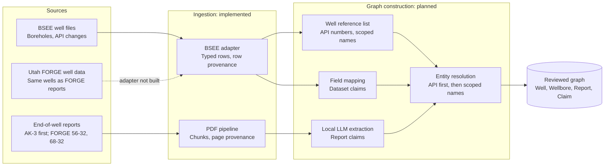

# Development focus and data sources

**Updated:** 25 October 2026 · **Applies to:** current development, until the supervisor changes the focus

> **Current focus.** The project supervisor asked the team to develop against two sources for now:
>
> 1. **[BSEE Data Center – Wells Information](https://catalog.data.gov/dataset/bsee-data-center-wells-information)**, the structured well data. An ingestion adapter is implemented: [BSEE well-data ingestion](bsee-ingestion.md).
> 2. **End-of-well reports, starting with the [Akutan AK-3 End of Well Report](https://gdr.openei.org/files/882/00%20AK-3%20EOW%20Report.pdf)**, the document type to extract knowledge from. It is already in the PDF corpus as `gdr882_ak3_eowr`.
>
> The next milestone (M2 in the [development plan](DEVELOPMENT_PLAN.md)) builds its ontology, labels and first extraction experiment from these two sources. Other corpora stay in the repository as regression and evaluation material, but new features should be demonstrated on AK-3 and BSEE first.

The two sources play different roles. BSEE provides authoritative identifiers and attributes for tens of thousands of boreholes: what a well **is**. An end-of-well report describes how one well was drilled, cased, logged and tested, mostly in prose and tables: what **happened** to it. The knowledge graph needs both. [Design §5.7](PROJECT_DESIGN.md#57-structured-well-data-and-cross-source-linking) describes how they meet.


<details>
<summary>Diagram source (Mermaid)</summary>



</details>

**Figure 8: Source integration.** Implemented today: both ingestion paths. Planned: everything in the graph-construction group. The FORGE well-data adapter does not exist yet.

> **Important: the two focus sources do not describe the same wells.** AK-3 is an onshore geothermal well on Akutan Island, Alaska. BSEE covers wells on the federal Outer Continental Shelf (OCS) only. Linking report mentions to BSEE wells therefore cannot be tested with AK-3. Use AK-3 to design document extraction and BSEE to design identity and reference data. Test cross-source linking on an overlapping set; see [Utah FORGE overlap test set](#3-utah-forge-overlap-test-set-for-cross-source-linking).

## 1. BSEE Data Center – Wells Information

| Item | Value |
|---|---|
| Publisher | Bureau of Safety and Environmental Enforcement (BSEE), U.S. Department of the Interior |
| Catalog entry | [catalog.data.gov/dataset/bsee-data-center-wells-information](https://catalog.data.gov/dataset/bsee-data-center-wells-information) |
| Download pages | [Gulf of America](https://www.data.bsee.gov/Main/Well.aspx), [Pacific](https://www.data.bsee.gov/Main/PacificWell.aspx), [Alaska](https://www.data.bsee.gov/Main/AlaskaWell.aspx) |
| Terms | data.gov lists the [BSEE disclaimer](https://www.bsee.gov/bsee.gov/privacy-disclaimer) as the license. It is not a standard open license, so raw and derived BSEE files are **not committed**. Confirm the terms before redistributing them. |
| Update pattern | BSEE regenerates the files. Every file in the snapshot below was dated 18 October 2026, one week before retrieval. |
| Ingested files | Borehole and Borehole API Number Changes for all three regions, in the delimited variant. Configuration: [`configs/datasets/bsee_wells.json`](../configs/datasets/bsee_wells.json) |

### What the snapshot contains

Snapshot retrieved 25 October 2026; files dated 18 October 2026. Counts come from `summary.json` of a validated run.

| Table | Gulf of America | Pacific | Alaska | Total |
|---|---:|---:|---:|---:|
| Boreholes (12-digit API numbers) | 55,572 | 1,714 | 167 | **57,453** |
| Surface wells (first 10 API digits) | | | | **39,518** |
| API number changes | 564 | 6 | 17 | **587** |

Borehole status codes: PA 30,731 · ST 17,169 · COM 3,656 · TA 2,923 · CNL 994 · DSI 46 · APD 24 · DRL 14 · AST 13 · VCW 2. Type codes: D 35,620 · E 19,796 · C 117 · R 38 · O 1. Well class codes: DIR, STR, HOR.

### Fields that matter for the graph

| Concept | BSEE fields | Notes |
|---|---|---|
| Borehole identity | `api_well_number` (12 digits) | Unique across all three regions in this snapshot. It is the safest key in the domain. |
| Surface well identity | First 10 API digits (`well_api10`) | Sidetracks and bypasses of one surface hole share them. The adapter groups boreholes into `wells.jsonl` this way. |
| Names | `well_name`, `well_name_suffix` (`ST01BP00` = sidetrack 1, bypass 0) | A name is **not** an identity: it repeats across leases and can change between sidetracks of one hole (B010 → B011 → B022). |
| Location | Lease, area code, block number, distances from block lines, latitude/longitude | Coordinates use **NAD27** in the Gulf and **NAD83** in the Pacific and Alaska. Each record carries its datum, and the adapter never converts silently. |
| Dates | Spud, total depth, status, last update | Converted to ISO `YYYY-MM-DD`. |
| Depths | Measured depth, true vertical depth, RKB elevation, water depth | Feet, as stated on BSEE's borehole query page. Stored as `*_ft` fields. |
| Classification | Status, type, well class and district codes | Kept **verbatim**. BSEE's code meanings are not available in a retrievable form, and guessed meanings must not enter the graph. |
| Operator | `operator_number` | A number only. Resolving it to a company name needs BSEE's company file, which is not ingested yet. |
| Former identifiers | API number changes (`previous_api_number`) | Sometimes free text such as `55-201-00009`; kept verbatim. Useful as aliases. |

### Data-quality findings

- **445 boreholes have withheld fields.** BSEE fills depths, bottom location and well class with `#` until a borehole reaches total depth or its lease expires. The adapter records these as `null` and lists them in `withheld`, which keeps them distinct from fields that are simply blank.
- **Names change across sidetracks and repeat across leases.** Any linking rule based on names must be scoped by lease or area/block.
- **Two surface wells have boreholes at different surface blocks** (for example API 1770740013 at SM 0011 and SM 0049). They are reported as warnings, not silently merged or split.
- **Block numbers are zero-padded in the borehole file but not in the API-change file** (`0827` versus `827`). Entity resolution must normalize them; the adapter preserves the source values.
- **No header row and no published code tables.** Layouts come from BSEE's record-layout pages; the parser fails on any column-count or type mismatch rather than guessing.

### Other BSEE material (not ingested)

| Material | Why it may matter later |
|---|---|
| Directional surveys (points and azimuth, 100–140 MB ZIPs per region) | Survey stations for the same API numbers; comparable to report survey tables |
| Company/operator file | Resolves `operator_number` to names |
| eWell End of Operations Reports, Well Activity Reports, APD/APM | The closest oil-and-gas equivalents of end-of-well and daily drilling reports, for wells that **are** in the borehole table |
| Well completion and well test PDF reports; scanned well files | Documents that could provide a BSEE-native overlap set |

## 2. Akutan AK-3 End of Well Report: the document exemplar

| Item | Value |
|---|---|
| Report | [00 AK-3 EOW Report.pdf](https://gdr.openei.org/files/882/00%20AK-3%20EOW%20Report.pdf), 29 pages, dated 14 October 2016 |
| Submission | [GDR 882](https://gdr.openei.org/submissions/882), "End of Well Report and Addenda". Author Mary Mann, Geothermal Resource Group, Inc. (GRG), for the City of Akutan |
| License | CC BY 4.0 |
| Appendices | [AK-3 EOW Appendices.pdf](https://gdr.openei.org/files/882/AK-3EOWAppendices.pdf): a PDF portfolio of 44 unique attachments, 463 pages, 67 of them scanned (drilling plan and permits) |
| Repository status | Main bundle `gdr882_ak3_eowr`: 60 chunks (54 text, 6 table). Appendices: local registry `gdr_ak3_appendices`. Gold annotations exist for the abbreviation table and six appendix tables. |

### Why this report

AK-3 is short enough to label completely, yet has the structure of a typical end-of-well (EOW) report:

- an executive summary with headline facts;
- a drilling summary for each hole section;
- casing, survey, time-breakdown and temperature tables;
- geology, testing and next steps;
- an appendix portfolio of daily reports, mud and bit records, cementing and surveys.

What we learn here should transfer to oil-and-gas EOW reports and to BSEE's End of Operations Reports.

### Section-to-knowledge map

This map guides the first ontology draft and the development labels. "Target" means knowledge the graph should eventually hold; nothing here is extracted yet.

| Report section (as chunked) | Example content in AK-3 | Target entities and claims |
|---|---|---|
| Executive Summary | "drilled to a vertical depth of 1,955 feet in 27 days, in contrast to the planned 1,700 feet in 30 days"; max measured temperature 329 °F at about 500 ft | Well; actual and planned vertical depth; actual and planned duration; temperature measurement with depth and qualifier |
| Table of Abbreviations | 26 rows (ADEC, BOPE, TD, WOC …) | Glossary and aliases for entity resolution, not facts about the well |
| Introduction, Permitting | Project, funding grants, agencies, permits obtained | Project, Organization, Permit; well-to-project relation |
| Drilling Summary: Mobilization, Conductor, Surface, Intermediate and Production sections, Rig Down | Casing plan and actual: hole 10-3/4 in, casing 8-5/8 in, 28.55 ppf, grade A53B, welded connection, about 40 ft | HoleSection; CasingString with hole size, outer diameter, weight, grade, connection and setting depth; planned versus actual |
| Inclination survey table | 16 depth and inclination pairs (inclination-only surveys) | SurveyStation (measured depth, inclination); comparable to BSEE directional surveys |
| Productive vs. Non-Productive Time | 532.5 h productive time (82%) | Time breakdown by category |
| Health, Safety and Environment | Incidents and observations | HSE event; possibly none |
| Core logging and Geology: Lithology, Permeability, Alteration | Basalt and andesite lava, ash tuff, mass-wasting deposits; comparison to TG-2 | Lithology interval (top, base, rock type); relation to offset wells TG-2 and TG-4 |
| Testing and PT Logging | Temperature at 400 ft: three surveys and a projected equilibrium of 340 °F | Temperature measurements by survey, depth and kind (measured or projected) |
| Next Steps | "A flow test is planned for summer 2017" | Planned activity, marked as a plan rather than an observation |

### Known difficulties visible in the current chunks

- **Planned versus actual qualifiers.** The executive summary mixes planned and actual values in one sentence; [design §5.6](PROJECT_DESIGN.md#56-worked-example-using-an-existing-passage) works through this case.
- **Split and misaligned tables.** The casing data is emitted as two similar tables (`#t002`, `#t003`). The abbreviation table's last row is misaligned ("Waiting on Cement" is separated from "WOC").
- **Units.** Feet, °F, ppf, ppg and gpm appear without a column-level unit in some places, so the ontology must state the expected units.
- **Scanned appendix pages.** 67 pages need OCR, which is disabled in published bundles.
- **Offset wells.** TG-2 and TG-4 are named only within the Akutan project, so names must be scoped by project.

## 3. Utah FORGE: overlap test set for cross-source linking

The [Utah FORGE project data dashboard](https://utahforge.com/project-data-dashboard/) lists seven drilled wells: deep vertical well 58-32, injection well 16A(78)-32, production well 16B(78)-32, and several seismic monitoring wells, 56-32 and 68-32 among them. It also offers a downloadable general well dataset. (This summary comes from a search-indexed copy of the page; check the live page.) FORGE data is published on the GDR. The corpus already contains the **56-32 and 68-32 end-of-well reports**, so FORGE well data plus those reports form a small set in which the same wells appear in both structured data and documents.

Status: the dashboard could not be read by our automated tooling because its TLS certificate chain failed verification. A team member should download the general well dataset manually, record its URL and checksum, and decide whether it merits an adapter. Until then, cross-source linking is designed but not testable.

An alternative overlap set is BSEE-native: choose a few Gulf boreholes and obtain their End of Operations Reports or well files from BSEE.

## 4. Literature and reference material

The supervisor also pointed to two papers and the FORGE dashboard. Their access status, summaries and takeaways are in [Related work](references.md). In short:

- The OnePetro link is from the 2025 SPE/IADC International Drilling Conference. It is most likely the ontology for daily drilling reports by Queiroz et al., but this is unconfirmed: the page blocks automated access.
- The EarthDoc DOI could not be resolved yet.

## 5. Refreshing and freezing the BSEE snapshot

```powershell
python -m graph_builder.ingestion.bsee run             # first run downloads; later runs verify the local snapshot
python -m graph_builder.ingestion.bsee run --refresh   # download BSEE's current files and rebuild
```

`data/raw/bsee_wells/snapshot.json` records the URL, `Last-Modified`, retrieval time, size and SHA256 of every file. Every output record cites that SHA256 and its row number. To freeze a snapshot for an evaluation, copy each file's `sha256` and `bytes` into its entry in `configs/datasets/bsee_wells.json`. A later download that differs then fails instead of silently changing the evaluation data. Record the frozen snapshot in the evaluation report.
