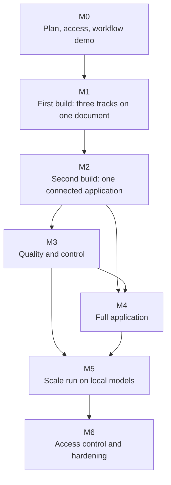

# Development and delivery plan

**Version:** 3.2 · **Baseline date:** 23 October 2026 · **Last revised:** 24 November 2026 (first build closed; second build planned) 
**Product target:** a GraphRAG application for drilling reports: ingestion, storage, a coordinator over two graphs and retrieval, chat and administration 
**Team:** Tri, Khai, Hung · **Source of truth:** [Project specification](PROJECT_DESIGN.md) · **Direction:** [28 October](requirements/supervisor-meeting-2026-10-28.md) and [9 November](requirements/supervisor-meeting-2026-11-09.md) meetings

This plan schedules the [specification](PROJECT_DESIGN.md). It adds no scope of its own; requirement IDs (FR), gates (G1–G8), decisions (D-xx) and questions (Q1–Q15) refer to the specification.

**Version 3.2 (24 November)** closes the first build (M0 and M1) and plans the second: one connected application (specification §4.6, D-64 to D-67). **Removed in 3.2**, because the work is done or replaced: the M0 task list ("this week" of 2 November); the three tracks' research questions, work lists and "starts from" lists; the 15-row backlog of 30 October; and the note written after the 9 November meeting, whose items are done or carried into §7. What each track found stays in its own record: [Track A progress](experiments/TRACK_A_PROGRESS.md), [Track B log](tracks/B-graphrag/log.md), [Track C log](tracks/C-storage/log.md). Version 3.1 is in the Git history.

## Current status

24 November 2026.

**In one paragraph.** The second build is coded in all three tracks and runs end to end on a laptop: one command loads a report package into the stores, and the application answers from them behind a password. It has only run with a stand-in for the model. The team has no GPU and no server of its own, and has asked for a small budget to rent them.

| Part | State | More |
|---|---|---|
| Reading the reports (Khai) | A demo package builds with one command: the end-of-well reports of AK-3, 56-32 and 68-32 and AK-3's daily reports, 302 pages, 1,431 chunks. Newer reading options exist and are off until measured | [Track A log](tracks/A-ingestion/log.md) |
| Stores (Hung) | PostgreSQL with pgvector and Neo4j. One command loads a package and checks each step: 161 events, 216 facts, 202 of them on the package's chunk IDs. Vector search runs inside the database. On laptops | [platform/README.md](../platform/README.md) |
| Engine (Tri) | A coordinator over four lanes: passages, well facts, events, reasoning about causes. Reads files or the stores. A bench checks a model, runs the whole measurement suite and compares runs. The coordinator and the reasoning lane are not measured | [graphrag/README.md](../graphrag/README.md) |
| Application (Tri, Hung) | A FastAPI backend, a React frontend for non-developers (questions, a page per well, the questions people asked), a question log that exports a test set, one shared password, all as containers | [backend](../backend/README.md), [frontend](../frontend/README.md), [deploy](../deploy/README.md) |

**What is not done**

| Gap | Blocked on |
|---|---|
| No measurement of the new parts with a real model (E32, E33, E34) | Compute: the [resource request](reports/RESOURCE_REQUEST_2026-11-24.md) |
| Not on a server | The same request, or Hung's machine in the meantime |
| 14 of the 216 facts still cite old chunk IDs, so their passage cannot be shown | Two chunks the old-to-new map does not reach |
| No vectors in the laptop's store, so vector search in the database has only run on test vectors | An embedding model: Hung's machine has one |
| No domain expert has used the application or reviewed a question | The supervisor naming one or two people |

**Results so far** are in the [experiment register](experiments/README.md) and [specification §8.4](PROJECT_DESIGN.md#84-what-the-first-build-runs-today). Every question set is written by the team, and every method is tuned on one well and one report family.

**Direction** (unchanged): a GraphRAG application for drilling reports (D-36, D-40); open-weight models of about 8B or smaller, never commercial APIs (D-37); a coordinator that sends each question to a lane (D-58, D-64); a real application shown to domain experts early (D-60, D-65); rule-based parsing before vision models (D-63); a capstone, not research (D-41, D-44).

## 1. Planning basis

- **Team:** three students. The supervisor expects the end-to-end application in English within the first semester (D-35); hardening and scale follow in the second.
- **Compute:**
  - no GPU of the team's own: the desktop that ran every measurement up to E31 was borrowed and is not planned on (Track B log B-D42, B-D43);
  - **rented from cloud providers, on public data only (D-68):** a GPU by the hour for measurements and experiments, running our own copy of the model; a server for the stores and the application; hosted open-weight models (OpenRouter) for the demo and quick checks. None is paid for yet: the [resource plan](reports/RESOURCE_REQUEST_2026-11-24.md) asks for 5 million VND (about US$190) from the capstone funding for the next three months (Q6, Q7);
  - the school's GPUs are not planned on: the supervisor advised they are slow and awkward (24 November);
  - laptops for code, tests, Docling and the stores.
- **Data:** public only. AK-3 first, then the Utah FORGE reports already used (56-32, 68-32, 78-32). The supervisor's petroleum document, if supplied, is processed on local models only.
- **Questions:** simulated sets stand in for the expert set (Q2, D-49) and are never reported as expert validation. The application's question log is the new route to real questions (D-65).
- **Estimates:** plan week by week. Re-plan at every check-in from what was actually finished.

## 2. Team split

The first build ran as three tracks joined by files (D-48). Those tracks are closed (§3), and K1 to K5 remain the interfaces between ingestion, engine and stores.

From this stint the split follows the lines the supervisor asked for (D-46, D-65). **Tri takes the engine and the frontend (his decision, 24 November). Hung agreed to backend and to the design on 24 November, and asked Tri to do part of the backend for now; what Tri does and what stays with Hung is in the [backend design](tracks/C-storage/backend-design.md). Khai agreed to data the same day (Track B log B-D40). The roles are settled for this stint (Q14).**

| Role | Proposed owner | Owns | Interface it publishes |
|---|---|---|---|
| **Data** | Khai (agreed) | PDFs to K1 packages; table and form quality; the QA sidecar; new reports | K1 releases |
| **Backend** | Hung (agreed; Tri helps for now) | Shared hosting of the stores; the runner from a K1 package to loaded stores and graphs; the FastAPI service; the question log | The OpenAPI file; the stores |
| **Engine** | Tri | Lanes, coordinator, answer checks, the reasoning probe; measurements | The `graphrag` library; K4 records |
| **Frontend** | Tri (confirmed by Tri, 24 November) | The React application | — |

Engine and frontend on one person is the weak point of this proposal. If it slips, the frontend's first version shrinks to the chat page and the source viewer.

The split is redone every one to two weeks (D-48). Everyone joins integration, demos and documentation.

## 3. Milestones

Weeks are counted from 2 November 2026. Windows are indicative; each check-in revises them.

| Milestone | Window | Exit demo | State |
|---|---|---|---|
| **M0: Plan, access, workflow demo** | Week 1 | Tracks assigned, contracts at version 0, workflow shown | Done, except the OpenRouter account (Q6) and GPU booking (Q7) |
| **M1: First build in three tracks** | Weeks 1–4 | One-document slice from pages to cited answers | **Closed 24 November**; see below |
| **M2: Second build — one connected application** | Weeks 4–6 (24 November to 12 December) | A person outside the team opens the application, asks about AK-3, and sees the answer, the lane used, the cited page and the evidence. Everything is read from the shared stores, loaded by one command | **Current** |
| **M3: Quality and control** | Weeks 6–9 | Wells linked to registry IDs; glossary in use; scores and flagged items; 5–10 documents from more than one report family; the expert or logged questions run (G3–G6) | Outline |
| **M4: Full application** | Weeks 7–11 | A non-developer uploads a report, watches the run, corrects three flagged items, edits a glossary entry, asks a question and opens the cited page | Outline |
| **M5: Scale run on local models** | Weeks 10–13 | The corpus processed in checkpointed runs on a booked GPU; evaluation on held-out questions; cost and throughput report (G8) | Outline |
| **M6: Access control and hardening** | Second semester | Login and roles; private-endpoint guard tested (G7); backup and restore; joint evaluation on the supervisor's document if supplied | Outline |

Diagram source (Mermaid)

**Figure 7 — Milestone dependencies.** The critical path is the K1 release for the demo set → the stores loaded by one command → the engine reading the stores → the API → the frontend → domain experts using it.

### M1: how the first build closed

| Track | Exit asked | Met | Not met; where it goes |
|---|---|---|---|
| A. Ingestion and tables (Khai) | A parser choice with table scores; K1 version 1 for both documents | K1 version 1 adopted (D-57). Docling stays the general parser, with rules for known table formats. Operations Summary tables rebuilt: 81 of 81 on seen data, and 27 of 27 found on a held-out round | The document VLM comparison was not run; deferred by D-63. Tables over several pages: options exist, off by default and not yet measured on end-of-well reports. Generalization beyond one report family. → M2 task D2, M3 |
| B. GraphRAG engine (Tri) | A base, an LLM, an embedding model and a vector store chosen; K4; cost per page | Qwen3-8B, Qwen3-Embedding-0.6B and pgvector chosen. No third-party base adopted; our own two graphs instead (D-53, D-55). K4 version 0.1. Cost reported on every run | Answers on K1 version 1 and on the stores. → M2 tasks E1, E2 |
| C. Storage and the run (Hung) | Schemas with validators; four stores loaded; page-rebuild check; one-command runner; viewer | K1 tables with constraints; loader and page rebuild; vectors; the event graph in Neo4j | The runner and the full pass through it; the viewer (Track B's local UI stood in); MinIO in use; the fact graph in Neo4j; shared hosting. → M2 tasks B1 to B3 |

### M2: second build, one connected application

The design is [specification §4.6](PROJECT_DESIGN.md#46-second-build-one-connected-application), [§7.5](PROJECT_DESIGN.md#75-http-interface-design) and [§8.1](PROJECT_DESIGN.md#81-the-coordinator-and-its-lanes). The task list is §7 below. Three checkpoints:

| When | Checkpoint |
|---|---|
| End of week 4 (28 November) | Roles agreed. Supervisor messaged. Stores reachable by all three, with the AK-3 release loaded. The OpenAPI file agreed. The lane interface written, with the lanes behind it. **State 24 November:** all built and run on laptops; open: the message to the supervisor, a host all three reach |
| End of week 5 (5 December) | The engine answers from the stores, with the baseline scores reproduced. The coordinator measured on the pooled questions. The API returns real answers. The frontend runs against it. **State 24 November:** the code exists; every item here waits for a model to measure with (D-68) |
| End of week 6 (12 December) | The exit demo above, shown to the supervisor: one sample walked from PDF to answer inside the application. The reasoning probe's record written. The application handed to whoever the supervisor names among the domain experts |

**Order matters more than dates.** The first two things unblock everyone else: shared stores (B1) and the K1 release for the demo set (D1). The frontend does not wait for them: it starts on recorded answers as fixtures.

### M3: quality and control

1. **Identity and glossary.** Link report mentions to the registry, and AK-3 to its project-scoped entry. Link daily reports to their well through `Document` nodes. Use the glossary in the question frame.
2. **Generalization.** Reports from more than one family: the 58-32 daily reports, a different author's modern end-of-well report (Track B log B-F54), tables over several pages, and the QA thresholds calibrated on more than one family.
3. **Scores and flagged items.** Compute scores, set the threshold from a labelled sample, and list flagged items for people (D-43, D-63).
4. **Questions.** Run the expert set if it has arrived; otherwise the questions domain experts typed into the application, with gold answers written from the reports.
5. **Lanes.** Split, merge or add lanes from what the question log shows (Q13). Decide whether the reasoning lane becomes a loop (D-64).

### M4: full application

- **End user:** well page (facts, documents, timeline of days); graph and source browsing.
- **Admin:** document upload and run status; ontology versions with validation and diff; glossary editor; flagged items with accept, correct and reject; duplicate wells; generation activation; document retirement.
- **Governance:** versions and audit of every correction and activation.
- Keep the UI plain: tables and lists before graph visualizations.

### M5: scale run on local models

Serve the chosen model ourselves (vLLM or llama.cpp) on a rented cloud GPU (D-68). Process the corpus in checkpointed runs that stop and resume across slots, then evaluate on held-out questions. Estimate first from the measured cost per page; prepare data, containers and models before the slot starts.

### M6: second semester

- Login, roles and server-side checks.
- The private-endpoint guard test.
- Backup and restore of PostgreSQL, the file store and Neo4j.
- The joint evaluation with the supervisor's document if supplied, on local models only.
- Improvements chosen from the evaluation.

## 4. Compute and cost control

| Item | Approach | Control |
|---|---|---|
| A GPU of our own | None (Track B log B-D43). Runs up to E31 were made on a borrowed desktop | Their recorded scores stand; nothing new is planned on that machine |
| Hosted open models (OpenRouter) | The demo's model and quick checks, public data only (D-68) | A cap on the account; cost per run reported (FR-30); never private data (spec §10.1); a hosted score is compared only with a baseline rerun on the same endpoint |
| A cloud GPU rented by the hour | Every measurement, experiment and large run, with our own copy of the model (D-68) | Switched off after each session; hours and cost recorded with each run; model files kept on a rented disk; one request at a time; public data only |
| School GPU slots | Not planned on (D-68) | — |
| Shared host for the stores | A rented cloud server, from student credits or the requested budget; interim: Hung's machine over a private network, if he agrees (Track C log C-D06, C-D07) | Public data only; credentials outside the repository; one shared password in front of the application until login exists |

Every run reports calls, tokens, seconds and cost per page and per question next to quality. The coordinator adds one model call to lookups; that cost is measured before it is adopted (D-64).

**Scope cuts if time runs short**, in this order:

1. graph visualization;
2. the well page;
3. the reasoning lane beyond its probe;
4. the ontology assistant and extra document types;
5. corpus size.

Keep:

- citations and the source page;
- the ID scheme;
- the coordinator with its lanes;
- the question log;
- the private-data boundary.

## 5. Risks

| ID | Risk | Watch for | Mitigation | Owner |
|---|---|---|---|---|
| R-01 | A ~7B model states plausible but wrong facts | Wrong values in answers; unsupported claims in the reasoning probe | Values and citations checked in code; computed results inserted by code; facts validated before use; causes labelled stated or possible | Engine |
| R-02 | Table parsing errors propagate | Wrong cells, missing headers, lost marks | Rules for known formats with a fallback and a reason; the QA sidecar; measure on other report families | Data |
| R-03 | Methods tuned on one well do not transfer | A second report family fails | Add one new family at a time in M3; report seen and unseen data separately | Data, Engine |
| R-04 | The coordinator sends questions to the wrong lane | Pooled score below the hand-routed scores | Wells and dates read by code; fixed fallback; measured before adoption; a lane can be forced from the UI | Engine |
| R-05 | No compute to measure with: no GPU of our own, no budget yet for a rented one | No approval of the resource plan | Ask now (Q6, Q7); about 1.5 million VND for three months keeps the project moving; a hosted model for a few dollars covers the first measurements | All |
| R-06 | Hosted endpoint used on non-public data | A private file in a run | The model client's guard; test it | Engine |
| R-07 | No public daily-report collection beyond AK-3 | Reasoning and event lanes stay on one well | The 58-32 daily reports; keep looking (Q5); say so in every result | Data |
| R-08 | Real questions never arrive | No expert set, and nobody uses the application | Simulated sets, labelled; put the application in front of experts early; ask at each check-in | All |
| R-09 | Scope too large for three people; engine and frontend on one person | A checkpoint missed by a week | Cut in the order of §4; shrink the frontend to chat and source viewer | All |
| R-10 | Direction drifts without contact | **Already true: no recorded contact since 9 November** | Message the supervisor this week (task A1); short updates every few days (D-46) | All |
| R-11 | Wrong entity merges corrupt answers | Two wells joined | Identifier and scoped-name matching only; merges always by a person | Backend |
| R-12 | The three parts drift while being connected | A K1 or API change breaks another part | K1 changes by version only; the OpenAPI file agreed first; the runner checks each step | All |
| R-13 | Data passed by hand between machines | A zip in the chat | Shared stores and a file store for K1 releases (B1) | Backend |

## 6. Working cadence (D-46)

- **Weekly check-in with the supervisor, about 30 minutes:** what was done, what is blocked, next week's plan. Bring a demo whenever something runs.
- **Group chat updates every few days:** a short message or a screenshot. Message the supervisor when there is a result worth showing; do not wait for a meeting.
- **Reports are short:** two or three slides of architecture, one sample walked through the pipeline, weak points stated, then what the team needs (9 November meeting).
- **Review.** Each change is reviewed by another student before merging to `main`.
- **Record decisions.** A supervisor decision becomes a decision in spec §13.1 in the same week. Superseded text is removed, not kept beside the new text.

### Definition of done

- Demonstrated on real data (one document at least) or a fixture.
- Another student reviewed it.
- IDs and citations resolve.
- Calls and cost reported where models are used.
- Limitations written down.

## 7. What to do now

Tasks for M2. **State** says where a task stands; **Left** says what remains and for whom. Details of what was built are in the track logs, not here.

### Now, in order

| # | Who | Do |
|---|---|---|
| 1 | Tri | Send the [resource request](reports/RESOURCE_REQUEST_2026-11-24.md) to anh Trường, and the [stint report](reports/stints/STINT_REPORT_2026-11-27.md) to anh Tuấn with the open questions (experts to try the application, the purpose of use) |
| 2 | Hung | Say whether his machine hosts the stores for now; review the loaders, the runner and the deployment files |
| 3 | Khai | Review the demo package and the Track A log draft; measure the reading options (D2) |
| 4 | Tri | Once there is compute: the three measurements E32, E33, E34 ([commands](tracks/B-graphrag/next-runs.md)) |

### All

| # | Task | State | Left |
|---|---|---|---|
| A1 | Message anh Tuấn with the stint report and the open questions (Q2, Q6, Q13) | Not done | Tri |
| A2 | Agree the roles (Q14) | Done | — |
| A3 | Review the design: specification §4.1, §4.6, §7.5, §8 | Hung and Khai agreed | Each records objections, if any |
| A4 | Exit demo for the supervisor, then hand the application to domain experts | Not done | Needs a server and a model |

### Data (Khai)

| # | Task | State | Left |
|---|---|---|---|
| D1 | A package for the demo: three end-of-well reports, AK-3's four daily-report attachments and its non-productive-time report, with the old-to-new ID map and a well on every end-of-well chunk | Built with Khai's clearance (`demo-v2`) | Khai's review; share it on the stores |
| D2 | Decide which reading options are on by default, by measurement on this package | Not done | Khai |
| D3 | Add the 56-32 and 68-32 end-of-well reports | Built with Khai's clearance, in `demo-v2` | Khai's review |
| D4 | Merged-cell text repeated in table Markdown | The fix exists as an option, with a test | Switch it on, with D2 |
| D5 | A dated Track A log | A draft exists | Khai corrects it |

### Backend and stores (Hung)

Built on 24 November with Hung's clearance, beside his own work of the same day.

| # | Task | State | Left |
|---|---|---|---|
| B1 | A host for the stores that all three reach | Scripts and a runbook ready | A host: Hung's machine or a rented server |
| B2 | One command from a package to loaded stores | Built; run twice with the same result, without vectors | A run with the embedding model |
| B3 | Both graph regions in Neo4j | Loaded on laptops; 202 of 216 facts cite chunks the store holds | 14 facts on old IDs |
| B4 | The API contract | Done | — |
| B5 | The backend service | Built; reads files or the stores | First run with a real model |
| B6 | The question log | Built, in PostgreSQL | — |
| B7 | Page images for the source viewer | Built | Render the demo package's pages on the host |
| B8 | The whole application as containers behind one password | Built; run on a laptop | A server and a domain |

### Engine (Tri)

| # | Task | State | Left |
|---|---|---|---|
| E1 | Answers on the new package (experiment E32) | Not run | Compute |
| E2 | The engine reads the stores | Built; equals the file-loaded engine; vector search in the database built | Scores from the stores; a run on real vectors |
| E3 | Lanes behind one interface; model roles in a settings file | Done | — |
| E4 | The fact graph as nodes and relationships | Done | Two doubtful facts to check |
| E5 | The coordinator (experiment E33) | Built, not measured | Compute. Adopt only if it matches the hand-routed scores |
| E6 | Totals reported by code, not retyped by the model | Built | Measured with E33 |
| E7 | The reasoning lane and its ten frozen questions (experiment E34) | Built, not measured | Compute |

| E8 | A bench for models: profiles, a preflight check, the measurement suite in one command, a comparison table | Built; run against a stand-in, and its check against a small real model on a laptop | The suite on the baseline model |

### Frontend (Tri)

| # | Task | State | Left |
|---|---|---|---|
| F1 | The question page with the trust label and "Verified data only"; a page per well; the questions people asked, with a download as a test set | Built | First run with a real model; first use by someone outside the team |
| F2 | The source viewer: the page beside the cited passage | Built, with the page image when one exists | — |
| F3 | The evidence panel: timeline, report text, facts, causes | Built | — |
| F4 | Right or wrong, with a comment | Built | — |

### After M2

The M3 to M6 lists in §3.

The main [README](../README.md) stays the setup entry point.

## 8. Decisions to close

| Decision | Needed by | Why |
|---|---|---|
| Where the demo runs and which model serves it (Q15) | 5 December | Domain experts must reach it without the team's laptops |
| Purpose of use and question types (Q13) | M3 | Decides how lanes are split or merged (D-58) |
| Expert question set, or which experts try the application (Q2) | M3 | Evaluation; simulated sets stand in for development only |
| Whether the coordinator is adopted (D-64) | After record E33 | It adds one model call to lookups |
| Whether the reasoning lane continues beyond its probe (D-66) | After record E34 | Depends on what the data supports |
| OpenRouter account owner and cap (Q6); GPU booking (Q7) | Before M5 | Open since M0 |
| Public daily-report sources beyond AK-3 (Q5) | M3 | Daily reports are half of the document scope |
