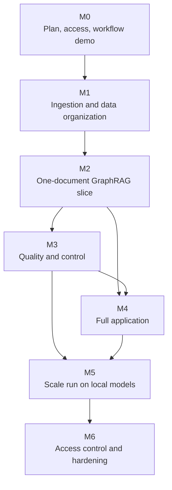

# Development and delivery plan

**Version:** 3.0 · **Baseline date:** 23 October 2026 · **Last revised:** 29 October 2026 (28 October supervisor direction applied) 
**Product target:** a GraphRAG application for drilling reports: ingestion, storage, retrieval, chat and administration 
**Team:** three students · **Source of truth:** [Project specification](PROJECT_DESIGN.md) · **Direction:** [28 October meeting](requirements/supervisor-meeting-2026-10-28.md)

This plan schedules the [specification](PROJECT_DESIGN.md). It adds no scope of its own; requirement IDs (FR), gates (G1–G8), decisions (D-xx) and questions (Q1–Q12) refer to the specification. Version 3.0 replaces the earlier plan: the M0–M7 milestones, the 720-hour model, the Student A/B/C roles and the research backlog items are removed. The [meeting digest](requirements/supervisor-meeting-2026-10-28.md#13-effect-on-the-documentation) records what was removed and why.

## Current status

**Direction (28 October).**

- Build a **GraphRAG application** on an existing open-source GraphRAG pipeline (D-36).
- Use open-weight models of about 7B or smaller, never commercial APIs (D-37). Hosted open models serve development on public data; school GPU slots serve large runs (D-38).
- Parse pages with VLMs and treat tables as their own workstream (D-39, D-47).
- Scope by document type: end-of-well and daily drilling reports (D-40).
- Work in this order: ingestion, then data organization, then retrieval (D-45). Start with **one document** (D-44).

**What exists and carries over** (code, tests and an experiment record):

| Item | Use in the new direction | Evidence |
|---|---|---|
| Document ingestion with page provenance, Markdown tables, row-safe table chunks, releases | Baseline parser and chunker; the VLM must beat its tables | [Guide](components/corpus-ingestion.md), [E7](experiments/E7-corpus-pipeline-smoke.md), [E8](experiments/E8-ak3-appendices-corpus-run.md) |
| Structured-data import (BSEE as a mapping) | Well identity source | [Guide](components/dataset-import.md), [E6](experiments/E6-generic-import-bsee.md) |
| Entity registry: 57,453 wellbores and 39,518 wells | One ID per well across documents | [Guide](components/entity-registry.md), [E13](experiments/E13-entity-registry-bsee.md) |
| Evidence, claim-revision and entity contracts | Starting point for the ID scheme (spec §5.11) | [E12](experiments/E12-shared-evidence-contract.md) |
| Prototype: ontology file, LLM extraction, Neo4j, template QA on 15 AK-3 chunks | Baseline the GraphRAG pipeline must match: precision 0.968, recall 0.732, 23/31 questions | [Prototype](../prototype/README.md), [E10](experiments/E10-profile-driven-prototype.md) |

**Not built:**

- VLM parsing;
- multi-page table joining;
- object storage;
- the parent/child ID scheme across stores;
- embeddings and a vector store;
- the GraphRAG base;
- ontology slicing and injection;
- the glossary area;
- scores and flagged items;
- the frontend;
- login.

## 1. Planning basis

- **Team:** three students. The supervisor expects the end-to-end application in English within the first semester (D-35); hardening and scale follow in the second.
- **Compute (D-38):**
  - hosted open-weight models through an OpenAI-compatible API (OpenRouter) for development, on public data only;
  - about US$5–10 runs a reasonable amount, and the supervisor supports the cost;
  - school GPUs, booked by time slot through Dr. Le Duy Dung, for large runs and the local-model evaluation;
  - laptops for code, tests, Docling and the stores.
- **Data:** public only.
  - Development order: the AK-3 end-of-well report, then one AK-3 daily report, then 5–10 documents.
  - The supervisor's petroleum document, if supplied, is processed on local models only.
- **Questions:** the supervisor has asked a drilling expert group for an evaluation question set (Q2). The team writes development questions until it arrives.
- **Estimates:** plan week by week. Re-plan at every weekly check-in from what was actually finished. There is no fixed hour budget.

## 2. Team roles

The supervisor asked for a split into data, backend and frontend (D-46). Names are assigned in this week's plan. Everyone joins integration, demos and documentation.

| Role | Owns | Reviews |
|---|---|---|
| **Data** | Document collection (end-of-well, daily reports), VLM parsing and the table evaluation, multi-page tables, chunking and IDs, ontology and glossary content, labelled samples and the question set | Extraction quality and citations |
| **Backend** | GraphRAG base selection and adaptation, model client and endpoints, extraction (ontology injection, batching, deterministic table mapping), embeddings and vector store, Neo4j, PostgreSQL and MinIO layout, retrieval and answers, scores, cost accounting, API | ID scheme and stores |
| **Frontend** | Chat with citations and source-page viewer; admin screens for documents, runs, ontology and glossary, flagged items and merges; demo build | User flows and acceptance demos |

The supervisor and Dr. Dung are consulted on scope; the drilling expert group, through the supervisor, on questions and domain terms.

## 3. Milestones

Windows are counted from the week of 2 November 2026 and are indicative; each weekly check-in revises them.

| Milestone | Window | Lead | Exit demo |
|---|---|---|---|
| **M0: Plan, access, current-workflow demo** | Week 1 | All | Weekly plan (slides) shared; supervisor on GitHub; OpenRouter account with a cap; GPU booking request sent; current workflow shown to the supervisor (below) |
| **M1: Ingestion and data organization** | Weeks 1–3 | Data, with Backend | One EOWR and one DDR registered in MinIO, parsed (VLM vs Docling), tables joined across pages, parent/child chunks with IDs in PostgreSQL; table evaluation report; storage and ID design written and shown (spec §4.2, §5.10, §5.11) |
| **M2: One-document GraphRAG slice** | Weeks 3–5 | Backend | Base pipeline chosen from a comparison on the AK-3 EOWR; ontology slice injected; items extracted with chunk citations; embeddings in the vector store; Neo4j graph; 10–20 development questions answered with page citations; calls, tokens and cost reported; compared with the E10 baseline |
| **M3: Quality and control** | Weeks 5–8 | Backend, with Data | Glossary in use; wells linked to registry IDs across the EOWR and DDRs; scores and flagged items; deterministic DDR table mapping and row batching (fewer calls per page); relation normalization; 5–10 documents; first run of the expert question set if it has arrived (G3–G6) |
| **M4: Full application** | Weeks 5–10 | Frontend, with Backend | Non-developer does it unaided: uploads a report, watches the run, corrects three flagged items, merges a duplicate well, edits a glossary entry, activates the generation, asks a question and opens the cited page; ontology versions and audit visible |
| **M5: Scale run on local models** | Weeks 9–12 | Backend, with Data | Local ~7B model served on a booked school GPU; the corpus processed in checkpointed runs; evaluation on the held-out expert questions; cost and throughput report (G8) |
| **M6: Access control and hardening** | Second semester | Frontend, with Backend | Login and roles; private-endpoint guard tested (G7); backup and restore of all stores; joint evaluation on the supervisor's document if supplied |

Diagram source (Mermaid)

**Figure 7 — Milestone dependencies.** The frontend can start in M2 against the API contract (spec §7.5) with fixture data. The critical path is ingestion and IDs → base pipeline on one document → quality on several documents → scale run.

### M0: this week

- **Weekly plan.** Hung drafts it this week as a short slide deck: roles, milestones, this week's tasks. Share it with the supervisor and in the group chat.
- **Access.**
  - Add the supervisor to the GitHub repository.
  - Create the OpenRouter account and set a spending cap; record who holds it (Q6).
  - Ask Dr. Dung how to book the school GPUs (Q7).
- **Show the current workflow** to the supervisor, as he asked:
  - how ingestion runs and what it outputs (pages, chunks, tables);
  - the BSEE numbers (57,453 wellbores, 39,518 wells) and graph;
  - what the prototype extracts (14 properties from 15 chunks) and how it answers;
  - where data is stored (corpus directories, `data/processed/`, Neo4j in Docker);
  - what is missing: the ontology is team-authored, not given with the data (spec §6.1), and there are no embeddings, VLM, object store or ID scheme yet.
- **BSEE data.** Share it with the supervisor as a ZIP of the local snapshot through the team drive. It is not committed (D-15).
- **Base pipeline shortlist.** List the GraphRAG candidates and the comparison criteria (spec §9).
- **Embedding plan.** List the candidate embedding models and how they will be compared (retrieval recall on development questions).

### M1: ingestion and data organization

1. **Collect** the AK-3 EOWR (in the repository) and one daily drilling report from the AK-3 appendices. List further public DDR sources (Q5, [Data sources](DATA_SOURCES.md)).
2. **Table evaluation set**: 20–40 pages from both document types with merged cells, nested text and tables continuing across pages. Label the expected cells for a subset.
3. **VLM comparison.** Run Docling (baseline) and two or three document VLMs within the size limit through hosted endpoints on that set. Measure:
   - cell accuracy;
   - header and row correctness;
   - merged cells;
   - continuation joins;
   - seconds and tokens per page.

   Pick one parser, or keep Docling.
4. **Multi-page tables.** Detect continuation, join the parts, carry the header and record the page span (spec §5.10).
5. **Storage layout.**
   - MinIO, or a directory with the same interface, for originals, page images and parser output.
   - PostgreSQL tables for files, pages, tables and chunks.
   - Choose the vector store (spec §4.2).
6. **ID scheme.** File → page → table → parent → child IDs. Rebuild a page as text from its chunks to prove nothing is detached (spec §5.11).

### M2: one-document GraphRAG slice

1. **Model client.** One OpenAI-compatible client with the endpoint, model and version recorded per run, and the private-file guard (FR-28).
2. **Base comparison.** Run two or three candidate GraphRAG pipelines on the AK-3 EOWR with the same ~7B model. Compare:
   - extracted items against the E4/E10 gold facts;
   - calls and tokens;
   - provenance kept;
   - ease of injecting the ontology.

   Choose one and record the reasons.
3. **Ontology.** Extend `oil_wells.json` into the drilling-report profile: entity types, relations, EOWR and DDR sections, glossary seed from the AK-3 abbreviation table. Implement slicing and the injection points (spec §6.2).
4. **Index and graph.** Embed child chunks with the chosen embedding model and write the vector payloads; project items, entities and chunk nodes to Neo4j as a generation.
5. **Answer** 10–20 development questions with citations. Check them by hand, and compare with the E10 template baseline and plain vector RAG.

### M3: quality and control

1. **Identity and glossary.**
   - Link report mentions to the BSEE registry, and AK-3 to its project-scoped entry.
   - Link DDRs to their well.
   - Use the glossary in normalization and question expansion.
2. **Cost.**
   - Map recognized DDR table columns deterministically.
   - Batch rows by token budget.
   - Handle long rows.
   - Report calls and tokens per page before and after.
3. **Scores and flagged items.**
   - Compute scores and set the threshold from a labelled sample.
   - Add relation normalization and the similar-entity search.
4. **Scale to 5–10 documents** and run the question set (expert set if available).

### M4: full application

- **End user:** chat, answer with citations, source-page viewer, well page (facts, documents, chunks).
- **Admin:**
  - document upload and run status (coverage, tables, items, flagged count, cost);
  - ontology versions with validation and diff;
  - glossary editor;
  - flagged items with accept/correct/reject;
  - duplicate wells with merge and keep-apart;
  - generation activation;
  - document retirement.
- **Governance:** versions and audit of every correction and activation.
- Keep the UI plain: tables and lists before graph visualizations.

### M5: scale run on local models

Serve the chosen ~7B model and VLM locally (vLLM or llama.cpp) on a booked school GPU. Process the corpus in checkpointed runs that stop and resume across slots, then evaluate on the held-out expert questions. Estimate first from the M3 cost report; prepare data, containers and models before the slot starts.

### M6: second semester

- Login, roles and server-side checks.
- The private-endpoint guard test.
- Backup and restore of PostgreSQL, MinIO, the vector store and Neo4j.
- The joint evaluation with the supervisor's document if supplied, on local models only.
- Improvements chosen from the evaluation.

## 4. Compute and cost control

| Item | Approach | Control |
|---|---|---|
| Hosted open models (OpenRouter) | Development and one-document runs, public data only | Monthly cap on the account; cost per run reported (FR-30); providers that do not retain prompts where possible; never private data (spec §10.1) |
| School GPU slots | Large runs, local-model evaluation, the final demonstration | Book early; checkpointed jobs; everything prepared before the slot |
| Laptops | Code, tests, Docling, Docker stores | Fixture-based tests without model calls |
| Storage | MinIO and databases in Docker locally; GPU host for large runs | Watch disk; parsed pages and vectors are rebuildable |

Before any large run, estimate the cost: pages × tokens per page × price, or pages × GPU-seconds per page against the slot length. Compare it with what the one-document runs measured.

**Scope cuts if time runs short**, in this order:

1. graph visualization;
2. community summaries;
3. the ontology assistant;
4. extra document types;
5. corpus size.

Keep:

- citations;
- the ID scheme;
- table handling;
- flagged-item correction;
- the private-data boundary.

## 5. Risks

| ID | Risk | Watch for | Mitigation | Owner |
|---|---|---|---|---|
| R-01 | A ~7B model extracts plausible but wrong facts | Low precision on the labelled sample | Ontology slices, verbatim-value check, scores and flagged items, deterministic table mapping | Backend |
| R-02 | Table parsing errors (merged cells, multi-page) propagate | Wrong cells, missing headers | Table evaluation set, VLM comparison, header carry-over, flags on uncertain joins | Data |
| R-03 | The chosen GraphRAG base does not fit (no schema control, loses provenance, too many calls) | Base comparison results | Compare before choosing; wrap it behind the ID scheme and model client so it can be swapped | Backend |
| R-04 | LLM calls and tokens per page too high for large runs | Cost report per page | Deterministic table mapping, batching, caching by page hash, cost estimate before runs | Backend |
| R-05 | School GPU slots hard to get or too short | No booking, long queue | Ask early; checkpointed jobs; hosted open models for development | All |
| R-06 | Hosted endpoint used on non-public data | Private file in a run | Permission field enforced by the model client; test it | Backend |
| R-07 | No public DDR collection that matches registry wells | No candidate by M1 | AK-3 appendix DDRs; search BSEE well activity reports and other public collections; label any synthetic link as such | Data |
| R-08 | Expert question set arrives late | None by M3 | Development questions written by the team, labelled as such | Data |
| R-09 | Scope too large for three people | Milestones slip two weeks running | Cut in the order of §4; keep a thin working path end to end | All |
| R-10 | Direction drifts without anyone noticing | Week without supervisor contact | Weekly check-in; group-chat updates every few days (D-46) | All |
| R-11 | Wrong entity merges corrupt answers | Two wells joined | Identifier and scoped-name matching only; merges always by a person | Backend |
| R-12 | BSEE redistribution terms unclear | Request to share derived data | Keep out of Git; share privately with the supervisor only | Data |

## 6. Working cadence (D-46)

- **Weekly check-in with the supervisor, about 30 minutes:** what was done, what is blocked, next week's plan. Bring a demo whenever there is something running.
- **Group chat updates every few days:** a short message or a screenshot, without polishing. Ask early when stuck. If a week passes without contact, message the supervisor.
- **Weekly plan as a few slides**, not a long written report. Detailed write-ups go into experiment records only when there is a measurement.
- **Board.** One shared board (Backlog, In progress, Review, Done); one major item per person at a time.
- **Review.** Each change is reviewed by another student before merging to `main`.
- **Record decisions.** A supervisor decision becomes a decision in spec §13.1 in the same week. Superseded text is removed, not kept beside the new text.

### Definition of done

- Demonstrated on real data (one document at least) or a fixture.
- Another student reviewed it.
- IDs and citations resolve.
- Calls and cost reported where models are used.
- Limitations written down.

## 7. Next implementation backlog

| Order | Task | Acceptance | Status |
|---|---|---|---|
| 1 | Weekly plan slides; roles assigned; supervisor added to GitHub; OpenRouter account with cap; GPU booking request | Shared in the group chat | Open (this week) |
| 2 | Demo of the current workflow to the supervisor (M0 list) | Supervisor has seen ingestion outputs, BSEE graph, prototype, storage, gaps | Open (this week) |
| 3 | Table evaluation set from AK-3 EOWR and appendix DDR pages | 20–40 pages, labelled subset | Open |
| 4 | VLM vs Docling comparison on the table set through hosted endpoints | Report with cell accuracy, joins, cost; parser chosen | Open |
| 5 | Multi-page table joining with header carry-over | Continued tables joined with page spans; uncertain joins flagged | Open |
| 6 | Storage layout and ID scheme: MinIO, PostgreSQL tables, vector store choice, parent/child IDs | Page rebuilt from chunks; every chunk resolves to file and page | Open |
| 7 | Model client with endpoint recording and the private-file guard | Runs record model and endpoint; private file refused by hosted endpoint | Open |
| 8 | GraphRAG base comparison on the AK-3 EOWR | Comparison against E10 gold facts, calls, tokens; base chosen | Open |
| 9 | Drilling-report ontology (EOWR + DDR) and glossary seed; ontology slicing and injection points | Off-ontology rate and per-type counts reported per run | Prototype ontology of 14 properties exists ([E10](experiments/E10-profile-driven-prototype.md)) |
| 10 | Embeddings, vector index and cited answers on one document | 10–20 development questions answered with page citations; compared with E10 templates and plain vector RAG | Open |
| 11 | Registry linking of report mentions; DDR-to-well links | One well's EOWR and DDRs under one ID | Registry exists ([E13](experiments/E13-entity-registry-bsee.md)) |
| 12 | Scores, flagged items, deterministic DDR table mapping, row batching | Flagged share and calls per page reported | Open |
| 13 | Frontend: chat, source viewer, admin screens | M4 exit demo by a non-developer | Open |
| 14 | Local model on a school GPU; scale run; evaluation on expert questions | M5 report | Open |
| 15 | Open repository-review fixes: cache identity, redirect checks ([E9](experiments/E9-repository-review.md)) | Tests | Open; low priority |

The main [README](../README.md) stays the setup entry point. Do not rerun `publish` just to check documentation: it writes the selected bundle.

## 8. Decisions to close

| Decision | Needed by | Why |
|---|---|---|
| Who holds which role | M0 | The supervisor asked for a data/backend/frontend split |
| OpenRouter account owner and cap (Q6) | M0 | Development model access |
| GPU booking process (Q7) | M1, before M5 | Large runs and the local-model evaluation |
| Vector store | M1 | Storage layout and ID payloads |
| VLM, embedding model, ~7B LLM (Q4) | M1–M2 | Quality and cost |
| GraphRAG base (Q3) | M2 | Everything after M2 builds on it |
| Public DDR sources (Q5) | M1 | Daily reports are half of the document scope |
| Question set (Q2) | M3 | Evaluation |
