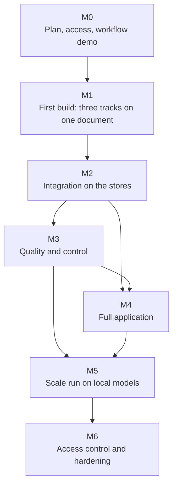

# Development and delivery plan

**Version:** 3.1 · **Baseline date:** 23 October 2026 · **Last revised:** 30 October 2026 (first build split into three tracks) 
**Product target:** a GraphRAG application for drilling reports: ingestion, storage, retrieval, chat and administration 
**Team:** Tri, Khai, Hung · **Source of truth:** [Project specification](PROJECT_DESIGN.md) · **Direction:** [28 October meeting](requirements/supervisor-meeting-2026-10-28.md)

This plan schedules the [specification](PROJECT_DESIGN.md). It adds no scope of its own; requirement IDs (FR), gates (G1–G8), decisions (D-xx) and questions (Q1–Q12) refer to the specification. Version 3.0 replaces the earlier plan: the M0–M7 milestones, the 720-hour model, the Student A/B/C roles and the research backlog items are removed. The [meeting digest](requirements/supervisor-meeting-2026-10-28.md#13-effect-on-the-documentation) records what was removed and why. Version 3.1 splits the first build into three independent tracks (D-48), keeps domain depth thin (D-49) and plans only M0 and M1 in detail.

## Current status

**Direction (28 October).**

- Build a **GraphRAG application** on an existing open-source GraphRAG pipeline (D-36).
- Use open-weight models of about 7B or smaller, never commercial APIs (D-37). Hosted open models serve development on public data; school GPU slots serve large runs (D-38).
- Parse pages with VLMs and treat tables as their own workstream (D-39, D-47).
- Scope by document type: end-of-well and daily drilling reports (D-40).
- Work in this order: ingestion, then data organization, then retrieval (D-45). Start with **one document** (D-44).
- Build the first slice in **three independent tracks** joined by versioned files: A ingestion and tables, B GraphRAG engine and models, C storage, IDs and the end-to-end run (D-48, spec §4.5). Keep domain depth thin (D-49).

**What exists and carries over** (code, tests and an experiment record):

| Item | Use in the new direction | Evidence |
|---|---|---|
| Document ingestion with page provenance, Markdown tables, row-safe table chunks, releases | Baseline parser and chunker; the VLM must beat its tables | [Guide](components/corpus-ingestion.md), [E7](experiments/E7-corpus-pipeline-smoke.md), [E8](experiments/E8-ak3-appendices-corpus-run.md) |
| Structured-data import (BSEE as a mapping) | Well identity source | [Guide](components/dataset-import.md), [E6](experiments/E6-generic-import-bsee.md) |
| Entity registry: 57,453 wellbores and 39,518 wells | One ID per well across documents | [Guide](components/entity-registry.md), [E13](experiments/E13-entity-registry-bsee.md) |
| Evidence, claim-revision and entity contracts | Starting point for the ID scheme (spec §5.11) | [E12](experiments/E12-shared-evidence-contract.md) |
| Prototype: ontology file, LLM extraction, Neo4j, template QA on 15 AK-3 chunks | Baseline the GraphRAG pipeline must match: precision 0.968, recall 0.732, 23/31 questions | [Prototype](../prototype/README.md), [E10](experiments/E10-profile-driven-prototype.md) |

**Not built:**

- VLM parsing;
- multi-page table joining;
- object storage;
- the parent/child ID scheme across stores;
- embeddings and a vector store;
- the GraphRAG base;
- ontology slicing and injection;
- the glossary area;
- scores and flagged items;
- the frontend;
- login.

## 1. Planning basis

- **Team:** three students. The supervisor expects the end-to-end application in English within the first semester (D-35); hardening and scale follow in the second.
- **Compute (D-38):**
  - hosted open-weight models through an OpenAI-compatible API (OpenRouter) for development, on public data only;
  - about US$5–10 runs a reasonable amount, and the supervisor supports the cost;
  - school GPUs, booked by time slot through Dr. Le Duy Dung, for large runs and the local-model evaluation;
  - laptops for code, tests, Docling and the stores.
- **Data:** public only.
  - Development order: the AK-3 end-of-well report, then one AK-3 daily report, then 5–10 documents.
  - The supervisor's petroleum document, if supplied, is processed on local models only.
- **Questions:** the supervisor has asked a drilling expert group for an evaluation question set (Q2). The team writes development questions until it arrives.
- **Estimates:** plan week by week. Re-plan at every weekly check-in from what was actually finished. There is no fixed hour budget.

## 2. Team split

**First build (M0–M1): three tracks** (D-48, spec [§4.5](PROJECT_DESIGN.md#45-first-build-three-tracks-joined-by-files)). Each track is a line of work that one person can research in depth and build in their own way. Tracks A and B meet only through versioned files. Track C sits between them and builds what links them: IDs, stores and the runner.

**The split holds for one stint of one to two weeks.** At the end of each stint, the team divides the work again according to what is next. A track may change owner, merge with another or be replaced, and a new stint may split along different lines. Owners for the first stint:

| Track | Owner | Owns | Does not touch |
|---|---|---|---|
| **A. Ingestion and tables** | Hung | Page parsing (Docling vs document VLMs), table structure, multi-page tables, key-value forms, chunking; publishes K1 | Models for extraction or answers, the ontology, storage |
| **B. GraphRAG engine and models** | Tri | Base-pipeline comparison, ~7B LLM, embeddings, model client, a thin ontology slice and its injection, graph build, retrieval and cited answers, cost per page; publishes K2, K4 | Parsing, storage layout |
| **C. Storage, IDs and the end-to-end run** | Khai | ID scheme and contract schemas with validators; MinIO, PostgreSQL, the vector store (chosen with Tri) and Neo4j in Docker Compose; loader from K1; run log; one command that runs A → B; a debugging viewer | Parsing, models |

There is no team-written question set (D-49). Tri checks answers against the prototype's 31 questions until the drilling expert group's set arrives (Q2).

When the application work starts (M2), the split follows the data/backend/frontend lines the supervisor asked for (D-46). Who takes which is decided at that stint's split, not now. Everyone joins integration, demos and documentation.

The supervisor and Dr. Dung are consulted on scope; the drilling expert group, through the supervisor, on questions and domain terms.

## 3. Milestones

Windows are counted from the week of 2 November 2026 and are indicative; each weekly check-in revises them. Only M0 and M1 are planned in detail. Later milestones are outlines, replanned from what M1 teaches.

| Milestone | Window | Lead | Exit demo |
|---|---|---|---|
| **M0: Plan, access, current-workflow demo** | Week 1 | All | Weekly plan (slides) shared; tracks assigned; K1 and K4 schemas at version 0; supervisor on GitHub; OpenRouter account with a cap; GPU booking request sent; current workflow shown to the supervisor |
| **M1: First build — one-document slice in three tracks** | Weeks 1–5 | Per stint (first stint: A Hung, B Tri, C Khai) | On the AK-3 EOWR and one AK-3 DDR: parser chosen with table scores; K1 version 1 published; base pipeline, LLM, embedding model and vector store chosen by comparison; the prototype questions answered with page citations; the stores loaded and the run started by one command; compared with the E10 baseline and plain vector RAG; calls, tokens and cost per page reported |
| **M2: Integration on the stores** | Weeks 5–7 | Data, with Backend | The M1 runner and stores turned into the ingestion worker: upload a new report and it runs end to end with pinned versions; API contract drafted (spec §7.5) and the frontend started on fixtures |
| **M3: Quality and control** | Weeks 7–10 | Backend, with Data | Glossary in use; wells linked to registry IDs across the EOWR and DDRs; scores and flagged items; deterministic DDR table mapping and row batching (fewer calls per page); relation normalization; 5–10 documents; first run of the expert question set if it has arrived (G3–G6) |
| **M4: Full application** | Weeks 7–11 | Frontend, with Backend | Non-developer does it unaided: uploads a report, watches the run, corrects three flagged items, merges a duplicate well, edits a glossary entry, activates the generation, asks a question and opens the cited page; ontology versions and audit visible |
| **M5: Scale run on local models** | Weeks 10–13 | Backend, with Data | Local ~7B model served on a booked school GPU; the corpus processed in checkpointed runs; evaluation on the held-out expert questions; cost and throughput report (G8) |
| **M6: Access control and hardening** | Second semester | Frontend, with Backend | Login and roles; private-endpoint guard tested (G7); backup and restore of all stores; joint evaluation on the supervisor's document if supplied |

Diagram source (Mermaid)

**Figure 7 — Milestone dependencies.** M1 runs three tracks in parallel; nothing after M1 starts until its exit demo. The critical path is Track A's chunk package → Track B's engine on it, run and stored by Track C → integration into a worker → quality on several documents → scale run.

### M0: this week

- **Weekly plan.** Hung drafts it this week as a short slide deck: tracks and owners for this stint, M1 checkpoints, this week's tasks. Share it with the supervisor and in the group chat. Tell the supervisor why the first phase is split by track instead of data/backend/frontend (D-48).
- **Contracts at version 0** (half a day, all three together). Agree the K1 and K4 field lists (spec §4.5). Khai writes them as JSON Schemas in `schemas/` and converts the AK-3 corpus chunks into K1 version 0. Tri starts K2 from `oil_wells.json`. Hung uses the 10 existing gold tables as K5.
- **Access.**
  - Add the supervisor to the GitHub repository.
  - Create the OpenRouter account and set a spending cap; record who holds it (Q6).
  - Ask Dr. Dung how to book the school GPUs (Q7).
- **Show the current workflow** to the supervisor, as he asked:
  - how ingestion runs and what it outputs (pages, chunks, tables);
  - the BSEE numbers (57,453 wellbores, 39,518 wells) and graph;
  - what the prototype extracts (14 properties from 15 chunks) and how it answers;
  - where data is stored (corpus directories, `data/processed/`, Neo4j in Docker);
  - what is missing: the ontology is team-authored, not given with the data (spec §6.1), and there are no embeddings, VLM, object store or ID scheme yet.
- **BSEE data.** Share it with the supervisor as a ZIP of the local snapshot through the team drive. It is not committed (D-15).

### M1: first build in three tracks

Each track below lists its goal, the questions it researches, its work, its checkpoints and its exit. A track may change its own method freely; it may change a contract only by the rules in spec §4.5. Each comparison becomes an experiment record (E14 onward).

**Shared checkpoints.**

| When | All tracks |
|---|---|
| End of week 1 | K1 and K4 schemas and version 0 files; A and B running on version 0 inputs; stores coming up |
| End of week 3 | **Dry run:** Track B runs on Track A's real K1 for the AK-3 EOWR, and Track C loads both into the stores. Fix contract mismatches only, not quality |
| End of week 5 | **First full pass:** EOWR and one DDR through A → B with Track C's runner, stored and shown in the viewer; scores and choices shown to the supervisor |

#### Track A: ingestion and tables (first stint: Hung)

**Goal.** Drilling-report pages become correct text, tables and chunks, each with a stable ID back to its file and page.

**Research questions.**

1. Which document VLM of about 7B or smaller parses drilling-report tables better than Docling, and at what seconds and tokens per page?
2. How to detect a table that continues on the next page, join the parts and carry the header (spec §5.10).
3. How to read key-value forms, such as DDR header boxes. "Days On Location: 1700" is the kind of mismatch seen in the AK-3 daily reports ([Data sources](DATA_SOURCES.md)).
4. How to cut parent and child chunks so that no table row is split and each table child carries its header.

**Work.**

1. **Baseline.** Run the current Docling pipeline on the AK-3 EOWR and the four AK-3 DDR attachments. Score its tables against the 10 existing gold tables (K5).
2. **VLM comparison.** Run two or three VLMs from the spec §9 list through OpenRouter on the pages of the gold tables. Measure:
   - cell accuracy;
   - header and row correctness;
   - merged cells;
   - continuation joins;
   - seconds and tokens per page.

   Pick one parser, or keep Docling.
3. **Multi-page tables and key-value forms.** Join continued tables, record the page span, and flag uncertain joins.
4. **Chunks.** Build parent/child chunks in the K1 format, with the spec §5.11 IDs from Track C's schema. Publish K1 version 1 for the EOWR (by week 3) and one DDR (by week 5).

**Exit.**

- A parser choice with table scores against K5.
- K1 version 1 for both documents.

**Starts from.**

- The corpus pipeline and its tests ([guide](components/corpus-ingestion.md), [E8](experiments/E8-ak3-appendices-corpus-run.md)).
- Code stays in `src/graph_builder/`.
- Compute: a laptop for Docling and OpenRouter for the VLMs.

#### Track B: GraphRAG engine and models (first stint: Tri)

**Goal.** Chunks with IDs become a graph and vectors that answer questions with chunk citations, on a ~7B model, at a known cost.

**Working files.** Findings, decisions, design choices and runs are logged in [`docs/tracks/B-graphrag/log.md`](tracks/B-graphrag/log.md). The survey of ready-made repositories is in [`survey.md`](tracks/B-graphrag/survey.md).

This stint starts small and treats efficiency as a headline metric (B-D01, B-D02):

- begin with the 15 prototype chunks, then the whole AK-3 end-of-well report;
- record calls, tokens, seconds and cost per page on every run.

**Research questions.**

1. Which open-source GraphRAG base fits our needs? Run neo4j-graphrag-python, then LightRAG (B-D04), judged on the spec §9 criteria. Above all, can we inject our ontology slice, and does it keep chunk IDs?
2. Which ~7B LLM extracts reliably (JSON compliance, precision, recall)?
3. Which embedding model retrieves the right chunks for the questions?
4. Which vector store suits the chosen base: Neo4j's index, pgvector or Qdrant? Decided with Track C.
5. Which retrieval mode answers best: vector, graph or hybrid?
6. How many calls and tokens per page does each option need?

**Work.**

1. **Model client.** One OpenAI-compatible client with these properties:
   - it records the endpoint, model and version per run;
   - it refuses private files (FR-28);
   - it uses JSON-schema output;
   - it caches calls by chunk hash.
2. **Vector baseline.** Run plain vector RAG on the same chunks and questions. Every base must beat it or justify its extra cost (B-D03).
3. **Base comparison.** Run each candidate base on K1 version 0 with the same ~7B model and K2 version 0. Compare:
   - extracted items against the E10 gold facts;
   - calls and tokens;
   - provenance kept;
   - ease of injecting the ontology.

   Choose one by week 3 and record the reasons.
4. **Models.** Compare two or three LLMs and two or three embedding models on the chosen base. Choose the vector store with Track C.
5. **Thin ontology slice.** Extend `oil_wells.json` only with what the reports show:
   - section headings;
   - table column headers;
   - the AK-3 abbreviation table as the glossary seed.

   Keep it just large enough for the extractor to work (D-49). Publish it as K2 version 1 and report the off-ontology rate per run.
6. **Answers.** Answer the prototype's 31 questions (K3) with citations to child chunk IDs and write K4. Compare with the E10 template baseline and plain vector RAG.

**Progress (31 October).** Details in the [track log](tracks/B-graphrag/log.md).

| Work item | State | Evidence |
|---|---|---|
| 1. Model client | Done: JSON-schema output, cache, cost ledger, private-data guard | `graphrag/client.py` |
| 2. Vector baseline | Done and strengthened: Qwen3-8B, BM25 routed by well, citations checked in code; 28/31 on one report and on three (D-50) | [E14](experiments/E14-plain-rag-baseline.md) to [E18](experiments/E18-well-routing.md) |
| 3. Base comparison | neo4j-graphrag-python and LightRAG run, not adopted: neither beats the baseline, and unvalidated graph facts lower answers. LightRAG with K2 next | [E16](experiments/E16-neo4j-graphrag-python.md), [E19](experiments/E19-lightrag.md), [E20](experiments/E20-well-fact-sheet.md) |
| 4. Models | Answer LLM: Qwen3-8B (thinking off). Embeddings: Qwen3-Embedding-0.6B, used only in fusion | [E17](experiments/E17-model-sweep.md) |
| 5. Ontology slice | K2 version 1 published: 9 entity types, 13 relations, 19 properties, 104 generated glossary entries | [`k2_eowr_v1.json`](../configs/ontology/k2_eowr_v1.json) |
| 6. Answers | Cited answers to the 31 questions; K4 file format still open | `graphrag/results/` |

The 31 development questions each name one well and are mostly single-fact lookups, which plain RAG already answers. Judging a graph needs questions across wells and reports: a 9-question probe (not an evaluation set) shows plain RAG and LightRAG each at 3/9, on different questions (E19).

**Exit.**

- A base, an LLM, an embedding model and a vector store chosen, with a comparison record.
- K4 for the prototype questions, and for the expert questions if they arrive.
- Calls, tokens and cost per page reported.

**Starts from.**

- The prototype ([E10](experiments/E10-profile-driven-prototype.md)) and its Neo4j compose file.
- K1, K2 and K3 at version 0.
- New code in its own folder (`graphrag/`), kept separate from `src/graph_builder/` until M2 decides what stays.
- Compute: OpenRouter, within the cap.

#### Track C: storage, IDs and the end-to-end run (first stint: Khai)

**Goal.** Every piece the other two tracks produce is linked by one ID scheme, stored where spec §4.2 says, and runnable in one command.

**Research questions.**

1. How to write the §5.11 ID scheme so that every chunk, vector and answer resolves to its file and page, and so that rechunking never breaks old citations.
2. How to lay out MinIO keys and PostgreSQL tables for files, pages, tables, chunks and runs.
3. Which vector store to use: Neo4j's index, pgvector or Qdrant? Decide with Tri, based on what the chosen GraphRAG base supports.
4. How do the candidate GraphRAG pipelines store their own data, and how do we keep our IDs through them?

**Work.**

1. **IDs and schemas.** Write the K1 and K4 schemas in `schemas/`, with validators, starting from the E12 evidence contract and the current chunk schemas. Convert the existing AK-3 chunks into K1 version 0 for Hung and Tri.
2. **Stores.** Bring up MinIO, PostgreSQL, the vector store and Neo4j with Docker Compose, extending the prototype's compose file.
3. **Loader and run log.**
   - Load K1 into the stores with its IDs.
   - Rebuild a page from its chunks to prove nothing is detached.
   - Record each run's models, versions, calls, tokens and cost from K4.
4. **Runner.** One command that runs Hung's parser and then Tri's engine on a document and loads the results.
5. **Viewer.** A simple local page that shows a page image beside its chunks and the answers that cite them. Use Streamlit or plain HTML; it is a debugging tool first.

**Exit.**

- K1 and K4 schemas with validators.
- The four stores up and loaded with the AK-3 EOWR.
- The page-rebuild check passes.
- The week-5 full pass runs through the runner.
- The viewer is used in the demo.

**Starts from.**

- The E12 evidence contract and the existing chunk schemas.
- The prototype's Neo4j compose file.
- New code in `platform/`.
- Compute: a laptop.

### M2: integration on the stores

Outline only; plan it in detail at the end of M1.

1. Turn Track C's runner into an ingestion worker that registers a new report and goes through to answers. Each run pins its versions (spec §4.3).
2. Move the stores from development to a shared setup with backup of PostgreSQL and MinIO.
3. Decide the package layout from the code that survived M1, and move the prototype and legacy pipelines aside.
4. Draft the API contract (spec §7.5). The frontend starts against fixtures.
5. Switch to data/backend/frontend roles (D-46).

### M3: quality and control

1. **Identity and glossary.**
   - Link report mentions to the BSEE registry, and AK-3 to its project-scoped entry.
   - Link DDRs to their well.
   - Use the glossary in normalization and question expansion.
2. **Cost.**
   - Map recognized DDR table columns deterministically.
   - Batch rows by token budget.
   - Handle long rows.
   - Report calls and tokens per page before and after.
3. **Scores and flagged items.**
   - Compute scores and set the threshold from a labelled sample.
   - Add relation normalization and the similar-entity search.
4. **Scale to 5–10 documents** and run the question set (expert set if available).

### M4: full application

- **End user:** chat, answer with citations, source-page viewer, well page (facts, documents, chunks).
- **Admin:**
  - document upload and run status (coverage, tables, items, flagged count, cost);
  - ontology versions with validation and diff;
  - glossary editor;
  - flagged items with accept/correct/reject;
  - duplicate wells with merge and keep-apart;
  - generation activation;
  - document retirement.
- **Governance:** versions and audit of every correction and activation.
- Keep the UI plain: tables and lists before graph visualizations.

### M5: scale run on local models

Serve the chosen ~7B model and VLM locally (vLLM or llama.cpp) on a booked school GPU. Process the corpus in checkpointed runs that stop and resume across slots, then evaluate on the held-out expert questions. Estimate first from the M3 cost report; prepare data, containers and models before the slot starts.

### M6: second semester

- Login, roles and server-side checks.
- The private-endpoint guard test.
- Backup and restore of PostgreSQL, MinIO, the vector store and Neo4j.
- The joint evaluation with the supervisor's document if supplied, on local models only.
- Improvements chosen from the evaluation.

## 4. Compute and cost control

| Item | Approach | Control |
|---|---|---|
| Hosted open models (OpenRouter) | Development and one-document runs, public data only | Monthly cap on the account; cost per run reported (FR-30); providers that do not retain prompts where possible; never private data (spec §10.1) |
| School GPU slots | Large runs, local-model evaluation, the final demonstration | Book early; checkpointed jobs; everything prepared before the slot |
| Laptops | Code, tests, Docling, Docker stores | Fixture-based tests without model calls |
| Storage | MinIO and databases in Docker locally; GPU host for large runs | Watch disk; parsed pages and vectors are rebuildable |

Before any large run, estimate the cost: pages × tokens per page × price, or pages × GPU-seconds per page against the slot length. Compare it with what the one-document runs measured.

**Scope cuts if time runs short**, in this order:

1. graph visualization;
2. community summaries;
3. the ontology assistant;
4. extra document types;
5. corpus size.

Keep:

- citations;
- the ID scheme;
- table handling;
- flagged-item correction;
- the private-data boundary.

## 5. Risks

| ID | Risk | Watch for | Mitigation | Owner |
|---|---|---|---|---|
| R-01 | A ~7B model extracts plausible but wrong facts | Low precision on the labelled sample | Ontology slices, verbatim-value check, scores and flagged items, deterministic table mapping | Track B, then Backend |
| R-02 | Table parsing errors (merged cells, multi-page) propagate | Wrong cells, missing headers | Table evaluation set, VLM comparison, header carry-over, flags on uncertain joins | Track A, then Data |
| R-03 | The chosen GraphRAG base does not fit (no schema control, loses provenance, too many calls) | Base comparison results | Compare before choosing; wrap it behind the ID scheme and model client so it can be swapped | Track B |
| R-04 | LLM calls and tokens per page too high for large runs | Cost report per page | Deterministic table mapping, batching, caching by page hash, cost estimate before runs | Backend |
| R-05 | School GPU slots hard to get or too short | No booking, long queue | Ask early; checkpointed jobs; hosted open models for development | All |
| R-06 | Hosted endpoint used on non-public data | Private file in a run | Permission field enforced by the model client; test it | Backend |
| R-07 | No public DDR collection that matches registry wells | No candidate by M1 | AK-3 appendix DDRs; search BSEE well activity reports and other public collections; label any synthetic link as such | Track A |
| R-08 | Expert question set arrives late | None by M3 | Keep checking against the prototype's 31 questions; ask the supervisor at each check-in | Track B |
| R-09 | Scope too large for three people | Milestones slip two weeks running | Cut in the order of §4; keep a thin working path end to end | All |
| R-10 | Direction drifts without anyone noticing | Week without supervisor contact | Weekly check-in; group-chat updates every few days (D-46) | All |
| R-11 | Wrong entity merges corrupt answers | Two wells joined | Identifier and scoped-name matching only; merges always by a person | Backend |
| R-12 | BSEE redistribution terms unclear | Request to share derived data | Keep out of Git; share privately with the supervisor only | Data |
| R-13 | Tracks drift apart, or work is lost when owners change at a stint boundary | Dry run in week 3 breaks; a new owner cannot pick up a track | Contracts at version 0 in week 1; versioned changes announced in the chat; dry run in week 3; each track's experiment record and README kept current for handover | All |

## 6. Working cadence (D-46)

- **Weekly check-in with the supervisor, about 30 minutes:** what was done, what is blocked, next week's plan. Bring a demo whenever there is something running.
- **Group chat updates every few days:** a short message or a screenshot, without polishing. Ask early when stuck. If a week passes without contact, message the supervisor.
- **Weekly plan as a few slides**, not a long written report. Detailed write-ups go into experiment records only when there is a measurement.
- **Board.** One shared board (Backlog, In progress, Review, Done); one major item per person at a time.
- **Review.** Each change is reviewed by another student before merging to `main`.
- **Record decisions.** A supervisor decision becomes a decision in spec §13.1 in the same week. Superseded text is removed, not kept beside the new text.

### Definition of done

- Demonstrated on real data (one document at least) or a fixture.
- Another student reviewed it.
- IDs and citations resolve.
- Calls and cost reported where models are used.
- Limitations written down.

## 7. Next implementation backlog

| Order | Task | Acceptance | Status |
|---|---|---|---|
| 1 | Weekly plan slides; tracks assigned; supervisor added to GitHub; OpenRouter account with cap; GPU booking request | Shared in the group chat | Open (this week) |
| 2 | Demo of the current workflow to the supervisor (M0 list) | Supervisor has seen ingestion outputs, BSEE graph, prototype, storage, gaps | Open (this week) |
| 3 | K1 and K4 schemas with validators; K1 version 0 from the AK-3 chunks | A and B run on version 0 inputs | Open (this week, C) |
| 4 | A: Docling baseline and VLM comparison on the gold-table pages | Parser chosen with table scores | Open |
| 5 | A: multi-page tables, key-value forms, parent/child chunks; K1 version 1 | EOWR by week 3, DDR by week 5 | Open |
| 6 | B: model client with endpoint recording and the private-file guard | Runs record model and endpoint; private file refused by hosted endpoint | Done (`graphrag/client.py`) |
| 7 | B: GraphRAG base comparison on K1 version 0 | Base chosen by week 3 with reasons | In progress: baseline D-50; neo4j-graphrag and LightRAG not adopted (E16, E19, E20); LightRAG with K2 next |
| 8 | B: LLM and embedding model comparison; cited answers (K4) | Prototype questions answered with chunk citations; cost per page | LLM chosen (Qwen3-8B, E17); retrieval E14 to E18; K4 format open |
| 9 | B: thin ontology slice from the reports' headings, table columns and abbreviation table (K2 version 1) | EOWR and DDR sections covered; off-ontology rate reported | Prototype ontology of 14 properties exists ([E10](experiments/E10-profile-driven-prototype.md)) |
| 10 | C: MinIO, PostgreSQL, vector store (chosen with B) and Neo4j in Docker Compose; loader from K1; page-rebuild check | AK-3 EOWR loaded; every chunk resolves to file and page | Open |
| 11 | C: run log, one-command runner (A → B), debugging viewer | Week-5 full pass runs through it; viewer in the demo | Open |
| 12 | M1 dry run (week 3) and first full pass (week 5) | Shown to the supervisor | Open |
| 13 | M2: stores, one end-to-end run, package layout, API contract | M2 exit demo | Later |
| 14 | M3–M5: registry linking, scores and flagged items, frontend, local-model scale run | Their exit demos | Later |
| 15 | Open repository-review fixes: cache identity, redirect checks ([E9](experiments/E9-repository-review.md)) | Tests | Open; low priority |

The main [README](../README.md) stays the setup entry point. Do not rerun `publish` just to check documentation: it writes the selected bundle.

## 8. Decisions to close

| Decision | Needed by | Why |
|---|---|---|
| Next split of the work | End of each one- to two-week stint | The split is redone every stint (D-48); first stint: A Hung, B Tri, C Khai |
| Data/backend/frontend owners | The stint where M2 starts | The supervisor asked for this split (D-46) |
| OpenRouter account owner and cap (Q6) | M0 | Development model access |
| GPU booking process (Q7) | M1, before M5 | Large runs and the local-model evaluation |
| Vector store | M1 (Tracks B and C) | Storage layout and ID payloads |
| VLM (Track A), embedding model and ~7B LLM (Track B) (Q4) | M1 | Quality and cost |
| GraphRAG base (Q3) | M1 week 3 (Track B) | Everything after M1 builds on it |
| Public DDR sources (Q5) | M1 (Track A) | Daily reports are half of the document scope |
| Expert question set (Q2) | M3 | Evaluation; the team writes none of its own |
