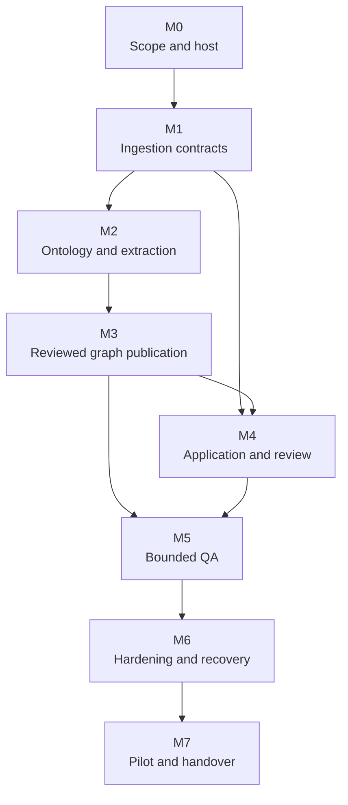

# Development and delivery plan

**Version:** 1.0 · **Baseline date:** 23 October 2026 
**Product target:** a maintained internal service for one small team 
**Team:** three students · **Architecture:** [Project description and system design](PROJECT_DESIGN.md)

This plan translates the design into deliverable work, dependencies, ownership, estimates, and release gates. The implementation currently stops at PDF ingestion. Future milestone names do not imply that their features are already present.

## 1. Planning basis

The user confirmed a three-student team, an internal production target, limited school/cloud resources, and possible access to an RTX 4080 SUPER-class GPU or an A100. No deadline, weekly availability, spending ceiling, or permanently allocated host has been confirmed.

Use **20 working weeks as an illustrative baseline**, assuming each student contributes an average of 12 hours/week: `3 × 12 × 20 = 720 person-hours`. Allocate approximately **576 hours to planned delivery and 144 hours (20%) to contingency**, integration surprises, and rework. These are rough planning estimates with at least ±30% uncertainty until the first model and deployment spikes are complete. They are not a fixed-price or completion-date commitment.

At 8 hours/student/week, the same 720-hour capacity would take about 30 working weeks; at 15 hours it would take about 16. Exams, holidays, hardware queues, and institutional approvals can extend elapsed calendar time without adding engineering hours. Re-estimate after M1 and M2 using actual delivery speed.

The baseline includes one ontology/domain, one shared document-access boundary, a small supported-question catalogue, a simple review interface, and a single-host deployment. It excludes fine-tuning, multi-GPU inference, high availability, general OCR, multi-tenancy, and an elaborate graph visualization editor.

## 2. Team responsibilities

Assign actual names at kickoff. A role is an area of responsibility, not an exclusive silo; all three students participate in integration, tests, documentation, and pilot support.

| Role | Primary responsibility | Secondary / review responsibility |
|---|---|---|
| Student A — Data and extraction | Ingestion adapters, evidence contracts, ontology, extraction, model benchmark | Review graph data model and numerical/citation correctness |
| Student B — Backend and graph | PostgreSQL workflow, jobs, graph projection, publication, QA query templates | Review deployment/recovery and API authorization |
| Student C — Application and operations | UI, evidence viewer, identity integration, deployment, monitoring, runbooks | Review user acceptance and operational test evidence |
| Product/domain owner — to name | Scope priorities, ontology meaning, question catalogue, pilot acceptance | Provide reviewer availability and resolve ambiguous domain labels |
| School IT / host operator — to name | Host allocation, access, identity/TLS integration, backups, post-project maintenance | Approve the operating environment and private-data boundary |

Student A coordinates the model/extraction benchmark, B coordinates technical integration, and C coordinates release readiness. Rotate meeting facilitation and peer review so project knowledge is shared. No milestone closes on its author's self-assessment alone.

### Responsibility matrix

`A` = accountable for closure; `R` = does the work; `C` = consulted; `I` = informed. One accountable owner per row.

| Deliverable | Student A | Student B | Student C | Product/domain owner | IT/operator |
|---|---|---|---|---|---|
| Scope, supported questions, acceptance priorities | C | C | R | A | C |
| Source/evidence contracts and extraction | A/R | C | C | C | I |
| Graph, jobs, API, query templates | C | A/R | R | C | C |
| UI and evidence inspection | C | R | A/R | C | I |
| Ground-truth labels and domain adjudication | R | C | R | A | I |
| Staging deployment and restore demonstration | C | R | A/R | I | C |
| Production hosting and ongoing operation | I | C | R | C | A |
| Product release acceptance | C | R | R | A | C |

If no domain owner or operating owner is available, work can continue on a public-data prototype, but internal production acceptance cannot be represented as complete.

## 3. Milestones and work packages

Effort is combined team effort, including peer review, milestone tests, and relevant documentation. Calendar windows overlap only where different students can work against agreed interfaces. The exit criteria reference [design gates G1–G9](PROJECT_DESIGN.md#122-proposed-release-gates).

| Milestone | Indicative window | Effort | Lead | Dependencies | Reviewable deliverable and exit condition |
|---|---|---:|---|---|---|
| M0 — Scope and host feasibility | Week 1 | 12 h | C, with product owner | None | Confirm service audience, one-workspace policy, host access, operator path, workload, question shortlist, and spending control; record open decisions |
| M1 — Reproducible ingestion boundary | Weeks 1–2 | 44 h | A | M0 | Clean setup, independent bundle verification, source-neutral v2 envelope/local upload adapter, input limits, baseline access skeleton, immutable run manifest; G1/G2 cases defined |
| M2 — Ontology and local extraction slice | Weeks 3–5 | 80 h | A | M1 | One PDF → typed candidates → exact evidence; small-model comparison on actual GPU; ontology validator and frozen evaluation split; initial G3 results |
| M3 — Accepted knowledge and graph publication | Weeks 6–8 | 72 h | B | M2 contracts | Claims/reviews in PostgreSQL, conservative identity links, Neo4j projection, complete-generation activation, retry/rollback demo; G1/G4 and crash cases pass |
| M4 — Team application and review workflow | Weeks 6–11 | 104 h | C | M1 API/auth contracts; M3 before closure | Login/roles, uploads/jobs, candidate review, PDF evidence, conflict/merge actions, publication and retirement UI; unauthorized direct requests denied |
| M5 — Bounded question answering | Weeks 12–14 | 84 h | B | M3/M4; frozen question catalogue | Intent plans, parameterized templates, deterministic answers, citations, abstention, optional wording fallback; G5/G6 benchmark report |
| M6 — Production hardening | Weeks 15–17 | 88 h | C | M3–M5 | Pinned deployment, actual-host load/VRAM tests, offline test, fault tests, backup/restore, retirement propagation, runbooks; G7/G8 evidence |
| M7 — Pilot, corrections, and handover | Weeks 18–20 | 92 h | C, with product owner | M6 technical gates | At least 3 intended users, task/time comparison, defects resolved, release checklist, operator training and acceptance; G9 and all release gates signed off |
| **Total planned delivery** | **20-week illustration** | **576 h** | | | **Plus 144 h reserved capacity; total 720 h** |

The hours are a constrained first-release allocation. A requirement for custom identity infrastructure, document-level permissions, enterprise availability, or substantial parser repair requires a new estimate. Avoid compressing the quality and operations milestones to preserve an artificial deadline.

Diagram source (Mermaid)

**Figure 7 — Milestone dependencies.** UI foundations can begin before graph publication is complete, using agreed fixtures/contracts. The working review journey depends on M3. The likely critical path is ingestion contracts → extraction quality → reviewed graph → cited QA → recovery/security validation → pilot acceptance.

### M0: decisions before the team commits a calendar

- Inventory the actual GPU and available allocation. An A100 partition may expose less memory than the physical card; record what the process can actually use.
- Confirm that the research machine may host a persistent service, whether other workloads compete for resources, and who can administer it after the project.
- Confirm the institutional login, network/TLS route, backup destination, data classification, and expected support hours.
- Select approximately 10 question intents and identify a domain reviewer. Decide whether all team readers may view all published documents.
- Agree weekly availability and a currency-denominated spending ceiling. Record the owner of any cloud account and its shutdown/budget controls.

**Output:** a one-page decision record, confirmed backlog priorities, and a revised milestone calendar if needed. Do not buy hardware or reserve paid instances merely because the estimates mention them.

### M1: protect the existing ingestion work

Retain the current GDR v1 bundle and its hashes as a regression fixture. Build adapters around its contract. Move GDR-specific source fields into an adapter/metadata namespace for the v2 application envelope, define the local-upload permission record, and validate unknown schema versions explicitly. Decide per-document ID limits before large-file support.

Add source hash and parser/model/package/configuration fingerprints to production cache eligibility. Stage each run in an immutable output location and activate a bundle only after full validation. Define scan/partial-document behavior: the UI must show gaps, and claims from unsupported pages cannot be presented as extracted knowledge. Begin identity integration and deny-by-default API access here; auth is not a final-week addition.

**Exit demo:** process one supported public PDF, locate a chunk in the exact PDF version, reject an unsupported file, and prove that reprocessing cannot silently replace the accepted bundle.

### M2: smallest complete extraction example

Before building a broad pipeline, use one short report section, one relation type, and one quantity type. Produce typed JSON with original value/unit, normalized value only when a rule exists, qualifiers, and an exact evidence span. Include a deliberately ambiguous alias and a misleading embedded instruction. Compare model output with deterministic checks and a manual reference.

Benchmark two or three eligible small instruction models, starting around 7–8B parameters with 4-bit weights. Record checkpoint/license, weight/tokenizer hashes, runtime version, prompt/schema, context budget, GPU allocation, peak VRAM/RAM, latency, schema-valid output rate, factual precision/recall, and numerical/citation errors. A public-data cloud run may screen candidates, but final acceptance uses the agreed school-host profile.

Create development/test documents and label at least the initial portion of the 200-claim acceptance set. Add a second annotation pass for a subset and a disagreement log. Selection weighs factual correctness, evidence fidelity, and review effort before speed. Do not choose a larger model solely because an A100 happens to be available.

**Exit demo:** a local command takes versioned chunks and ontology and writes reviewable candidates with evidence; invalid output is bounded and visible. No automatic graph publication yet.

### M3: durable knowledge and reproducible graph

Implement relational migrations for document/run metadata, entities, candidate/claim revisions, review decisions, jobs, outbox, and graph-generation pointers. Implement the entity-resolution rules and tests for duplicate names, aliases, merges, and reversal. Build claim/evidence nodes in Neo4j using scoped IDs and a generation marker.

Inject failures before and after outbox processing and generation activation. A job retry must not duplicate effects. A missing projection marker must fail closed. Restore a graph from accepted records without rerunning the language model. Demonstrate that conflicting facts remain independently inspectable.

**Exit demo:** a reviewed claim becomes queryable with its source; a failed replacement build leaves the old graph usable; rolling back selects a prior validated generation.

### M4: a usable review application

Implement a small set of screens: document list/upload and coverage; job detail; review queue; claim/evidence detail; entity detail/conflicts; publication summary; and minimal administration. Prefer a clear fact table and relationship list before adding a force-directed graph visualization.

The review view must show exact text, physical page, highlighted region where reliable, table headers for numeric cells, ontology rule, and validation issues. Never force a reviewer to approve a claim without access to its source. Correcting a claim creates a revision and requires a reason. Test stale edits from two reviewers and retired-source behavior.

**Exit demo:** someone outside the developer who built the screen uploads a report, understands warnings, reviews candidates, publishes accepted facts, and withdraws the source. Reader-role attempts to perform those changes fail at the API.

### M5: reliable answers within a defined scope

Implement the supported-intent schema and versioned query catalogue. Start with direct structured search and deterministic answer formatting, then add natural-language intent classification. Optional generated wording comes last and retains a deterministic fallback.

Create at least 60 held-out questions, including missing information, ambiguity, conflicting values, unit distinctions, withdrawn evidence, and adversarial instructions. Measure results before and after the optional model wording layer. Compare at least a small representative subset against direct PDF search and a simple passage-search baseline to explain where the graph helps.

**Exit demo:** a supported question produces a correct answer, an exact citation, and the served knowledge revision. Ambiguous questions request clarification. Unsupported and unavailable cases are distinguishable.

### M6: operate the system on the actual host

Package the application, worker, stores, and model runtime with pinned versions. Benchmark the 16 GB-class baseline first unless a different device is the only confirmed resource. Record GPU sharing and cold/warm behavior. Verify Linux ingestion output against the Windows reference instead of assuming byte equality.

Exercise restart during each stage, database/model outages, resource limits, full-disk prevention, rejected uploads, unauthorized routes, prompt/query injection, immediate withdrawal, and backup restore. Run the complete cached workflow with internet access blocked. Capture enough evidence to repeat each check, without putting private data into ordinary logs.

**Exit demo:** restore the system into an isolated environment from the documented backup, rebuild the graph, verify accepted facts and citations, and prove withdrawn content stays unavailable.

### M7: pilot and handover

Run a limited pilot with the agreed corpus and at least three intended users. Record task success, time, citation inspection, corrections, review time, and support issues. Triage failures into release blockers, scope restrictions, and later improvements. The product owner accepts the supported scope; the operator accepts the maintenance responsibilities.

**Exit package:** tagged release and changelog, pinned configuration/model inventory, deployment instructions, completed acceptance matrix, known limitations, backup/restore evidence, user guide, operator guide, and named support/ownership arrangements. A demo video can supplement these artifacts but does not replace recovery or access-control evidence.

## 4. Hardware, compute, and cost control

### 4.1 Practical resource allocation

Use the [design's hardware baseline](PROJECT_DESIGN.md#111-hardware-baseline): one 16 GB-class GPU, a small quantized model, CPU parsing, 32–64 GB host RAM, and initially around 250 GB free SSD. An A100 is optional headroom. No dedicated new GPU purchase, fine-tuning cluster, or always-on cloud GPU is assumed.

Reserve school-GPU sessions for benchmarks, integration, and demonstrations. Most developer tests use fixed model-response fixtures; they should not require three GPU allocations. Run extraction batches outside interactive service windows if the GPU cannot keep answer latency within target. If the host is shared, cap its resource usage and obtain a service window rather than assuming exclusive access.

### 4.2 Cost worksheet

No actual budget amount was supplied. These are planning categories, not prices or spending authorization. Fill them with the institution's allocation and the provider's current quoted rates before paid work.

| Cost item | Baseline approach | Estimate method / control |
|---|---|---|
| Student effort | 720 total planned-capacity hours | 576 delivery + 144 contingency; use school accounting only if needed |
| GPU host | Existing school allocation | Record allowed hours, sharing, and any internal charge; new purchase excluded |
| Cloud experiments | Optional, public/synthetic data only | `GPU hours × current hourly rate + storage + transfer`; hard project cap and auto-shutdown |
| Persistent storage | School SSD/volume where possible | Measure source × working-artifact multiplier + models + database; review disk weekly |
| Independent backup | Existing institutional destination | Retention × measured daily change; confirm capacity and restore access |
| Software | Open-source components and school identity/TLS | Check model and distribution licenses; do not assume enterprise features are free |
| Ongoing operations | Named institutional/team owner | Budget maintenance time, patching, restore drills, and handover outside feature work |

Track spend and remaining credits weekly. Save experiment checkpoints/results frequently, stop idle paid resources, and treat credits as a finite balance. Free or educational Colab resources are not a production hosting assumption: Google documents changing availability, runtime termination, and restrictions on web-service use. Use it for bounded interactive experiments. [Colab FAQ](https://research.google.com/colaboratory/faq.html).

### 4.3 Scope cuts if resources are tighter

Cut in this order: optional generated prose; elaborate graph visualization; extra question intents; extra ontology types; optional OCR; corpus size/concurrency beyond the agreed minimum. Keep citations, validation, role enforcement, withdrawal behavior, backups, and honest coverage reporting. If no persistent host/operator is available, deliver the validated prototype and handover package while explicitly leaving the internal production release unaccepted.

## 5. Risk and dependency register

Likelihood/impact are initial qualitative estimates. Review weekly and after each milestone. Owners are role placeholders until kickoff.

| ID | Risk / dependency | Likelihood / impact | Trigger to watch | Mitigation / contingency | Owner |
|---|---|---|---|---|---|
| R-01 | Model extracts plausible but incorrect facts | High / High | Low precision, wrong units, unsupported citations | Exact evidence checks, held-out evaluation, manual approval, narrower ontology/model comparison | A |
| R-02 | Table/scan errors propagate into claims | High / High | Missing pages, malformed headers, known form failures | Coverage flags, table-specific labels, reviewed corrections; exclude unsupported pages and defer OCR | A |
| R-03 | GPU access is intermittent or shared | Medium / High | Allocation changes, OOM, long queue | Small baseline model, fixture tests, scheduled batches, bounded public-data cloud experiments | C / IT |
| R-04 | Research host cannot support a persistent service | Medium / High | No stable volume/network/owner | Confirm in M0; seek approved institutional host; production gate stays open | C / IT |
| R-05 | Three-person scope is too large | High / High | Two consecutive milestones consume reserve | Preserve a thin complete workflow, reduce intents/corpus/UI extras, rebaseline hours | B / product owner |
| R-06 | Domain reviewer unavailable | Medium / High | Queue age or labels stall | Schedule review sessions early, use smaller acceptance corpus, escalate domain ambiguities | A / product owner |
| R-07 | Cross-store publication becomes inconsistent | Medium / High | Missing markers, outbox lag, partial graph | Immutable generations, reconciliation, idempotency, fault tests, fail-closed reads | B |
| R-08 | Private data leaks through cloud/logs/backups | Medium / High | Unapproved endpoints or content in logs | Approved boundary, offline test, sanitized diagnostics, role checks, controlled experiment corpus | C / IT |
| R-09 | Identity/TLS access is delayed | Medium / Medium | No provider credentials/integration path by M1 | Use test identity fixtures locally; prioritize IT integration; no private-data launch without auth | C |
| R-10 | False entity merges corrupt many answers | Medium / High | Ambiguous aliases joined automatically | Scope identifiers, review suggestions, retain history, reversible merge projection | B |
| R-11 | Reproducibility differs across Windows/Linux | Medium / Medium | Changed hashes or parser output | Keep Windows reference; version Linux baseline separately after evaluation | A |
| R-12 | Student turnover leaves an unmaintained service | High / High | No successor named by M6 | Shared runbooks, operator training, restore exercise, explicit end-of-project ownership | C / product owner |
| R-13 | Cloud credits expire or costs exceed expectations | Medium / Medium | Credit balance drops or idle compute persists | Hard cap, auto-shutdown, school-host baseline; cloud remains optional | C |
| R-14 | Gold sample is biased or leaks into tuning | Medium / High | Duplicate documents, repeated test-set prompt changes | Freeze split, document-level separation, second annotation subset, disclose uncertainty | A |

External dependencies are host allocation, institutional access/identity/TLS, backup storage, domain review, and model-use permissions. Record who is expected to supply each item and by which milestone. Lack of a reply is not approval.

## 6. Delivery cadence and change control

Use one shared board with Backlog, Ready, In Progress, Review, Validate, and Done. A ready item has a requirement ID, owner, acceptance examples, dependencies, and a small estimate. Split work until most items can be completed and reviewed in one or two student work sessions. Limit each student to one major work item at a time.

Meet briefly each week to demo working behavior, review the critical path, inspect risks/remaining hours, and record scope decisions. Re-estimate unfinished work from evidence rather than marking a milestone “90% complete” repeatedly. Track accepted requirement coverage, failing release gates, review backlog, and forecast hours; commit counts are not a progress measure.

Each change receives peer review. Implement tests for meaningful contracts and failure modes, with a small deterministic suite for everyday work and a separate host/GPU integration suite. Keep real-model benchmarks versioned but outside the fast test loop. Every milestone updates the relevant design/current-state sections and stores its verification commands and results.

### Definition of done for a work item

- Its acceptance behavior is demonstrated with an appropriate fixture or real integration check.
- Error handling and access checks are implemented where relevant.
- Another student has reviewed the change and material test evidence.
- Data/schema changes have a migration and rollback/recovery story.
- User-facing behavior and operating instructions are documented.
- Known limitations are recorded; no failing required check is described as a pass.

### Definition of release complete

All Must requirements FR-01 through FR-13 have accepted evidence; gates G1–G9 have results; unresolved defects are classified and accepted where permissible; the workload and support limits are published; the product owner and operator accept their respective responsibilities. Security, evidence integrity, and recovery failures block release. The source repository and this design alone do not satisfy that definition.

## 7. First implementation backlog

These are the next concrete tasks after the documentation baseline. Complete the small evidence-to-claim path before expanding infrastructure.

| Order | Task | Acceptance artifact |
|---|---|---|
| 1 | Name the product/domain reviewer and prospective operator; inspect actual host | Decision record with GPU/VRAM, RAM/disk, sharing, access, identity, and service-hosting status |
| 2 | Recreate the pinned ingestion environment and verify the committed bundle | Setup log, test results, nine matching manifest entries; clearly separate cached checks from fresh conversion |
| 3 | Define versioned source/run/evidence envelopes and a local-upload adapter | JSON schemas and fixtures covering GDR, local PDF, duplicate text, multi-page chunks, Unicode, and tables |
| 4 | Define a small initial ontology and 10 intended question examples | Reviewed ontology draft, scoped aliases, quantity/unit rules, unsupported examples |
| 5 | Label a small development slice and freeze the evaluation strategy | Candidate reference claims with evidence and a document-separated test inventory |
| 6 | Run the one-section local extraction experiment on the actual GPU | Versioned candidates, exact-evidence validation, quality/latency/VRAM report |
| 7 | Finalize relational/graph contracts from the tested slice | Accepted claim revisions projected into a tiny graph and queried with evidence |

The main [README](../README.md) remains the setup/CLI entry point. Do not rerun `publish` simply to check documentation: it writes the selected bundle. Fresh `run` requires PDF/model acquisition and can take time; first inspect existing artifacts and use an isolated named run for experiments.

## 8. Planning decisions still to close

| Decision | Needed by | Why it matters |
|---|---|---|
| Actual weekly availability and any deadline | M0 | Converts person-hours into a realistic calendar |
| Exact host/GPU allocation and service-hosting permission | M0/M1 | Determines runtime, access windows, and whether production hosting is possible |
| Team-wide versus document-specific access | M0 | Current scope assumes all readers may see all published documents |
| Domain reviewer and initial question catalogue | M0/M2 | Defines ontology semantics and an answerable product boundary |
| Login provider, TLS/network route, backup destination | M1, finalized by M6 | Avoids late integration and operational blockers |
| Model/checkpoint/license and measured context/concurrency | M2 | Determines quality, memory use, and actual hardware fit |
| Spending ceiling and cloud-account owner | Before paid use | Prevents accidental reliance on unbounded cloud resources |
| Retention, support hours, operating owner | Before M7 acceptance | Makes the internal service maintainable after handover |

The current documentation request does not require these choices to be invented. The design and plan remain usable with clearly labelled assumptions; production implementation must close the relevant decisions at their stated gates.
