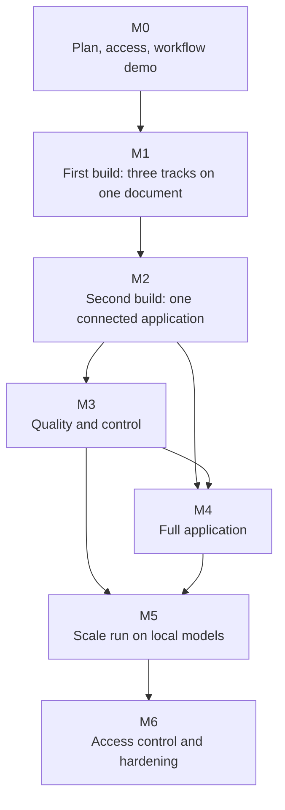

# Development and delivery plan

**Version:** 3.2 · **Baseline date:** 23 October 2026 · **Last revised:** 24 November 2026 (first build closed; second build planned) 
**Product target:** a GraphRAG application for drilling reports: ingestion, storage, a coordinator over two graphs and retrieval, chat and administration 
**Team:** Tri, Khai, Hung · **Source of truth:** [Project specification](PROJECT_DESIGN.md) · **Direction:** [28 October](requirements/supervisor-meeting-2026-10-28.md) and [9 November](requirements/supervisor-meeting-2026-11-09.md) meetings

This plan schedules the [specification](PROJECT_DESIGN.md). It adds no scope of its own; requirement IDs (FR), gates (G1–G8), decisions (D-xx) and questions (Q1–Q15) refer to the specification.

**Version 3.2 (24 November)** closes the first build (M0 and M1) and plans the second: one connected application (specification §4.6, D-64 to D-67). **Removed in 3.2**, because the work is done or replaced: the M0 task list ("this week" of 2 November); the three tracks' research questions, work lists and "starts from" lists; the 15-row backlog of 30 October; and the note written after the 9 November meeting, whose items are done or carried into §7. What each track found stays in its own record: [Track A progress](experiments/TRACK_A_PROGRESS.md), [Track B log](tracks/B-graphrag/log.md), [Track C log](tracks/C-storage/log.md). Version 3.1 is in the Git history.

## Current status

**Direction.**

- A **GraphRAG application** for drilling reports: end-of-well and daily drilling reports (D-36, D-40).
- Open-weight models of about 7B or smaller, never commercial APIs (D-37). The model can be swapped (D-62).
- A **coordinator** sends each question to a lane: passages, well facts or events (D-58, D-64).
- A **real application now**: FastAPI and React, read path first, shown to domain experts to learn what they ask (D-60, D-65).
- Rule-based parsing is pushed as far as it goes before vision models (D-63). People review part of the machine-made data, after the pipeline is built (D-63).
- A capstone, not research: prefer what works, start small, keep domain depth thin (D-41, D-44, D-49).

**What exists** (code, tests and a record):

| Part | State on 24 November | Evidence |
|---|---|---|
| Chunk packages (K1 version 1) | AK-3's end-of-well report and four daily-report attachments, 174 pages: validated, with a QA sidecar. Options added on 17 November, off by default: table joining across pages, section context, form recognition, label-value repair, page orientation, quarantine, resumable runs | [Track A progress](experiments/TRACK_A_PROGRESS.md), [E30](experiments/E30-k1-version-1-candidate.md) |
| Engine | Retrieval by well and date, the per-well fact graph, the event graph, cited answers checked in code, K4 records, a local UI. 28/31 on the prototype's questions; 22/35 and 19/23 on totals over time against 5/35 and 4/23 for plain RAG. Since 24 November: lanes behind one interface, the coordinator and the fact graph export, tested with stand-in models and not yet measured | [Specification §8.4](PROJECT_DESIGN.md#84-what-the-first-build-runs-today), [Track B log](tracks/B-graphrag/log.md) |
| Stores | PostgreSQL with pgvector and Neo4j in Docker Compose on one laptop; K1 loader with page rebuild (174 of 174); 1,042 vectors; the event graph in Neo4j, replaying 58 of 58 query plans | [Track C log](tracks/C-storage/log.md) |
| Backend API | The read path as a FastAPI service with its contract and example responses, built 24 November. It reads files, not the stores | [backend/README.md](../backend/README.md), Track B log B-C44 |
| Frontend | The React application, built 24 November on the contract and the example responses. Not yet run against a real model | [frontend/README.md](../frontend/README.md), Track B log B-C45 |
| Earlier foundation | Document pipeline, structured-data import, the entity registry (57,453 wellbores), the prototype as the measured baseline (23/31) | [Specification §3.1](PROJECT_DESIGN.md#31-what-exists) |

**Not built:** the list in [specification §3.1](PROJECT_DESIGN.md#31-what-exists). In short: the parts are not connected, there is no coordinator, no API, no React frontend and no shared hosting.

**Honest limits.** Every question set is simulated. Every method is tuned on one well and one report family. The repository shows no work between 17 and 24 November, and no supervisor contact is recorded after 9 November.

## 1. Planning basis

- **Team:** three students. The supervisor expects the end-to-end application in English within the first semester (D-35); hardening and scale follow in the second.
- **Compute:**
  - Tri's desktop (RTX 4080 SUPER, 16 GB) with llama.cpp runs every Track B measurement locally;
  - hosted open-weight models (OpenRouter) remain allowed for development on public data only (D-38). Who holds and funds the account is still open (Q6);
  - school GPUs, booked through Dr. Le Duy Dung, for large runs. The booking process is still open (Q7);
  - laptops for code, tests, Docling and the stores.
- **Data:** public only. AK-3 first, then the Utah FORGE reports already used (56-32, 68-32, 78-32). The supervisor's petroleum document, if supplied, is processed on local models only.
- **Questions:** simulated sets stand in for the expert set (Q2, D-49) and are never reported as expert validation. The application's question log is the new route to real questions (D-65).
- **Estimates:** plan week by week. Re-plan at every check-in from what was actually finished.

## 2. Team split

The first build ran as three tracks joined by files (D-48). Those tracks are closed (§3), and K1 to K5 remain the interfaces between ingestion, engine and stores.

From this stint the split follows the lines the supervisor asked for (D-46, D-65). **Tri takes the engine and the frontend (his decision, 24 November). Hung agreed to backend and to the design on 24 November, and asked Tri to do part of the backend for now; what Tri does and what stays with Hung is in the [backend design](tracks/C-storage/backend-design.md). Khai agreed to data the same day (Track B log B-D40). The roles are settled for this stint (Q14).**

| Role | Proposed owner | Owns | Interface it publishes |
|---|---|---|---|
| **Data** | Khai (agreed) | PDFs to K1 packages; table and form quality; the QA sidecar; new reports | K1 releases |
| **Backend** | Hung (agreed; Tri helps for now) | Shared hosting of the stores; the runner from a K1 package to loaded stores and graphs; the FastAPI service; the question log | The OpenAPI file; the stores |
| **Engine** | Tri | Lanes, coordinator, answer checks, the reasoning probe; measurements | The `graphrag` library; K4 records |
| **Frontend** | Tri (confirmed by Tri, 24 November) | The React application | — |

Engine and frontend on one person is the weak point of this proposal. If it slips, the frontend's first version shrinks to the chat page and the source viewer.

The split is redone every one to two weeks (D-48). Everyone joins integration, demos and documentation.

## 3. Milestones

Weeks are counted from 2 November 2026. Windows are indicative; each check-in revises them.

| Milestone | Window | Exit demo | State |
|---|---|---|---|
| **M0: Plan, access, workflow demo** | Week 1 | Tracks assigned, contracts at version 0, workflow shown | Done, except the OpenRouter account (Q6) and GPU booking (Q7) |
| **M1: First build in three tracks** | Weeks 1–4 | One-document slice from pages to cited answers | **Closed 24 November**; see below |
| **M2: Second build — one connected application** | Weeks 4–6 (24 November to 12 December) | A person outside the team opens the application, asks about AK-3, and sees the answer, the lane used, the cited page and the evidence. Everything is read from the shared stores, loaded by one command | **Current** |
| **M3: Quality and control** | Weeks 6–9 | Wells linked to registry IDs; glossary in use; scores and flagged items; 5–10 documents from more than one report family; the expert or logged questions run (G3–G6) | Outline |
| **M4: Full application** | Weeks 7–11 | A non-developer uploads a report, watches the run, corrects three flagged items, edits a glossary entry, asks a question and opens the cited page | Outline |
| **M5: Scale run on local models** | Weeks 10–13 | The corpus processed in checkpointed runs on a booked GPU; evaluation on held-out questions; cost and throughput report (G8) | Outline |
| **M6: Access control and hardening** | Second semester | Login and roles; private-endpoint guard tested (G7); backup and restore; joint evaluation on the supervisor's document if supplied | Outline |

Diagram source (Mermaid)

**Figure 7 — Milestone dependencies.** The critical path is the K1 release for the demo set → the stores loaded by one command → the engine reading the stores → the API → the frontend → domain experts using it.

### M1: how the first build closed

| Track | Exit asked | Met | Not met; where it goes |
|---|---|---|---|
| A. Ingestion and tables (Khai) | A parser choice with table scores; K1 version 1 for both documents | K1 version 1 adopted (D-57). Docling stays the general parser, with rules for known table formats. Operations Summary tables rebuilt: 81 of 81 on seen data, and 27 of 27 found on a held-out round | The document VLM comparison was not run; deferred by D-63. Tables over several pages: options exist, off by default and not yet measured on end-of-well reports. Generalization beyond one report family. → M2 task D2, M3 |
| B. GraphRAG engine (Tri) | A base, an LLM, an embedding model and a vector store chosen; K4; cost per page | Qwen3-8B, Qwen3-Embedding-0.6B and pgvector chosen. No third-party base adopted; our own two graphs instead (D-53, D-55). K4 version 0.1. Cost reported on every run | Answers on K1 version 1 and on the stores. → M2 tasks E1, E2 |
| C. Storage and the run (Hung) | Schemas with validators; four stores loaded; page-rebuild check; one-command runner; viewer | K1 tables with constraints; loader and page rebuild; vectors; the event graph in Neo4j | The runner and the full pass through it; the viewer (Track B's local UI stood in); MinIO in use; the fact graph in Neo4j; shared hosting. → M2 tasks B1 to B3 |

### M2: second build, one connected application

The design is [specification §4.6](PROJECT_DESIGN.md#46-second-build-one-connected-application), [§7.5](PROJECT_DESIGN.md#75-http-interface-design) and [§8.1](PROJECT_DESIGN.md#81-the-coordinator-and-its-lanes). The task list is §7 below. Three checkpoints:

| When | Checkpoint |
|---|---|
| End of week 4 (28 November) | Roles agreed. Supervisor messaged. Stores reachable by all three, with the AK-3 release loaded. The OpenAPI file agreed. The lane interface written, with the three lanes behind it |
| End of week 5 (5 December) | The engine answers from the stores, with the baseline scores reproduced. The coordinator measured on the pooled questions. The API returns real answers. The frontend runs against it |
| End of week 6 (12 December) | The exit demo above, shown to the supervisor: one sample walked from PDF to answer inside the application. The reasoning probe's record written. The application handed to whoever the supervisor names among the domain experts |

**Order matters more than dates.** The first two things unblock everyone else: shared stores (B1) and the K1 release for the demo set (D1). The frontend does not wait for them: it starts on recorded answers as fixtures.

### M3: quality and control

1. **Identity and glossary.** Link report mentions to the registry, and AK-3 to its project-scoped entry. Link daily reports to their well through `Document` nodes. Use the glossary in the question frame.
2. **Generalization.** Reports from more than one family: the 58-32 daily reports, a different author's modern end-of-well report (Track B log B-F54), tables over several pages, and the QA thresholds calibrated on more than one family.
3. **Scores and flagged items.** Compute scores, set the threshold from a labelled sample, and list flagged items for people (D-43, D-63).
4. **Questions.** Run the expert set if it has arrived; otherwise the questions domain experts typed into the application, with gold answers written from the reports.
5. **Lanes.** Split, merge or add lanes from what the question log shows (Q13). Decide whether the reasoning lane becomes a loop (D-64).

### M4: full application

- **End user:** well page (facts, documents, timeline of days); graph and source browsing.
- **Admin:** document upload and run status; ontology versions with validation and diff; glossary editor; flagged items with accept, correct and reject; duplicate wells; generation activation; document retirement.
- **Governance:** versions and audit of every correction and activation.
- Keep the UI plain: tables and lists before graph visualizations.

### M5: scale run on local models

Serve the chosen model locally (vLLM or llama.cpp) on a booked school GPU. Process the corpus in checkpointed runs that stop and resume across slots, then evaluate on held-out questions. Estimate first from the measured cost per page; prepare data, containers and models before the slot starts.

### M6: second semester

- Login, roles and server-side checks.
- The private-endpoint guard test.
- Backup and restore of PostgreSQL, the file store and Neo4j.
- The joint evaluation with the supervisor's document if supplied, on local models only.
- Improvements chosen from the evaluation.

## 4. Compute and cost control

| Item | Approach | Control |
|---|---|---|
| Local GPU (Tri's desktop) | Every measurement; the demo's model, reached over a private network (Q15) | One request at a time for measurements; server settings recorded with each run (Track B log B-F19) |
| Hosted open models (OpenRouter) | Optional, public data only | A cap on the account; cost per run reported (FR-30); never private data (spec §10.1) |
| School GPU slots | Large runs and the local-model evaluation | Book early; checkpointed jobs; everything prepared before the slot |
| Shared host for the stores | A free cloud tier (Track B log B-D35) | Public data only; credentials outside the repository; one shared password in front of the application until login exists |

Every run reports calls, tokens, seconds and cost per page and per question next to quality. The coordinator adds one model call to lookups; that cost is measured before it is adopted (D-64).

**Scope cuts if time runs short**, in this order:

1. graph visualization;
2. the well page;
3. the reasoning lane beyond its probe;
4. the ontology assistant and extra document types;
5. corpus size.

Keep:

- citations and the source page;
- the ID scheme;
- the coordinator with its three lanes;
- the question log;
- the private-data boundary.

## 5. Risks

| ID | Risk | Watch for | Mitigation | Owner |
|---|---|---|---|---|
| R-01 | A ~7B model states plausible but wrong facts | Wrong values in answers; unsupported claims in the reasoning probe | Values and citations checked in code; computed results inserted by code; facts validated before use; causes labelled stated or possible | Engine |
| R-02 | Table parsing errors propagate | Wrong cells, missing headers, lost marks | Rules for known formats with a fallback and a reason; the QA sidecar; measure on other report families | Data |
| R-03 | Methods tuned on one well do not transfer | A second report family fails | Add one new family at a time in M3; report seen and unseen data separately | Data, Engine |
| R-04 | The coordinator sends questions to the wrong lane | Pooled score below the hand-routed scores | Wells and dates read by code; fixed fallback; measured before adoption; a lane can be forced from the UI | Engine |
| R-05 | School GPU slots hard to get | No booking | Local GPU for development; ask early (Q7) | All |
| R-06 | Hosted endpoint used on non-public data | A private file in a run | The model client's guard; test it | Engine |
| R-07 | No public daily-report collection beyond AK-3 | Reasoning and event lanes stay on one well | The 58-32 daily reports; keep looking (Q5); say so in every result | Data |
| R-08 | Real questions never arrive | No expert set, and nobody uses the application | Simulated sets, labelled; put the application in front of experts early; ask at each check-in | All |
| R-09 | Scope too large for three people; engine and frontend on one person | A checkpoint missed by a week | Cut in the order of §4; shrink the frontend to chat and source viewer | All |
| R-10 | Direction drifts without contact | **Already true: no recorded contact since 9 November** | Message the supervisor this week (task A1); short updates every few days (D-46) | All |
| R-11 | Wrong entity merges corrupt answers | Two wells joined | Identifier and scoped-name matching only; merges always by a person | Backend |
| R-12 | The three parts drift while being connected | A K1 or API change breaks another part | K1 changes by version only; the OpenAPI file agreed first; the runner checks each step | All |
| R-13 | Data passed by hand between machines | A zip in the chat | Shared stores and a file store for K1 releases (B1) | Backend |

## 6. Working cadence (D-46)

- **Weekly check-in with the supervisor, about 30 minutes:** what was done, what is blocked, next week's plan. Bring a demo whenever something runs.
- **Group chat updates every few days:** a short message or a screenshot. Message the supervisor when there is a result worth showing; do not wait for a meeting.
- **Reports are short:** two or three slides of architecture, one sample walked through the pipeline, weak points stated, then what the team needs (9 November meeting).
- **Review.** Each change is reviewed by another student before merging to `main`.
- **Record decisions.** A supervisor decision becomes a decision in spec §13.1 in the same week. Superseded text is removed, not kept beside the new text.

### Definition of done

- Demonstrated on real data (one document at least) or a fixture.
- Another student reviewed it.
- IDs and citations resolve.
- Calls and cost reported where models are used.
- Limitations written down.

## 7. What to do now

Tasks for M2, in order within each group. "Needs" names what must exist first. Owners follow the proposal in §2.

### All

| # | Task | Done when |
|---|---|---|
| A1 | **Message anh Tuấn this week**, with the [stint report](reports/stints/STINT_REPORT_2026-11-24.md). Two weeks have passed. Say what exists, show the design in three lines (coordinator, three lanes, application), and ask the open questions: the purpose of use (Q13), the expert questions (Q2), which experts will try the application, OpenRouter funding (Q6), GPU booking (Q7) | Sent; answers recorded in spec §13.2 |
| A2 | **Agree the roles** for this stint (Q14) | **Done 24 November:** Khai data, Hung backend, Tri engine and frontend (Track B log B-D39, B-D40) |
| A3 | Review this design: specification §4.1, §4.6, §7.5, §8.1, §8.5, §8.6 | Hung agreed to it and Khai to his role (24 November). Open: each reads his note ([Khai](tracks/A-ingestion/note-from-track-B-2026-11-24.md), [Hung](tracks/C-storage/note-from-track-B-2026-11-24.md)) and records objections |
| A4 | Exit demo for the supervisor, then hand the application to domain experts | M2 exit shown; the question log has questions from someone outside the team |

### Data (Khai)

| # | Task | Needs | Done when |
|---|---|---|---|
| D1 | **A K1 release for the demo set**: AK-3's end-of-well report, the four daily-report attachments and appendix 23 (the non-productive-time report), with the legacy ID map inside and a well on end-of-well chunks | — | The release validates; the event graph builds from K1 alone (drops the fallback of [E31](experiments/E31-event-graph-on-k1.md)) |
| D2 | Decide which 17 November options are on by default, by measurement on this release | D1 | Each option on or off with a number behind it, in Track A's record |
| D3 | Add 56-32 and 68-32 end-of-well reports to the release | D1 | Questions across wells can run from the stores |
| D4 | Fix duplicated merged-cell text in table Markdown | — | Track A progress §7 item 1 closed |
| D5 | A Track A log in `docs/tracks/A-ingestion/`, like the other two | — | Findings and decisions since 9 November are in it |

### Backend (Hung)

Hung asked Tri to do part of this for now (Track B log B-D39). B4, B5 and the file version of B6 are done on his behalf; the others are designed for him in the [backend design](tracks/C-storage/backend-design.md), which also gives a suggested order.

| # | Task | Needs | Done when |
|---|---|---|---|
| B1 | **Shared hosting of the stores** and of K1 releases (Track B log B-D35) | — | Tri and Khai connect with their own credentials; no data moves through chat |
| B2 | **The runner**: one command from a K1 release to loaded chunks, vectors, the event region and the fact region, each step checked | D1, E4 | Run twice on the AK-3 release with the same result |
| B3 | The fact region in Neo4j, and the event region on K1 version 1 IDs | E4 | Layout agreed (D-67); every fact and event links to a chunk that exists in PostgreSQL |
| B4 | **The OpenAPI file** for the read path of spec §7.5, agreed with Engine and Frontend before coding | — | **Done 24 November by Tri, on Hung's behalf** (Track B log B-C44): `backend/openapi.json` and ten example responses in `backend/fixtures/`. Hung to review |
| B5 | The FastAPI service in `backend/`, calling `graphrag` | B4, E3 | **Built 24 November by Tri, on Hung's behalf** (B-C44), reading files. Open: each endpoint returns real data from the stores (after B1 and E2) |
| B6 | The question log and feedback tables | B5 | **Done as a file** (B-C44): every question is stored with its lane, answer and any mark. Open: the PostgreSQL tables, designed in the [backend design](tracks/C-storage/backend-design.md) §3 |
| B7 | Page images or PDF pages served for the source viewer | B1 | A citation opens the right page |
| B8 | Compose file for the whole application; one shared password at the proxy | B5, F1 | The application runs on the shared host |

### Engine (Tri)

| # | Task | Needs | Done when |
|---|---|---|---|
| E1 | Answers on K1 version 1 (the runs named in [next-runs](tracks/B-graphrag/next-runs.md)); `DateRouter` reads K1's report date | Desktop | Record E32, compared with 28/31, 22/35, 19/23 and 14/26 |
| E2 | The engine reads chunks and vectors from the stores | B1 | The same scores as E1 from the stores |
| E3 | **The lane interface**: passages, well facts and events behind one function shape, returning the common evidence (spec §8.1); model roles in configuration (D-62); K4 gains the lane and the frame | — | **Done 24 November** (Track B log B-C37, B-C41): the baseline's requests are unchanged, and tests cover each lane |
| E4 | The fact graph as nodes and relationships (spec §8.5), written for Backend's loader | — | **Done 24 November** (B-C40): `graphrag/results/E27_fact_graph.graph.json`, 216 facts of 5 wells. Two doubts to check (B-F60) |
| E5 | **The coordinator**: the framing call, the routing table, the fallback, the exact-answer switch. **Built 24 November (B-C38), not measured** | E3, desktop | Record E33: the 221 development questions in one pool, lane accuracy and answers against the hand-routed scores, with calls and tokens per question. Adopt or not (D-64) |
| E6 | Results computed by code are reported by code. **Built 24 November (B-C39)** | E3, desktop | The garbled answers of E28 are gone; rerun in E33 |
| E7 | **The reasoning probe**: about ten questions on AK-3's non-productive events, frozen first; then the lane of spec §8.6 | E3, D1 | Record E34: stated cause found and cited; unsupported claims counted; what the data could not support |

### Frontend (Tri)

| # | Task | Needs | Done when |
|---|---|---|---|
| F1 | A React and TypeScript application in `frontend/`: the chat page with the exact-answer switch, the answer with citations and the lanes used | B4 (fixtures): **ready** | **Built 24 November** (Track B log B-C45), then redone for non-developers with a guide and explanations on hover (B-C47), working on the example responses. Open: the first run against the API with a real model, and a first use by someone outside the team |
| F2 | The source viewer: the cited page beside the cited passage | B7 | **Built as text** (B-C45): a source opens its page's text with the cited passage marked. Open: the page image (B7) |
| F3 | The evidence panel: passages, facts, the query plan with its events | B5 | **Built** (B-C45): day strips and a table for a computed total; passages with the answer's value marked; checked facts |
| F4 | "Wrong answer" button and comment | B6 | **Built** (B-C45): right in one click, wrong with a comment, both sent to the question log |

### After M2

The M3 to M6 lists in §3.

The main [README](../README.md) stays the setup entry point.

## 8. Decisions to close

| Decision | Needed by | Why |
|---|---|---|
| Where the demo runs and which model serves it (Q15) | 5 December | Domain experts must reach it without the team's laptops |
| Purpose of use and question types (Q13) | M3 | Decides how lanes are split or merged (D-58) |
| Expert question set, or which experts try the application (Q2) | M3 | Evaluation; simulated sets stand in for development only |
| Whether the coordinator is adopted (D-64) | After record E33 | It adds one model call to lookups |
| Whether the reasoning lane continues beyond its probe (D-66) | After record E34 | Depends on what the data supports |
| OpenRouter account owner and cap (Q6); GPU booking (Q7) | Before M5 | Open since M0 |
| Public daily-report sources beyond AK-3 (Q5) | M3 | Daily reports are half of the document scope |
