# Secure LLM and Knowledge Graph Platform

## Project specification and system design

**Document version:** 3.8 · **Baseline date:** 23 October 2026 · **Last revised:** 25 November 2026 ([change history](#change-history))<br>
**Project context:** VPI capstone "Secure Domain-Specific LLM and Knowledge Graph Platform for Oil & Gas Technical Intelligence"; three students<br>
**Status:** the first build is closed (§4.5); the second build connects its parts behind one application (§4.6). Current status: [plan](DEVELOPMENT_PLAN.md#current-status)<br>
**Inputs:** [Stakeholder requirements](requirements/README.md), supervisor meetings of [7 October](requirements/supervisor-meeting-2026-10-07.md), [28 October](requirements/supervisor-meeting-2026-10-28.md) and [9 November](requirements/supervisor-meeting-2026-11-09.md) · **Derived:** [Development plan](DEVELOPMENT_PLAN.md) · **Supporting:** [Data sources](DATA_SOURCES.md), [components](components/), [experiments](experiments/README.md)

> **This document is the project's single source of truth.** It decides what the project builds, for whom, how the parts fit together, and how completion is judged.
>
> - The [stakeholder requirements](requirements/README.md) and supervisor meetings are inputs; §1.2 states how each requirement is met, narrowed or dropped.
> - The [development plan](DEVELOPMENT_PLAN.md) schedules this specification and must not add scope of its own.
> - Component guides describe implemented behavior; experiment records hold measurements.
> - If any of them disagrees with this document, this document wins until it is changed.
> - Items still to settle with the supervisors are in [§13.2](#132-open-questions-for-supervisor-meetings).

### Reading guide

| If you need to understand… | Start here |
|---|---|
| Why the project exists and what it delivers | [1. Product](#1-product-purpose-and-scope), [2. Users](#2-users-and-workflows) |
| Which data the team builds on | [Data sources](DATA_SOURCES.md), [§1.3](#13-three-layer-target-and-what-the-capstone-delivers) |
| What is implemented today and what is missing | [3. Current baseline](#3-current-implementation-and-evidence) |
| How the system fits together and where data is stored | [4. Architecture](#4-target-architecture) |
| How documents become chunks, vectors and graph | [5. Processing](#5-document-to-graph-processing), [5.10 Tables](#510-tables-in-drilling-reports), [5.11 IDs](#511-identifiers-and-cross-store-linking) |
| How the ontology is defined, injected and verified | [6. Ontology](#6-ontology-layer-and-domain-modules) |
| How questions are answered: the coordinator, the lanes, the two graphs | [8. Question answering](#8-question-answering), [8.5 Graph model](#85-the-graph-nodes-and-relationships) |
| What is being built next | [4.6 Second build](#46-second-build-one-connected-application), [development plan](DEVELOPMENT_PLAN.md) |
| Which models and tools, and why | [9. Technology choices](#9-technology-choices-and-alternatives) |
| Security, hosting and compute | [10. Security](#10-security-and-data-boundaries), [11. Compute and operations](#11-deployment-capacity-and-operations) |
| How completion is measured, and what is decided | [12. Acceptance](#12-quality-and-acceptance), [13. Decisions](#13-decisions-assumptions-and-change-control) |

All architecture diagrams describe the **target** unless labelled **current**. Diagrams are SVG images with expandable Mermaid source; the source is authoritative ([how to regenerate](diagrams/README.md)).

## 1. Product purpose and scope

### 1.1 Problem and intended value

The project is a capstone for the Vietnam Petroleum Institute (VPI), supervised by Dr. Le Duy Dung and MSc. Nguyen Anh Tuan. Its aim, from the [proposal](requirements/README.md#capstone-proposal-digest), is a pilot of an in-house, secure AI platform that extracts, organizes and reasons over PetroVietnam's (PVN's) technical knowledge. Commercial LLM services are not an option: the data is confidential, and the security requirements are strict.

Drilling knowledge sits in long reports, most of it in tables: end-of-well reports, daily drilling reports, casing and survey tables, time breakdowns. Finding a fact means opening several documents, matching different names for the same well, reading multi-page tables whose headers appear only on the first page, and checking which source says what. One well is mentioned in many documents, and nothing links them.

The product is a **GraphRAG application** for drilling reports (D-36). It ingests reports, parses pages and tables with a vision-language model (D-39), and has an open-weight LLM extract entities and relations under an ontology the user supplies (D-29). It stores the results as linked chunks, vectors and a knowledge graph with unified entity IDs (D-42), and answers questions with citations to the source page. Administrators manage documents, the ontology and glossary, and correct low-confidence items (D-43); end users ask questions and inspect sources. The team uses existing open-source GraphRAG code as libraries and references, adopting no base wholesale (D-50), and spends its effort where those pipelines are weak:

- drilling tables;
- injecting the ontology during ingestion;
- unified IDs across documents and stores;
- human-in-the-loop correction;
- running well on models of about 7B parameters (D-37).

This is a capstone, not a research project (D-41). Effectiveness on real drilling documents matters more than novelty. The team starts with a basic working pipeline and upgrades parts when a measured improvement is available.

### 1.2 Stakeholder requirements and how they are met

VPI's [requirement documents](requirements/README.md) define 18 stakeholder requirements. **Covered** = in the first-release scope; **Partial** = part in scope; **Later** = architecture leaves room, nothing committed; **Not in capstone** = dropped from this project.

| ID | Requirement (short) | Decision | Where |
|---|---|---|---|
| SR-01 | Secure on-premise or private-cloud deployment; data owner keeps control | Covered: open-weight models deployable on a local GPU; no commercial APIs; hosted open models only on public data during development | §10, §11, D-37, D-38 |
| SR-02 | Automated extraction of structured knowledge from unstructured documents | Covered: VLM parsing plus ontology-guided LLM extraction | §5 |
| SR-03 | A domain-specific oil-and-gas knowledge graph | Covered: drilling-report graph on a domain-agnostic core | §1.3, §6 |
| SR-04 | Customized LLM-based reasoning and question answering | Covered: GraphRAG with open ~7B models; no fine-tuning in the baseline | §8, §9 |
| SR-05 | Long-term technological independence | Covered: open-weight models and open-source stack | §9 |
| SR-06 | Separate domain knowledge graphs | Partial: versioned profile boundary; one drilling-report profile delivered | §6 |
| SR-07 | Unified entity identification and shared ontology | Covered for wells: one ID per well across documents, datasets and stores | §5.7, §5.11 |
| SR-08 | Several hypotheses with supporting and opposing evidence | Not in capstone | §13.1 D-20 |
| SR-09 | Deterministic system structure for midstream/downstream | Not in capstone | — |
| SR-10 | Rich relation types | Partial: relation types declared by the user's ontology; structural and conditional relations in the drilling profile | §6.3 |
| SR-11 | Synonyms and context-dependent terms | Covered: glossary and abbreviation area, scoped aliases | §6.4 |
| SR-12 | Vietnamese, English and Russian material | Partial: English first; language-tagged names retained | §6.4, D-27 |
| SR-13 | Diverse source types | Partial: drilling-report PDFs (end-of-well, daily) and structured well datasets | §1.3 |
| SR-14 | Continuous growth | Covered: incremental ingestion, versioned runs and graph generations | §4.3, §5 |
| SR-15 | Preserve expert knowledge | Partial: user corrections and glossary entries are attributed and kept; separate expert-note capture is not in the capstone | §5.3 |
| SR-16 | Retrieval by relationship, not only keyword | Covered: graph expansion in retrieval | §8 |
| SR-17 | Application layer: RAG, Graph RAG, assistant, QA | Covered: GraphRAG question answering with citations for end users | §8 |
| SR-18 | The knowledge is PVN's | Partial: VPI supplies no datasets (D-33); built and evaluated on public data; installable on a VPI-controlled host | D-33 |

### 1.3 Three-layer target and what the capstone delivers

VPI's three-layer target gives the shape:

1. domain knowledge;
2. unified entities and ontology;
3. applications.

The core stays independent of oil terminology, and a versioned profile supplies the drilling ontology, glossary and rules.


<details>
<summary>Diagram source (Mermaid)</summary>

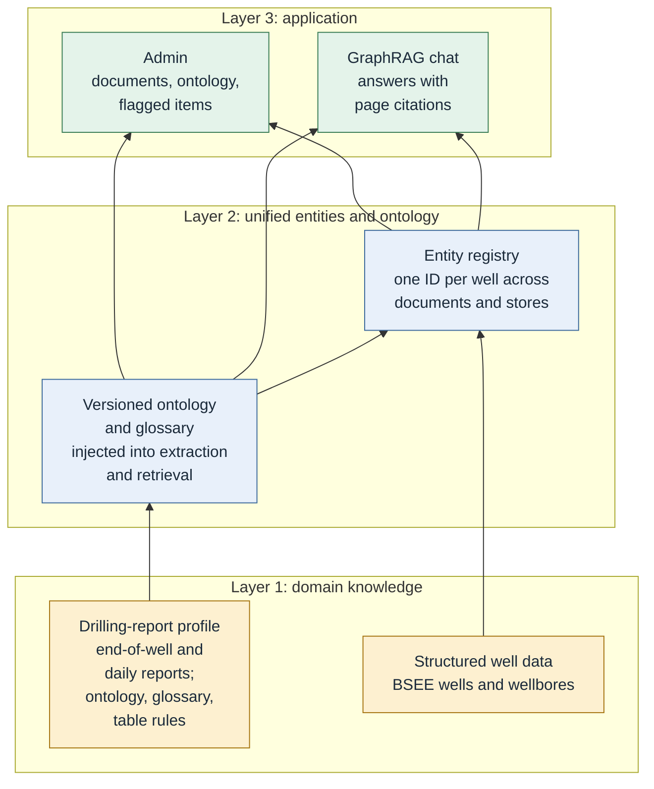

</details>

**Figure 9: Three layers in the capstone.** Drilling terminology and rules are profile inputs. The application layer is the full application: chat for end users, administration for the people who ingest and correct.

| Layer | Capstone delivers | Not in the capstone |
|---|---|---|
| 1. Domain knowledge | Everything in **drilling reports by document type** (D-40): end-of-well reports and daily drilling reports, including their geology sections at summary level. Structured well data (BSEE) for identity. | Other document families and other domains (optional later work) |
| 2. Unified entities and ontology | Entity registry with one ID per well across documents, datasets, vectors and graph; versioned ontology and glossary that the admin manages and the pipeline injects (§5.11, §6) | Formal ontology languages (OWL), automatic reasoning |
| 3. Applications | GraphRAG question answering with citations for end users; administration of documents, runs, ontology, glossary and flagged items (§2, §8) | Decision support, competing-hypothesis workflows, fine-tuning |

**Development data.** VPI will not supply datasets (D-33), so development uses public proxies ([Data sources](DATA_SOURCES.md)):

- the BSEE well files for well identity;
- public end-of-well reports, starting with Akutan AK-3;
- daily drilling reports, starting with the daily reports in the AK-3 appendix portfolio.

A public oil-and-gas daily-report collection for wells in a structured dataset is still to be found (§13.2 Q5). Work starts on **one document** (D-44): AK-3's end-of-well report, then one daily report. More documents come only after the result on one has been checked.

### 1.4 Meaning of "secure"

Secure means:

- document content and model inference stay inside an approved deployment boundary;
- no commercial model or API ever sees project data (D-37);
- users have authenticated, authorized access;
- changes and runs are auditable;
- backups exist.

During development the team uses hosted open-weight models through an API, **on public data only** (D-38, §10.1). That is a development convenience, not the deployment. The deployed system runs the same class of model locally. Local inference is necessary but not sufficient: access control, safe parsing and recovery are separate requirements.

### 1.5 First-release boundaries

| Included | Not included |
|---|---|
| English drilling-report PDFs: end-of-well and daily drilling reports, text and scanned pages | Vietnamese/Russian delivery; Office/email workflows; handwriting |
| VLM page parsing to Markdown/HTML, with tables as structured output; multi-page tables joined and headers carried over (§5.10) | Tuning classic OCR engines further |
| Existing open-source GraphRAG pipelines used as libraries and as references (D-36); none is adopted wholesale, because none beat the baseline on our questions (D-50) | Writing a general GraphRAG framework; training extraction models |
| Open-weight models of about 7B parameters or smaller for extraction, answering and parsing (D-37) | Commercial models or APIs; models above the size limit as the measured configuration |
| Object storage for raw files, a metadata database, a vector store and a graph database, linked by one ID scheme (§4.2, §5.11) | Multi-region storage, high availability |
| Admin-managed versioned ontology and glossary (abbreviations), injected into extraction and retrieval (§6) | AI-generated ontologies activated automatically |
| Entity registry seeded from BSEE; one ID per well across documents | Fuzzy automatic merges |
| Confidence score on every extracted item; low-score items flagged for people to correct in the UI (D-43) | Per-item approval of everything; automatic identity merges |
| End-user chat with page citations; graph and source browsing | Arbitrary analytics, open-ended Cypher from the model |
| One shared document-access boundary; login and roles before any private data | Per-document permissions, multi-tenancy |

### 1.6 Delivery order and success measures

**Delivery order (D-45).**

1. **Ingestion, made clear and demonstrable.** VLM parsing, table handling and chunking with IDs, shown on one end-of-well report and one daily report.
2. **Data organization.** Where raw files, parsed pages, chunks, metadata, vectors and the graph live, and how IDs link them.
3. **A thin GraphRAG slice on one document.** ontology injection, extraction, embeddings, graph, and cited answers to a few questions, checked by hand.
4. **Quality and control.** Glossary, entity linking across documents, confidence scores and flagged items, table extraction efficiency, and evaluation on the expert question set; then 5–10 documents.
5. **The full application.** Chat for end users, administration, governance features (versions, audit, corrections).
6. **Scale run** on a rented cloud GPU with a model we deploy ourselves (D-68); **access control** and hardening.

The plan maps steps 1–5 onto the first semester. Step 6 and improvements fall in the second (D-35).

**Success measures.**

- **Answer quality** on the question set the drilling expert group provides (§12).
- **Citation correctness:** the cited page supports the answer.
- **Table fidelity** on the table evaluation set (§5.10).
- **Cost:** LLM calls, tokens and GPU time per page.
- **Correction effort:** flagged items per document, and minutes per correction.

A pilot with intended users, if one can be arranged, measures task time against reading the PDFs directly. Targets are proposals until measured.

## 2. Users and workflows

### 2.1 Roles

| Role | Responsibilities |
|---|---|
| End user | Ask questions in the chat, read answers with citations, open the source page, browse a well's facts and documents, report a wrong answer |
| Administrator / knowledge engineer | Upload documents and start runs; manage ontology versions and the glossary; work through flagged items; confirm or reject identity merges; publish graph generations; retire documents |
| Operator | Model endpoints and rented GPU time (D-68), storage, backups, logs; access to content follows policy |

One person may hold several roles; actions still record which identity performed them.

### 2.2 Primary journeys

**Define the ontology and glossary.** An administrator uploads an ontology file or edits the active version:

- entity types;
- relation names with definitions and endpoint types;
- properties and units;
- per-document-type sections.

They also maintain a **glossary**: abbreviations (TD, BOP, WOC, ROP…) with expansions and term aliases. The application validates the ontology and shows the difference from the active version. Activating a version is recorded, and the next run uses it (§6).

**Ingest a document.** An administrator uploads a PDF and records its document type (end-of-well, daily drilling report), source and permission. Then:

1. The file goes to object storage under a file ID.
2. A VLM parses each page into Markdown/HTML with table structure.
3. Multi-page tables are joined, and chunks are built with parent/child IDs.
4. Entities and relations are extracted under the active ontology, embeddings are computed, and the graph is updated.

The run page shows page coverage, tables found, items extracted, items flagged, LLM calls and tokens.

**Correct flagged items.** Every extracted item has a score. The admin view lists low-score items and items with validation warnings, each beside its source page. The administrator accepts, corrects or rejects it; a correction is versioned and attributed. Possible duplicate entities, such as two spellings of one well, are listed for a person to merge or keep apart.

**Ask a question.** An end user asks, for example, "What was the casing setting depth of the surface section in AK-3?" or "Which days had non-productive time on AK-3, and why?" The coordinator reads the question and sends it to a lane (§8.1): the well's passages, its checked facts, its daily events, or the events around a problem. A total over time is computed by code; otherwise the model answers from the evidence it was given, with citations that code checks. Each citation opens the source page. If the context does not support an answer, the system says so.

**Reprocess.** When the parser, model, prompt or ontology changes, a new run produces a comparison (added, changed, removed items). The served graph changes only when the administrator activates the new generation.

**Import well data.** An administrator imports a BSEE snapshot. Its wells and wellbores seed the registry, so report mentions of those wells link to one ID.

### 2.3 Functional requirements

"Must" applies to the first-semester application; "Should" is planned but may be cut; "Later" is outside the baseline. IDs are stable, so FR-17 is unused.

| ID | Priority | Requirement | Observable outcome |
|---|---|---|---|
| FR-01 | Must | Register and verify source documents | File ID, hash, document type, metadata, permission and status; original stored immutably in object storage |
| FR-02 | Must | Parse documents with page provenance | Every chunk resolves to its file, version and physical page(s) |
| FR-03 | Must | Validate versioned ontologies | Invalid types, relation endpoints, units and duplicate names rejected before a run |
| FR-04 | Must | Extract locally into typed items under the ontology | Every item uses only declared types and relations, cites its chunk, or receives an explicit error |
| FR-05 | Must | Resolve entity names conservatively | Wells resolve by identifier or scoped name; uncertain matches go to a person; merges keep history |
| FR-06 | Must | Publish graph generations | A run never changes the served graph until its generation is checked and activated |
| FR-07 | Must | Browse facts and original evidence | A citation opens the correct file version and page |
| FR-08 | Must | Answer questions with GraphRAG and citations | Answers come from retrieved context only; every factual sentence cites a chunk; unsupported questions get an explicit "not found in the documents" |
| FR-09 | Must | Re-run, compare and roll back | A comparison report per re-run; the previous generation can be restored |
| FR-10 | Must | Roles and audit | Before any private data or shared deployment: login, roles, audited changes, server-side checks |
| FR-11 | Must | Retire documents | A retired document's chunks, vectors and graph items stop serving immediately |
| FR-12 | Should | Operate and recover | Backup and restore of all stores demonstrated once |
| FR-13 | Must | Report unsupported input honestly | Failed pages, unparsed tables and truncated content are visible per run |
| FR-14 | Later | More languages and document families | Separate scope and evaluation |
| FR-15 | Must | Import versioned structured well datasets with row provenance | Each record cites snapshot, file and row |
| FR-16 | Must | Shared entity registry | One opaque ID per well; dataset rows and report mentions link to it |
| FR-18 | Should | Language-tagged names and aliases | Aliases carry language and scope |
| FR-19 | Must | Manage the ontology in the admin application | Upload, edit, validate, diff and activate versions; re-run under a new version |
| FR-20 | Later | Draft an ontology with AI assistance | A draft is never active until a person edits and activates it |
| FR-21 | Must | Curate duplicates | Similar-entity search; merge, keep-apart and known-distinct decisions with history |
| FR-22 | Should | Resolve references within a document | "The well", "it" link to the named well in the same document, or the item is flagged |
| FR-23 | Must | Score every item and route low scores to people (D-43) | Each item has a score and its signals; items below the threshold or with warnings appear in the flagged list; corrections are versioned and attributed |
| FR-24 | Must | VLM page parsing | Pages are parsed by a configured VLM (or Docling) into Markdown/HTML; parser and model recorded per page |
| FR-25 | Must | Table handling | Tables keep row/column structure and merged cells; continuation pages are joined to their table with the header carried; rows never split mid-row; long rows handled without silent truncation (§5.10) |
| FR-26 | Must | Storage layout and ID linking | File → page → parent chunk → child chunk → vector point → graph evidence, one ID scheme across stores; a well has one ID across all documents (§5.11) |
| FR-27 | Must | Retrieval index | Child chunks embedded with a pinned embedding model; vector, keyword and graph retrieval combined (§8) |
| FR-28 | Must | Model endpoint configuration | Every LLM, VLM and embedding call goes through one OpenAI-compatible client; endpoint, model and version recorded per run; hosted endpoints refused for non-public documents (§10.1) |
| FR-29 | Must | Glossary and abbreviations | Admin-managed, versioned; used in name normalization, extraction prompts and query expansion |
| FR-30 | Must | Cost and volume accounting | Per run: LLM calls, input/output tokens, pages, GPU or API time, cost estimate |

## 3. Current implementation and evidence

### 3.1 What exists

Four parts exist: chunk packages read from the reports (Track A, `src/graph_builder/`), the GraphRAG engine with its four lanes and the coordinator (Track B, `graphrag/`), the stores (Track C, `platform/`), and the application. The application is a FastAPI backend and a React frontend that run as containers behind one shared password; the backend reads files or the stores (§4.6). What is done, what is left and the latest results are in the [plan](DEVELOPMENT_PLAN.md#current-status) and the [experiment register](experiments/README.md). How to run each part: [engine](../graphrag/README.md), [backend](../backend/README.md), [frontend](../frontend/README.md), [stores](../platform/README.md), [server](../deploy/README.md).

Guides and records:

- **Chunk packages:** [guide](components/corpus-ingestion.md), [Track A progress](experiments/TRACK_A_PROGRESS.md), K1 version 1 in [E30](experiments/E30-k1-version-1-candidate.md); earlier runs [E7](experiments/E7-corpus-pipeline-smoke.md), [E8](experiments/E8-ak3-appendices-corpus-run.md), [E11](experiments/E11-publication-and-import-fixes.md); the table-column correction [E56](experiments/E56-track-a-handoff-and-table-alignment.md) and the source-grid rule [E57](experiments/E57-track-a-source-grid-transfer.md). K1's optional features (off by default): joining tables across pages, section context, form recognition, label-value repair, page orientation, quarantine, resumable runs.
- **Structured-data import:** [guide](components/dataset-import.md), [E6](experiments/E6-generic-import-bsee.md).
- **Shared contracts:** [`contracts.py`](../src/graph_builder/contracts.py), [`schemas/`](../schemas/), [E12](experiments/E12-shared-evidence-contract.md).
- **Entity registry:** [guide](components/entity-registry.md), [E13](experiments/E13-entity-registry-bsee.md); it resolves by identifier or scoped name, never by similarity (§5.7).
- **Engine:** §8.4, [Track B log](tracks/B-graphrag/log.md), E14 to E31.
- **Stores:** [Track C log](tracks/C-storage/log.md), [platform/README.md](../platform/README.md).
- **Application:** [runbook](../deploy/README.md), Track B log B-C50 to B-C57.
- **Prototype:** [`prototype/`](../prototype/README.md), [E10](experiments/E10-profile-driven-prototype.md). It is the **baseline** the GraphRAG pipeline must match or beat on the same questions.

### 3.2 Evidence and limits

- The committed PDF bundle (three end-of-well reports) and the BSEE snapshot of 18 October 2026 are described in [E1](experiments/E1-pdf-ingestion-configuration.md) and [E3](experiments/E3-reproduction-run-2026-10-25.md); a test-suite run in [E11](experiments/E11-publication-and-import-fixes.md).
- Extraction and QA numbers are in-sample development results on one report.
- The first build's measurements cover daily reports and retrieval quality, on simulated questions only (§8.4). The whole path from the public PDFs to an answer in the application was run once on one machine, with the real model, on 25 November 2026 (Track B log B-F71); it is a check that the parts connect, not a score. No measurement covers VLM parsing.
- Every question set is simulated or written by the team with AI. None is expert-reviewed, and every method was tuned on one well and one report family.

### 3.3 Gaps the architecture must close

1. **One system.** The engine must read the stores, one command must run a report end to end, and one application must sit on top (§4.6). Progress: [plan](DEVELOPMENT_PLAN.md#current-status).
2. **Routing.** The coordinator that chooses the lane per question is built (§8.1). Until it is measured, the scores of §8.4 are those of lanes chosen by hand.
3. **Generalization.** Table rebuilding, forms and the event graph are tuned to AK-3's report family. Other authors' reports, scanned pages and tables over several pages are untested or fail (E29, Track A progress).
4. **Real questions.** No expert question set exists, and the purpose of use is still open (Q2, Q13). The application must collect the questions people ask (§4.6).
5. **Cross-document identity.** Report mentions are not linked to the registry, and a well's daily and end-of-well reports are linked only by a well name in the text.
6. **Human control.** Checks are automatic. Scores, flagged items and review by people are not built (D-43, D-63).
7. **Reliability and security.** Open findings from the repository review remain (cache identity, redirect checks; [E9](experiments/E9-repository-review.md)); login and roles are not built, and one shared password guards the application meanwhile (§4.6).

## 4. Target architecture

### 4.1 Components and trust boundary

The system is a modular Python backend with a separate ingestion worker, a web frontend, and model endpoints behind one client.

- Inside the backend, a **coordinator** reads each question and sends it to one or more **lanes** (D-58, D-64, §8.1). There are four lanes: passages from retrieval, facts from the per-well fact graph, a computed result from the event graph, and reasoning about causes (§8.6).
- Each lane is a function with a fixed input and output, so more lanes, outside tools or MCP connectors can be added later without changing the rest.
- Open-source GraphRAG code (D-36) is used as a library inside a lane or the worker, under the project's ID scheme and storage layout. It does not run as a separate product with its own storage rules.


<details>
<summary>Diagram source (Mermaid)</summary>

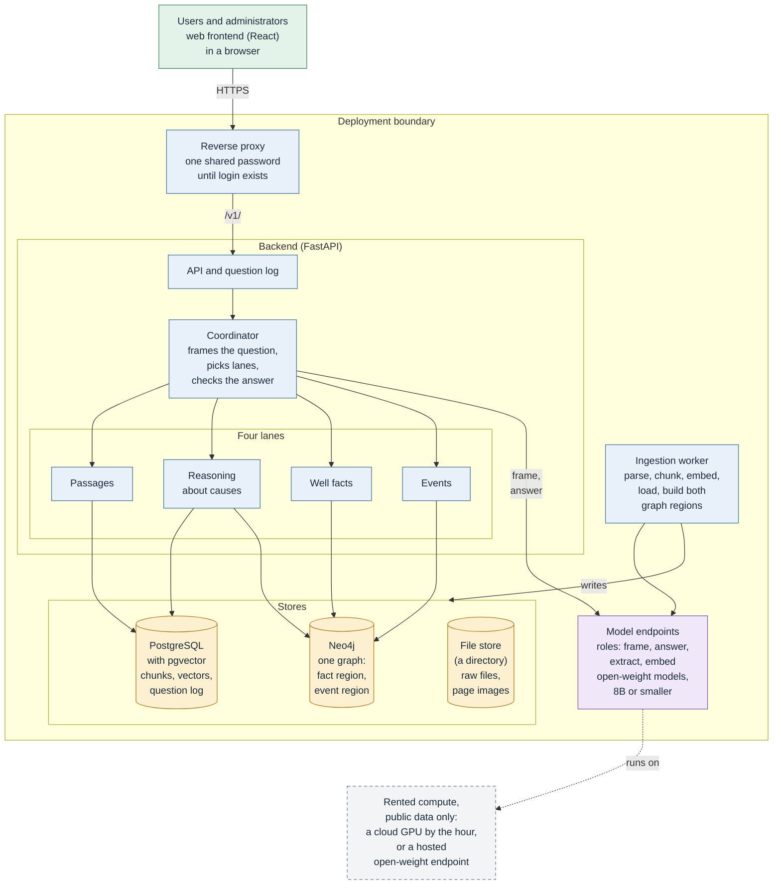

</details>

**Figure 2: Target components and stores.** Users never reach a database or model endpoint directly. The coordinator and lanes are drawn inside the backend; they are Track B's engine used as a library. Compute is rented, on public data only (D-68): a hosted open-weight API for development and the demo, a cloud GPU by the hour for measurements and large runs. The deployed system uses local models.

**Model roles (D-62).** Code names a role, not a model: `frame` (the coordinator's call), `answer`, `extract` and `embed`. [`configs/graphrag/roles.json`](../configs/graphrag/roles.json) maps each role to an endpoint and a model, and a deployment can name another file, so a stronger model replaces Qwen3-8B without a code change. Each run records the mapping it used.

### 4.2 Which store owns what

The supervisor asked for raw files, chunk/metadata and vectors to be designed as separate stores linked by IDs (D-42).

| Store | Owns | Rule |
|---|---|---|
| Object store (MinIO, S3-compatible; a plain directory in development) | Original files, page images, the parser's per-page output (Markdown/HTML and layout JSON), run artifacts | Write once under content-addressed keys; never overwrite; back up originals |
| PostgreSQL | File and page records, parent/child chunk records and text, table and form records, ID mappings, runs and their cost, the question log and feedback (§4.6), ontology and glossary versions, extracted items and scores, corrections, merges, generations, audit | System of record; anything else can be rebuilt from it plus the object store |
| Vector store: **pgvector inside the same PostgreSQL** (D-56) | One vector per child chunk and embedding model, with the chunk's well and report date copied beside it for filtering | Derived; rebuildable from the chunk records and the pinned embedding model. BM25 runs alongside it |
| Neo4j | The two graphs of §8.5: wells, facts, report days, events, codes, and `Chunk` nodes that hold only an ID | Derived; rebuildable; never the only copy of a correction. Chunk text and pages stay in PostgreSQL |

The object store is a plain directory until a second machine needs the files. What Track C has built is in §3.1 and the [plan](DEVELOPMENT_PLAN.md#current-status).

### 4.3 Runs and publication

Each run has an ID and pins:

- file versions;
- parser and VLM model;
- LLM and embedding model (endpoint, name, version);
- prompt templates;
- ontology and glossary versions;
- configuration.

Each graph build is a **generation**. The worker writes the generation's graph items and vectors, checks counts and that every item resolves to a chunk, then the administrator activates it. Readers pin one generation per answer. A failed or partial build never becomes active. The existing release mechanism ([E11](experiments/E11-publication-and-import-fixes.md)) and exact-set generation check carry over.

### 4.4 Core and domain-profile boundary

The core works on typed contracts and opaque IDs; drilling semantics enter through a versioned profile selected per run.

| Domain-agnostic core | Drilling-report profile and adapters |
|---|---|
| File registry, page parsing, chunking, ID scheme, storage | Document types (end-of-well, daily drilling report) and their section and table layouts |
| Entity registry, conservative resolution | Well/Wellbore types, API-number schemes, well-name scoping rules |
| Ontology loading, validation and injection; extraction runner | Entity and relation types, definitions, properties, units, glossary, extraction examples |
| Scoring, flagged items, corrections, generations | Score thresholds per item type |
| Retrieval, answer generation, citation checks | Example questions; table column mappings for known layouts |

The ontology belongs to whoever runs the system (D-29). The team writes the core and supplies the drilling-report profile as its test ontology. A synthetic second profile checks that no core code names a well type.

### 4.5 First build: three tracks joined by files

**The first build is closed.** It built the one-document slice in three tracks joined only by versioned files (D-48). Those files, K1 to K5, remain the interfaces between ingestion, engine and stores; K1 version 1 is the agreed chunk package (D-57). What each track did is in its [log](tracks/README.md); what it delivered is in §3.1.

- **Track A, ingestion and tables** (§5.1 stages 1–4, §5.10): produces K1.
- **Track B, GraphRAG engine and models** (§5.1 stages 5, 8 and 9, §5.3, §6.2, §8, §9): produces K4, from its own K2.
- **Track C, storage, IDs and the end-to-end run** (§4.2, §4.3, §5.11): the ID scheme, the contract schemas with validators, the stores, a loader from K1 and the runner.


<details>
<summary>Diagram source (Mermaid)</summary>

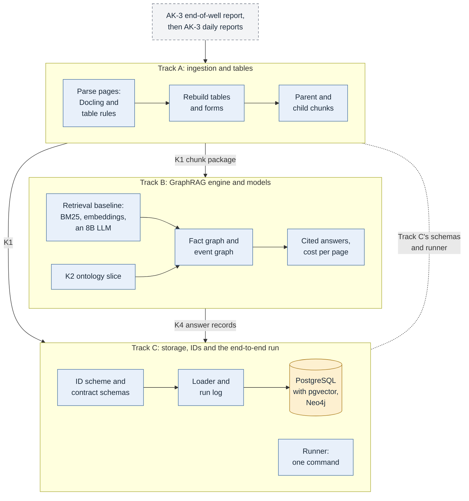

</details>

**Figure 10: First build.** Solid arrows are files. The dotted line is Track C's schemas and runner, used by every track.

| Contract | From → to | What it is now |
|---|---|---|
| **K1 Chunk package** | A → B, C | Version 1 (D-57): file, pages, tables, parent and child chunks |
| **K2 Ontology slice** | B (its own input) | Version 1.2, [`k2_eowr_v1.json`](../configs/ontology/k2_eowr_v1.json) |
| **K3 Question set** | Specialists → B | Question, gold answer, file and page; development sets until Q2 |
| **K4 Answer record** | B → C | Version 0.1, [`k4_answer_record.schema.json`](../schemas/k4_answer_record.schema.json) |
| **K5 Table gold** | A (its own input) | One CSV per labelled table, with file and page span |

- **K1** holds, per document: the file record (`file_id`, name, document type, page count); pages (`file_id:p<n>`, parser and model); tables (`file_id:t<n>`, page span, header, cells); parent and child chunks (§5.11 IDs, text, pages, table ID and row range). Version 0 chunks (`data/processed/gdr_chunks_full.jsonl`, [`corpus_chunk.schema.json`](../schemas/corpus_chunk.schema.json)) stay readable (§5.11).
- **K2** holds entity and relation types with definitions, properties with units, the document sections they apply to, short examples, glossary entries and table mappings, checked on unseen reports ([E29](experiments/E29-table-mappings-across-reports.md)). It started from [`prototype/profiles/oil_wells.json`](../prototype/profiles/oil_wells.json). No further ontology work is planned (D-52).
- **K3**, until the drilling expert group's set arrives (Q2), is development only: the prototype's 31 questions ([`prototype/gold/questions.json`](../prototype/gold/questions.json), `ak3_facts.json`) and labelled simulated sets in `graphrag/gold/` (Track B log B-D22), never reported as expert validation.
- **K4** carries the question ID, answer, cited child chunk IDs, base pipeline, models and versions, calls, tokens and cost. `graphrag/k4.py` writes it; records from the D-50 baseline are in [E26](experiments/E26-routing-and-strict-facts.md) and [E27](experiments/E27-date-filter-and-coverage.md).
- **K5** is [`data/gold/ingestion/tables/`](../data/gold/ingestion/tables/) (10 tables), with page annotations in [`data/gold/ingestion/pages/`](../data/gold/ingestion/pages/); extended only if Track A needs it.

Track C writes the contract schemas in `schemas/`, with validators. A track changes a contract only by publishing a new version. It announces the change in the group chat and keeps the previous version readable for one week. Each track measures its own work against the gold (K5, K3) and records each comparison as an experiment record.

**Domain depth is kept thin (D-49).** The ontology slice comes from what the reports themselves show: section headings, table column headers and the AK-3 abbreviation table. The domain-correct question set comes from the drilling expert group (Q2).

From the second build on, the work is split by data, backend and frontend (D-46, D-48; §4.6).

### 4.6 Second build: one connected application

The supervisor asked for the three parts connected behind a UI that domain experts can touch (D-60). The second build is that application: a FastAPI backend and a React frontend (D-65). It covers the **read path**: ask a question, see the answer, its sources and how it was reached. Uploading and administration come after it (plan M4).


<details>
<summary>Diagram source (Mermaid)</summary>

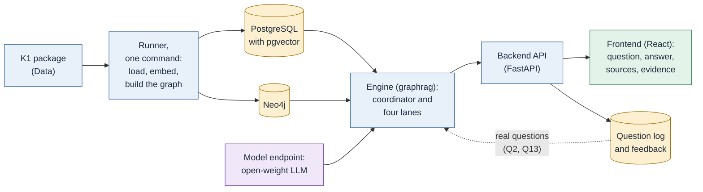

</details>

| Part | Role (D-46) | Content of the second build |
|---|---|---|
| Packages | Data | A K1 release for the demo set |
| Stores and runner | Backend | Shared stores; one command from a K1 package to checked stores |
| Engine | Engine (Track B's code) | Lanes behind one interface, reading the stores; the coordinator (§8.1); results computed by code reported by code; the reasoning probe (§8.6) |
| API | Backend | The read-path endpoints of §7.5, agreed as an OpenAPI file before either side codes against it |
| Frontend | Frontend | A question page for people who are not developers |

- **Packages:** AK-3's end-of-well report, its daily reports and its non-productive-time report, then 56-32 and 68-32. The legacy ID map ships with it. Which of K1's optional features (§3.1) are on is decided by measurement.
- **Stores and runner:** hosted where all three teammates reach them (Track B log B-D35). One command takes a K1 package to loaded chunks, vectors and both graphs, and checks each step.
- **Frontend** ([frontend/README.md](../frontend/README.md)): a question box with the exact-answer switch (D-59, shown as "Verified data only"); the answer with a label saying how far to trust it; its sources and evidence (the timeline of activities behind a total, the report text with the answer highlighted, the key facts); right or wrong marking; a guide.

**Where the code lives.** Folders keep their owners; nothing is moved now.

| Folder | Holds |
|---|---|
| `src/graph_builder/` | Ingestion and K1 packages |
| `graphrag/` | The engine: client, lanes, coordinator, answer checks. Imported by the backend as a library |
| `platform/` | Store scripts, SQL and the compose file. It stays a folder of scripts, because a package named `platform` would hide Python's own module (Track C log C-C02) |
| `backend/` | The FastAPI service |
| `frontend/` | The React application |

**The question log is a product of this build.** It stores every question asked, the lane chosen, the answer and any "wrong answer" mark. Shown to domain experts, the application then yields the real questions that Q2 and Q13 are waiting for. The log holds what users typed, so it stays inside the deployment boundary.

**Access.** The demo holds public data only. A shared host still needs a gate, so the reverse proxy asks for one shared password until login and roles exist (FR-10, plan M6). The demo's model is a hosted open-weight endpoint, on public data only (D-68, §10.1).

**When something fails (D-69).** One model server answers one question at a time, so the application is built around that limit and around not losing what people type.

| Situation | What happens |
|---|---|
| Several people ask at once | Questions take turns. A question waits at most a minute for its turn, and at most eight wait; beyond that the asker is told the system is busy and to try again shortly |
| The model hangs or is slow | A model call ends after a set time (75 seconds by default), so one stuck call cannot hold everyone up. The limits are ordered: model call, then the wait for a turn, then the browser's own limit, so nobody waits for an answer the server has given up on |
| The model or a store does not answer | The asker gets a plain message and a "Try again" button. The question is still written to the question log, marked as failed, with the kind of failure |
| The question log cannot be written | The answer is still returned; the failure goes to the server log |
| The model returns broken output | The reply is not kept, so asking again asks the model again |
| The server restarts | The stores and the application come back by themselves, in order: the stores first, then the backend once they answer |
| A hosted model is configured | The backend starts only if the loaded package is named as public in its settings (§10.1) |

Nothing is retried automatically, and no queue, cache service or streaming is added: at a handful of users they would cost more than they give. The limits and messages are in [backend/README.md](../backend/README.md#waiting-and-failures).

**Not in the second build:** upload through the UI, ontology and glossary editing, flagged items and corrections, generations, login and roles, VLM parsing.

## 5. Document-to-graph processing

### 5.1 Stages

| Stage | Input | Processing | Output / failure behavior |
|---|---|---|---|
| 1. Register | Uploaded file + document type | Check signature, size and page limits; hash; store the original in object storage; assign a file ID | File record; unsupported or corrupt files rejected with a reason |
| 2. Parse | File version + parser config | Render pages; a document VLM (or Docling) produces per-page Markdown/HTML with tables as structured cells; record parser and model per page (§5.10, FR-24) | Parsed pages in object storage; failed pages listed |
| 3. Assemble tables | Parsed pages | Join tables that continue across pages, carry the header to continuation rows, keep merged-cell spans, link each table to its pages | Table records with page spans |
| 4. Chunk | Parsed pages + tables | Parent chunks: sections and whole tables; child chunks: passages and row groups that fit the token budget, never splitting a row; header repeated in each table child (§5.11) | Parent/child chunk records with IDs and page provenance |
| 5. Extract | Child chunks + active ontology slice + glossary | The LLM extracts entities, relations and properties using only declared types; deterministic mapping for recognized table layouts; batching rows within the token budget (§5.3, §6.2) | Items with chunk citation, raw value, unit and score signals |
| 6. Validate and score | Items + ontology | Check types, endpoints, units and that the quoted value appears in the chunk; compute a score; warnings for anything odd | Valid items with scores; invalid items recorded with reasons |
| 7. Resolve | Entity mentions + registry + glossary | Normalize names and expand abbreviations; match identifiers and scoped names; suggest duplicates | Links to registry IDs, or flagged ambiguity |
| 8. Embed and index | Child chunks | Embed with the pinned embedding model; write points with ID payloads | Vector points |
| 9. Project and activate | Items, links, chunks | Build the Neo4j generation (entities, relations, chunk nodes, evidence links); check it; administrator activates | Active generation; failures leave the previous one serving |
| 10. Correct | Flagged items | People accept, correct or reject in the admin UI (§5.2) | Versioned corrections, applied in the next generation |

Dataset records skip stages 2–5 and 8. A versioned field mapping produces items with row evidence, approved per snapshot (D-14), and seeds the registry (§5.7).

### 5.2 Item lifecycle and review by exception


<details>
<summary>Diagram source (Mermaid)</summary>

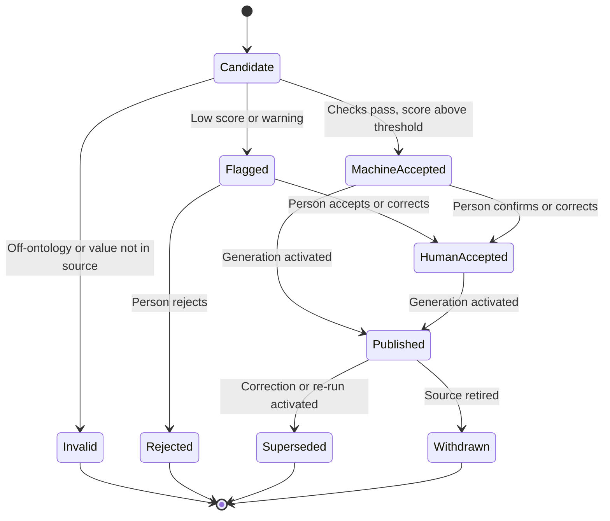

</details>

**Figure 3: Item lifecycle.** People review by exception (D-43). Items that pass validation with a score above the threshold are published, labelled machine-extracted. Flagged items wait for a person. Any published item can still be corrected from the UI; a correction creates a new version and keeps the old one.

**Score signals:**

- validation result;
- whether the value string occurs verbatim in the chunk;
- the extraction path (deterministic table mapping scores higher than free-text extraction);
- model self-check warnings;
- agreement between two extraction passes, if enabled;
- entity-resolution certainty.

The score is a ranking signal, not a calibrated probability. Set the threshold from the labelled sample (§12) so the precision of unflagged items meets the target; report the share of items flagged.

**Always a person:** identity merges, and items whose subject well cannot be resolved.

### 5.3 Extraction controls and LLM cost

**Inputs to the model.** The model receives only:

- the ontology slice for the document type and section (§6.2);
- the relevant glossary entries;
- the chunk;
- the output schema;
- the instructions.

Document text is untrusted: it cannot change the schema, call tools, or trigger queries. Output uses constrained JSON where the endpoint supports it, and is validated independently.

**Quantities.** Keep:

- the literal source value and unit;
- the normalized value only where a rule exists;
- the measurement kind (MD vs TVD), planned vs actual, and date or interval.

Missing values stay missing.

**Cost control (D-37, §3.3).** LLM extraction is the expensive part, in compute and in tokens, so:

- **Deterministic first for tables.** A daily-report table with recognized headers (date, depth from/to, hours, operation code, description) maps columns to ontology properties by a reviewed mapping, like the dataset importer. Only free-text cells (operation descriptions, remarks) go to the LLM.
- **Batch rows.** Send the header plus as many rows as fit the token budget in one call, not one call per row.
- **Token budgets, not characters.** Count tokens with the model's tokenizer; reserve room for the ontology slice and the output.
- **Long rows.** A row that does not fit is split at cell boundaries with the header repeated, or flagged as unprocessed. It is never silently truncated.
- **Account for every call** (FR-30): calls, tokens and cost per page are reported per run and compared across configurations.

### 5.4 Entity resolution and conflicts

Resolve a well by a stable identifier when available (API number), otherwise by its normalized name within its scope (project, field or operator), using glossary expansions. A string such as "AK-3" is not globally unique.

- Similarity only suggests duplicates; it never merges.
- Merges keep a reason, actor and history, and can be undone.
- Different values for the same property and context, for example two reports giving different depths, stay as separate items with their sources. An answer shows both.

### 5.5 Jobs, retries and reprocessing

Ingestion is a batch job per document, resumable per page and per stage. Stage outputs are keyed by input hash and the pinned versions in §4.3, so a retry does not duplicate items, and an unchanged page is not re-parsed or re-embedded. One generation build runs per workspace at a time. Large runs go to a cloud GPU rented by the hour (D-68, §11): the job must checkpoint, so it can stop at the end of a session and continue in the next.

### 5.6 Worked example using an existing passage

The AK-3 end-of-well report, physical page 2, "Executive Summary", begins:

> Akutan Well AK-3 well was drilled to a vertical depth of 1,955 feet in 27 days, in contrast to the planned 1,700 feet in 30 days, including rig-up and rig-down time.

1. The file is registered, and page 2 is parsed and stored. The paragraph becomes a child chunk under the "Executive Summary" parent, with IDs linking it to the file and page (§5.11).
2. Extraction, with the ontology slice for end-of-well executive summaries, proposes:
   - actual vertical depth 1,955 ft;
   - planned vertical depth 1,700 ft;
   - actual duration 27 days;
   - planned duration 30 days.

   Each item cites the chunk. "AK-3" resolves to its registry entry within the Akutan project.
3. Validation finds every value verbatim in the chunk. Whether "including rig-up and rig-down time" applies to both durations is unclear, so the self-check warns and the duration items are flagged.
4. The chunk is embedded. The graph gets `(Well AK-3)-[:HAS_DEPTH {kind: vertical, qualifier: actual}]`-style items plus a `MENTIONS` link from the chunk node.
5. "What vertical depth did AK-3 reach?" retrieves the chunk by vector and keyword search and the depth items through the graph. The model answers "1,955 ft (planned 1,700 ft)" and cites the chunk, which opens page 2. It must not call this measured depth.

### 5.7 Structured well data and the entity registry

The **entity registry** is layer 2: canonical entities with opaque IDs, profile-declared types, scoped identifiers and aliases, and merge history.

- **Registry entries from BSEE.** Each borehole defines a *Wellbore* keyed by its 12-digit API number; each group sharing the first 10 digits defines a *Well*. Previous API numbers and lease-scoped names are aliases. Implemented: 57,453 wellbores and 39,518 wells ([E13](experiments/E13-entity-registry-bsee.md)).
- **Report mentions** link to an entry only through an exact identifier or a scoped name. Wells outside the dataset, such as AK-3, get entries from report mentions, scoped by project.
- **Daily and end-of-well reports of one well** link through the same registry ID, so a question about the well can retrieve from both.

**Identity rules in BSEE.** API numbers are exact keys. Well names are never identities on their own: they repeat across leases and change between sidetracks. Name + sidetrack suffix + lease resolves 98.6% of wellbores; the rest go to a person ([E13](experiments/E13-entity-registry-bsee.md)). Block numbers compare without leading zeros. Depths stay in feet, and coordinates keep their datum.

**Dataset review (D-14).** A snapshot is reviewed as a unit (counts, warnings, difference from the previous snapshot), not row by row.

### 5.9 Builder controls: nodes, connections and curation

This section answers the supervisor's builder questions of 7 October: when two mentions are one node, which connections to make, and how a person corrects the machine.

| Kind of mention | Example | Becomes a node when |
|---|---|---|
| Listed entity | A well in the BSEE registry or a user's well list | Its identifier or scoped name matches; the registry entry is the node |
| Named entity | A rig, contractor or formation named in the text | It has a declared type and name, and matches no existing node |
| Referring expression | "the well", "it" | Never on its own; resolved to a named mention in the same document, otherwise flagged |

**Which connections are made.** An edge is created only when:

- its relation is declared in the active ontology;
- its endpoint types match the declaration;
- it is stated in a chunk or comes from a dataset mapping;
- it is not rejected.

Co-occurrence alone creates no edge. The `MENTIONS` link from a chunk to an entity is the exception: it records where an entity appears, not a domain relation.

**Curation tools.**

- Similar-entity search per type, with merge, keep-apart and known-distinct decisions.
- A list of relations whose type was removed from the ontology.
- The impact of an ontology change before activation.

**Relation normalization.** GraphRAG pipelines tend to produce many near-duplicate relation names, which is what made the larger LLM-built graph shown on 28 October hard to read. The extractor may only use declared relation names. Anything else is rejected, or mapped to a declared name through the glossary's relation aliases and recorded as such.

### 5.10 Tables in drilling reports

Tables carry most of the content of drilling reports and get their own evaluation (D-39, D-47).

**What makes them hard:**

- daily drilling reports are mostly tables;
- cells contain sentences;
- many cells are merged across rows or columns;
- one table can run for 3–4 pages, and its header appears only on the first;
- parsers may split one table into several, or misalign a row.

These are already seen in AK-3:

- its casing data comes out as two tables, and the abbreviation table has a misaligned last row;
- in the daily detail reports, the key–value header loses its pairing: the parsed text reads "Days On Location: 1700", where 1,700 ft is the proposed TD ([Data sources](DATA_SOURCES.md#daily-drilling-reports)).

Key–value forms are therefore part of the table problem.

**Parsing.** A document VLM converts each page to Markdown, or to HTML when the table has merged cells (Markdown cannot express spans). Docling's table model remains the baseline it must beat. The table evaluation set holds pages from end-of-well and daily reports, including merged cells, nested text and multi-page tables. Measure:

- cell-level accuracy;
- row and header correctness;
- merged-cell handling;
- correct joining of continued tables;
- seconds and tokens per page.

**Assembling multi-page tables.** A table that continues on the next page is detected when:

- the next page's first table has the same column count and compatible widths;
- no header row is repeated, or the header repeats verbatim;
- no section heading comes between the two.

Continued parts are joined into one table record with its page span, and the header is attached to every continuation row. Uncertain joins are flagged.

**Chunking tables.**

- The parent chunk is the whole table.
- Child chunks are groups of whole rows that fit the token budget, each with the header repeated (the current corpus pipeline already splits only between rows).
- For daily reports, the date and well from the report header are attached to every row group as context.
- A row that alone exceeds the budget is split at cell boundaries with the header repeated, or flagged (§5.3).

**Extracting from tables.** Known layouts map deterministically (§5.3); the LLM handles free-text cells; every item cites its table, row and page.

### 5.11 Identifiers and cross-store linking

The supervisor asked for an ID scheme that keeps every piece linked across files, stores and documents (D-42).

| Level | ID | Links to | Stored in |
|---|---|---|---|
| File | `file_id` = hash-based ID of the original bytes; `document_id` groups versions | Original object key; document type; metadata | PostgreSQL; object store |
| Page | `file_id:p<page>` | Page image and parsed output objects; parser and model | PostgreSQL; object store |
| Table | `file_id:t<n>` | Page span; header; merged-cell structure | PostgreSQL |
| Parent chunk | `file_id:s<n>` (section) or the table ID | Pages; section path; document type; well IDs | PostgreSQL; Neo4j `Chunk` node |
| Child chunk | `<parent_id>:c<n>` | Parent; pages; character span or row range; text | PostgreSQL; vector point ID; Neo4j `Chunk` node |
| Vector point | Child chunk ID | Payload: `file_id`, `document_id`, pages, `parent_id`, document type, well registry IDs, ontology and generation | Vector store |
| Entity | Opaque registry ID (for example from the API number) | Identifiers, scoped names, aliases | PostgreSQL registry; Neo4j node |
| Item (fact or relation) | Item ID and version | Subject/object entity IDs; child chunk ID and span or table row; run; score | PostgreSQL; Neo4j relationship properties |

The rules:

1. Every ID is derived or recorded at the stage that creates it and never reassigned.
2. Rechunking produces new child IDs under a new run; old citations keep resolving to their run.
3. From any vector hit, the system can reach its parent chunk, page, file and the entities it mentions; from any entity, every chunk and document that mentions it.
4. A page can be rebuilt as text from its child chunks in order, or directly from its stored parser output.

**The format in use (D-54).** K1 version 1 ([E30](experiments/E30-k1-version-1-candidate.md)) writes the IDs of the table above in this format:

| Level | Format | Example |
|---|---|---|
| File | `f` and the first 16 hex digits of the SHA-256 of the PDF bytes; `doc_id` is the document ID | `f62efbee00767a3e7` |
| Page | `<file_id>:p<n>` | `f62efbee00767a3e7:p1` |
| Table | `<file_id>:t<n>`; the corpus table ID stays as `logical_id` | `f62efbee00767a3e7:t3` |
| Parent | `<file_id>:s<n>` (section), `<file_id>:f<n>` (form) or the table ID | `f62efbee00767a3e7:s6` |
| Child chunk | `<parent_id>:c<n>` | `f62efbee00767a3e7:s6:c0` |

- K1 version 0 IDs (`<doc_id>#c<nnnn>`, tables `<doc_id>#t<nnn>`) stay valid for runs made on version 0.
- `export --legacy-chunks` maps them to the new IDs by text, and Track B's code reads both (Track B log B-C28).
- The rest of the first table, such as `document_id` grouping versions and vector payloads, is not built yet.

## 6. Ontology layer and domain modules

An ontology is the vocabulary the extractor may use: entity types, relation types with definitions, properties, units and rules. The glossary holds abbreviations and aliases. Both are versioned inputs from the user organization (D-29). The first release uses a JSON/YAML schema, not OWL.

### 6.1 Is there an ontology for the data?

The supervisor asked this on 28 October.

- **BSEE has no published ontology**, only record layouts. Its entity types and relations (wellbore, well, lease, block, operator, field) come from the team's mapping file ([`bsee_wells.mapping.json`](../configs/datasets/bsee_wells.mapping.json)).
- **The reports have none either.** The drilling-report ontology is **authored by the team**: assumed from the AK-3 report, the BSEE fields and the public well-engineering ontology for daily reports by Queiroz et al. ([related work](references.md)), with AI assistance, and checked against the source text.
- The prototype's [`oil_wells.json`](../prototype/profiles/oil_wells.json) holds 14 properties. K2 grew from it and is at version 1.2 ([`k2_eowr_v1.json`](../configs/ontology/k2_eowr_v1.json)): entity and relation types, properties with units, glossary entries and table mappings (§4.5). No further ontology work is planned (D-52).

A customer would replace it with their own ontology through the admin application.

### 6.2 Where the ontology enters, and how it is checked

| Stage | What is injected | How it is checked |
|---|---|---|
| Activation (admin) | The whole version | Schema validation: unknown units, missing definitions, bad endpoints, duplicates rejected; diff and impact against the active version |
| Chunk (stage 4) | Document-type sections and table layouts | Table mappings validated against the ontology's properties |
| Extract (stage 5) | An **ontology slice**: only the types and relations relevant to the document type and section, with definitions and two or three examples, plus matching glossary entries | Output schema generated from the slice; constrained decoding where available |
| Validate (stage 6) | Full type, relation and unit rules | Off-ontology items rejected or mapped through relation aliases, and counted |
| Project (stage 9) | Labels and relationship types | Graph uses only declared names; the generation check fails otherwise |
| Retrieve and answer (§8) | Relation names and definitions for graph expansion; glossary for query expansion | Only declared relations are traversed |

**Why slicing.** A large ontology does not fit the context of a ~7B model next to the chunk (the context-limit problem raised on 28 October). Slicing by document type and section keeps each request small. If a slice is still too large, extraction runs in passes over groups of types.

**Verification report per run.**

- Instances per declared type and relation; types that are never used point to an ontology or prompt problem.
- Off-ontology attempts by name (candidates for new relations or aliases).
- Rejection reasons.
- On the labelled sample: precision and recall per type.

### 6.3 Relation categories

| Category | Meaning | Status |
|---|---|---|
| Structural | Part of, located in, has component (well → wellbore → hole section → casing string) | Used |
| Temporal / activity | Daily operation on date, during section, at depth interval | Used for daily reports |
| Evidential | Item cites a chunk; chunk mentions entity | Used |
| Condition | Holds under stated conditions (planned vs actual, MD vs TVD) | Used, as item context |
| Causal | Caused, resulted in (for example a stuck pipe causing non-productive time) | Stored only when the report states it; no inference is stored. The reasoning lane (§8.6) may propose causes at answer time, labelled as possible and never written to the graph |
| Inheritance | Subtype of, between ontology types | Ontology level only |

### 6.4 Terms, abbreviations and languages

The glossary (FR-29) lists abbreviations and their expansions (TD = total depth, NPT = non-productive time, WOC = waiting on cement…), term aliases, and relation aliases. It is used in name normalization, in extraction prompts (relevant entries only), and to expand a user's question before retrieval. The AK-3 abbreviation table is the seed. Users extend the glossary in the admin UI. English first; names keep language tags (D-27).

### 6.5 Changes and new domains

Each run pins one ontology version. Activating a new version never relabels old data in place: a re-run produces a comparison, and the administrator activates the result. Another domain needs its own ontology, glossary, document types and evaluation. The synthetic second profile checks only that the core does not depend on drilling terms.

### 6.6 Example profile shape

This shape is illustrative. The file in use is K2, [`k2_eowr_v1.json`](../configs/ontology/k2_eowr_v1.json), which grew from [`prototype/profiles/oil_wells.json`](../prototype/profiles/oil_wells.json).

```yaml
profile: drilling_reports
version: "0.3"
language: en
document_types:
  end_of_well_report: {sections: [executive_summary, drilling_summary, casing, surveys, time_breakdown, geology, testing]}
  daily_drilling_report: {sections: [header, operations, mud, bit, personnel, remarks]}
entity_types: [Well, Wellbore, HoleSection, CasingString, Rig, Organization, Formation, DailyOperation]
relations:
  HAS_SECTION: {from: Wellbore, to: HoleSection, definition: "A hole section drilled in this wellbore"}
  SET_IN:      {from: CasingString, to: HoleSection, definition: "Casing run and set in this section"}
  ON_WELL:     {from: DailyOperation, to: Wellbore, definition: "The operation was performed on this wellbore"}
properties:
  total_vertical_depth: {subject: Wellbore, unit: ft, qualifiers: [planned, actual]}
  npt_hours:            {subject: DailyOperation, unit: h}
identifier_schemes:
  api12: {entity_type: Wellbore}
table_layouts:
  ddr_operations: {match_headers: [From, To, Hrs, Code, Description], map: {Hrs: duration_hours, Code: operation_code}, llm_columns: [Description]}
```

## 7. Data model and contracts

### 7.1 Source-to-answer model


<details>
<summary>Diagram source (Mermaid)</summary>

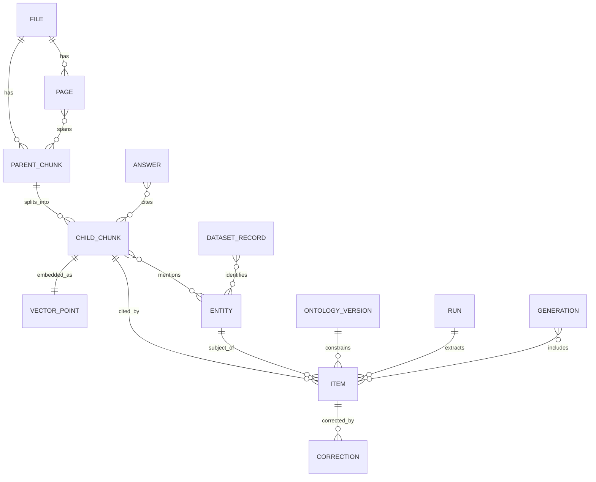

</details>

**Figure 4: Logical model.** Every vector point is a child chunk, and every item cites a child chunk or a dataset record. Entities are registry entries shared by all documents.

### 7.2 Existing artifact contracts

The committed GDR PDF bundle (`data/processed/`: `gdr_chunks.json`, `gdr_chunks_full.jsonl`, `gdr_tables.jsonl`, `documents/`) and the BSEE bundle (`boreholes.jsonl`, `wells.jsonl`, `api_changes.jsonl`) are described in [PDF ingestion](components/pdf-ingestion.md) and [BSEE ingestion](components/bsee-ingestion.md). Corpus outputs (`chunks.jsonl`, `tables.jsonl`, `text.txt`) are in [document ingestion](components/corpus-ingestion.md). They remain inputs and regression fixtures; new work writes the records in §7.3.

### 7.3 Application records

| Record | Required fields |
|---|---|
| File | `file_id`, `document_id`, hash, size, media type, object key, document type, source metadata, permission (public / private), status |
| Page | Page ID, file, number, size, image key, parser/VLM and version, parsed output key, status and warnings |
| Table | Table ID, file, page span, header, cells with spans, continuation joins and their certainty |
| Chunk | ID, parent ID or none, file, pages, span or row range, text, token count, section path, document type, well IDs, run |
| Item | ID and version, type, subject/object entity IDs or typed value, raw value and unit, qualifiers, cited chunk and span, run, score and signals, state (§5.2) |
| Correction | Actor, time, item version before and after, action, reason |
| Entity | Opaque ID, type, display name, identifiers by scheme, scoped aliases, merge history |
| Run | ID, inputs, parser/LLM/embedding endpoints and models, prompt, ontology and glossary versions, config, counts, calls, tokens, cost, status |
| Generation | ID, included item versions, ontology version, counts, completion marker, activation history |
| Answer | Request, user, generation, retrieved chunk IDs, answer text, citations, checks passed, model |

### 7.4 Evidence rules

Every published item cites at least one chunk (with span or table row) or a dataset row. A citation resolves to the exact file version and page. An automatic check proves only that the value occurs in the cited text, not that it means what the item says. People and the labelled sample check meaning. Table items need their header and row, not just a number on the page.

### 7.5 HTTP interface (design)

**Read path, built in the second build (§4.6).** The exact fields are fixed in [`backend/openapi.json`](../backend/openapi.json), generated from the code, with one example response per endpoint in [`backend/fixtures/`](../backend/fixtures/). How to run the service: [backend/README.md](../backend/README.md).

| Endpoint | Behavior |
|---|---|
| `POST /v1/questions` | Body: the question, `mode` (`exact` or `allow_fallback`, D-59) and an optional lane to force. Returns the answer or an explicit "not found"; the question frame and the lanes used; citations (chunk ID, file, page); the evidence (passages, facts, the query plan with its result and source events); the checks passed; calls, tokens and seconds. The question and its result are written to the question log |
| `POST /v1/questions/{id}/feedback` | Mark an answer right or wrong, with an optional comment |
| `GET /v1/chunks/{id}` | Text, section, file and page. Chunk IDs contain `#` or `:`, so a client percent-encodes them |
| `GET /v1/files`, `GET /v1/files/{id}/pages/{n}` | The loaded reports; one page as its chunks in reading order, with `image_url` when the page has been rendered |
| `GET /v1/files/{id}/pages/{n}/image` | The page as a PNG, rendered at load time by `platform/render_pages.py` ([backend design](tracks/C-storage/backend-design.md) §7) |
| `GET /v1/wells`, `GET /v1/wells/{id}` | The wells; one well's facts, documents and report days |
| `GET /v1/wells/{id}/events` | Events of a well between two dates |
| `GET /v1/health` | Whether the service is up, what it holds and which models the roles map to |
| `GET /v1/ready` | Whether a question could be answered now: asks the model endpoint and the question log. The monitor watches it (§11.4) |
| `GET /v1/admin/questions` and below | The question log, read-only: list with filters, one question, counts, and an export as a question file |

Every error has one shape: a sentence for a person, a code for a program (`busy`, `model_unavailable`, `store_unavailable`, `not_found`, `invalid_request`, `internal`) and the question's log ID when one was written.

**Write path and administration, later (plan M4).**

| Endpoint | Behavior |
|---|---|
| `POST /v1/files` | Upload with document type and permission; returns file ID and queued run |
| `GET /v1/runs/{id}` | Stage progress, page coverage, tables, items, flagged count, calls, tokens, cost |
| `GET /v1/flagged` | Flagged items with source chunk and page |
| `POST /v1/items/{id}/corrections` | Accept, correct or reject; stale version returns `409` |
| `GET/PUT /v1/ontology`, `/v1/glossary` | Versions, validation, diff, activation |
| `POST /v1/generations/{id}/activate` | Activate a checked generation |
| `POST /v1/files/{id}/retire` | Stop serving immediately; clean up vectors and graph items |

## 8. Question answering

QA is GraphRAG (D-36): a question is answered from text chunks and from two graphs, and an open-weight model of about 7B writes the answer from that evidence with citations. The shape of a graph has to match the questions asked of it (Track B log B-F47), so the design is not one retrieval recipe. It is a **coordinator** in front of **lanes**, each good at one kind of question (D-58, D-64).

§8.1 to §8.3, §8.5 and §8.6 are the design. §8.4 summarises what runs today and points to its scores.

### 8.1 The coordinator and its lanes

**Kinds of question.** This is the working list until the purpose of use is known (Q13).

| Kind | Example | Lanes used |
|---|---|---|
| Lookup in an end-of-well report | "What total depth did AK-3 reach?" | Well facts, then passages |
| Lookup by date in daily reports | "What was the mud weight on AK-3 on 20 August 2016?" | Passages of that well and date |
| Across wells | "Which of AK-3, 56-32 and 68-32 was drilled deepest?" | Well facts for each well, with passages per well |
| Over time | "How many hours of non-productive time did AK-3 have in August?" | Events |
| Reasoning about causes (D-61) | "AK-3 lost time on 2 September. What are the likely causes?" | Reasoning (§8.6), which calls events and passages |
| Anything else | | Passages; or "not found" |

**The lanes.** Each lane is a function: it takes the question and its frame, and returns evidence in one common shape. That shape is what makes a lane a tool that a later agent, or an MCP server, can call.

| Lane | Reads | Returns | Model calls |
|---|---|---|---|
| **Passages** | Chunks in PostgreSQL: BM25 over the documents that name the well; vectors fused in per well when several wells are named; only the pages of the date named, for daily reports | Ranked chunks with their IDs | 0 |
| **Well facts** | The fact region of the graph (§8.5) for the wells named | Validated facts, each with its chunk ID | 0 |
| **Events** | The event region of the graph (§8.5) | A query plan, its result computed by code, and the events it was computed from with their chunk IDs | 0 (the plan comes with the frame) |
| **Reasoning** (probe) | Events and passages around one problem event | Stated causes and possible causes, each with chunk IDs (§8.6) | 0 or 1 |

Evidence from every lane has the same fields: `passages`, `facts`, `computed` (plan, result, source events), the `lane` name, and `exact` (true for facts and computed results, false for passages).

**The steps.**

1. **Frame the question: one model call with a JSON schema.** It returns the kind of question, the report type (end-of-well, daily or both) and, for a question over time, the query plan for the event lane. Wells and dates are read by code, as today (`WellRouter`, `DateRouter`); what the code finds wins over what the model says. Later the registry and the glossary do this reading (§5.4, §6.4), and a name that matches several wells asks the user which one.
2. **Choose lanes in code,** from the table above. The model never chooses a tool freely and never writes a query that runs: a plan is JSON, checked against a schema, and code runs it (§10.2).
3. **Run the lanes** and merge their evidence, cut to the token budget. Every piece keeps its chunk ID.
4. **Fall back in a fixed order.** If a lane returns nothing (no fact for the property, a plan that cannot run), the passages lane runs instead.
5. **Answer: one model call,** from the evidence only (§8.3). A result computed by code is reported by code, with no answer call.
6. **Check in code** (§8.3), then write the answer record (K4) and the question log.

**Cost and adoption.**

- A question costs two model calls, the frame and the answer, or one when code reports a computed result (§8.3).
- With the lane chosen by hand, an end-of-well lookup costs one call and an event question two. The coordinator adds one call to lookups and saves one on event questions.
- Whether that call earns its cost is measured before it is adopted: all 221 existing development questions go in one pool with no lane given, and the coordinator must match the hand-routed scores (§8.4). Their source sets give the expected lane for free.

**The exact-answer switch (D-59).** With `mode: exact`, only evidence marked `exact` may support an answer, and step 4's fallback is off: if the graphs hold no answer, the reply is "not found in the graph", with the closest passages shown as sources but no generated answer. With `mode: allow_fallback`, the default, passages may support the answer and the reply says which kind of evidence it used.

**Later: an agent in one lane only.** The reasoning lane may need several steps: find the event, look around it, look again. If the fixed version of §8.6 proves too rigid, that lane alone becomes a loop in which the model picks among the other lanes as tools, with a step limit and read-only tools. Routing stays in code. A model of 8B is not assumed to manage a free tool loop until a run shows it.

**Not used.** Expanding through the graph by a fixed number of hops, and community summaries: the two ready-made pipelines that do this did not beat plain retrieval on our questions (E16, E19, E21).

### 8.2 Answer sequence

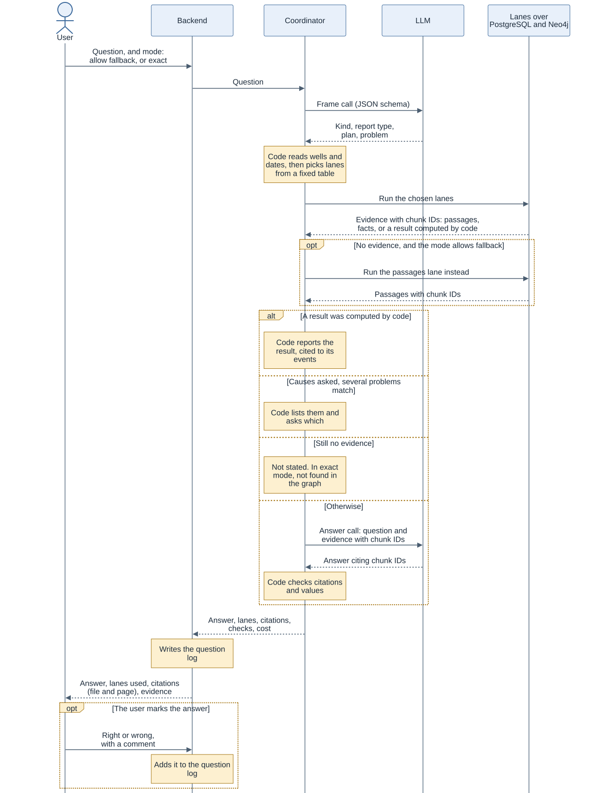

<details>
<summary>Diagram source (Mermaid)</summary>

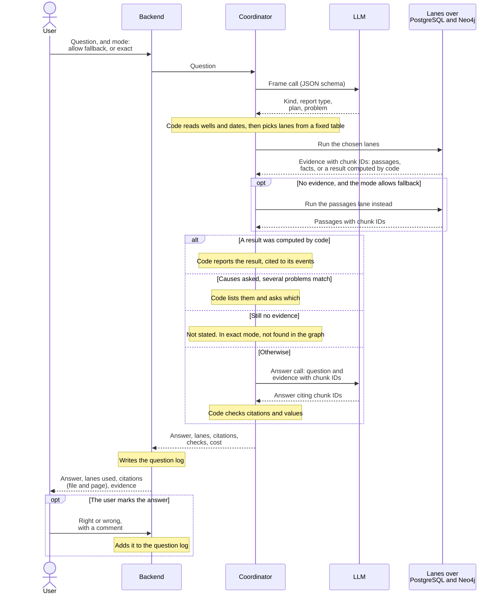

</details>

**Figure 5: Answer flow.** The model frames the question and writes the answer. Code reads wells and dates, chooses lanes, runs plans, and checks citations and numbers.

### 8.3 Answer rules

- The model answers only from the supplied evidence and cites chunk IDs. Every cited ID must be in the evidence, and every number in the answer must occur in a cited chunk or be a result computed by code, or the answer falls back to showing the sources without a generated answer.
- A result computed by code (a total, a count, a date from the event lane) is the answer as code wrote it, cited to the events it was computed from. No model call retypes it: retyping garbled right results in E28.
- The answer names the lanes it used. In `exact` mode it uses facts and computed results only (§8.1).
- A cause that no report states is labelled "possible", never stated as fact (§8.6).
- "Not found in the documents" is not "does not exist".
- When sources disagree, the answer gives both values with their sources.
- The E4 template answers for property lookups remain as the baseline. Run them on the same questions; if GraphRAG is worse on exact numeric lookups, the templates may serve those questions.
- Compare against a plain vector-RAG baseline (same chunks and model, no graph) to measure what the graph adds (SR-16).

### 8.4 What the first build runs today

Status and scores live in the [plan](DEVELOPMENT_PLAN.md#current-status) and the [experiment register](experiments/README.md). In short:

- The first build answers **questions over time on daily reports from a graph of events** (D-53), and other questions by retrieval routed by well and date (D-50). End-of-well questions also get validated facts from the per-well fact graph (D-55).
- The measured runs used K1 version 0 chunks; the event graph rebuilt from K1 version 1 has identical events ([E31](experiments/E31-event-graph-on-k1.md)).
- In the measured runs, which reports are asked about is chosen per run. **The `KIND` box below is what the coordinator's framing call replaces.** The coordinator (`graphrag/coordinator.py`, `graphrag/lanes.py`) was measured against these runs on one question set per lane (E33).
- All these questions are simulated or development questions.


<details>
<summary>Diagram source (Mermaid)</summary>

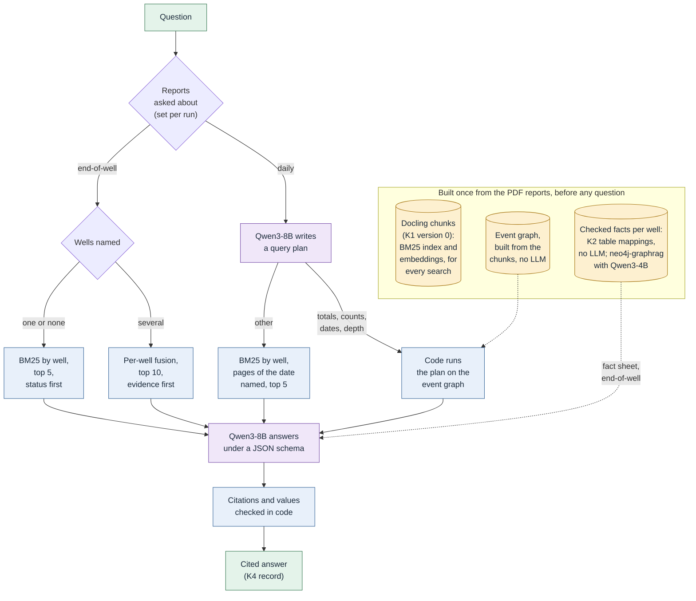

</details>

**Results.** On simulated totals-over-time questions the event graph beats retrieval; those questions were chosen to suit it ([E28](experiments/E28-event-graph.md)). On end-of-well lookups the fact sheet ties retrieval ([E26](experiments/E26-routing-and-strict-facts.md), [E27](experiments/E27-date-filter-and-coverage.md)).

**Reporting computed results in code (§8.3)** was checked by replaying E28's recorded plans without a model; it is not a run of the coordinator ([E28, addendum](experiments/E28-event-graph.md#addendum-24-november-2026-results-reported-by-code), Track B log B-F61).

**Cost.** Retrieval needs no LLM call at index time and one per question; the event graph needs none to build and two per question; the fact graph's LLM extraction adds calls per page at index time ([E23](experiments/E23-simulated-set.md)), and its table mappings need none. Numbers: [Track B log](tracks/B-graphrag/log.md) and the experiments above.

**Known gaps** are tracked in the plan. Three shape the design:

- comparison questions across end-of-well reports fail so far ([E26](experiments/E26-routing-and-strict-facts.md)), and table mappings beyond casing are unreliable ([E29](experiments/E29-table-mappings-across-reports.md));
- a name in a question counts as a well only if the engine holds that well, because the pattern for well names also matches a date range or a tool name (Track B log B-C43);
- the fact graph holds facts about wells the AK-3 report only describes, and one casing string may be a hole size (B-F60).

### 8.5 The graph: nodes and relationships

The supervisor asked for the node and relationship logic to be stated clearly (9 November). There is **one graph with two regions**, joined at `Well` and `Chunk`. No model call writes to the event region; the fact region is written by table mappings and by LLM extraction, and only after the checks of `graphrag/validate.py`.


<details>
<summary>Diagram source (Mermaid)</summary>

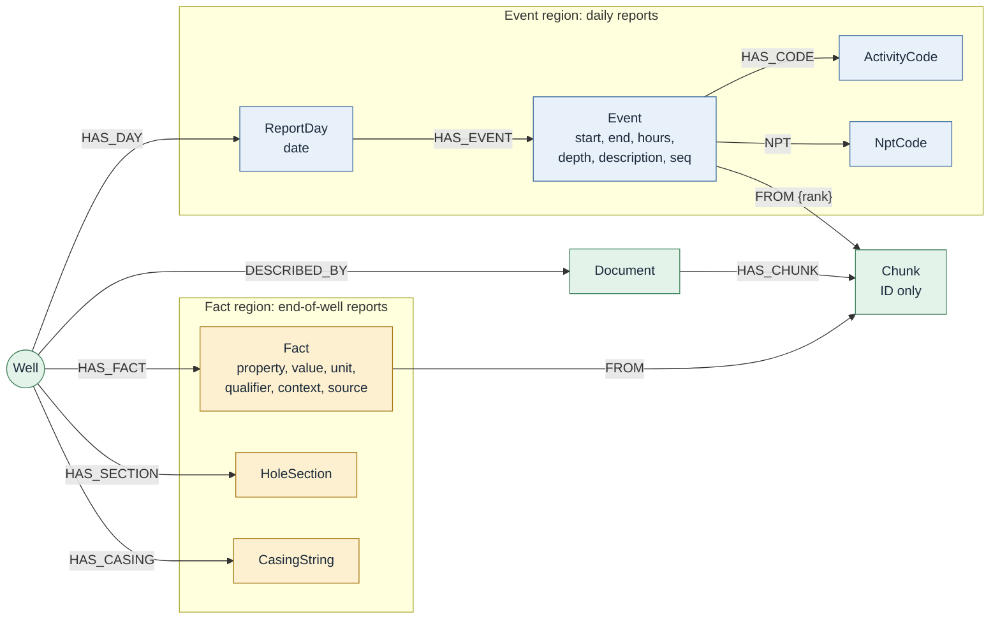

</details>

| Node | Key | Properties | Written by |
|---|---|---|---|
| `Well` | Registry ID when linked, else the scoped name | Name, aliases | Both regions |
| `Document` | File ID (D-54) | Document type, report date if a daily report | The loader, from K1 |
| `Chunk` | Chunk ID (D-54) | None. Text and page stay in PostgreSQL | The loader, from K1 |
| `Fact` | Well, property, qualifier, context | Value, unit, qualifier (planned or actual), context (for example the casing size a depth belongs to), source (`table_mapping` or `llm`) | `graphrag/tables.py` (no model call) and LLM extraction, both validated |
| `HoleSection`, `CasingString` | Well and size | Hole size; casing size, weight, grade, setting depth | Table mappings (E29) |
| `ReportDay` | Well and date | Date | `graphrag/events.py`, no model call |
| `Event` | Well, date and order in the day | Start, end, hours, end depth, description, `seq` | The same |
| `ActivityCode`, `NptCode` | Code | Code | The same |

| Relationship | Meaning |
|---|---|
| `(Well)-[:HAS_FACT]->(Fact)` | A value the reports state about the well |
| `(Well)-[:HAS_SECTION]->(HoleSection)`, `(Well)-[:HAS_CASING]->(CasingString)` | The well's hole sections and its casing strings. Which casing was set in which hole (`CASED_WITH`) is not written yet: no fact states it today |
| `(Well)-[:HAS_DAY]->(ReportDay)-[:HAS_EVENT]->(Event)` | One row of a day's operations table |
| `(Event)-[:HAS_CODE]->(ActivityCode)`, `(Event)-[:NPT]->(NptCode)` | The activity; the non-productive code when the report marks one |
| `(Fact)-[:FROM]->(Chunk)`, `(Event)-[:FROM {rank}]->(Chunk)` | Where it was read. Every fact and event has at least one |
| `(Well)-[:DESCRIBED_BY]->(Document)-[:HAS_CHUNK]->(Chunk)` | Which reports cover a well. This is what links a well's daily reports to its end-of-well report |

**Why a fact is a node.** One well can have several values for one property (planned and actual, two reports that disagree), and each needs its own source. So a fact is a node, not a property on `Well`.

**Where the regions live.** The event region is in Neo4j as Track C loaded it (Track C log C-C11). The fact region's layout is agreed with Track C (D-67); `graphrag/factgraph.py` writes it as a file of nodes and relationships, and `platform/load_facts_neo4j.py` loads it beside the event region (Track C log C-C12, C-F09).md). Progress: [plan](DEVELOPMENT_PLAN.md#current-status).

**Kept thin (D-49, D-52).** K2 declares more than this: `Project`, `Organization`, `Person`, `Rig`, `Formation` and relations such as `OPERATED_BY` and `MONITORS`. They are added when a kind of question needs them, such as questions about people or about one well monitoring another, not before. A stated cause may be stored as a relationship between events; an inferred one is never stored (§6.3).

### 8.6 Reasoning about causes (a probe: measured once, not ready to show)

The supervisor's question type (D-61): a drilling problem happened at some point in the well; what are the likely causes? An experienced engineer sees which part of the drilling process is involved, reads the related documents, forms a judgement, and checks it. The lane follows the same order, with code doing the gathering.

1. **Find the problem.** From the frame: a date, a depth, a non-productive code, or words such as "stuck" or "lost circulation". The lane finds the matching events in the event region. If several match, the answer lists them and asks which. Code checks the model's fields first: the day, the depth and the keywords are kept only where the question says them; a day read from the question outranks a code the model chose; a code the reports do not use as a non-productive code is read as a word.
2. **Gather what surrounds it, in code.** The events of the days before and after it; the depth and activity at the time; the non-productive report's own description of the event; the passages of the same day's reports (mud, remarks); and the end-of-well report's passages that mention the problem.
3. **Answer in two parts.** *Stated in the reports:* what a report gives as the cause, with citations. *Possible, not stated:* other factors visible in the evidence, each with its citation and labelled as a possibility. A cause with no citation is not allowed. Code decides the first part: a stated cause must rest on a clause in which the report gives a reason ("due to", "because", "waiting on", "unable"), once per clause, and not on something written after the day asked about. Anything else the model lists as stated is shown as a possible factor.
4. **Say what is missing.** The answer lists the kinds of evidence a real judgement needs and the reports do not hold.

**Implementation.** `graphrag/reasoning.py` is a fourth lane (Track B log B-C51).

- The frame's kind is `cause` and carries a `problem` (date, depth, non-productive code, keywords).
- The answer status `ask_which` covers step 1's "asks which".
- Code removes a cause whose citation is not among the evidence shown.
- Open: exact mode still runs this lane and only hides the possible causes, though a stated cause rests on a passage and the model's reading. Whether that fits D-59 is to decide.

**The probe and its first result ([E34](experiments/E34-reasoning-probe.md)).** Two sets of ten questions on AK-3, simulated and not expert-reviewed: the first frozen before any run, the second written after the first run's fixes and before any run on it. Each answer is scored on whether the cause the reports state is found and cited, and whether anything else is stated as fact.

- **It does the part it was built for:** when the lane reached the right problem, Qwen3-8B named the stated cause and quoted the report's words for it.
- **It over-states:** the model also lists things that happened nearby as stated causes, each with a true quote. The code rules of step 3 remove about half of these. What remains is a true reason for a neighbouring event of the same incident.
- **The model's fields about the problem cannot be trusted as written:** hence the checks of step 1.
- **So it stays a probe (D-66):** not shown to anyone as a finding. A smaller unit for "the problem" is built (the activities the question names on the day asked about, not a whole incident) and is to be scored on the second probe. Then an expert's reading of ten answers, and a question set written by someone else.

**What the data cannot support.** One well's daily and end-of-well reports hold what happened and, sometimes, what the crew wrote about why. They do not hold offset wells, formation pressures, drilling parameters sampled over time, or lessons-learned reports. The supervisor expected the data to fall short (9 November). The probe's purpose is to show the supervisor a concrete answer, so the expert group can say what a useful one would need. A larger public set of daily reports is still to be found (Q5).

## 9. Technology choices and alternatives

Everything not yet in the repository is a proposal. Pin exact versions and licenses when adopting.

| Area | Choice | Status |
|---|---|---|
| Language | Python 3.12 | Existing |
| GraphRAG base (D-36) | No base adopted wholesale (D-50); libraries used inside lanes | Open until the expert question set (Q3) |
| LLM (D-37) | Open-weight instruction models, **about 7B or smaller** | **Answer model: Qwen3-8B, thinking off** ([E17](experiments/E17-model-sweep.md)) |
| Page parsing (D-39) | Document VLMs of about 7B or smaller, against Docling's table model | Proposed; selected in M1 (Track A) |
| Existing parser | Docling + pypdf; corpus pipeline with per-page OCR (VietOCR/RapidOCR) | Existing; Docling is the baseline |
| Embeddings | Open embedding models; optionally a reranker | Qwen3-Embedding-0.6B, in fusion for several wells (E26) |
| Model client (FR-28) | One OpenAI-compatible client for LLM, VLM and embeddings | Exists (`graphrag/client.py`), with model roles (D-62) |
| Coordinator (D-58, D-64) | Our own: one framing call with a JSON schema, then lanes chosen in code (§8.1) | Built (`graphrag/coordinator.py`, `graphrag/lanes.py`); measured on one team-written question set per lane: 101/119 against 87/119 hand-routed, at the same number of calls (E33) |
| Object store | MinIO (S3 API); a local directory behind the same interface in development | Optional in Track C's compose file; a directory in use |
| Metadata DB | PostgreSQL 16 | Exists: K1 tables and loader (Track C) |
| Vector store | **pgvector inside the PostgreSQL that holds K1** (D-56) | Chosen |
| Graph DB | Neo4j Community 5.26, no plugin | Exists: both regions loaded and checked (Track C log C-F09) |
| Backend | FastAPI 0.165 + Pydantic 2, importing `graphrag` as a library | Read path built (`backend/`) |
| Frontend | React 19 + TypeScript, built with Vite | Built (`frontend/`) |
| Packaging | Docker Compose | The stores, backend, frontend and password proxy run as containers |

- **GraphRAG base.** Compared on one document among the candidates below; none beats the D-50 baseline on these questions (E16 to E28). Our own thin event graph handles questions over time on daily reports (D-53). neo4j-graphrag is an optional extractor for the fact graph (D-51); LightRAG with K2 (E21) is the candidate for document, project and people structure. [Track B survey](tracks/B-graphrag/survey.md).
- **LLM.** Candidates such as Qwen3-4B-Instruct-2507, Qwen3-8B and Qwen2.5-3B (prototype); 8B models count as about 7B (Track B log B-D06). Measure JSON compliance, extraction precision and recall, answer quality, tokens per page. Qwen3-4B came second; Qwen2.5-7B and Llama-3.1-8B abstain under a JSON schema and are dropped (D-50).
- **Page parsing.** Compared on the table set: e.g. granite-docling / SmolDocling (inside Docling's VLM pipeline), PaddleOCR-VL, MinerU, olmOCR, Qwen2.5-VL-3B/7B. The OCR engines of the existing parser are kept only for reproduction.
- **Embeddings.** Candidates: BAAI bge-m3, Qwen3-Embedding-0.6B, nomic-embed-text; reranker bge-reranker-v2-m3. BM25 routed by well serves one-well questions ([E18](experiments/E18-well-routing.md)). Other embedding models are compared once questions need them.
- **Model client.** JSON-schema output, request cache, cost ledger, private-data guard. [`configs/graphrag/roles.json`](../configs/graphrag/roles.json) names the model for the frame, answer, extract and embed roles; a deployment can name other files (§4.1). Measurements and large runs: our own copy of the model with llama.cpp on a rented cloud GPU. Development and the demo: hosted open-weight models (OpenRouter). Both on public data only (D-68). Deployment: local serving with vLLM or llama.cpp.
- **Coordinator.** No agent framework: a fixed router needs none, and the lanes keep one interface so one can be wrapped later. Tested with stand-in models.
- **Vector store.** Proposed by Track C; Neo4j's index stays the alternative if retrieval moves next to the graphs.
- **Backend** ([backend design](tracks/C-storage/backend-design.md)). It reads files or the stores. The prototype's API and Track B's standard-library UI server are not carried over.
- **Frontend.** Types generated from the API's contract; plain language for non-developers, with a guide and explanations on hover. Track B's local UI (`graphrag/ui.html`) stays as a developer tool for replaying recorded runs.

**Criteria for the GraphRAG base:** works with an OpenAI-compatible endpoint and a ~7B model; accepts a schema and lets us inject an ontology slice; keeps chunk provenance; uses Neo4j or allows it; extraction calls and tokens per page; license; maintenance. Candidates compared:

- [neo4j-graphrag-python](https://github.com/neo4j/neo4j-graphrag-python): schema-guided KG builder, Neo4j-native, vector and hybrid retrievers;
- [LightRAG](https://github.com/HKUDS/LightRAG): light, graph + vector retrieval;
- [Microsoft GraphRAG](https://github.com/microsoft/graphrag): community summaries; heavy LLM use;
- LlamaIndex property graphs: schema-constrained extractors.

**Not used:**

- commercial LLM or embedding APIs (OpenAI, Gemini, Claude…), for development or deployment (D-37);
- fine-tuning;
- custom-trained NER or relation-extraction models (D-36);
- Kubernetes;
- multi-GPU serving in the baseline.

## 10. Security and data boundaries

### 10.1 Model and data boundary

| Data | Where models may run |
|---|---|
| Public documents (GDR reports, BSEE, other public drilling reports) | Hosted open-weight model APIs (OpenRouter or similar) for development and testing; local models |
| Any non-public document (a VPI document, the supervisor's evaluation document) | Local models inside the approved boundary only |
| Any data | Never a commercial model or API |

Two checks enforce this rule. The model client refuses to send content marked non-public to a hosted endpoint. K1 packages carry no such mark yet, so the backend adds a check at start: with a hosted endpoint in its roles, it runs only on packages a person has named as public in its settings, and refuses to start otherwise (D-69). An address outside the machine and its private network counts as hosted whatever the settings say. When files carry a permission field (plan M6), the field replaces the list. OpenRouter forwards requests to third-party providers. Even for public data, choose providers that do not retain or train on prompts where the option exists. Record the provider in the run.

### 10.2 Threats and controls

| Threat | Control |
|---|---|
| Private content sent to a hosted endpoint | Permission-aware model client; test that a private file cannot reach a hosted endpoint |
| Malicious or oversized PDF | Size and page limits; parsing in a separate process with time limits |
| Prompt injection in a document | Documents are data; the model has no tools; outputs validated; answers checked against citations |
| Query injection | Retrieval and graph expansion use fixed, parameterized queries; the model never writes Cypher that runs |
| Unauthorized access or edits | Login and roles before private data or shared deployment (D-45); server-side checks |
| Tampered sources or models | Hashes for files, snapshots and model weights; pinned versions |
| Lost or partial publication | Generations activated only after checks; previous generation kept |
| Retired document still answering | Retirement filters vectors, chunks and graph items at query time immediately, then cleans up |
| Sensitive content in logs | Logs carry IDs and reasons, not document text |
| Oversized or flooding requests | The proxy refuses request bodies over 64 kB; a question is at most 500 characters; waiting questions are capped (§4.6) |
| The shared password guessed | A long random password over HTTPS; it guards public data only, and login replaces it before any private data (D-45) |
| Script or frame injection in the browser | The proxy sends a content security policy that allows only the application's own files, and forbids framing |

### 10.3 Retention

Retirement stops serving at once. Purging removes originals and derived chunks, vectors and graph items after the agreed period. Restores re-apply retirements. The durations are placeholders until agreed with the institution.

## 11. Deployment, capacity, and operations

### 11.1 Hardware baseline

| Use | Compute | Notes |
|---|---|---|
| Daily development, one-document runs | Hosted open-weight models through an API (D-38); students' laptops for code, tests, Docling and the stores | Cost is small (about US$5–10 goes a long way, per the supervisor); the supervisor supports it; track spend per run |
| Measurements, experiments and large runs (hundreds to thousands of pages) | **A cloud GPU rented by the hour** (one 24 GB card), running our own copy of the model (D-68). The school's GPU machines are not planned on (D-68) | Runs must checkpoint and resume; model files are kept on a rented disk between sessions; the machine is switched off after each session; public data only |
| Deployment target | One GPU that serves a ~7B model locally (a 16 GB-class card fits a 7B model in 4-bit, or 8B with limits) | The size limit (D-37) keeps the deployment hardware realistic |

A laptop without a usable GPU runs only a 3B model, far too slowly for full-corpus extraction ([E10](experiments/E10-profile-driven-prototype.md)). So development uses hosted models.

### 11.2 Throughput and cost tracking

Every run reports pages, tables, chunks, LLM calls, input/output tokens, VLM seconds per page, embedding time, and API cost or GPU time (FR-30). Before a large run, extrapolate from the one-document runs: tokens per page × pages × price, or GPU-seconds per page × pages against the hours rented (D-68). Targets for answer latency (for example 30 seconds at the 95th percentile on the deployment GPU) are set after the first measurements.

### 11.3 Environments

| Environment | Content |
|---|---|
| Development | Laptops plus Docker Compose (PostgreSQL with pgvector, Neo4j, optional MinIO), hosted model endpoints, public data |
| GPU runs | A rented cloud GPU: local model server (vLLM or llama.cpp), the worker and the stores, or the worker pointed at them |
| Demonstration | Compose on one rented cloud server, a hosted open-weight model, public data (D-68) |

### 11.4 Operating the demonstration

The demonstration serves a handful of experts on one small server. It needs little, but it must not fail silently, and it must not lose the question log: the questions experts type are the one thing in the system that cannot be rebuilt (D-65).

| Need | How it is met |
|---|---|
| Know that it is down before an expert says so | A script on another machine runs the quick smoke test every five minutes against `GET /v1/ready` and posts to the group chat when the state changes (`deploy/watch.sh`) |
| Know how it is doing | Each question writes one line to the server log; `python -m backend.questions stats` gives seconds per question (median and 95th percentile), model calls and tokens per question, the share of errors, of "not found" and of fallbacks, and the wait for the model |
| Keep the question log | A nightly PostgreSQL dump, copied off the server by the same job; a restore check that loads a dump into a throwaway database (`platform/server/`) |
| Survive a restart | Restart policies and health checks in the compose file; the backend starts only when the stores answer |
| Fit a small server | Memory limits per service; Neo4j runs with a small heap, since the graph is small and is read once at start |
| Load a new package | Run the runner, then restart the backend, which reads its data at start. A few seconds without answers is accepted at this size |

**What breaks first as use grows.** The one model slot: about four questions a minute at best, against a burst of fifty users. After that, the engine held in memory and its scans over all chunks, then exact vector search without an index. None of these is designed for now; they are named so the first sign is recognised.

Production operations beyond this (an operator, restore drills on a schedule, RPO and RTO targets) are second-semester work. They are required only if the system will hold private data or serve users beyond the team.

## 12. Quality and acceptance

### 12.1 What each evaluation shows

| Evaluation | Shows | Does not show |
|---|---|---|
| Table evaluation (§5.10) | Parser and joiner fidelity on drilling tables | Correct extraction |
| Extraction sample | Items match labelled facts per type | Answers are right |
| Retrieval | The right chunks are retrieved for each question | The answer is worded correctly |
| QA on the expert question set | Answers are correct and cited | Arbitrary questions work |
| Cost report | Calls, tokens and time per page | Quality |

### 12.2 Proposed release gates

The **question set** comes from the drilling expert group the supervisor contacted (§13.2 Q2). Until it arrives, the team writes development questions, labelled as such. Freeze a held-out set before tuning. Evaluate first on one document, then on 5–10.

| Gate | Proposed minimum |
|---|---|
| G1: Provenance and IDs | 100% of chunks, vector points and items resolve to file, page and parent; no orphan IDs across stores |
| G2: Ingestion and tables | No silently missing pages; on the table set, cell accuracy and multi-page joins reported per parser; the chosen parser beats Docling, or Docling stays |
| G3: Extraction | Labelled sample across both document types: precision ≥ 90% for unflagged items, recall reported per type; flagged share reported |
| G4: Identity | No wrong automatic merge in the labelled identity cases; daily and end-of-well reports of one well linked to one ID |
| G5: QA | On the held-out expert questions: correct and supported answers ≥ 80% (target to confirm with the supervisor); correct "not found" on unanswerable questions ≥ 90%; compared with plain vector RAG and the E4 templates |
| G6: Citations | Every factual sentence cites a chunk; ≥ 95% of citations support the sentence (human-judged sample); no number absent from its cited chunk |
| G7: Boundary and access | A private file cannot reach a hosted endpoint; login and roles in place before private data |
| G8: Cost | Calls, tokens and time per page reported for the configuration used; a full-corpus estimate made before the large run |

The thresholds are proposals for a student project. Report sample sizes. If a gate is missed, narrow the scope and record the decision rather than relabelling the result.

## 13. Decisions, assumptions, and change control

### 13.1 Decision register

**Active decisions.**

| ID | Decision | Status | Revisit trigger |
|---|---|---|---|
| D-01 | Target a usable application for one team; a pilot-grade service only if a host and owner exist | Confirmed; narrowed by D-41 | Different audience |
| D-02 | Three student developers | Confirmed | Staffing changes |
| D-04 | One shared document-access boundary | Proposed | Per-document restrictions |
| D-05 | Modular Python backend with a separate worker; no distributed platform | Proposed | Measured need |
| D-06 | PostgreSQL is the system of record; Neo4j and the vector store are derived and rebuildable | Proposed; extended by D-42 | Team cannot run the stores |
| D-09 | New sources through versioned adapters and document types | Required | — |
| D-10 | Private content stays inside the approved boundary | Confirmed by D-37/D-38 | Institution authorizes otherwise |
| D-12 | Operator, host, identity provider, budget ceiling, retention | Open | Before any private-data deployment |
| D-13 | Develop on BSEE well data and public end-of-well reports, AK-3 first | Supervisor direction, 25 Oct; extended by D-40 to daily reports | Supervisor changes focus |
| D-14 | Review datasets per snapshot, not per row | Proposed | Reviewer requires row-level review |
| D-15 | Keep BSEE raw and derived files out of Git | Proposed (unclear redistribution terms) | Terms confirmed open |
| D-16 | Three-layer shape: domain knowledge, unified entities/ontology, applications | Adopted from KGinEP | VPI revises target |
| D-18 | Public proxy data; any VPI document through the same adapters | Proposed | VPI documents arrive |
| D-21 | Domain-neutral ingestion: one document pipeline, one mapping-driven importer | Implemented | — |
| D-24 | Validate before switching a publication pointer; generations activated only after checks | Required | — |
| D-25 | Public-data demonstrator acceptance is distinct from private-data deployment acceptance | Baseline | — |
| D-26 | Domain-agnostic core; one drilling-report profile delivered | Team agreement 27 Oct; amended by D-40 | — |
| D-27 | English first; language tags kept | User direction 27 Oct | Another language prioritized |
| D-28 | The product builds a knowledge graph from documents under a user ontology; now delivered as a GraphRAG application (D-36) | Supervisor 7 Oct; reframed 28 Oct | — |
| D-29 | The ontology is a user-supplied, versioned input, managed in the admin application; the team supplies the drilling-report test ontology. A synthetic fixture checks portability; other-domain runs are optional later work | Supervisor 7 Oct; portability deliverable removed 28 Oct | — |
| D-33 | VPI supplies no datasets; the supervisor may provide one petroleum document for a joint evaluation | Supervisor 7 Oct | VPI offers data |
| D-35 | Builder, application and English QA in the first semester; improvements in the second | Supervisor 7 Oct; reporting format replaced by D-46 | Calendar shows it is infeasible |
| D-36 | **GraphRAG approach**: LLM extraction under a provided ontology plus graph-and-vector retrieval, built on an existing open-source GraphRAG pipeline; no training of custom extraction models | Supervisor direction, 28 Oct 2026 ([digest](requirements/supervisor-meeting-2026-10-28.md) §4) | Base pipeline cannot meet G3/G5 after optimization |
| D-37 | **Open-weight models only, about 7B or smaller**, for extraction, parsing and answering; no commercial models or APIs | Supervisor direction, 28 Oct (§2) | Supervisor changes the limit |
| D-38 | **Compute**: hosted open-model APIs (e.g. OpenRouter) for development on public data, cost supported by the supervisor; school GPU slots for large runs; the same code switches to local endpoints. **Amended by D-68 (24 November):** a rented cloud GPU replaces the school slots | Supervisor direction, 28 Oct (§2) | GPU access or budget changes |
| D-39 | **VLM page parsing** replaces OCR-engine work; tables emitted as Markdown/HTML; Docling's table model is the baseline | Supervisor direction, 28 Oct (§3, §7) | No VLM within the limit beats Docling on the table set |
| D-40 | **Scope by document type**: everything in end-of-well and daily drilling reports, including geology sections at summary level; supersedes the geology exclusion of D-34 | Supervisor answer, 28 Oct (§6) | Supervisor changes scope |
| D-41 | **Capstone, not research**: deliver a full application (data, ingestion, architecture, governance, application, end user); prefer measured effectiveness; start basic and upgrade parts | Supervisor direction, 28 Oct (§5) | — |
| D-42 | **Separate stores linked by one ID scheme**: object store for raw files, PostgreSQL for metadata and chunks, a vector store, Neo4j; file → page → parent → child chunk → vector point → item; one ID per well across documents | Supervisor direction, 28 Oct (§8); design in §4.2, §5.11 | — |
| D-43 | **Review by exception**: every item scored; low scores and warnings go to people; users correct in the UI; identity merges always need a person. Supersedes D-07 and D-31 | Supervisor direction, 28 Oct (§9); threshold rule proposed by the team | Unflagged precision misses G3 |
| D-44 | **One document first**: evaluate the pipeline on one short document before any large run | Supervisor direction, 28 Oct (§11) | — |
| D-45 | **Order**: ingestion, then data organization and storage, then a thin GraphRAG slice, then quality controls, then the full application; access control before private data. Supersedes the D-30 order | Supervisor direction, 28 Oct (§11) | — |
| D-46 | **Process**: weekly 30-minute supervisor check-in; short group-chat updates every few days; a light weekly plan (slides acceptable); roles split into data, backend and frontend | Supervisor direction, 28 Oct (§12) | Team or supervisor changes cadence |
| D-47 | **Tables are a dedicated workstream** with their own evaluation set: merged cells, nested text, multi-page continuation, header carry-over, row-safe chunking | Supervisor direction, 28 Oct (§7) | — |
| D-48 | **First build in three independent tracks** joined only by versioned files (§4.5): A ingestion and tables, B GraphRAG engine and models, C storage, IDs and the end-to-end run. The API and frontend wait for M2. **Work is divided again at the end of every one- to two-week stint**; the D-46 data/backend/frontend split is used once the application work starts | Team decision, 30 Oct; refines D-45 and D-46 for the first phase | Contracts keep breaking, or a track is blocked for more than a week |
| D-49 | **Domain depth is kept thin**: the ontology slice comes from the reports' own headings, table columns and abbreviation table; the expert group supplies the evaluation question set (§4.5). Until it arrives, a clearly labelled simulated set is used for development, never reported as expert validation (Track B log B-D22, 4 Nov) | Team decision, 30 Oct, after the first split loaded one person with domain work | Supervisor asks for deeper domain modelling |
| D-50 | **Baseline every GraphRAG base must beat**: plain RAG with Qwen3-8B (thinking off) as the answer model, citations and values checked in code. BM25 routed by well, top 5; per-well fusion, top 10, evidence first, for several wells; daily reports also filtered by the date named (§8.4). neo4j-graphrag-python and LightRAG are not adopted as the base: neither improves answers on these questions ([E16](experiments/E16-neo4j-graphrag-python.md), [E19](experiments/E19-lightrag.md), [E20](experiments/E20-well-fact-sheet.md)). Qwen2.5-7B and Llama-3.1-8B are dropped as answer models ([E17](experiments/E17-model-sweep.md)) | Track B, 31 Oct to 4 Nov (log B-D14, B-D16, B-D18, B-D23; [E18](experiments/E18-well-routing.md), [E26](experiments/E26-routing-and-strict-facts.md), [E27](experiments/E27-date-filter-and-coverage.md)) | A base beats it on the expert question set, or questions across wells need more than retrieval |
| D-51 | **The per-well fact graph is optional, not part of the baseline, for now.** Validated in code and built from K2 table mappings and LLM extraction, it does not beat plain RAG on simulated questions ([E23](experiments/E23-simulated-set.md), [E26](experiments/E26-routing-and-strict-facts.md), [E27](experiments/E27-date-filter-and-coverage.md)). The code stays; further LLM extraction stops. Not a verdict on graphs across wells, and not a change of direction (D-36, D-52): all these questions are simulated | Track B, 4 Nov; decided by Claude, delegated by Tri (log B-D24). **Replaced by D-55 on 9 November** | The expert question set shows a graph helps, or the supervisor asks for a graph in the main pipeline |
| D-52 | **No ontology work for now; the direction is GraphRAG.** K2 stays thin (D-49). The two papers from the supervisor (SPE-223801, EAGE well performance) were sent before this direction and are background only | Supervisor, relayed by Tri, 4 Nov (log B-D25) | Supervisor asks for deeper domain modelling |
| D-53 | **Questions over time on daily reports are answered from a graph of events**, built with no LLM from operations tables and the non-productive report. The model plans, code runs the plan, the model writes the answer; other questions fall back to retrieval. It beats retrieval on such questions and does no harm on lookups ([E28](experiments/E28-event-graph.md)). No new ontology (D-52). Replaces the first clause of D-51 for this kind of question | Track B, 5 Nov; decided by Claude, delegated by Tri (log B-D26, E28); the supervisor has yet to see it. The questions are simulated and were chosen to suit it | The expert question set does not ask such questions, or other report series cannot be read into events |
| D-54 | **Chunk and table IDs follow §5.11 as Track A's K1 version 1 writes them:** `f<first 16 hex of the PDF's SHA-256>` for the file, then `:p<n>` page, `:t<n>` table, `:s<n>` section parent, `:f<n>` form parent, and `<parent>:c<n>` child chunk. The file part comes from the PDF bytes, so it does not change when a report is renamed or rechunked; version 0's `<doc_id>#c<nnnn>` counted chunks in order and did. Version 0 IDs stay readable, mapped by `export --legacy-chunks`. Track C builds the stores on it | 9 Nov 2026; chosen by Tri from Track A's proposal ([E30](experiments/E30-k1-version-1-candidate.md)); §5.11; Track B log B-D28 | — |
| D-55 | **The per-well fact graph is part of the design, not optional; replaces D-51.** The system is GraphRAG: a per-well fact graph for end-of-well reports and an event graph for daily reports (D-53), with retrieval routed by well and date feeding both. Plain RAG (D-50) is the baseline every setup is measured against, not the system. Validated facts go into end-of-well answers (`--fact-sheet --strict-facts --sheet-properties 3`), and fact-graph work resumes. On lookups it ties retrieval so far ([E26](experiments/E26-routing-and-strict-facts.md)); it is expected to help on questions that need facts across wells, which the expert set should bring | 9 Nov 2026; Tri (Track B log B-D29) | The expert question set shows the fact graph does not help, or the supervisor says otherwise |
| D-56 | **Vector store: pgvector inside the PostgreSQL that holds K1**, as Track C proposed (C-D03). No extra service; filters by well and report date in the same SQL query as the vector search; rebuilt from the system of record; at a few thousand chunks an exact search drops no matches. BM25 stays alongside it | 9 Nov 2026; Tri, accepting Hung's proposal (Track B log B-D30, Track C log C-D04) | Retrieval moves next to the graphs in Neo4j, or the corpus outgrows exact search |
| D-57 | **K1 version 1, as Track A proposed it (E30), is the team's chunk-package interface**: the six `k1_*` schemas on `main`, the D-54 IDs, forms as their own record type, report date and well on daily-report chunks, and the QA output as a separate sidecar file next to each release. Packages are shared as files, not committed. Still to add in a later version: the legacy ID map shipped with each package, and a quality status on records | 9 Nov 2026; Tri, accepting Khai's proposal (Track B log B-D31) | A track needs a field the schemas cannot carry; changes go through a new K1 version (§4.5) |
| D-58 | **A coordinator routes each question.** The current lanes (retrieval by well and date, the per-well fact graph, the event graph with fallback) stay; a coordinator chooses among them, and later treats retrieval and the graphs as tools among others (tools, MCP, connectors to outside systems). How lanes are split or merged waits for the document scope and the users' question types (Q13) | 9 Nov 2026, supervisor ([digest](requirements/supervisor-meeting-2026-11-09.md)) | Q13 answered |
| D-59 | **A user switch, later:** exact answers from the graph only, or allow fallback to approximate semantic search. Until then, a question the graph cannot plan falls back to retrieval | 9 Nov 2026, supervisor | The application (M4) |
| D-60 | **A simple UI early.** Connect the three tracks and show question, answer, cited source text and what was retrieved, first to review quality, then to put in front of domain experts and ask what they would ask. It moves ahead of the rest of M2 | 9 Nov 2026, supervisor | — |
| D-61 | **Reasoning about the causes of a drilling problem is a target question type** ("a problem happened at this point of the well; what are the likely causes?"). It needs several sources and real reasoning; the current data is likely insufficient, so it is a target, not a first-build commitment | 9 Nov 2026, supervisor | Data and question set allow it |
| D-62 | **The model can be swapped.** The architecture must take a stronger model when infrastructure allows; model choices so far (D-37, Q4) are not fixed into the design | 9 Nov 2026, supervisor | — |
| D-63 | **People review part of the machine-made data.** Automatic checks (Track A's QA layers, Track B's validation) stay, and human review is added on top after the pipeline is built. Non-LLM methods are pushed as far as they go before turning to OCR or vision models, which cost hardware or money | 9 Nov 2026, supervisor | — |
| D-64 | **The coordinator is a router now; an agent comes later, in one lane.** One model call frames the question (kind, report type, plan); code reads wells and dates, chooses lanes from a fixed table and falls back in a fixed order. Every lane has the same input and evidence output, so it can later be called as a tool or through MCP. A multi-step loop is considered only inside the reasoning lane, after a run shows a model of this size can manage it. Adopted only if it matches the hand-routed scores of §8.4 on the pooled development questions (§8.1) | 24 Nov 2026; Tri, from D-58 (Track B log B-D36). Built the same day (B-C37 to B-C43). E33, on one team-written set per lane: 101/119 against 87/119 hand-routed at the same calls, so it stays the application's path (B-D51); to be confirmed on an expert's set | The pooled run shows the router loses answers, or the supervisor asks for a free agent |
| D-65 | **The application is built now: a FastAPI backend and a React frontend,** read path first (§4.6, §7.5). It replaces the plan of first pointing Track B's local UI at the stores; D-60's purpose stays. Every question asked is logged, so use by domain experts yields the real questions (Q2, Q13). Work is split by data, backend and frontend from this stint (D-46); who takes which is the team's to agree (Q14) | 24 Nov 2026; Tri (Track B log B-D37) | The team cannot staff a frontend, or the supervisor wants something shown sooner than it can be built |
| D-66 | **The reasoning lane is designed and probed, not promised.** It finds the problem event, gathers what surrounds it in code, and answers in two parts: causes the reports state, and possible causes, each cited (§8.6). About ten frozen questions on AK-3's non-productive events test it. No inferred cause is stored in the graph | 24 Nov 2026; Tri, from D-61 (Track B log B-D38). **25 Nov: probed with the real model ([E34](experiments/E34-reasoning-probe.md)); it continues as a probe (B-D50)** | An expert reads ten answers; or more data arrives |
| D-67 | **One graph with two regions, joined at `Well` and `Chunk`** (§8.5): facts for end-of-well reports, days and events for daily reports, and documents linking a well's reports. A fact is a node with its own source. The event region is as Track C loaded it; the fact region's layout in Neo4j is agreed with Track C | 24 Nov 2026; proposed by Track B (Track B log B-C35); agreed by Hung, as relayed by Tri (B-D39). Exported as a file (B-C40); `CASED_WITH` is not written yet | Loading it shows another layout works better, or a question type needs K2's other entity types |
| D-68 | **The team rents its compute: a cloud GPU by the hour for measurements, a cloud server for the stores and the application, and a hosted open-weight model for the demo. All on public data only.** The team has no GPU of its own (the desktop used up to E31 was borrowed), and the school's machines are not planned on, as the supervisor advised they are slow and awkward. A rented GPU runs our own 4-bit copy of the model with llama.cpp, so its scores stay comparable with the recorded ones. A hosted model runs at another precision at a third party: it serves the demo and quick checks, and a hosted score is compared only with a baseline rerun on the same endpoint. No private document goes on a rented machine without VPI's written agreement (§10.1); the client refuses private data on hosted endpoints. Budget: [resource plan](reports/RESOURCE_REQUEST_2026-11-24.md) | Tri, 24 November 2026, on the supervisor's advice; Track B log B-D42, B-D47 | D-38, §10.1, §11, Q6, Q7, Q15 |
| D-69 | **The application is built around one model slot and around not losing a question.** Questions take turns with a bounded wait and a cap on how many wait; a model call has a time limit shorter than the wait, which is shorter than the browser's; a failed question is logged as failed; an answer is never lost to a log failure; a hosted model is only given packages named as public; the stores and the application restart by themselves; an outside monitor and a copy of the question log off the server come before the first expert uses it (§4.6, §11.4). No queue service, answer cache or streaming: a design review found them unnecessary at this size | Tri, 25 November 2026, from a design review of the second build before its first deployment; Track B log B-D49, B-C65 to B-C67 | When more than a handful of people use it at once, or a hosted endpoint that answers in parallel serves it |

**Superseded or removed decisions** (kept as history; do not follow them):

| ID | Earlier decision | Replaced by |
|---|---|---|
| D-03 | Size for a school RTX 4080 SUPER, A100 optional | D-38 (hosted open models for development, school GPU slots for runs) |
| D-07 | Human approval of every published report claim | D-43 |
| D-08 | Template-based graph queries and deterministic answers only | D-36 (GraphRAG; templates kept as a baseline) |
| D-11 | Exact model chosen by benchmark, no size rule | D-37 (≤ ~7B open-weight; checkpoint still chosen by measurement) |
| D-17, D-19 | Subsurface interpretation; Vietnamese delivery | D-26/D-27 (earlier) |
| D-20 | Preserve competing interpretations and expert notes | Removed (D-41) |
| D-22 | VietOCR + PP-OCRv6 as the OCR default; OCR benchmarking as next step | D-39 |
| D-23 | Smallest reviewed evidence-to-answer workflow first | D-44/D-45 |
| D-30 | Builder and admin first, QA second, access control after | D-45 |
| D-31 | Calibrated threshold auto-acceptance per claim type | D-43 |
| D-32 | Survey and reuse open-source tools stage by stage | D-36 (adopt a whole GraphRAG base pipeline) |
| D-34 | Wells only; geology and geophysics excluded | D-40 |

### 13.2 Open questions for supervisor meetings

| # | Question | Current assumption | Affects |
|---|---|---|---|
| Q1 | Which petroleum document will the supervisor provide for the joint final evaluation, and where may it be processed? The team will have no machine of its own (D-68), and a rented one is someone else's | Public data only until then; a private document needs VPI's written agreement to a provider, or VPI's own hardware | D-34, D-68, §10.1 |
| Q2 | When will the drilling expert group's question set arrive, and how many questions, on which documents? | Requested by the supervisor (28 Oct). Simulated sets stand in for development (D-49). Tri has asked for a specification to write better development questions from (5 Nov). The supervisor proposes getting questions by showing domain experts a simple UI (D-60) | G5, §12 |
| Q3 | Which GraphRAG base pipeline, and is the event graph the right main graph? | No base beats retrieval on current questions (E16 to E27), but a graph of events does on totals over time (E28). So the event graph serves those (D-53), and the per-well fact graph stays in the end-of-well answer path (D-55). The supervisor accepts the lanes as a concept and asks for a coordinator (D-58), judging them once the purpose of use is known (Q13). Whether users ask questions over time is for the question log to show (D-65) | D-36, D-50, D-53, D-55, §8.4, §9 |
| Q4 | Which VLM and embedding models, and which ~7B LLM? | Chosen by measurement in M1 (VLM by Track A; LLM and embeddings by Track B), within D-37 | §9 |
| Q5 | Which public daily drilling reports to use, ideally for wells in a structured dataset? | AK-3 appendix daily reports first; candidates in [Data sources](DATA_SOURCES.md) | D-40, G4 |
| Q6 | How is the OpenRouter (or similar) account funded and capped, and who holds it? | Supervisor supports the cost; team sets a monthly cap | D-38 |
| Q7 | How is the rented compute paid for: a budget from the school, a refund, or accounts someone else holds? | Email anh Trường to use the capstone funding, as Dr. Le Duy Dung said, with the [resource plan](reports/RESOURCE_REQUEST_2026-11-24.md): 5 million VND (about US$190) for the next three months, the rest next semester | D-38, D-68, §11 |
| Q8 | May the two VPI requirement documents be published in this public repository? | No | `docs/requirements/` |
| Q9 | The two papers (OnePetro 642469, EarthDoc DOI) | The supervisor's friend abroad will download and send them | [Related work](references.md) |
| Q10 | Is the ontology assistant (FR-20) wanted? | Later | §6 |
| Q11 | What answer accuracy should G5 target on ~7B models? | 80% proposed | §12 |
| Q12 | Who reviews flagged items and labels the extraction sample? | The team, with the expert group's help if available | D-43, D-63, G3 |
| Q13 | What is the full purpose of use: which document types are in scope for good, and which main kinds of question do users ask? | Supervisor to supply (9 Nov). Until then: end-of-well and daily reports; lookups, lookups by date, across wells, totals over time, and reasoning about causes (D-61). The application's question log is meant to help answer it (D-65) | D-58, D-61, D-64 |
| Q14 | Who takes data, backend and frontend, and who owns the engine, in the second build? | Settled for this stint: Tri takes the engine and the frontend; Hung the backend and stores, with Tri doing part of it for now (Track B log B-D39); Khai the data (B-D40) | D-65, plan §2 |
| Q15 | Where does the demo for domain experts run, and which model serves it? | **The model: a hosted open-weight endpoint,** since the demo data is public and the team has no GPU of its own (D-68). The stores and the application: a rented cloud server, from student credits or the requested budget; until then Hung's machine over a private network if Hung agrees (Track C log C-D06, C-D07), which cannot serve a demo at any hour | D-65, D-68, §10.1, §11.3 |

### 13.3 Change process

Update this document first when scope, interfaces, stores or gates change, then the plan. Record supervisor direction as a meeting digest in [`requirements/`](requirements/) and as decisions here. When a decision is superseded, move it to the superseded table and **remove** the old design text; do not leave both. Update §3 only after code and evidence exist. Measurements live in [experiment records](experiments/README.md).

### 13.4 Glossary

| Term | Meaning here |
|---|---|
| GraphRAG | Retrieval-augmented generation that retrieves from a knowledge graph as well as from text chunks |
| VLM | Vision-language model; here a model that reads a page image and outputs text and tables |
| Embedding / vector store | A numeric vector for a chunk, and the database that searches them by similarity |
| Parent / child chunk | A section or whole table / a passage or row group small enough to embed and give the model |
| Payload | The IDs and filter fields stored with a vector point |
| Object store (MinIO) | S3-compatible storage for files, addressed by key |
| Ontology / ontology slice | The allowed types, relations and properties / the part of it relevant to one request |
| Glossary | Abbreviations, aliases and relation aliases managed by administrators |
| Item | One extracted fact or relation, with its citation, score and state |
| Flagged item | An item whose score is below the threshold or that has a warning, waiting for a person |
| Review by exception | People check only flagged items; others are published as machine-extracted and can still be corrected |
| Generation | A checked, versioned build of the graph and vectors that answers are served from |
| Entity registry | Canonical entities with stable IDs, identifiers and aliases |
| EOWR / DDR | End-of-well report / daily drilling report |
| NPT | Non-productive time |
| API well number | U.S. well identifier; 12 digits per wellbore in BSEE, the first 10 identify the well |
| MD / TVD | Measured depth / true vertical depth |
| OpenRouter | A hosted API that serves many open-weight models through one OpenAI-compatible endpoint |
| VPI / PVN | Vietnam Petroleum Institute / PetroVietnam |

## Change history

Superseded decisions are in the second table of §13.1; what each track changed, and why, is in its [log](tracks/README.md).

| Version | Date | Change |
|---|---|---|
| 2.0–2.4 | 23–27 October 2026 | Three-layer target, domain-agnostic core with an `oil_wells` profile, English-first delivery, the 7 October knowledge-graph-builder framing; surviving parts folded into 3.0 |
| 3.0 | 29 October 2026 | Applied the [28 October meeting](requirements/supervisor-meeting-2026-10-28.md) (D-36 to D-47): a GraphRAG application on open-weight models of about 7B or smaller, VLM page parsing, tables as a workstream. Removed template-only QA, per-claim approval, interpretation and expert-note workflows, OCR-engine tuning, portability runs as a deliverable and the research workstream (reasons in the digest's [§13](requirements/supervisor-meeting-2026-10-28.md#13-effect-on-the-documentation)) |
| 3.1 | 30 October 2026 | Added §4.5: the first build in three tracks joined by versioned files (D-48); domain depth kept thin (D-49); API and frontend deferred to M2 |
| 3.2 | 4 November 2026 | Track B's first-build results (§8.4), the revised baseline (D-50), the fact graph as an option (D-51), no ontology work for now (D-52) |
| 3.3 | 5 November 2026 | The event graph for daily reports (D-53) |
| 3.4 | 24 November 2026 | The [9 November meeting](requirements/supervisor-meeting-2026-11-09.md) (D-58 to D-63) and Tri's choices (D-64 to D-67) as design: coordinator and lanes (§4.1, §8.1), graph model (§8.5), reasoning lane (§8.6), the application (§4.6, §7.5); §3 lists what the first build delivered. Removed fixed-hop graph expansion and community summaries (E16, E19, E21), the vector-store candidates (settled by D-56), and the claim that the GraphRAG parts are not built |
| 3.5 | 24 November 2026 | What was built the same day (§3.1, §8.4); compute is rented (D-68) |
| 3.6 | 24 November 2026 | Reorganised for reading: history moved to this table, repetition removed. No change of scope or design |
| 3.7 | 24 November 2026 | Second reading pass: numbers in decisions replaced by links to their experiments, the pre-first-build picture of section 3.1 removed, out-of-date compute, lane and model-role text corrected. No change of scope or design |
| 3.8 | 25 November 2026 | How the application behaves when something fails (§4.6) and how the demonstration is operated (§11.4), from a design review before the first deployment (D-69); the hosted-model check at start (§10.1); three threats added (§10.2); every diagram redrawn in one style and checked against the code. The reasoning lane after its first measurement (§8.6, E34): the checks code makes on the model's fields and on what counts as a stated cause |
