# Secure LLM and Knowledge Graph Platform

## Project specification and system design

**Document version:** 2.4 · **Baseline date:** 23 October 2026 · **Last revised:** 27 October 2026<br>
**Project context:** VPI capstone "Secure Domain-Specific LLM and Knowledge Graph Platform for Oil & Gas Technical Intelligence"; three students<br>
**Status:** proposed implementation baseline; the PDF and BSEE ingestion subsystems exist<br>
**Inputs:** [Stakeholder requirements](requirements/README.md) · **Derived:** [Development plan](DEVELOPMENT_PLAN.md) · **Supporting:** [Data sources](DATA_SOURCES.md), [components](components/), [experiments](experiments/README.md)

> **This document is the project's single source of truth.** It decides what the project builds, for whom, how the parts fit together, and how completion is judged. The [stakeholder requirements](requirements/README.md) are inputs: §1.2 states how each one is met, narrowed or deferred. The [development plan](DEVELOPMENT_PLAN.md) schedules this specification and must not add scope of its own. Component guides describe implemented behavior in detail, and experiment records hold measurements. If any of them disagrees with this document, this document wins until it is changed. Items still to be settled with the supervisors are listed in [§13.2](#132-open-questions-for-supervisor-meetings).

This document describes the intended product, its current implementation, the proposed architecture, data contracts, operating requirements, and the evidence needed before release. “Proposed” means a design recommendation, not an installed component or an approved purchase.

**Version 2.0 (27 October 2026)** aligns the specification with VPI's two requirement documents: the three-layer target and what the capstone delivers in each layer (§1.3), requirement traceability (§1.2), the shared entity registry (§5.7), competing interpretations and expert knowledge (§5.8), domain modules and relation categories (§6), new requirements FR-16 to FR-18, decisions D-16 to D-20, and open questions for supervisor meetings (§13.2). **Version 2.1** records the domain-neutral ingestion layer: document pipeline, structured-data importer and default OCR engine (§3.1, §9, D-21, D-22).

Confirmed so far: a three-student team, an internal service as the target, and possible access to a school machine with an RTX 4080 SUPER-class GPU or an A100. Still unconfirmed: the exact machine, availability, budget, deadline, identity service, operating owner, and the VPI documents. The design deliberately works from the smaller GPU option.

**Version 2.2** recorded the repository assessment and an earlier second-domain proposal. **Version 2.3** supersedes that scope with the team agreement relayed on 27 October: domain-agnostic platform, one oil-well application profile, and English-first delivery (D-26, D-27). Subsurface interpretation and expert-note workflows move to later scope. The assessment’s reliability/security findings remain open ([E9](experiments/E9-repository-review.md)).

**Version 2.4** records the supervisor's direction from the [7 October meeting](requirements/supervisor-meeting-2026-10-07.md), retrieved on 27 October (D-28 to D-35). The product is a **knowledge-graph builder**: a domain-agnostic pipeline plus an admin application, with the ontology supplied by its users and oil-and-gas wells as the use case. The builder comes first: ontology management, extraction, entity identity, connection policy, human-in-the-loop review and graph curation (§2, §5.9, §6.5). Question answering comes second (§8), and access control after the admin layer. New requirements FR-19 to FR-23 cover these.

### Reading guide

| If you need to understand… | Start here |
|---|---|
| Why the project exists, what VPI asked for, and what the capstone delivers | [1. Product](#1-product-purpose-and-scope), [2. Users](#2-users-and-workflows) |
| Which data the team builds on now | [Data sources](DATA_SOURCES.md) |
| What is actually implemented | [3. Current baseline](#3-current-implementation-and-evidence) |
| How the whole system works | [4. Architecture](#4-target-architecture), [5. Processing](#5-document-to-graph-processing) |
| How well identities are shared across sources and domains | [5.7 Entity registry](#57-structured-well-data-and-the-entity-registry) |
| Where future interpretation and expert-note extensions fit | [5.8 Interpretations](#58-interpretations-competing-hypotheses-and-expert-knowledge) |
| How the builder decides nodes, links and duplicates | [5.9 Builder controls](#59-builder-controls-nodes-connections-and-curation) |
| What the graph and evidence mean | [6. Ontology](#6-ontology-layer-and-domain-modules), [7. Data model](#7-data-model-and-contracts) |
| How answers are produced safely | [8. Question answering](#8-question-answering) |
| Why each technology is needed | [9. Technology choices](#9-technology-choices-and-alternatives) |
| How it is secured, hosted, and maintained | [10. Security](#10-security-and-data-boundaries), [11. Operations](#11-deployment-capacity-and-operations) |
| How completion will be measured | [12. Acceptance](#12-quality-and-acceptance), [13. Decisions](#13-decisions-assumptions-and-change-control), [Development plan](DEVELOPMENT_PLAN.md) |

All architecture diagrams describe the **target** unless explicitly labelled **current**. Diagrams are provided as SVG images with expandable Mermaid source, so they display without a Mermaid-enabled viewer. Open an SVG directly to zoom into the larger architecture/data diagrams. The prose and tables explain the same component responsibilities.

## 1. Product purpose and scope

### 1.1 Problem and intended value

The project is a capstone for the Vietnam Petroleum Institute (VPI), supervised by Dr. Le Duy Dung and MSc. Nguyen Anh Tuan. Its aim, from the [proposal](requirements/README.md#capstone-proposal-digest), is a pilot of an in-house, secure AI platform that extracts, organizes and reasons over PetroVietnam's (PVN's) technical knowledge. Generic or commercial LLM services see limited use in oil and gas because the data is technically complex, operational documents are sensitive, and security requirements are strict.

Technical knowledge is scattered across long reports, tables, appendices, databases and the experience of individual experts. Finding a fact can require opening several documents, matching different names for the same object, interpreting units, and checking which source supports a statement. In upstream work, sources often disagree legitimately: the same observation supports several interpretations. Knowledge that is never written down is lost when experts retire or move. A fluent answer alone does not resolve these problems: a user needs to inspect the underlying evidence and see when sources disagree.

The product is a **knowledge-graph builder** (D-28). It converts approved technical documents and structured datasets into a reviewable knowledge graph, guided by an ontology that its users supply. An admin application controls each step: ontology, extraction runs, review, duplicate merging and publication. The team builds the pipeline and the application; it does not own the domain ontology (D-29). Oil and gas is the use case: the capstone applies the builder to upstream **wells** (drilling and production), initially with English documents and questions, and leaves geology and geophysics out (D-26, D-34).

The core manages sources, evidence, entities, claims, review, curation, publication and bounded QA. The `oil_wells` profile is the use case's ontology and rules: the test input that shows the builder working, not hardcoded behavior. A local language model proposes extractions; deterministic checks and human review decide what becomes available to ordinary users. Question answering over the published graph is the second half of the work (D-30).

The intended benefits are less repeated document searching, consistent terminology, inspectable conflicting values, and answers traceable to a physical page or dataset row. The oil-well application is the first evaluation scope. Reuse in another domain requires its own profile and evaluation; multilingual and interpretation workflows remain extensions. User time savings and answer accuracy are measured during the pilot.

### 1.2 Stakeholder requirements and how they are met

VPI's [requirement documents](requirements/README.md) define 18 stakeholder requirements (SR-01 to SR-18). This table is the authoritative decision on each. **Covered** = in the first-release scope; **Partial** = part in scope, the rest deferred; **Later** = the architecture leaves room, no delivery committed; **Open** = depends on a decision in §13.2.

| ID | Requirement (short) | Decision | Where |
|---|---|---|---|
| SR-01 | Secure on-premise or private-cloud deployment; data owner keeps control | Covered | §1.4, §10, §11 |
| SR-02 | Automated extraction of structured knowledge from unstructured documents | Covered | §5.1–§5.6 |
| SR-03 | A domain-specific oil-and-gas knowledge graph | Covered: oil-well application on a domain-agnostic platform | §1.3, §6 |
| SR-04 | Customized LLM-based reasoning and question answering | Covered: local model, ontology-guided extraction and intent planning; no fine-tuning in the baseline | §8, §9 |
| SR-05 | Long-term technological independence | Covered: open-weight models, open-source stack, runbooks and handover | §9, §11.4 |
| SR-06 | Separate domain knowledge graphs, not one monolithic graph | Partial: versioned domain-profile boundary; one oil-well profile delivered | §1.3, §6 |
| SR-07 | Unified entity identification and shared ontology across domains | Partial: generic registry with profile-declared types; oil-well identity across documents and datasets | §5.7, §6.1 |
| SR-08 | Several hypotheses with supporting and opposing evidence | Later: interpretation and claim-link workflows | §5.8 |
| SR-09 | Deterministic system structure (equipment, systems, flows) for midstream, downstream and operations | Later: no such module in the capstone; §6.3 reserves its relation categories | §1.3, §6.3 |
| SR-10 | Rich relations: cause, dependency, condition, correlation, evidence, hypothesis, contradiction, inheritance | Partial: structural links, source evidence, claim conditions and conflicting well values first; richer interpretation relations later | §6.3 |
| SR-11 | Synonyms and context-dependent terms | Covered: scoped aliases, glossary, review of ambiguous matches | §5.4, §6.4 |
| SR-12 | Vietnamese, English and Russian material | Partial: English-first documents, extraction, QA and evaluation; language-tagged schema retained; Vietnamese/Russian expansion later | §1.5, §6.4 |
| SR-13 | Diverse source types | Partial: English PDF reports and structured datasets; expert notes and further adapters later | §1.5, §5.8 |
| SR-14 | Continuous growth | Covered: versioned runs, snapshots, graph generations and comparisons | §4.3, §5.5 |
| SR-15 | Preserve expert knowledge; link theory, data and experience | Later: attributed expert-note and interview capture | §5.8 |
| SR-16 | Retrieval by relationship, not only keyword | Covered | §8 |
| SR-17 | Application layer: RAG, Graph RAG, expert assistant, technical QA, decision support | Partial: graph-grounded, cited technical QA and browsing; a passage-retrieval baseline for comparison; assistant and decision support later | §8 |
| SR-18 | The knowledge is PVN's | Partial: VPI will not supply datasets (confidentiality); the platform is built and evaluated on public data and can be installed on a VPI-controlled host; the supervisor may provide a petroleum document for a joint final evaluation | D-18, D-33, §13.2 |

### 1.3 Three-layer target and what the capstone delivers

VPI's three-layer target provides the architectural shape. The core remains independent of oil terminology; domain profiles configure its semantics and adapters connect source systems. The team delivers one oil-well application through all three layers, with English as the initial processing and evaluation language. Portability is checked first with a small synthetic configuration fixture. After the oil-well workflow works, the same builder runs on one or two public datasets from other domains, each with its own ontology (D-29). That is a portability demonstration, not a second delivered application.


<details>
<summary>Diagram source (Mermaid)</summary>

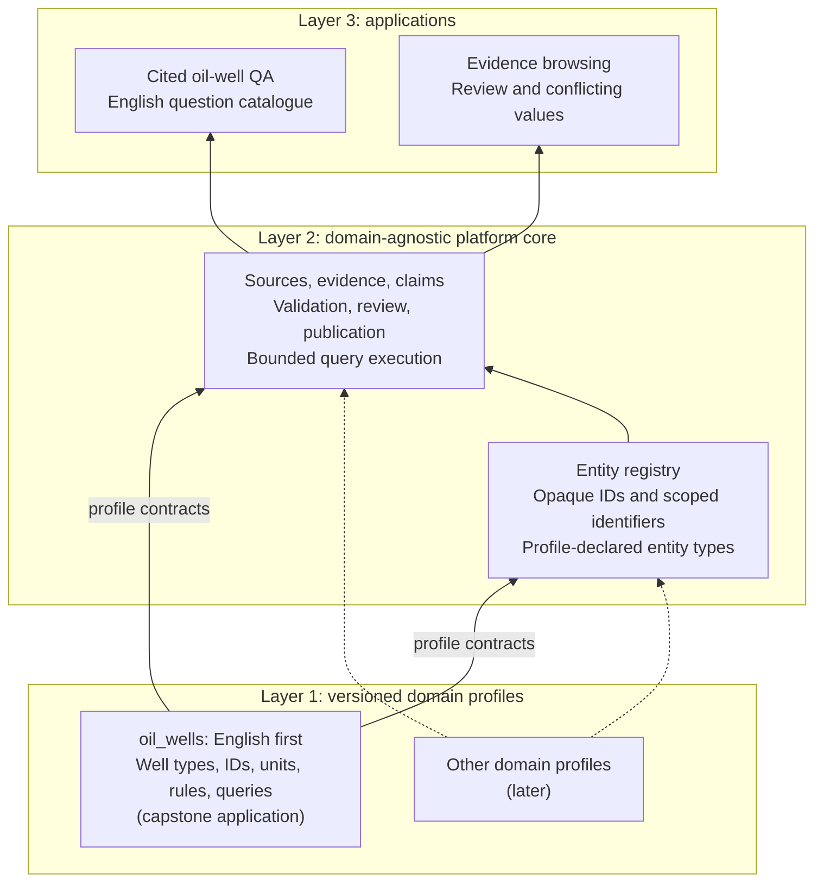

</details>

**Figure 9 — Reusable core and the oil-well application.** Oil terminology and rules are profile inputs. The first delivery supplies one `oil_wells` profile and English questions; other profiles remain future extensions.

| Layer | Capstone delivers | Deferred |
|---|---|---|
| 1. Domain knowledge graphs | One **oil-well profile**: well/wellbore identity and status, hole sections, casing, depths, surveys, drilling time and reported measurements from English well reports and structured well datasets. Operator, lease, block and field are supporting references. The ontology is a profile input that the admin application loads, edits and versions | Additional application domains (portability runs only); subsurface-interpretation and expert-note workflows |
| 2. Unified entities and ontology | Generic entity/identifier registry, evidence and claim contracts; profile-declared entity types and rules (§5.7, §6) | Additional real profiles and their domain evaluation |
| 3. Applications | Bounded English oil-well QA with citations; entities, claims, conflicting values and evidence browsing (§8) | Expert assistant, competing-hypothesis workflows, decision support, fine-tuning |

**Development data.** VPI will not supply datasets (D-33), so development uses public proxies chosen by the supervisor (D-13): the [BSEE well files](https://catalog.data.gov/dataset/bsee-data-center-wells-information) and end-of-well reports, starting with [Akutan AK-3](https://gdr.openei.org/files/882/00%20AK-3%20EOW%20Report.pdf). [Data sources](DATA_SOURCES.md) describes them. AK-3 is a geothermal well outside BSEE, so the two sources currently share no wells: they are developed as two tracks and meet only in the registry's design. Demonstrating one well known to both a dataset and a report needs an oil-and-gas report for a BSEE well, such as a BSEE End of Operations Report (§13.2).

### 1.4 Meaning of “secure” and “internal production”

For this project, secure means document content and model inference stay inside an approved deployment boundary; users have authenticated, authorized access; changes and processing runs are auditable; and recoverable backups exist. Local inference is one part of this requirement. It does not itself provide access control, protection from malicious PDFs, or reliable recovery.

Internal production means a small team can use a maintained service with documented limits, a named operator, tested recovery, and a support route. This is how the proposal's "pilot" is made concrete. The proposed first release is a **single-host, single-workspace service** with scheduled maintenance. It does not promise continuous availability during a host failure. A shared research machine qualifies only if IT permits service hosting and can provide persistent storage and an operating arrangement. On-premise and private-cloud deployment are both allowed by the proposal; the design assumes on-premise school hardware and treats a private cloud as an equivalent boundary only if the data owner approves it (§10.1).

### 1.5 First-release boundaries

| Included in the first production release | Deferred until there is evidence of need |
|---|---|
| English technical PDFs with extractable text or evaluated English OCR | Vietnamese/mixed-language and Russian delivery; general Office/email workflows, handwriting and image understanding |
| Language-tagged names and aliases; English terminology and questions in the initial evaluation | Multilingual quality gates, source translation and multilingual QA |
| Domain-agnostic core plus one versioned `oil_wells` profile (§1.3); synthetic fixture checks the configuration boundary | Second real application/profile and new-domain accuracy evaluation |
| Development on public proxies: BSEE well records and end-of-well reports, AK-3 first; VPI documents once supplied | |
| Conflicting reported values retain their source and context for review | Competing interpretations, claim-to-claim reasoning links, expert notes, interviews and transcription |
| Versioned public well datasets through adapters (BSEE borehole and API-change files) | Further BSEE tables (directional surveys, company file, eWell reports) until a question needs them |
| Versioned ontology and reference lists, uploaded and edited in the admin application; AI-assisted ontology drafts that a person edits and activates | Full OWL reasoning, arbitrary ontology languages, ontology marketplace, automatic activation of a generated ontology |
| Local extraction of entities, relations, and supported quantities, with in-document reference resolution and an optional model self-check that adds warnings | Autonomous agents, internet browsing, tools controlled by the model |
| Evidence viewer, approval/rejection, correction, merge review, duplicate-node search and redundant-link removal | Fully automatic acceptance of all extracted facts |
| Confidence-routed review queue; threshold auto-acceptance only for claim types calibrated on held-out data and approved by the product owner (D-31) | Auto-acceptance without calibration, or for identity merges |
| Graph browsing and a bounded question catalogue | Arbitrary questions guaranteed to work, unrestricted generated Cypher |
| Local PDF upload, the existing GDR import adapter and the BSEE dataset adapter | Arbitrary URL fetching or many external connectors |
| One team sharing one document security boundary | Multiple tenants or different document permissions within one graph |
| Authentication, roles, audit, backup/restore, monitoring | High availability, multi-region operation, 24/7 service commitments |
| Explicit detection and reporting of unsupported/scanned pages | Production OCR for all scans; integrate only after a separate quality gate |

The single-workspace access rule is deliberate: all authorized readers can see all published material in that workspace. A requirement to hide particular documents from some readers changes retrieval, entity resolution, graph access, caching, and audit design; it must be addressed before admitting those documents.

### 1.6 Proposed business success measures

**Delivery order (D-30).**

1. **Graph builder:** ontology loading and management, ontology-guided extraction, entity identity and duplicates, connection policy, review and curation, publication. Built on 5–10 representative English well reports, with the well types, identifiers, units and context rules externalized into the `oil_wells` profile.
2. **Admin application** around the builder, used by the person who ingests data.
3. **Question answering:** 5–8 agreed oil-well question intents, three first.
4. **Access control, hardening and pilot.**

A small synthetic profile fixture checks that the core has no oil-specific branching; one or two public portability runs follow once the oil-well workflow works. Additional languages require a separate scope decision and evaluation. These workload limits preserve the held-out acceptance samples in §12. The supervisor expects steps 1–3 in English within the first semester (D-35).

**Two acceptance packages.** A public-data demonstrator proves the implemented workflow and records its limitations. The internal pilot additionally requires an approved data/host boundary, authenticated access, independent restore evidence and an operating owner. A demonstrator does not satisfy internal production acceptance. The immediate integration demo is a real reviewer accepting a versioned claim, a cited answer, interruption-safe replacement and immediate source withdrawal.

Before the pilot, collect a small baseline in which intended users answer representative questions using the PDFs directly. During the pilot, measure task completion time, correct answers, successful source inspection, and corrections requested. Provisional targets are at least 30% lower median task time and at least 80% successful completion of the supported question tasks without developer assistance. These are targets to negotiate and test, not observed results. Incorrect answers with plausible citations count as failures.

## 2. Users and workflows

### 2.1 Roles

| Role | Responsibilities and permissions |
|---|---|
| Reader / domain user | Ask supported questions, browse accepted facts, inspect evidence, report a problem; cannot publish or edit facts |
| Reviewer / domain expert | Inspect candidates and source pages, approve/reject/correct, resolve ambiguous entity matches and conflicting well values |
| Administrator / knowledge engineer | Load, draft (with AI assistance) and edit ontology versions; start and re-run extraction; set review-routing thresholds; search and merge duplicate nodes, remove redundant links; publish validated releases; retire documents; manage membership and roles once access control exists. The first phase of the application serves this role (D-30) |
| Operator | Maintain the host, model runtime, secrets, logs, backups, restores, and capacity; access to content follows institutional policy |

One person can hold multiple roles, but actions still record which identity performed them. A student should not self-certify the whole release: another student reviews implementation changes, and the designated domain/product owner accepts the pilot results. Named people remain to be assigned.

### 2.2 Primary journeys

**Define the ontology.** An administrator uploads an ontology file, or asks the ontology assistant for a draft from sample documents and edits it: entity types, relation names with definitions, properties, units and reference lists (for example a spreadsheet of canonical well names). The application validates it and shows what changed against the active version. Activating it is a recorded decision; the next run uses it. The team supplies only the oil-well test ontology; a customer brings their own (D-29).

**Add knowledge.** An administrator uploads a PDF and records title, source, permission to use it, and intended ontology. The service validates and stores it, runs ingestion, and shows page coverage, warnings, and processing status. Extraction produces candidates. A reviewer sees each candidate beside its evidence, accepts or corrects it, and resolves ambiguous names. The administrator publishes a validated graph revision. Readers can then find those facts.

**Import a dataset snapshot.** An administrator fetches a new BSEE snapshot. The adapter verifies and parses it, and the service shows counts, warnings, and a comparison with the active snapshot (added, changed, and removed boreholes). A reviewer approves the snapshot as a whole (§5.7). Its records then update the well reference list and the dataset-sourced claims in the next graph revision.

**Ask a question.** A reader asks “Which reports describe well AK-3?” or “What are the status and total depth of borehole 177214004100?” The system recognizes a supported intent, resolves the well to an approved entity, executes an authorized graph query, and displays the result with references to the report page or dataset row. If there are several matching entities, it asks the reader to choose. If the question requires an unsupported relation or unpublished information, it says what is missing.

**Correct knowledge.** A reviewer identifies an incorrect value or merge, opens its evidence and extraction history, and records a correction with a reason. The old assertion remains in history. A new graph revision replaces it for current use. A report being withdrawn is immediately excluded from answers while projection cleanup runs.

**Later extension — record an interpretation or expert note.** A domain expert opens an entity or claim, for example a temperature interval of a well, and adds an interpretation or lesson in their own words, in Vietnamese or English. They link it to the claims it relies on and to any interpretation it supports or contradicts. A second expert reviews it before publication. Readers then see it attributed to its author and date, next to competing views and their evidence (§5.8).

**Curate the graph.** An administrator asks for likely duplicates: nodes of the same type whose normalized names, identifiers or neighbors are highly similar. For each pair the application shows both nodes with their evidence; the administrator merges them (with a reason and history), keeps them apart, or marks the pair as known-distinct so it is not suggested again. Links without accepted evidence, or that repeat an existing claim, can be removed the same way (§5.9).

**Reprocess a report.** An administrator selects a new parser, model, prompt, or ontology version. A new run produces a comparison: unchanged, added, changed, removed, and newly conflicted facts. Existing accepted facts remain available until the new revision passes checks. Changed evidence does not silently inherit an old approval.

### 2.3 Functional requirements

IDs connect implementation work to the acceptance and delivery plan. “Must” applies to the first internal production release; “Should” is planned for it but may be cut under §4.3 of the plan; “Later” is outside its baseline.

| ID | Priority | Requirement | Observable outcome |
|---|---|---|---|
| FR-01 | Must | Register and verify source documents | Source hash, metadata, permission record, status, and immutable version available |
| FR-02 | Must | Parse PDFs with source provenance | Every emitted chunk resolves to its stored document version and physical page(s) |
| FR-03 | Must | Validate versioned domain ontologies | Invalid types, relation endpoints, and unit rules rejected before extraction |
| FR-04 | Must | Extract locally into typed candidates | Every candidate passes schema checks or receives an explicit error/review reason |
| FR-05 | Must | Resolve entity names conservatively | Ambiguous aliases produce review tasks; merges retain their history |
| FR-06 | Must | Review and publish accepted claims | Pending or rejected candidates cannot appear as accepted answers |
| FR-07 | Must | Browse graph facts and original evidence | Clicking a citation opens the correct PDF version and physical page |
| FR-08 | Must | Answer a bounded question catalogue | Supported questions return scoped results and citations; others abstain or clarify |
| FR-09 | Must | Re-run, compare, and roll back | New processing does not overwrite the currently served graph revision |
| FR-10 | Must | Enforce roles and audit changes | Direct API attempts receive the same authorization checks as UI actions |
| FR-11 | Must | Retire/delete documents and derived knowledge | Withdrawn evidence is excluded immediately; retention/purge status is visible |
| FR-12 | Must | Operate and recover the service | Job recovery, backup restoration, and a documented handover are demonstrated |
| FR-13 | Must | Report unsupported input honestly | Scans, failed pages, and truncated processing are visible and affect release eligibility |
| FR-14 | Later | Expand OCR, formats, languages and domain adapters beyond the approved English oil-well workload | Separate scope and evaluation precede delivery; existing OCR capability remains available |
| FR-15 | Must | Import versioned structured well datasets with row provenance | Each record resolves to its dataset snapshot (URL, SHA256, retrieval time), file member, and row; malformed rows block the import; withheld values stay distinct from blank ones |
| FR-16 | Must | Shared entity registry independent of application domain | Opaque entity IDs, profile-declared types, scoped identifier schemes and provenance; one oil-well entity can link dataset rows and report mentions; uncertain identity requires review (SR-07) |
| FR-17 | Later | Represent competing interpretations and attributed expert knowledge | Future interpretation claims and reviewed claim-to-claim links; expert-note capture and interpreted-topic QA are outside the first delivery (SR-08, SR-15) |
| FR-18 | Must | Store language-tagged names and aliases | Names/aliases carry language tags and scope; English aliases resolve consistently and ambiguous matches go to review; multilingual evaluation is later (SR-11, SR-12) |
| FR-19 | Must | Manage the ontology in the admin application | Upload, edit and version entity types, relation names and definitions, properties and reference lists; validation and a diff against the active version before activation; a re-run under the new version produces a comparison, not an in-place relabel (D-29) |
| FR-20 | Should | Draft an ontology with AI assistance | From sample documents and optional seed rules, the local model proposes types, relations and definitions with example evidence; the draft is never active until a person edits and activates it |
| FR-21 | Must | Curate duplicates and redundant links | Similar-node search per type (normalized name, identifiers, shared neighbors); merge, keep-apart and known-distinct decisions with history; links without accepted evidence or duplicating a claim can be removed and are audited |
| FR-22 | Must | Resolve references within a document | Pronouns and descriptive mentions ("the well", "it") are linked to a named mention in the same document before entity resolution, with the antecedent kept as evidence; unresolved references create no node |
| FR-23 | Should | Route review by confidence | Candidates are ranked by validation result and model/self-check signals; a product-owner-approved threshold may auto-accept a claim type only after held-out calibration meets its precision target; auto-accepted claims are labelled and sampled for audit (D-31) |

## 3. Current implementation and evidence

### 3.1 What exists

The ingestion layer (stages 1–2 of §5.1, and the dataset path of §5.7) is implemented as two domain-neutral pipelines:

- **Document ingestion** ([`graph_builder.corpus`](components/corpus-ingestion.md)). It registers supported PDF, scan/image, DOCX, PPTX, XLSX, HTML and Markdown files into a content-addressed store with a SQLite catalog, decides per page whether to use the text layer or OCR, and uses a local Vietnamese/English OCR engine ([E5](experiments/E5-ocr-engine-benchmark.md)). It produces chunks with provenance and quality flags. Processing is per-document, resumable and parallel; exports are validated, then published as immutable releases behind an atomically switched pointer ([E7](experiments/E7-corpus-pipeline-smoke.md), [E11](experiments/E11-publication-and-import-fixes.md)); support does not mean every format has a representative quality benchmark.
- **Structured-data import** ([`graph_builder.datasets`](components/dataset-import.md)). One mapping file turns CSV, Excel or JSON-lines files into typed records and a property graph whose every record and edge cites its file, digest and row. BSEE well data is one such mapping; it reproduces the earlier dedicated adapter and graph builder exactly ([E6](experiments/E6-generic-import-bsee.md)). The linked BSEE graph (wellbores to wells, operators, leases, blocks, fields and renumbered predecessors) is the seed of the entity registry (§5.7).

The earlier source-specific commands remain for reproducing experiments E1–E4: the GDR PDF pipeline (`graph_builder.ingestion`), the BSEE adapter (`graph_builder.ingestion.bsee`) and the BSEE graph builder (`graph_builder.graph.bsee`). Separately, an [architecture prototype](../prototype/README.md) runs the report track (extraction, validation, review, Neo4j generations, cited QA) on 15 AK-3 chunks as a test build ([experiment E4](experiments/E4-ak3-architecture-prototype.md)). Since [E10](experiments/E10-profile-driven-prototype.md), the prototype reads its ontology from a validated profile file, and a synthetic second profile runs the same extraction and validation code; it also has a duplicate-name search. Its QA templates remain oil-well specific. There is no implemented ontology editor or service, local LLM extraction, graph database integration, web application, authentication, or question-answering service. Libraries that appear transitively in the lock file do not mean these application features exist.


<details>
<summary>Diagram source (Mermaid)</summary>

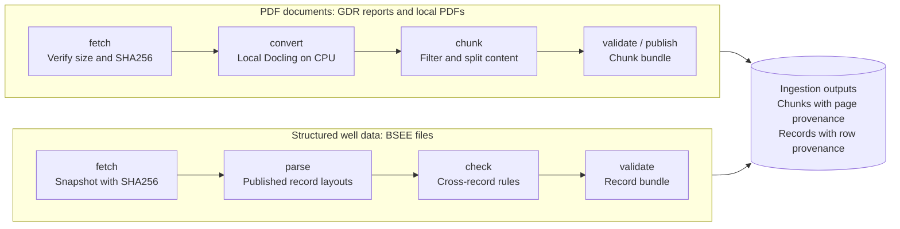

</details>

**Figure 1 — Current implementation.** Both paths verify their inputs by SHA256 and produce validated, byte-reproducible file bundles. "Publish" means copying an evaluated PDF bundle into its artifact directory. It does not mean publishing reviewed knowledge into a graph or making a service available.

| Responsibility | Current code / contract |
|---|---|
| CLI orchestration | [`__main__.py`](../src/graph_builder/ingestion/__main__.py) |
| HTTPS host allow-list, registry validation, download verification | [`sources.py`](../src/graph_builder/ingestion/sources.py) |
| CPU parsing, table extraction, remote-service disablement | [`convert.py`](../src/graph_builder/ingestion/convert.py) |
| Filters, text packing, chunking, tables | [`filters.py`](../src/graph_builder/ingestion/filters.py), [`chunking.py`](../src/graph_builder/ingestion/chunking.py), [`tables.py`](../src/graph_builder/ingestion/tables.py) |
| Canonical offsets and PDF geometry | [`provenance.py`](../src/graph_builder/ingestion/provenance.py) |
| Run isolation, comparisons, artifact publication | [`runs.py`](../src/graph_builder/ingestion/runs.py) |
| Structural validation and quality evaluation | [`schema_validation.py`](../src/graph_builder/ingestion/schema_validation.py), [`validate.py`](../src/graph_builder/ingestion/validate.py), [`evaluation.py`](../src/graph_builder/ingestion/evaluation.py) |
| BSEE snapshot fetch, parsing, cross-record checks, well grouping, bundle validation | [`bsee.py`](../src/graph_builder/ingestion/bsee.py), [`bsee_layouts.py`](../src/graph_builder/ingestion/bsee_layouts.py), [`bsee_wells.json`](../configs/datasets/bsee_wells.json) |

The configured PDF baseline is Python 3.12, Docling 2.141.0, pypdf 6.1.1, paragraph chunking with a 1,500-character budget, fast TableFormer, CPU execution, and OCR disabled. Versions come from [`pyproject.toml`](../pyproject.toml), [`requirements.lock.txt`](../requirements.lock.txt), and [`default.json`](../configs/ingestion/default.json); they are repository pins, not a claim that these are the latest releases.

### 3.2 Evidence and limits

The committed main bundle contains **3 documents, 155 physical pages, and 372 chunks: 237 text and 135 table chunks**. The recorded evaluation reports zero validation errors and 20 allowed over-budget table parts, plus known semantic extraction weaknesses. See [experiment E1](experiments/E1-pdf-ingestion-configuration.md) for the original measurements and method. A valid artifact structure does not establish correct interpretation of every number or table.

The recorded extended and appendix evaluations cover a further 2 reports/170 pages and 44 attachment PDFs/463 pages. Those bundles are ignored local outputs, not guaranteed to exist in a fresh checkout. The evaluation reports 67 scanned appendix pages; that pipeline's chunks do not include OCR output. The new document pipeline processed the same 44 PDFs with OCR: 463 pages, 104 of them OCR'd, 1,778 chunks, and 5 pages flagged for review ([E8](experiments/E8-ak3-appendices-corpus-run.md)). [E4](experiments/E4-ak3-architecture-prototype.md) provides a development prototype benchmark: 41 single-annotator, AI-assisted facts, extraction precision 0.97/recall 0.68, and 19/31 correct end-to-end questions. The 31/31 QA-layer score permits honest no-answer for facts absent from the graph; it is not complete useful-answer coverage. There is no independent release benchmark or real-reviewer measurement yet.

On 27 October, after E10 and E11, 136 main tests (including the available cached PDF regression) and 11 prototype tests passed ([E11](experiments/E11-publication-and-import-fixes.md)). The unified [progress report](reports/KNOWLEDGE_GRAPH_BUILDER_PROGRESS_2026-10-27.md) covers the project’s WebNLG/2Wiki/EOR method evaluation, expanded BSEE graph, ingestion and AK-3 prototype. These workstreams inform the shared contracts and integration backlog; each retains its dataset, metrics and test-suite scope.

The BSEE snapshot of 18 October 2026 (retrieved 25 October) parses into **57,453 boreholes, 39,518 surface wells and 587 API-number changes**. It has zero errors and two warning kinds: 445 boreholes with withheld fields, and two wells spanning several surface blocks. Rebuilding from the snapshot is byte-identical. The bundle is a local, ignored output; [BSEE ingestion](components/bsee-ingestion.md#checks) lists the checks. Valid records do not mean that BSEE's values are correct; they are the regulator's records, cited as such.

### 3.3 Gaps the architecture must close

1. **Integration remains open.** The generic corpus and mapping-driven dataset pipelines exist; the AK-3 prototype still reads the earlier PDF bundle. A shared source/evidence/claim contract and authenticated upload/review application are not implemented.
2. **Evidence identity must be versioned.** Legacy `content_id` is a matching aid, not a unique evidence ID. Corpus chunks have SHA256 and longer IDs, but accepted claims must pin the source version and processing bundle, not only a chunk index that can change on rechunking.
3. **Publication is interruption-safe for files; the application store is not built.** Corpus exports and dataset bundles are validated while staged, then published as immutable releases behind an atomically switched pointer; the prototype checks each generation against the exact accepted set ([E11](experiments/E11-publication-and-import-fixes.md)). Legacy PDF publication still copies files individually (frozen for reproduction). PostgreSQL-backed publication pointers, idempotent retries and withdrawal remain application work.
4. **Cache identity is incomplete.** Corpus fingerprints include config, Docling/core versions and OCR model digests, but omit the collected OCR runtime versions and full code/layout/table-model identity. Converter reuse keys only on format/mode. Complete manifests and configuration-aware reuse remain required.
5. **Validation and installation need hardening.** Duplicate CSV/XLSX headers can lose values; prototype calendar-date validation accepts impossible dates or raises on invalid months. Schemas are resolved from the checkout; a separately installed wheel and Linux/GPU environment are not verified. Preserve legacy fixed-width IDs for regression and use versioned corpus IDs for new work.
6. **Security controls are incomplete.** Authentication, server-derived review actors, role enforcement, parser isolation, enforced egress, safe diagnostics, audit and independent recovery are future work. Redirect allow-list checks occur after requests have followed redirects; byte/page checks do not establish expanded-archive/image/CPU limits.

7. **Builder controls are mostly missing.** The prototype now loads and validates its ontology from a file and offers a command-line duplicate-name search ([E10](experiments/E10-profile-driven-prototype.md)). It still lacks ontology editing and versioned activation, an AI-assisted draft, measured in-document reference resolution (only a prompt rule exists), and review routing by confidence (FR-19 to FR-23).

These are design inputs and backlog items, not claims that the existing ingestion milestone has failed.

## 4. Target architecture

### 4.1 Component and trust boundaries

Use a modular Python application with a separate worker process, a browser UI, and a local model server. Keep the modules in one repository. Separate processes isolate slow parsing/model jobs from interactive requests without introducing a large distributed-service system.

Use module boundaries for source/evidence, ontology/registry, extraction/validation, review/publication, queries and operations; these are not separate network services. The per-corpus SQLite catalog remains a processing detail. PostgreSQL owns application permissions, source retirement and accepted knowledge. Keep legacy ingestion as a frozen regression interface and integrate the generic pipelines through adapters rather than expanding two product paths.


<details>
<summary>Diagram source (Mermaid)</summary>

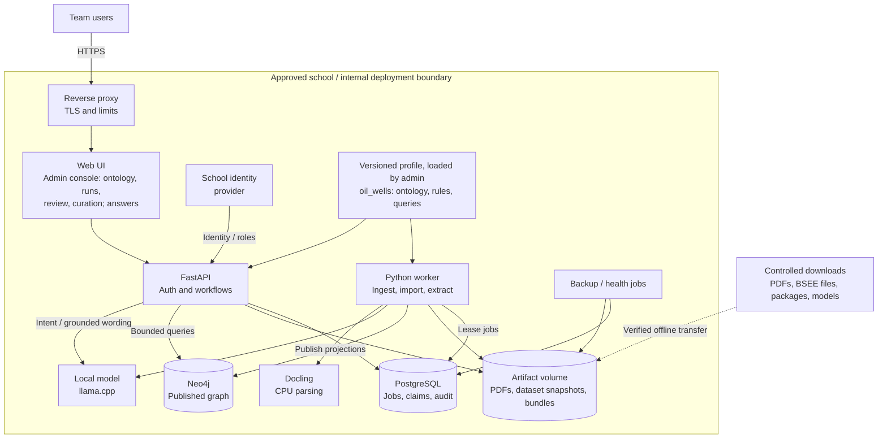

</details>

**Figure 2 — Target containers and profile input.** The first phase of the web UI is the admin console for the builder (D-30); the reader view and identity provider follow. Browser users never connect directly to either database or the model server. External downloads belong to a controlled acquisition process. The application content path stays inside the approved boundary. The identity provider must also be institutionally approved.

### 4.2 Which store is authoritative?

| Store | Owns | Recovery and consistency rule |
|---|---|---|
| Artifact volume | Original PDF versions, dataset snapshots (original ZIPs plus snapshot manifest), canonical text, chunks, table structures, normalized dataset records, immutable run manifests, model/config fingerprints | Append new versions; verify hashes; back up original evidence and accepted-run artifacts |
| PostgreSQL | Membership/roles, document lifecycle, ontology versions, jobs, candidate/accepted claim revisions, review decisions, merge history, publication pointers, audit, outbox events | System of record for workflow and accepted knowledge; transactions protect state changes |
| Neo4j | Queryable projection of accepted entities, claims, evidence references, and graph relationships for a named generation | Rebuildable from accepted revisions and manifests; never the sole copy of review history |
| Local model cache | Approved weights, tokenizer and runtime configuration | Reacquire from a verified internal package or retain offline; record exact checksums and license |

An **outbox** is a table of committed work to perform after a database transaction. For example, accepting a claim records the review and a projection event together in PostgreSQL. A worker later applies that event to Neo4j and records completion. This avoids pretending that writes to two different databases form a single transaction.

### 4.3 Build and publication boundaries

Each graph build has a `generation_id`. All its projected entities, claims, and evidence links belong to that generation. A worker creates the new generation, checks record counts, referential integrity, evidence availability, ontology compatibility, and a manifest digest, then writes a completion marker. Only then may a PostgreSQL transaction change `active_generation_id`.

Freeze the accepted revision set and expected distinct claim/evidence IDs before building. Compare exact expected and projected sets, not only nonempty counts. Corpus and dataset bundles are validated in staging and stored under immutable release IDs; existing accepted export names are never overwritten. Readers resolve and pin a publication pointer once. Implement a transactional generation-build job or an outbox request first; defer incremental per-claim projections until measured need. The current code does not yet meet these publication contracts (§3.3).

A query first reads the active generation and pins it for the whole answer. It must match a completed graph marker and manifest. If either is absent, the API returns “knowledge revision unavailable” instead of mixing generations. Existing readers may finish against the prior generation, subject to a final authorization and document-withdrawal check. Retain the previous validated generation for rollback; collect older ones only under retention policy.

This is application-level consistency, not a distributed transaction. A crash after Neo4j completion but before pointer activation leaves an unused generation that can be reconciled safely. A crash after activation is handled by checking the persisted marker. Direct database writes outside the projection worker are prohibited operationally.

### 4.4 Core and domain-profile boundary

The platform core operates on typed contracts and opaque identifiers. Domain semantics enter through a versioned profile selected for each run and publication; the first supplied profile is `oil_wells`.

| Domain-agnostic core | `oil_wells` profile and source adapters |
|---|---|
| Source catalog, parsing orchestration, evidence locators and lifecycle | BSEE field mappings; well-report sections and source conventions |
| Entity/identifier storage, conservative resolution workflow | Well/Wellbore types, BSEE API10/API12 identifiers and scoped alias rules |
| Typed claims, generic schema checks and registered validator interface | Well properties, units, MD/TVD and depth-reference rules; planned/actual context |
| Extraction runner, output schema enforcement and audit | Ontology, glossary, examples and extraction prompt context |
| Review, jobs, publication, withdrawal and graph projection | Profile-declared relation and property schema |
| Authorized intent dispatch and parameterized query execution | English oil-well intents, trusted query catalogue and display labels |

The ontology belongs to whoever runs the builder (D-29). The team writes the core and the profile contract, and supplies `oil_wells` as the use case's test ontology; another organization uploads its own profile through the admin application (FR-19) without code changes. Pin profile/schema, mapping, rule-handler, prompt and query-catalogue versions in the processing/publication manifest. Validation and projection use that same pinned profile. Profile activation is an administrator action in the admin application: safe YAML/JSON parsing, bounded schemas and allow-listed handler IDs only; executable expressions and model-generated query text are rejected. Query templates are reviewed application assets with bound parameters and the same authorization limits as core queries.

Promote the prototype incrementally. The first step is done ([E10](experiments/E10-profile-driven-prototype.md)): the 14 properties are a profile file with a validating loader, and extraction and validation read it. Next, move entity resolution and query dispatch behind the same contract. Keep BSEE-specific code in its adapter. A synthetic non-well vocabulary fixture checks schema loading, validation and dispatch without core edits; it is a portability check, with accuracy evaluated only on the oil-well workload. Domain-neutral ingestion already exists; reusable extraction/QA is planned.

## 5. Document-to-graph processing

### 5.1 Stages, inputs, and outputs

| Stage | Input | Processing | Output / failure behavior |
|---|---|---|---|
| 1. Register | Uploaded PDF, approved GDR adapter result, or dataset snapshot | Validate file signature, size/page or archive-member limits, permission metadata, duplicate hash; assign a version | Immutable source record; encrypted/corrupt/unsupported files quarantined with a reason |
| 2. Ingest | Source version + parser settings or record layout | PDF: local Docling conversion, filtering, chunking, table serialization, page coverage checks. Dataset: layout parsing, typed values, withheld-versus-blank distinction, cross-record checks | Versioned chunk bundle or record bundle; missing or scanned pages and withheld fields explicitly recorded |
| 3. Prepare | Bundle + active ontology/reference versions | Assemble bounded context, preserve table headers and row identity, calculate token budget | Extraction requests with complete run fingerprints |
| 4. Extract | Request + local model | Produce typed entity mentions and claim candidates with cited spans, using only the ontology's types and relation names; link pronouns and descriptive mentions to a named antecedent in the same document (FR-22) | Candidate records; malformed output receives at most one repair attempt, then a failure record |
| 5. Validate | Candidates + ontology + source | Check types, relation direction, values/units, exact evidence spans, page/table references; an optional model self-check pass critiques each candidate against its passage and adds warnings, never acceptances | Eligible candidates or specific rejection/review reasons |
| 6. Resolve | Entity mentions + reference lists | Normalize names (whitespace, case, punctuation, declared abbreviations), then exact IDs, reference-list names, scoped aliases, and similarity suggestions last (§5.9) | Canonical-entity links or ambiguity tasks |
| 7. Review and curate | Eligible candidates and source view | Route by confidence (FR-23); accept, reject, correct, resolve conflicts and merges; duplicate-node search and redundant-link removal | Immutable review decisions and accepted claim revisions |
| 8. Project | Accepted revisions + manifests | Build and validate a new Neo4j generation | Completed graph marker; failure leaves active generation unchanged |
| 9. Activate | Completed generation | Administrator checks summary and switches the publication pointer | Readers see the new accepted knowledge revision |

Dataset records do not pass through stages 3–4. A deterministic, versioned field mapping turns them into claim candidates with dataset evidence, which enter at stage 5 ([§5.7](#57-structured-well-data-and-the-entity-registry)).

### 5.2 Review lifecycle


<details>
<summary>Diagram source (Mermaid)</summary>

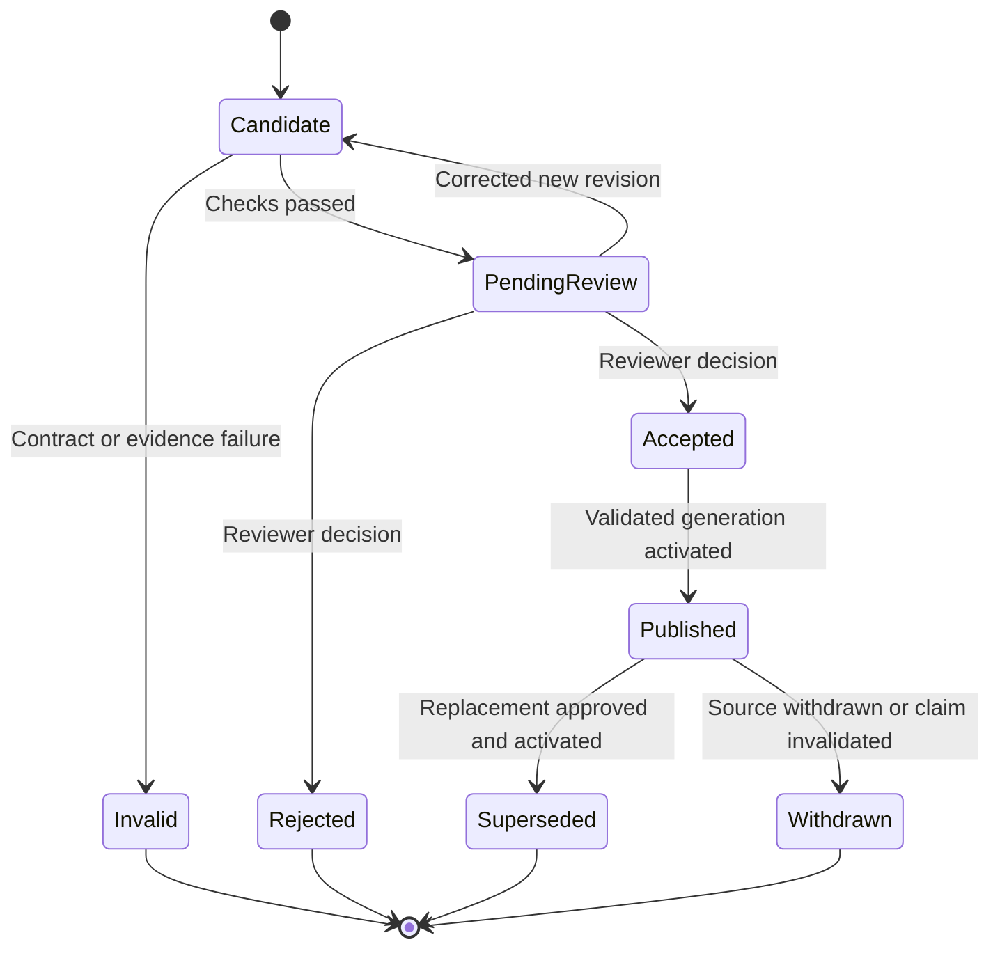

</details>

**Figure 3 — Claim lifecycle.** The diagram shows logical states. Corrections create revisions and audit events; they do not erase the original candidate. An accepted claim is not visible to readers until included in an activated generation. Withdrawal blocks serving immediately, even before the graph projection is rebuilt.

### 5.3 Extraction controls

The model receives only the ontology subset, source context, output schema, and task instructions needed for that request. PDF text is untrusted input and may contain instructions; it cannot select tools, change the schema, execute a query, or grant access. The model has no filesystem or network tools.

For quantities, retain the literal source value, source unit, normalized value/unit if conversion is defined, measurement kind, and relevant conditions. “Measured depth” and “true vertical depth” are different properties. Preserve negation, uncertainty, date/interval, and whether a statement is a plan, observation, or estimate. Missing values remain missing; the model must not complete them from background knowledge.

Current chunks use a character budget. Model requests require a **token** budget calculated with the selected tokenizer. Reserve space for instructions, ontology, and output. A table containing one oversized row must be handled explicitly, for example by a table-aware field extraction request, or marked unsupported. Never silently truncate a row or assume 1,500 characters equals 1,500 tokens.

Use constrained JSON generation when supported, then validate independently. Valid JSON says nothing about factual correctness. Store model-reported confidence and self-check results separately; do not interpret them as calibrated probability. By default every published report claim requires human approval, and confidence and evidence checks prioritize the queue. The supervisor's human-in-the-loop design allows a threshold above which claims are accepted automatically (D-31). The builder supports it per claim type, switched off until three conditions hold: held-out calibration shows that claims above the threshold meet that type's precision target; the product owner approves the setting; and auto-accepted claims stay labelled as such and are sampled for audit. Identity merges are never auto-accepted. Deterministic dataset claims are approved per snapshot (§5.7, D-14).

### 5.4 Entity resolution and conflicts

Resolve an entity by a stable domain identifier when available. Otherwise compare a normalized name with approved aliases inside its type and scope, such as well name plus project. A string such as “AK-3” alone is not assumed globally unique. Fuzzy matches are suggestions for review. Store the original mention and evidence even after linking it to a canonical entity.

Merges produce a revisioned mapping from old entity IDs to a canonical ID and preserve a reason, reviewer, and affected claims. Undoing a merge rebuilds the affected projection; it must not rely on recovering deleted graph nodes. Different values for the same subject/property/context remain distinct claims with their own evidence. Reviewers can mark them compatible, superseded, or unresolved. An answer surfaces unresolved conflicts instead of averaging values or selecting the last imported report. The builder's rules for which mentions become nodes, which links are made and how duplicates are found are in §5.9.

### 5.5 Jobs, retries, and reprocessing

Workers lease queued PostgreSQL jobs with a short transaction, then do expensive work outside that transaction. The lease has a deadline, heartbeat, attempt count, and fencing token so an expired worker cannot commit after another worker takes ownership. Use bounded retries for transient errors, and terminal failure for invalid input. Limit active inference requests separately from CPU parsing jobs.

Delivery is **at least once**: a crashed job may run again. Idempotent stage outputs make this safe. A stage key includes source hash, input-bundle hash, ontology/reference hashes, parser/model/tokenizer/runtime fingerprints, prompt/schema versions, and configuration. A deliberate new experiment has a new run ID; repeated execution of the same job uses its stage keys and does not duplicate accepted claims.

For the first release, allow one graph build/publication per workspace at a time. Extraction can proceed independently, but publication takes a workspace lock and an optimistic revision check. Two reviewers editing the same candidate receive a conflict response instead of overwriting each other's decision.

### 5.6 Worked example using an existing passage

The committed AK-3 report chunk `gdr882_ak3_eowr#c0002`, on physical page 2 under “Executive Summary,” begins:

> Akutan Well AK-3 well was drilled to a vertical depth of 1,955 feet in 27 days, in contrast to the planned 1,700 feet in 30 days, including rig-up and rig-down time.

The passage is available in the [committed canonical document](../data/processed/documents/gdr882_ak3_eowr.txt). This text exists today; the processing below describes the proposed next stages.

1. The application pins that chunk's ingestion bundle and the report's source SHA256. It constructs an evidence record for the exact sentence and its physical page/region.
2. Extraction proposes separate candidates for **actual vertical depth = 1,955 ft**, **planned vertical depth = 1,700 ft**, **actual duration = 27 days**, and **planned duration = 30 days**. The scope of “including rig-up and rig-down time” needs careful review; it must not be silently applied to the wrong duration.
3. The ontology must define the relevant depth/duration properties and actual/planned qualifiers. A rule for measured depth alone is insufficient: the source specifically says vertical depth. AK-3 is resolved within the Akutan project.
4. A reviewer checks the original page, approves supported claims, and leaves any unclear qualifier unresolved. The accepted claim revisions enter the next validated graph generation.
5. “What vertical depth did AK-3 reach?” maps to a property lookup with the **actual** qualifier. A deterministic answer returns “1,955 ft,” the report name, physical page 2, and the evidence link. It does not substitute the planned 1,700 ft or describe the value as measured depth.

This example illustrates why the graph needs context and claim-level evidence: extracting all four numbers correctly is not enough if the system assigns them the wrong meanings.

### 5.7 Structured well data and the entity registry

The **entity registry** is layer 2 of §1.3: the generic store of canonical entities, opaque IDs, profile-declared types, scoped external identifiers, language-tagged names and merge history. The core enforces identifier uniqueness within a declared scheme and scope; the `oil_wells` profile and adapters define which schemes and matching rules apply. This section describes the BSEE adapter and oil-well identity rules. A VPI dataset uses its own mapping and identifier scheme through the same contracts.


**Figure 8 — Current development tracks.** The Mermaid source is in [DATA_SOURCES.md](DATA_SOURCES.md). The tracks share no wells today (§1.3), so the registry's cross-source linking is specified here but not yet demonstrated.

**Two roles for dataset records.**

1. **Registry entries.** Each BSEE borehole defines a canonical *Wellbore* keyed by its 12-digit API number. Each group sharing the first 10 digits defines a *Well* (the surface hole and its sidetracks). Well names with suffixes, leases, area/blocks, and previous API numbers from the change file become scoped aliases. `wells.jsonl` and the linked graph from the adapter are the current form of this list. A report mention links to an entry only through an exact identifier or a reviewed scoped alias (§5.4); wells outside the dataset, such as AK-3, get entries from reviewed report mentions, scoped by project.
2. **Dataset claims.** A versioned field mapping turns selected fields into claim candidates: spud and total-depth dates, measured and true vertical depth, RKB elevation, water depth, status code and date, surface and bottom location with datum, operator number, and lease. Each claim's evidence is the dataset record: snapshot SHA256, file, row, and field. The mapping is reviewed code or configuration, not model output.

**Review policy (proposed, D-14).** A dataset snapshot is reviewed as a unit. The reviewer approves its validation summary and its comparison with the active snapshot: added, changed, and removed boreholes, and changed values by field. Approval accepts all mapped claims from that snapshot. Claims whose values changed are superseded, not deleted. Reviewing about 57,000 boreholes claim by claim would be infeasible and add little, because the values are the regulator's records rather than model interpretations. This is a deliberate, narrow exception to per-claim approval (§5.3). It applies only to deterministic mappings from allow-listed datasets; claims extracted from reports always need per-claim review.

**Identity within BSEE.** The 12-digit API number identifies a wellbore and the first 10 digits a well; both are exact keys. Previous API numbers from the change file are aliases of the current wellbore. Well names are never identities: they repeat across leases and change between sidetracks of one hole, so a name is only meaningful together with its lease or area/block. Block numbers are compared without leading zeros (`0827` = `827`); stored values keep their source form. The implemented linked graph (`graph_builder.graph.bsee`) follows these rules.

**Units, datums, and codes.** Depths keep their source unit (feet); normalized values come only from reviewed conversion rules. Coordinates keep their datum: NAD27 in the Gulf, NAD83 in the Pacific and Alaska. Any conversion for mapping is a recorded, deterministic transform. Status, type, and class codes stay verbatim until a verified code table is added as a versioned reference list.

**Worked dataset example.** Borehole `012032016500` is the first row of the Gulf borehole file. It has measured depth 21,678 ft, TVD 21,675 ft, status `COM`, spud date 1984-09-24, and surface location MO 0827 at 30.18845, −87.95863 (NAD27). The mapped claim "total measured depth = 21,678 ft, referenced to the rig kelly bushing" cites `borehole_gulf` row 1 of the snapshot with SHA256 `1bf9abb7…`. "What is the total depth of 012032016500?" returns that value with the row citation. If a later approved snapshot changes the value, the earlier claim becomes superseded, and the answer cites the new snapshot.

### 5.8 Interpretations, competing hypotheses and expert knowledge

**Status: later extension (FR-17).** Competing-hypothesis modelling and expert-note capture are retained as an architectural extension; first-delivery acceptance covers oil-well facts and conflicting reported values.

Upstream knowledge is often uncertain: one set of observations can support several explanations, each valid under its own data and assumptions (SR-08). The graph therefore stores interpretations as claims in their own right and records how they relate, instead of keeping only one "true" value.

**Claim kinds.** Every claim has a `kind`:

| Kind | Meaning | Example from AK-3 |
|---|---|---|
| Observation | Measured or recorded, with method and conditions | Temperature surveyed at 400 ft on a given date |
| Plan | Intended, not yet done | "A flow test is planned for summer 2017" |
| Derived | Computed by a stated method from other claims | Projected equilibrium temperature of 340 °F at 400 ft |
| Interpretation | An explanation or conclusion that its author holds | A lithology correlation between AK-3 and offset well TG-2 |

Interpretations carry their author or source, date, and optionally assumptions or a school of thought. Report-derived interpretations cite the passage as usual. **Expert notes** are a source type of their own: text written in the review application, attributed to the expert and dated, and published only after a second expert reviews it (SR-15). They make tacit knowledge and lessons learned citable without pretending they came from a document.

**Relations between claims.** Reviewed links connect claims:

| Link | Meaning |
|---|---|
| `supports` / `contradicts` | One claim is evidence for or against another |
| `alternative_to` | Two interpretations explain the same observations differently; neither replaces the other |
| `depends_on` | An interpretation or derived value relies on a claim or assumption |
| `refines` | A later claim narrows an earlier one without contradicting it |

The model may propose links from report text; a reviewer accepts them like any other candidate. `contradicts` differs from a value conflict (§5.4): a conflict is two values for the same property and context, often a data error, while a contradiction is a reasoned disagreement that stays in the graph.

**Answers.** When a question touches an interpreted topic, the answer lists every accepted interpretation with its author, date, evidence and links, and says that they compete. The system never chooses a winner. Retiring a source withdraws its claims, and the answer flags any remaining interpretation whose `depends_on` target was withdrawn.

### 5.9 Builder controls: nodes, connections and curation

This section answers the supervisor's three builder questions ([7 October](requirements/supervisor-meeting-2026-10-07.md#3-what-makes-a-graph-builder-hard)): when two mentions are one node, which connections to make, and how a person corrects the machine. The rules are generic; the profile supplies the types, relation names and lists.

**Three kinds of mention.**

| Kind | Example | Becomes a node when |
|---|---|---|
| Listed entity | A well on a reference list the user supplies (for example a spreadsheet of canonical well names, or the BSEE borehole file) | Its normalized name or identifier matches the list exactly; the list entry is the canonical node |
| Named entity | An operator, rig or contractor named in the text but on no list | It has a profile type and a name; it is first matched against existing nodes (below), and a new node is created only if nothing matches |
| Referring expression | "it", "the well", "the operator", "this section" | Never on its own. It is resolved to a named mention in the same document (FR-22) and its claims attach to that entity; if no antecedent is clear, the claim goes to review with the reference unresolved |

**One object, one node.** Before resolution, names are normalized: whitespace and case are folded, punctuation and dash variants are unified, and abbreviations declared in the profile glossary are expanded. "AK - 3", "AK-3" and "ak-3" are then the same key within their scope. Exact identifiers win over names, and names are compared only within their type and scope (§5.4). Similarity (edit distance, token overlap, shared neighbors and, if adopted, embeddings) never merges anything. It only feeds the duplicate search that an administrator works through.

**Which connections are made.** An edge is created only when all four of these hold:

1. its relation name is declared in the active ontology, with a definition the extraction prompt includes;
2. its endpoint types match the relation's declared domain and range;
3. it is stated in the source, with an evidence span, or comes from a deterministic dataset mapping;
4. it is accepted.

The builder does not create links by inference or co-occurrence. Two entities named in the same passage, or connected through a third, are not linked unless the source states a declared relation. Indirect connections ("friend of a friend") stay implicit and are found at query time by bounded traversal (§8.3). Each relation in the profile may declare how many hops QA may traverse through it, so weak or broad relations do not flood answers.

**Curation tools for the administrator (FR-21).**

- **Duplicate search.** Per type, list node pairs above a similarity threshold, with both nodes' names, identifiers, neighbors and evidence side by side. Decisions are merge, keep apart, or known-distinct; merges keep their history and can be reversed (§5.4).
- **Redundant-link review.** List links that repeat an accepted claim, have lost their evidence through withdrawal, or use a relation since removed from the ontology. Removal is a recorded decision.
- **Ontology change impact.** Before activating a new ontology version, show which accepted claims use removed or renamed types and relations, and what a re-run would change (§6.5).

**Agent-style steps.** The pipeline may run a critique step after extraction: the local model re-reads each candidate with its passage and adds warnings (unsupported value, wrong subject, unclear qualifier). Warnings raise the candidate's review priority. The model has no tools, cannot accept or publish, and cannot change the ontology (§5.3, §10.2).

## 6. Ontology layer and domain modules

An ontology is the project's explicit vocabulary: the entity types, relation types, properties, and rules that the extractor is allowed to use. A reference list contains known instances and aliases. Both are versioned inputs. The first release uses a small YAML/JSON application schema; it does not claim compatibility with OWL or implement automatic logical inference.

**Who writes the ontology (D-29).** The ontology is the user organization's input. The builder's job is to load, validate, version and apply whatever ontology it is given, and the admin application lets a knowledge engineer edit it (FR-19). The team does not author domain ontologies beyond the oil-well test profile. That profile is built from public documents with AI assistance and checked against the source reports, since ready-made well ontologies are hard to find. An ontology assistant (FR-20) can draft types, relations and definitions from sample documents; a person edits and activates the draft.

### 6.1 Core ontology and domain modules

The **core schema** defines `Entity`, scoped external identifiers, `Claim`, typed values/quantities, `Evidence`, source versions, reviews and graph generations. An entity’s type is declared by its profile. `Well`, `Wellbore`, `HoleSection`, `CasingString`, `Organization`, `Lease`, `Field` and `Block` belong to the `oil_wells` profile; they are not hardcoded core types. Organizations and locations support well identity and context within this application.

A **domain profile** bundles ontology, glossary, units, context rules, identifier schemes, extraction examples and a trusted query catalogue. Profiles share core contracts and refer to canonical entity IDs. Each run pins its core-schema and profile versions. Only `oil_wells` is delivered and evaluated; “domain module” in older records refers to this profile boundary.

### 6.2 Example module configuration

This is an **illustrative future configuration**, not a file accepted by the current CLI. The prototype already uses a smaller JSON form of it: [`prototype/profiles/oil_wells.json`](../prototype/profiles/oil_wells.json), which declares the subject entity, units with value kinds, qualifiers, context fields, 14 properties with definitions and domain extraction rules. Its loader rejects unknown units, qualifiers, context fields and normalizers, missing definitions, duplicate keys and oversized files ([E10](experiments/E10-profile-driven-prototype.md)). Identifier schemes, relations between entities and query catalogues are still to be added to that form.

```yaml
profile: oil_wells
version: "0.1"
primary_language: en
entity_types: [Well, Wellbore, HoleSection, CasingString, Organization, Lease, Field, Block]
identifier_schemes:
  bsee_api10: {entity_type: Well, validator: bsee_api10}
  bsee_api12: {entity_type: Wellbore, validator: bsee_api12}
quantity_types:
  total_measured_depth:
    subject_type: Wellbore
    canonical_unit: ft
    permitted_source_units: [ft, m]
    context_required: [depth_reference, status]
    evidence_required: true
  total_vertical_depth:
    subject_type: Wellbore
    canonical_unit: ft
    permitted_source_units: [ft, m]
    context_required: [depth_reference, status]
    evidence_required: true
validator_ids: [well_depth_context, planned_actual]
extraction_template_id: oil_wells_v1
query_catalogue_id: oil_wells_v1
external_mappings: {}
```

Handler/template IDs select reviewed implementations; configuration cannot execute arbitrary code. Reject duplicate names, unknown types/handlers, incompatible endpoints, unsupported units, missing evidence constraints, unsafe YAML tags and oversized/deep files. Conversions and decimal/rounding rules are reviewed deterministic assets. Introducing another domain means supplying a new profile and any necessary adapter/registered rules, while keeping source, evidence, review and publication contracts stable.

### 6.3 Relation categories

Each profile relation declares a category understood by the generic validator and query dispatcher (SR-10). The first oil-well profile uses structural links, source evidence and claim conditions; richer reasoning categories remain extension definitions.

| Category | Meaning | Capstone status |
|---|---|---|
| Structural | Part of, located in, has component, flows to | Used (well, wellbore, section, casing; registry links) |
| Evidential | Source evidence supporting a claim; claim-to-claim support/contradiction in §5.8 | Source evidence first; interpretation links later |
| Hypothesis | Alternative to, depends on (§5.8) | Later (FR-17) |
| Condition | Holds only under stated conditions (stored as claim context) | Used |
| Dependency | Requires, depends on (between entities or activities) | Later unless needed by an agreed oil-well intent |
| Causal | Causes, results in | Later |
| Correlation | Correlates with | Later |
| Inheritance | Subtype of, between ontology types | Ontology level only; no logical inference in the first release |

Deterministic system structure for production and plant operations (SR-09) uses the structural category (equipment part of system, unit feeds unit) when such a module is added.

### 6.4 Terms, synonyms and languages

The initial workload uses English documents, ontology labels, extraction prompts, questions and held-out evaluation. Types, properties, names and aliases still carry language tags, beginning with `en`, plus project/source/profile scope. Keep source text in its original language. Existing Vietnamese OCR experiments and optional engines remain reproducible capabilities; Vietnamese/mixed-language and Russian delivery, multilingual alias quality and translation are later extensions with their own evaluation. A profile glossary supplies reviewed English aliases and abbreviations; string similarity alone never authorizes an entity merge (§5.4).

### 6.5 Changes and new domains

Ontology changes have three categories: additive changes, rule changes requiring revalidation, and breaking changes requiring re-extraction/migration. Each run pins one immutable ontology version. Activating a new ontology does not relabel old graph data in place. Maintain explicit mappings where renamed types are equivalent and keep old runs readable.

**In the admin application (FR-19).** The administrator edits a draft version: adds or renames entity types, writes relation names with definitions and endpoint types, adds properties and units, and uploads reference lists. Validation runs on save. Activation shows the change category and its impact on accepted claims (§5.9). The administrator then starts a re-run of the affected documents. The re-run produces a comparison and a review queue; it does not overwrite the active graph.

**Ontology assistant (FR-20).** Given sample documents and optional seed rules (for example "wells are identified by API number"), the local model proposes types, relations, definitions and one evidence example each. The output is a draft only: it is validated like any upload, and a person edits and activates it. If the draft does not fit the domain, the user writes the ontology by hand and uploads it.

To add a domain profile, supply its ontology, glossary, identifier mappings, unit/context rules, extraction examples, trusted question catalogue and evaluation set; add a source adapter or reviewed rule handler only where necessary. Run the same source/evidence/review/publication checks and new domain-specific extraction/QA gates. The capstone checks configuration portability with a synthetic fixture and measures accuracy on English oil-well data. After that, it runs the builder on one or two public datasets from other domains with their own (possibly assistant-drafted) ontologies, and reports what worked unchanged and what needed new rules.

## 7. Data model and contracts

### 7.1 Source-to-answer model

Represent a factual assertion as a **Claim** rather than storing only a bare edge. A claim can carry a value, conditions, review status, and several evidence references. This makes disagreement and provenance explicit. Convenience graph edges may be materialized for queries, but must reference their originating claim IDs.


<details>
<summary>Diagram source (Mermaid)</summary>

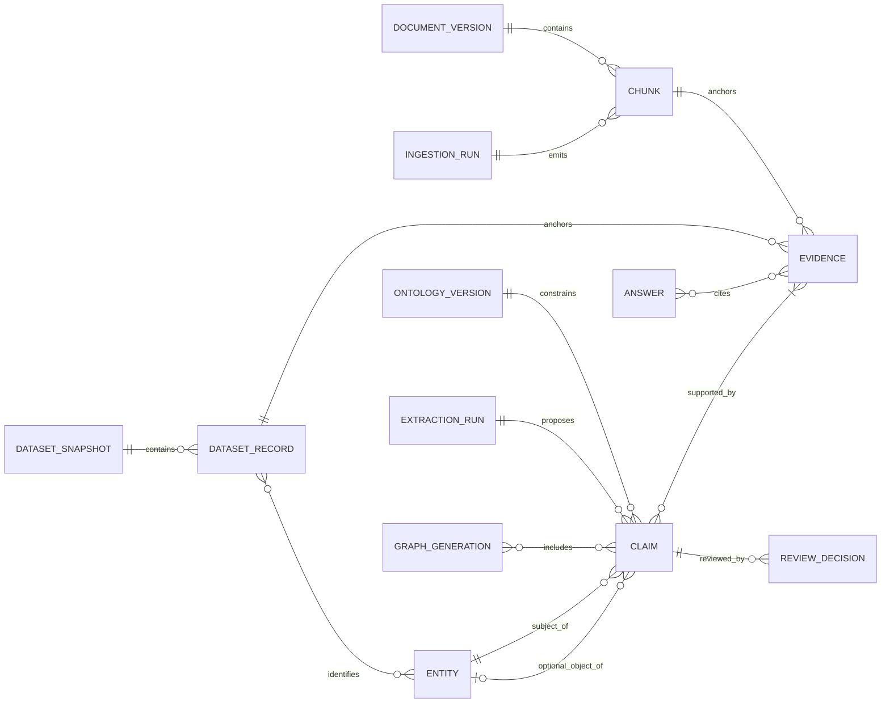

</details>

**Figure 4 — First-delivery logical model.** Claims carry a subject and either an object entity or typed literal. Evidence anchors to a document chunk or dataset record; entities are generic registry entries whose types come from the active profile. For example, a BSEE row identifies a profile-defined Wellbore and Well. Expert notes and claim-to-claim interpretation links (§5.8) are later extensions.

### 7.2 Existing artifact contracts

PDF bundle (`data/processed/` and `data/processed/local/<registry>/`):

| Artifact | Existing semantics |
|---|---|
| `gdr_chunks.json` | Ordered array: document ID, physical page, sequential chunk ID, type, text, nearest section |
| `gdr_chunks_full.jsonl` | Matching ordered records with content ID, canonical offsets, page regions, section path, table references, and available source spans |
| `gdr_tables.jsonl` | Shared table structures with row/column spans, headers, cell text, and row-oriented text |
| `documents/<doc_id>.json` | Source metadata, parser/configuration information, source SHA256, physical page geometry |
| `documents/<doc_id>.txt` | Canonical emitted text, constructed by joining chunk texts with two newlines |
| `SHA256SUMS` | Digests of the bundle's files; excludes itself |

BSEE bundle (`data/processed/local/bsee_wells/`; details in [BSEE ingestion](components/bsee-ingestion.md#output-bundle)):

| Artifact | Existing semantics |
|---|---|
| `boreholes.jsonl` | One typed record per 12-digit API number, with coordinate datum, withheld-field list, and `source` (snapshot SHA256, file, member, row) |
| `api_changes.jsonl` | One record per API-number change row, with the same `source` provenance |
| `wells.jsonl` | One record per 10-digit API prefix: boreholes, surface area/blocks, previous API numbers, source record IDs |
| `summary.json`, `SHA256SUMS` | Snapshot description, counts, code distributions, warnings; digests |

Canonical text is a derived representation, not a verbatim transcription of every PDF element. `char_start` and `char_end` are half-open Python Unicode character indexes into this text. Source-span indexes address emitted chunk text and parser source items. Regions use PDF points and a top-left origin; physical pages start at 1. A multi-page chunk's single `page` field is not a complete citation: inspect its regions/source spans.

A browser uses UTF-16 string indexes, which differ from Python character indexes for some characters. The API must send an exact evidence quote and a tested offset mapping or handle substring extraction server-side. The PDF viewer must transform coordinates for scale and rotation; a stored box is not already a browser pixel rectangle.

### 7.3 Proposed versioned application envelope

Preserve the existing v1 bundles as inputs. Add a v2 envelope and adapters rather than editing published records in place. Domain-specific metadata moves under a namespaced `source_metadata` object; source type can be `gdr`, `local_upload` or `dataset`. A local upload records its uploader and permission basis instead of fabricating a public URL or license.

| Record | Required fields and invariants |
|---|---|
| Document version | `schema_version`, `workspace_id`, `document_id`, `document_version_id`, SHA256, size, media type, storage key, source metadata, lifecycle status; source bytes immutable |
| Dataset snapshot | `dataset_id`, snapshot ID, and per-file URL, SHA256, size, publisher `Last-Modified`, retrieval time, record layout version, review/activation status; files immutable |
| Run manifest | Run ID, input/code/dependency/runtime/model hashes, core-schema/profile/mapping/rule/prompt/query-catalogue versions, resolved config, timestamps, status, output hashes and warnings |
| Evidence | Evidence ID and either document version/run/chunk/bundle/quote/span/page/regions/table context, or dataset snapshot/file/row/field/source value; exact source bytes must resolve. Expert-note anchors are a later extension |
| Entity (registry entry) | Opaque stable ID, profile-declared type, canonical display name, scoped external identifiers/schemes, language-tagged names/aliases, reference version and merge history; name is not identity |
| Claim revision | ID/revision, profile and schema version, subject, predicate, object entity or typed literal, original/normalized units, context/time/planned-actual qualifiers, evidence IDs, run and review state; interpreted claim kinds are later scope |
| Claim link (later) | Optional FR-17 extension: typed from/to claim revisions, evidence/reviewer rationale and review state |
| Expert note (later) | Optional FR-17 extension: attributed text, date/language, related entities/claims and independent expert review |
| Review decision | Actor, time, candidate/claim revision, expected previous revision, action, reason, replacement values/evidence if any; append-only history |
| Graph generation | Generation ID, included claim revisions, ontology version, manifest digest, counts, completion marker, activation and retirement history |
| Answer | Request ID, user/workspace, generation, supported intent, query-template version, structured result, sentence-to-claim/evidence citations, limitations, model fingerprint if used |

Use opaque application IDs for entities, documents, and events. Derive evidence identity from the immutable bundle/run/chunk/span combination, with a full hash if content-addressed. Never use the existing 16-hex content ID as a database uniqueness key for evidence. Cross-version matching is an explicit comparison process, with duplicates and changed spans handled conservatively.

### 7.4 Evidence and approval rules

Every published claim has at least one valid evidence reference and a review decision. Every source-derived entity name/alias and materialized relation is explainable through accepted claims or a versioned reference-list record. A citation must resolve to the exact PDF version, not whichever file currently has the same name.

Automatic evidence checks establish that the quoted text exists at the stated location. They do not prove that it entails the claim. Reviewer and benchmark checks assess that semantic relationship. Table claims need header and row context as well as the value; citing an unrelated number on the same page is a failure.

### 7.5 Proposed HTTP contract

These are design endpoints, not current commands. Generate the formal OpenAPI contract during the application milestone.

| Endpoint | Main behavior |
|---|---|
| `POST /v1/documents` | Authorized multipart upload with metadata and idempotency key; returns document version and queued job |
| `POST /v1/documents/{id}/runs` | Starts processing against immutable config/ontology versions; returns `202` and job ID |
| `GET /v1/jobs/{id}` | Stage, progress counts, warnings, retry/failure information; no raw sensitive stack traces |
| `GET /v1/review-items` | Paginated, filtered candidates with evidence and expected revision |
| `POST /v1/review-items/{id}/decisions` | Authorized accept/reject/correct action; stale expected revision returns `409` |
| `POST /v1/publications` | Administrator requests validated generation activation; idempotent, serialized per workspace |
| `GET /v1/entities/{id}` | Accepted facts and evidence from the selected completed generation |
| `POST /v1/questions` | Validates supported intent and scope; returns answer/clarification/abstention with citations |
| `GET /v1/evidence/{id}` | Authorized quote, page/geometry, and PDF-view reference; authorization checked again on PDF access |
| `POST /v1/documents/{id}/retire` | Immediately suppresses source and derived claims, queues cleanup, records audit |

Use a consistent error envelope: `code`, user-readable `message`, `request_id`, and safe field errors. Examples include `UNSUPPORTED_DOCUMENT`, `MODEL_UNAVAILABLE`, `REVISION_CONFLICT`, and `EVIDENCE_UNAVAILABLE`. Apply request-size limits, pagination, timeouts, CSRF/session protection as appropriate, and role checks on the server.

## 8. Question answering

QA is the second half of the work (D-30). Once the graph is built, the supervisor's suggested approach is that the model reads the question together with the graph schema and produces a query. The design keeps that idea but makes the model produce a **structured query plan over the active ontology** rather than query text. The application validates the plan and runs it through parameterized templates. Generic intents work for any ontology, so a newly uploaded profile gets basic QA without hand-written queries:

- find an entity;
- read one of its properties;
- list its neighbors by a declared relation;
- find a bounded path between two entities.

Profile-specific templates add domain detail on top of them.

### 8.1 Supported capabilities

Start with three English oil-well intents: find a well by scoped name/identifier, list its source reports, and retrieve a supported property with context and evidence. Agree 5–8 intents for the initial workload, adding related well entities, planned/actual or MD/TVD comparisons, conflicting values and source coverage as needed. Hypothesis comparison and expert-note questions remain later scope (§5.8).

Each intent has a typed parameter schema and a developer-reviewed parameterized query in the versioned oil-well catalogue. The generic dispatcher checks profile, intent, authorization, parameter types, permitted traversals and result limits. User values are bound parameters; labels/properties/query structure come from trusted templates. Unknown intents are rejected or clarified.

Oil-well queries join accepted claims across report and dataset sources through canonical registry IDs. Bounded traversal provides Graph RAG; the model words results from retrieved accepted claims. Evaluate an English passage-retrieval baseline over the same chunks/questions alongside it (M5) to measure the graph’s contribution (SR-16, SR-17). Additional profile-spanning queries remain future scope.

### 8.2 Answer sequence

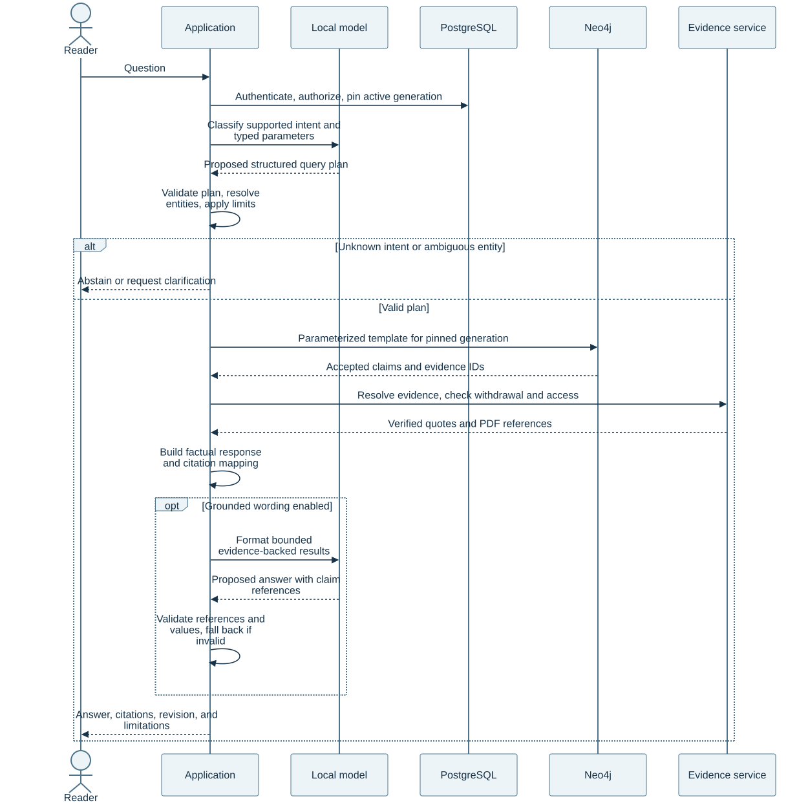

<details>
<summary>Diagram source (Mermaid)</summary>

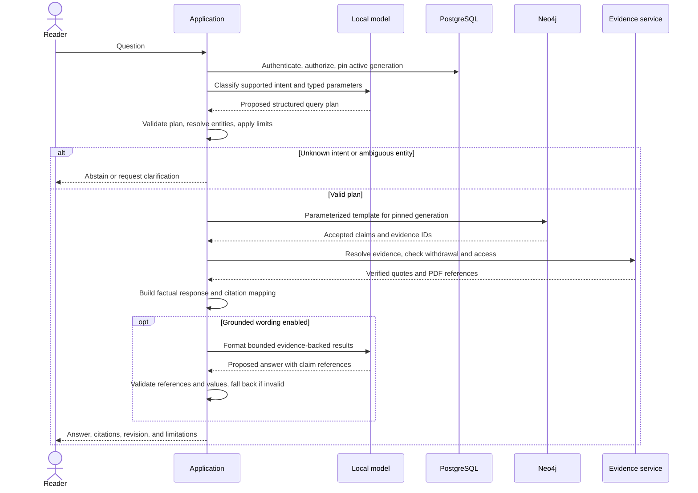

</details>

**Figure 5 — Target QA flow.** The model proposes an intent and optional wording. The application controls authorization, query construction, evidence resolution, and the final result.

### 8.3 Answer rules and failure modes

The default response uses deterministic templates or structured tables, especially for numbers, comparisons, and conflicts. Optional generated wording cannot introduce new values or claim IDs; validate its structured fields and citations against the query result. Where semantic correctness cannot be checked reliably, fall back to the deterministic response. An entailment model alone is not a release guarantee.

If no accepted facts match, distinguish “no matching accepted knowledge” from a factual claim that something does not exist. An unavailable database or model is a service error, not an empty search result. Show the publication revision and data coverage. If the model is unavailable, structured search and graph browsing should still work.

Proposed bounds are a two-hop traversal catalogue, 100 returned rows by default, bounded server-side aggregation, a 5-second graph-query timeout, and a maximum of one active generative request on the 16 GB GPU baseline. Exact settings are benchmarked. Caching, if introduced, keys on workspace/access policy, active generation, intent/parameters, and model/template versions; retirement invalidates affected cached answers.

## 9. Technology choices and alternatives

Everything marked proposed is an architectural recommendation. Select exact future versions, licenses, and image digests during implementation and pin them in a separate deployment lock. Do not silently add the entire future stack to the current ingestion lock.

| Technology | Status and role | Why it fits / limitation |
|---|---|---|
| Python 3.12 | Existing pipeline; proposed application/worker language | Reuses ingestion and evaluation code; keeps three students in one backend language |
| Docling + pypdf | Existing parser and independent PDF-text/structure checks | Already evaluated locally; known difficult forms/tables remain quality risks |
| JSON/JSONL + JSON Schema; YAML for authored ontology | Existing artifact formats; proposed versioned contracts | Inspectable and easy to diff; schema validation must be supplemented by semantic checks |
| Python standard library (`csv`, `zipfile`, `sqlite3`, `urllib`) and openpyxl | Existing structured-data importer and corpus catalog | No server for ingestion state; rows stream file to file, with keys and nodes in SQLite, so memory stays flat. Revisit (for example Parquet or DuckDB) only if tables reach a size where JSONL is impractical |
| PP-OCRv6 detection (RapidOCR, ONNX) + VietOCR recognition | Existing default OCR engine in the document pipeline | Existing Vietnamese/mixed-language option; English-first deployment compares RapidOCR on representative well pages. Reads Vietnamese tone marks and English on CPU; about 180 MB of models; PP-OCR recognition and EasyOCR measured worse for Vietnamese ([E5](experiments/E5-ocr-engine-benchmark.md)). 25–50 s per scanned page on a laptop CPU; a GPU or more workers shorten large scan batches |
| FastAPI + Pydantic | Proposed API and typed request/response layer | Fits the Python codebase and explicit contracts; heavy work runs in a worker process |
| PostgreSQL | Proposed metadata, accepted-claim, audit, and job store | Transactions suit review decisions and workflow state; operationally one additional database |
| Neo4j Community initially | Proposed accepted-knowledge graph projection | Cypher supports explicit relation queries; application validators provide checks unavailable in the selected edition |
| llama.cpp server | Proposed local inference baseline | Supports local model serving and schema-constrained output; actual model quality and throughput require a benchmark |
| Small instruction-tuned open-weight model | Model family/checkpoint undecided | Benchmark a 7–8B model in 4-bit quantization first; validate license, tokenizer, schema compliance, and numerical accuracy |
| React + TypeScript | Proposed browser UI | Reusable document/review/answer screens; use a small UI surface and avoid a complex graph canvas in the first milestone |
| [PDF.js](https://mozilla.github.io/pdf.js/) or institution-approved equivalent | Proposed PDF evidence viewer | Page/rotation/geometry alignment must be tested against the stored provenance contract |
| Docker Compose on a supported Linux host | Proposed service packaging | A small set of containers, persistent volumes, health checks, and reproducible configuration; no clustering assumption |
| Institutional OIDC identity provider | Proposed login | Avoids maintaining student-built password storage; provider and group/role mapping must be confirmed |
| Existing reverse proxy + TLS; structured logs and health metrics | Proposed operational layer | Reuse school infrastructure where available; expose only the application endpoint |

The worker decision follows FastAPI's distinction between small in-process background work and heavy computation. A PostgreSQL job table is this project's proposed small-team implementation, not a built-in FastAPI queue. PostgreSQL explicitly documents `SKIP LOCKED` for queue-like consumers; leases, fencing, retries, fairness, and monitoring still need implementation. [FastAPI background work](https://fastapi.tiangolo.com/tutorial/background-tasks/), [PostgreSQL locking clauses](https://www.postgresql.org/docs/current/sql-select.html).

Neo4j's current documentation identifies existence, type, and key constraints as Enterprise features. The initial design therefore validates these rules in the application and uses available uniqueness constraints; it does not assume paid capabilities or fine-grained database authorization. Restrict database network access and keep all user access behind the application. Reassess licensing and operational needs before deployment. [Neo4j constraints](https://neo4j.com/docs/cypher-manual/current/schema/constraints/).

The llama.cpp server documents local serving and JSON-schema constraints. That supports testing it as the baseline runtime, but does not establish which model will meet the project quality gates. [llama.cpp server](https://github.com/ggml-org/llama.cpp/tree/master/tools/server). React and Compose provide the proposed UI and service-packaging primitives. [React documentation](https://react.dev/learn), [Compose application model](https://docs.docker.com/compose/intro/compose-application-model/).

**Alternatives and triggers.** Use a higher-throughput runtime such as vLLM only if measured concurrency justifies it and the selected GPU/runtime combination is supported. Add a dedicated queue only when job volume or scheduling needs outgrow the PostgreSQL design. Add embeddings/vector retrieval only if the approved question set cannot be served adequately by graph templates and lexical entity search; evaluate a passage-search baseline before claiming graph benefit. RDF/SHACL becomes relevant if formal semantic interoperability is a requirement. Kubernetes, streaming infrastructure, fine-tuning, and multi-GPU inference are outside the first-release baseline.

## 10. Security and data boundaries

### 10.1 Deployment and cloud policy

The production content path is local to an institutionally approved host/network. Prefetch and verify packages and model files through a controlled acquisition process. Then test the application with outbound internet access blocked, including DNS and telemetry paths. `HF_HUB_OFFLINE` and application settings are helpful but are not substitutes for a network policy.

Cloud credits or Colab can support experiments on the public GDR reports, public BSEE data, or synthetic fixtures. Private team PDFs, extracts, prompts, graph facts, backups, and logs must stay in the approved boundary unless the data owner and institution explicitly authorize an alternative deployment. This separation is a project design constraint; public-data experiments do not demonstrate a secure private-data deployment.

### 10.2 Threats and required controls

| Threat / failure | First-release control | Verification |
|---|---|---|
| Malicious or oversized PDF | Signature/size/page limits; parser subprocess/container with resource/time limits and restricted mounts/network; quarantine failure | Corrupt, encrypted, oversized, and slow-file fixtures terminate safely |
| Altered or malformed dataset archive | HTTPS host allow-list including redirects, recorded snapshot digests, optional pins, exact ZIP member name and size limit, strict layout parsing that fails on any mismatch | Tampered snapshot, wrong host, missing member, and malformed-row fixtures fail without writing output (implemented in `tests/test_bsee.py`) |
| Prompt injection inside a report | Documents treated as data; model has no tools; constrained outputs independently validated | Adversarial passages cannot change queries, permissions, or publication state |
| Generated query injection | Approved templates, bound parameters, no arbitrary model query execution | Malicious identifiers/inputs cannot add clauses, execute procedures, or bypass generation scope |
| Unauthorized viewing or editing | OIDC, server-side role checks on every route, private database/model ports, secure sessions | Reader cannot approve/publish; anonymous access denied; PDF/evidence routes checked directly |
| Sensitive data in diagnostics | Content-free operational logs by default; restricted diagnostic artifacts with retention | Logs/errors contain IDs and safe reasons, not document text, tokens, or credentials |
| Tampered source/model/package | Hash verification, approved artifact inventory, pinned versions, controlled import | Mismatches prevent execution; unreviewed remote model code is not enabled |
| Lost or partial publication | Immutable generations, completeness checks, atomic pointer activation, outbox replay | Injected crashes cannot expose a partial graph or lose review decisions |
| Resource exhaustion | Upload quotas, job queue, per-user rate limits, token/result/time budgets, single GPU admission queue | Load tests stay inside host memory and return explicit busy/retry responses |
| Improper deletion | Immediate retirement, source-to-derived dependency tracking, cache invalidation, scheduled purge | Withdrawn source contributes no answer; retention status and restore suppression are tested |

Use separate service identities for API reads, worker writes, and backups where the chosen software edition allows it. Otherwise compensate with private interfaces, isolated processes/configuration, trusted templates, and tightly restricted credentials; document the residual risk. Secrets come from operator-managed files or an existing secret service, never from Git or browser JavaScript. Use encrypted disks/backups and TLS on user-facing traffic under school policy.

### 10.3 Retention and audit

Proposed defaults for a small internal deployment are 30 days for failed-run diagnostics, 30 days for ordinary application logs, 90 days for rolling backups, and retention of accepted-run manifests/evidence while their knowledge is active. Audit retention is set with the institution; do not assume logs must contain document text. These durations are planning placeholders, not legal advice or agreed policy.

Retirement removes knowledge from serving immediately. Hard purge removes the source and derived artifacts after the approved retention period; a minimal tombstone can retain IDs, hashes, and reasons without keeping content. Backups expire on schedule. A restore reapplies retirement/purge tombstones before the service opens to users, so restoration cannot resurrect withdrawn content.

## 11. Deployment, capacity, and operations

### 11.1 Hardware baseline

The reported options are approximately an RTX 4080 SUPER or an A100. Verify the actual device, VRAM, host RAM, free disk, OS, driver, access schedule, and whether the GPU is shared before choosing a model. The standard RTX 4080 SUPER has 16 GB VRAM; A100 capacity varies by variant. Neither the presence of an A100 nor a dedicated allocation is assumed.

| Profile | Reasonable starting allocation | Purpose and limitation |
|---|---|---|
| Student development | Existing laptop/desktop, ideally 16–32 GB RAM and 50–100 GB free SSD | Unit tests, fixture processing, UI/API, small data; use fake model responses for most tests |
| Production baseline on research host | RTX 4080 SUPER-class 16 GB GPU, 8+ CPU cores, 32 GB RAM minimum / 64 GB preferred, 250 GB free SSD initially | One local 7–8B quantized model, one active inference request, modest ingestion queue; benchmark before admitting users |
| Optional A100 allocation | Actual available A100 variant; same application architecture | Larger context/model or faster experiments only after measurement; first release must still pass on the smaller agreed baseline |
| Backup location | Separate institutional disk/server with access controls and enough space for the chosen retention | A second directory on the application disk is not an independent backup |

For a rough model-weight estimate, 8 billion parameters at 4 bits require about 4 GB before quantization metadata, runtime buffers, and the context/key-value cache. Actual VRAM use is model- and runtime-dependent. Start with a 4K-token total context budget and one request, then benchmark 8K; the limit includes instructions, source context, and generated output. Do not infer that all remaining GPU memory is available for concurrent users. Load only one baseline model at a time, and schedule extraction around interactive use.

The hardware facts above should be checked against [NVIDIA's RTX 4080 family specifications](https://www.nvidia.com/en-us/geforce/graphics-cards/40-series/rtx-4080-family/) and [A100 specifications](https://www.nvidia.com/en-us/data-center/a100-gpu/). The RAM/disk allocations and model sizing are this project's estimates, not vendor performance guarantees.

### 11.2 Workload and service targets

The proposed release envelope is **10–20 registered users, up to 5 concurrent browser users, at most 2 simultaneous answer requests admitted to the queue, 100 documents, and 5,000 total pages**, with an initial upload limit of 50 MB and 300 pages per file. These are scope limits to test, not measured capacity. Larger reports require an explicit operator override or a later increase after a representative benchmark.

Provisional targets on the agreed reference host are: normal metadata pages within 2 seconds at the 95th percentile; graph lookup within 5 seconds; and a warm end-to-end answer within 30 seconds at the 95th percentile with two concurrent requests. Queue waiting is included in that answer target. Set a 60-second overall request deadline and expose “busy” instead of allowing an unbounded queue. Cold model startup is reported separately. If targets fail, reduce context/concurrency or use deterministic answers before increasing infrastructure.

Plan for ingestion as asynchronous batch work. Measure pages/minute separately for text, complex tables, and rejected scans. Do not use the existing once-measured parser timings as a production SLA. Track model requests/second, tokens/second, peak VRAM/RAM, accepted claims per page, review minutes per document, and graph-build time.

Storage planning uses measured pilot sizes: `original PDFs + parser caches + retained run bundles + database snapshots + model files + backups`. As an initial allowance, reserve 5–10 times source-PDF size for working artifacts, plus 20–50 GB for model/runtime assets, then measure and revise. Keep at least 20% disk free; alert earlier. The multiplier is an estimate and can be exceeded by images/caches. Do not purchase hardware on this estimate alone.

### 11.3 Environments and deployment


<details>
<summary>Diagram source (Mermaid)</summary>

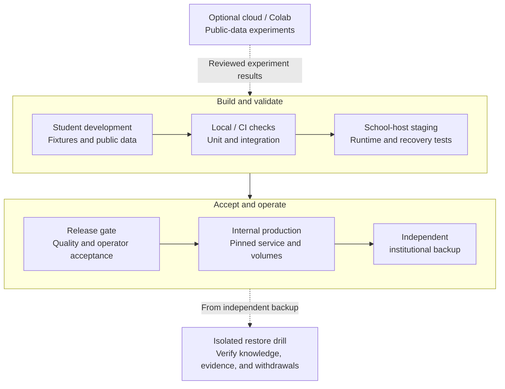

</details>

**Figure 6 — Delivery and recovery.** Staging can reuse the host at separate times if resources are limited, but it uses different volumes and credentials. Never run destructive integration tests against production stores.

Compose services are the reverse proxy/UI, application, worker, PostgreSQL, Neo4j, and model server. Keep database/model ports private. Persist data outside disposable containers. Pin images and verify GPU passthrough on the selected Linux host; current ingestion reproducibility is documented for a Windows CPU environment, so Linux output equivalence must be evaluated rather than assumed.

### 11.4 Operational runbooks required before launch

| Runbook | Required content / acceptance |
|---|---|
| Install and start | Verified offline artifacts, secrets, migrations, GPU/runtime checks, health checks, first admin, test document |
| Backup and restore | PostgreSQL backup plus matching immutable artifacts/manifests; restore in isolation, rebuild Neo4j, verify citations and tombstones |
| Failed jobs / model outage | Diagnose safe reason codes, requeue expired leases, pause inference, retain graph browsing, escalate to named operator |
| Release and rollback | Versioned images/config, migration compatibility, completed generation checks, previous application and graph revision |
| Disk/GPU pressure | Alert thresholds, queue limits, stop new ingestion, safe cache/old-generation cleanup, never delete active evidence |
| Source withdrawal / incident | Immediate serving block, audit, credential containment where needed, dependency cleanup, communication owner |
| Semester handover | Host ownership, maintenance access, backup location, support channel, renewal/license checks, final restore demonstration |

Proposed recovery objectives are **RPO 24 hours** (at most one day's accepted changes lost under the backup schedule) and **RTO one working day** during agreed support hours. They are targets, not guarantees; measure a full restore. Back up daily and before upgrades, check backup completion automatically, and perform at least one restore drill before release and each semester. Preserve a consistent PostgreSQL snapshot and all artifact hashes it references; files are immutable and must not be purged during backup capture. Neo4j may be backed up for speed, but must also be reconstructible.

Operational metrics include queue age, job failures/retries, model availability, GPU/host memory, disk space, projection lag, active generation, backup age, evidence-resolution errors, and QA abstentions. Assign actionable alerts to an operator. There is no meaningful production service without someone responsible after the student project ends.

## 12. Quality and acceptance

### 12.1 Separate the quality layers

| Layer | What it proves | What it does not prove |
|---|---|---|
| Artifact/hash validation | Files match their manifest and schema; offsets/links resolve | Every PDF fact was captured correctly |
| Ingestion evaluation | Coverage and table/text fidelity on evaluated examples | Correct entities, relations, units, or answers |
| Extraction/resolution evaluation | Typed facts and identity links match human labels | Every generated answer is correct |
| QA/user evaluation | Supported questions produce correct, supported results | Arbitrary questions or new domains will work |
| Operational/security tests | Specific access, failure, recovery, and offline controls work | Universal security or high availability |

### 12.2 Proposed release gates

Freeze the English oil-well evaluation split before tuning. Keep a development set for prompts/thresholds and a held-out test set for acceptance. Split by document, deduplicate overlapping reports/appendices, and disclose overlap with parser-selection data. A second person labels a subset independently and adjudicates disagreements. Report per-type and per-document results alongside aggregates. Historical WebNLG/2Wiki/EOR results remain research evidence; acceptance uses the agreed oil-well profile and English question catalogue.

Freeze an evaluation manifest containing source split, gold/rubric/scorer revisions and model/prompt/runtime hashes before the next extraction comparison. Score subject, property, value, unit, qualifier, depth/context and evidence together. Report answered-question coverage separately from abstention and QA correctness conditional on available facts. Compare passage retrieval, accepted-claim lookup and bounded graph traversal on the same questions/model conditions. Measure review minutes and corrections; oracle and AI-annotator agreement do not establish human-review accuracy. Adversarial state checks compare expected properties/edges, not only graph counts.

| Gate | Proposed minimum evidence |
|---|---|
| G1: Contracts and provenance | 100% valid published schemas, resolvable evidence, exact quote/offset checks, and valid source versions; no unknown schema version accepted |
| G2: Ingestion suitability | No silently missing substantive pages; known OCR/form/table limitations surfaced; published scope excludes unsupported pages or includes reviewed corrections |
| G3: Extraction utility | At least 200 held-out labelled claims across at least 10 documents; candidate precision ≥90% and recall ≥75%, reported by claim type; every production claim still reviewed |
| G4: Identity safety | At least 50 labelled alias/identity cases including ambiguity, spacing/case variants and in-document references; no incorrect automatic merge in the held-out set; fuzzy/uncertain cases require review; duplicate search surfaces at least 90% of seeded duplicate pairs |
| G5: QA correctness | At least 60 held-out questions covering supported intents, conflicts, unsupported/unanswerable cases; ≥90% correct supported answers; ≥95% correct abstention/clarification on designated negative cases |
| G6: Answer evidence | 100% of factual answer items have resolvable citations; ≥95% human-judged citation support; zero fabricated numeric values in the release test set |
| G7: Access and failure safety | All role/route tests pass; prompt-injection/query-injection cases cannot mutate or bypass access; crash/retry/withdrawal tests pass |
| G8: Operations | Measured load meets the agreed envelope, internet-blocked workflow succeeds, independent backup restores within agreed objectives, named operator accepts handover |
| G9: User value | At least 3 intended users complete the pilot tasks; completion/time targets assessed against the PDF baseline and failures recorded |

These sample sizes and thresholds are proposed feasibility gates for a student project. Report denominators and uncertainty; zero errors in a finite sample is not a zero-error guarantee. If a gate is infeasible or missed, narrow the supported scope and obtain a recorded product decision; do not relabel the target as achieved. Sensitive-data launch remains blocked by failed access, evidence, or recovery gates.

For extraction, a true positive requires matching subject, predicate, object/value, unit/context where applicable, and supporting evidence under a written matching rubric. Precision is correct predictions divided by all predictions; recall is recovered reference claims divided by all reference claims. Evaluate review effort separately: a model with good precision but excessive candidate volume may be impractical.

### 12.3 Documentation and implementation traceability

| Requirement group | Design coverage | Delivery milestone | Verification |
|---|---|---|---|
| FR-01/02/13 | Sections 3, 5, 7 | M1 | G1/G2; source/version and unsupported-page fixtures |
| FR-15 | Sections 3, 5.7, 7 | M1 (adapter, done); M3 (snapshot review and claims) | G1; snapshot, malformed-row and withheld-field fixtures; snapshot-diff review demo |
| FR-03/04/05 | Sections 5–7 | M2/M3 | G3/G4; frozen ontology and claim/identity benchmark |
| FR-16/18 | Sections 4.4, 5.4, 5.7, 6.1, 6.4 | M2 (profile and registry contract); M3 (registry in store) | G4 with English/scoped aliases; one oil-well entity linked across dataset/report; synthetic profile fixture loads and dispatches without core edits |
| FR-17 | Sections 5.8, 7, 8 | Later | Separate scope and evaluation for interpretations and expert notes |
| FR-06/07/09 | Sections 4, 5, 7 | M3/M4 | G1/G7; review conflicts, generation failure, rollback |
| FR-08 | Section 8 | M5 | G5/G6; intent catalogue and evidence-linked answer set |
| FR-10/11 | Sections 7, 10 | M1/M4/M6 | G7; direct endpoint authorization and deletion propagation |
| FR-12 | Section 11 | M6/M7 | G8/G9; restore, load, offline, pilot, handover |
| FR-14 | Sections 1, 6, 9 | Later | New evaluation and scope approval before production use |
| FR-19/20 | Sections 2.2, 4.4, 6 | M2 (ontology contract and loader); M4 (editor, assistant) | Invalid ontology rejected; activation diff and impact; re-run comparison; assistant draft never active without a person; portability runs on other public data |
| FR-21/22 | Sections 5.1, 5.4, 5.9 | M3 | G4; duplicate-search recall on seeded duplicates; no merge without decision; reference-resolution cases in the labelled set |
| FR-23 | Sections 5.3, 5.9 | M4 (routing); after G3 calibration (auto-accept) | Calibration report per claim type; audit sample of auto-accepted claims |

The [component guides](components/) remain the detailed reference for implemented behavior. This document provides a complete design baseline, but a baseline document does not mean implementation, operational validation, or stakeholder acceptance is complete.

## 13. Decisions, assumptions, and change control

### 13.1 Decision register

| ID | Decision / assumption | Status | Revisit trigger |
|---|---|---|---|
| D-01 | Target an internal production service for one team | User confirmed | Different operating audience or availability requirements |
| D-02 | Three student developers; school hardware and limited cloud credits | User confirmed | Staffing/access changes |
| D-03 | Size for a 4080 SUPER-class GPU; A100 optional | User supplied options; baseline proposed | Actual hardware inventory and benchmark |
| D-04 | Single shared document-access boundary | Proposed scope | Any per-document restrictions or multiple organizations |
| D-05 | Modular Python application, separate worker, no distributed platform | Proposed | Measured throughput or isolation requirements |
| D-06 | PostgreSQL authoritative workflow; Neo4j derived graph | Proposed | Team cannot operate two stores or graph value fails evaluation |
| D-07 | Human approval for published report claims by default (dataset claims per snapshot, D-14); threshold auto-acceptance per claim type under D-31 | Proposed release policy, amended by D-31 | Calibration results and product-owner approval |
| D-08 | Template-based graph queries and deterministic factual answers | Proposed | Supported-intent catalogue demonstrably insufficient |
| D-09 | Generalize metadata/upload through versioned adapters | Required to achieve stated portability | Approved replacement ingestion interface |
| D-10 | Private content stays inside the approved deployment | Derived from project purpose; policy confirmation needed | Institution authorizes another boundary |
| D-11 | Exact model and future package versions selected by benchmark | Open | M2 benchmark complete |
| D-12 | Operator, host allocation, IdP, budget ceiling, retention, support hours | Open | Must resolve before internal production launch |
| D-13 | Develop against BSEE well data and end-of-well reports, AK-3 first | Supervisor direction, relayed 25 Oct 2026 | Supervisor changes the focus |
| D-14 | Review allow-listed datasets per snapshot (summary and diff), not per claim; report claims stay per-claim | Proposed | Reviewer or product owner requires row-level review, or a dataset proves unreliable |
| D-15 | Keep BSEE raw and derived files out of Git; reproduce them from recorded snapshot digests | Proposed (size and unclear redistribution terms) | BSEE terms confirmed as open, and a small frozen fixture is needed in the repository |
| D-16 | Three-layer architecture: domain modules over a shared entity registry and core ontology, with applications on top | Adopted from VPI's KGinEP document (27 Oct 2026) | VPI revises its target |
| D-17 | Earlier proposal: wells/drilling plus subsurface interpretation | Superseded by D-26 | Retained as decision history |
| D-18 | Develop on public proxy data (BSEE, GDR end-of-well reports); any VPI document enters through the same adapters and gates | Proposed; VPI datasets not expected (D-33) | VPI documents arrive, or VPI restricts where they may be processed |
| D-19 | Earlier proposal: Vietnamese documents after OCR gate, with language-tagged names | Delivery language superseded by D-27; schema capability retained | Vietnamese expansion is separately prioritized and evaluated |
| D-20 | Preserve competing interpretations and attributed expert knowledge when this extension is implemented | Stakeholder target; later scope under D-26 | Separate extension decision |
| D-21 | Ingestion is domain-neutral: one document pipeline for every format and one mapping-driven importer for every table; sources are added by configuration, not code | Implemented 27 Oct 2026 ([E6](experiments/E6-generic-import-bsee.md), [E7](experiments/E7-corpus-pipeline-smoke.md)) | A source that cannot be expressed as a mapping or a supported document format |
| D-22 | Existing corpus default is VietOCR recognition with PP-OCRv6 detection; Vietnamese quality flags remain available | Implemented and measured ([E5](experiments/E5-ocr-engine-benchmark.md)); English workload under D-27 | English OCR benchmark justifies changing configuration |
| D-23 | Deliver the smallest reviewed evidence-to-answer workflow first | Delivery order retained; earlier second-domain minimum superseded by D-26 | Scope/workload changes |
| D-24 | Validate immutable bundles and exact generation membership before switching a pinned publication pointer | Required application contract; current defects open | Changed storage/consistency design |
| D-25 | Distinguish public-data demonstrator acceptance from private-data internal-pilot acceptance; retain the internal-service target | Delivery baseline; no new stakeholder approval implied | Host, reviewer or data-owner decision |
| D-26 | Domain-agnostic core; one oil-well application/profile delivered; subsurface interpretation and expert notes later | Team agreement relayed by user, 27 Oct 2026; portability extended by D-29 | Team/product owner explicitly changes scope |
| D-27 | English-first documents, extraction, QA and evaluation; existing multilingual capabilities/results retained | User direction, 27 Oct 2026; matches the supervisor's English-only first phase (7 Oct) | Additional language explicitly prioritized and evaluated |
| D-28 | The product is a knowledge-graph builder: a domain-agnostic pipeline and admin application. Oil and gas is the use case, not the product | Supervisor direction, 7 Oct 2026 ([digest](requirements/supervisor-meeting-2026-10-07.md)) | Supervisor or VPI changes the product framing |
| D-29 | The ontology is a user-supplied, versioned input: uploaded, edited and activated in the admin application, optionally drafted by an AI assistant. The team supplies only the oil-well test ontology. Portability is shown with a synthetic fixture, then one or two public datasets from other domains | Supervisor direction, 7 Oct 2026; supersedes the "synthetic fixture only" part of D-26 | Portability runs exceed capacity (cut back to the fixture), or a customer ontology needs a formal language |
| D-30 | Build order: graph builder and its admin application first; QA second; access control and hardening after the admin layer. Authentication stays a precondition for any private data or shared deployment | Supervisor direction, 7 Oct 2026 | Private data or other users arrive earlier than planned |
| D-31 | Human in the loop with confidence routing; per-claim-type threshold auto-acceptance only after held-out calibration and product-owner approval; never for identity merges | Supervisor direction (threshold), 7 Oct 2026; safeguards proposed by the team | Calibration fails its targets, or audit samples find errors |
| D-32 | Survey and reuse open-source KG-construction tools where measured better (for example relation canonicalization); the literature review and tool survey precede building each stage | Supervisor direction, 7 Oct 2026; survey done (27 papers, 13 repositories, [progress report](reports/KNOWLEDGE_GRAPH_BUILDER_PROGRESS_2026-10-27.md) §4) | A reused tool fails the license, offline or provenance requirements |
| D-33 | VPI will not supply datasets (confidentiality). Build an open platform on public data; the supervisor may provide one petroleum document for a joint final evaluation | Supervisor statement, 7 Oct 2026 | VPI offers data or a processing arrangement |
| D-34 | Within oil and gas: upstream wells and boreholes (drilling and production); geology and geophysics excluded | Supervisor direction, 7 Oct 2026; basis of D-13 and D-26 | Supervisor changes the focus |
| D-35 | Schedule: builder, admin application and QA in English within the first semester; the second semester improves selected areas. Report to the supervisor weekly | Supervisor expectation, 7 Oct 2026 | Semester calendar or capacity re-estimate shows it is infeasible |

### 13.2 Open questions for supervisor meetings

These items affect scope or priorities and need a decision from the supervisors or VPI. Until they are answered, the design uses the stated assumption. Record each answer as a decision in §13.1 and update the affected sections.

| # | Question | Current assumption | Affects |
|---|---|---|---|
| Q1 | Which petroleum document will the supervisor provide for the final joint evaluation, when, and may it be processed on school hardware? | Answered in part on 7 Oct: no VPI datasets (D-33); public proxies only; any private document stays within an approved boundary | SR-18, §10, M7 |
| Q2 | Which well properties and 5–8 English question intents form the initial oil-well workload? | One oil-well application agreed by team (D-26); catalogue still to finalize | §1.3, §6, M2–M3 |
| Q3 | Is a pilot-grade internal service the expected end state, or a demonstrated prototype with a handover package? | Internal service for one team (D-01) | M6–M7 effort, §11 |
| Q4 | When, if at all, should another language enter delivery? | English for the first semester (D-27, D-35); a later language is a second-semester candidate | §1.5, §6.4 |
| Q5 | Should the team add an oil-and-gas report for a BSEE well (for example a BSEE End of Operations Report) to demonstrate one entity shared by a dataset and a report? | Recommended for M3 | §1.3, §5.7, FR-16 evidence |
| Q6 | Which English oil-well reports enter the held-out acceptance set, and which geothermal reports remain development proxies? | AK-3/FORGE retained as well-report development material; oil-well acceptance set to agree | M2, G3/G5 |
| Q7 | Who will review oil-well claims and labels, and how much time can they give? | One reviewer named at M0 | R-06, G3–G5 |
| Q8 | May the two VPI requirement documents be published in this public repository? | No; kept out of Git | `docs/requirements/` |
| Q9 | Which papers did the supervisor intend (OnePetro 642469, EarthDoc DOI)? | Queiroz et al. ontology, unconfirmed | §6, [related work](references.md) |
| Q10 | Is the ontology assistant (FR-20) expected in the capstone deliverable, or is upload and editing (FR-19) enough? | Should: built after the editor if capacity allows | §6.5, M4 |
| Q11 | Is threshold auto-acceptance acceptable only with calibration and audit sampling as in D-31, and who approves a threshold? | Off by default; product owner approves per claim type | §5.3, FR-23 |
| Q12 | Which public datasets from other domains should the portability runs use? | Team proposes one or two with ready documents, after the oil-well workflow | §6.5, D-29 |
| Q13 | What do "first semester" and "second semester" contain, given the 20-week plan and graduation in June 2027? | Builder, admin application and English QA in the first; hardening, access control, pilot and selected improvements in the second (D-35) | Plan §1, §3 |

### 13.3 Change process

The product owner prioritizes user-visible scope. A technical lead records architecture changes and migration effects. Each change states its reason, affected requirement IDs, effort/capacity impact, test changes, and rollout/rollback path. Rebaseline the development plan if scope or resources change. Keep decisions in this register.

Update this document first when scope, interfaces, data ownership, deployment boundaries, or release gates change, then the plan. Update the current-state section only after code and verification evidence exist. Measurements live in [experiment records](experiments/README.md) and implemented behavior in [component guides](components/); link to them rather than copying numbers.

### 13.4 Glossary

| Term | Meaning here |
|---|---|
| Knowledge-graph builder | The product: pipeline plus admin application that turns documents and datasets into a reviewed knowledge graph under a user-supplied ontology |
| Ontology | Allowed domain types, relations, properties, and validation rules; supplied by the user organization |
| Referring expression / reference resolution | A mention that is not a name ("it", "the well"); resolving it links it to the named entity it refers to in the same document |
| Human in the loop | People approve, correct or reject what the machine proposes; thresholds decide which proposals need a person |
| Duplicate search | An admin tool listing node pairs that are probably the same real-world object, for a person to merge or keep apart |
| Knowledge graph | Entities and their supported relationships/claims |
| Provenance / evidence | The exact source version, passage, page, and processing history supporting a claim |
| Canonical entity | The stable internal identity to which names and aliases are linked |
| Claim | One asserted relation or value, with context, evidence, and review state |
| Projection / generation | A rebuildable, versioned graph representation of accepted knowledge |
| Idempotent | Repeating the same operation does not duplicate its effect |
| RPO / RTO | Acceptable data-loss window / target time to restore service |
| Abstention | An explicit statement that the system lacks enough supported information to answer |
| API well number | U.S. well identifier: 2-digit state code (an offshore pseudo-code for the OCS), 3-digit county, 5-digit well, optional 2-digit sidetrack code. BSEE uses 12 digits per borehole |
| Well / wellbore (borehole) | The surface hole (first 10 API digits) versus each original hole, sidetrack, or bypass drilled from it (12 digits) |
| BSEE / OCS | Bureau of Safety and Environmental Enforcement, which regulates wells on the federal Outer Continental Shelf |
| End-of-well (EOW) report | Operator or consultant report written after drilling: summary, hole sections, casing, cementing, surveys, time breakdown, geology, testing |
| Dataset snapshot | One retrieved set of dataset files, identified by their SHA256 digests and retrieval time |
| Withheld value | A field BSEE masks (for example until total depth or lease expiry); stored as `null` and listed separately from blank values |
| Domain module / profile | Versioned domain vocabulary, identifiers, rules, extraction context and trusted query catalogue; `oil_wells` is the first supplied profile |
| Entity registry | The shared list of entities with stable IDs, identifiers and aliases that all modules refer to (layer 2) |
| Interpretation | A claim that explains or concludes rather than records; stored with its author and links to competing views |
| Expert note | Knowledge written directly by an attributed expert in the application, reviewed by a second expert |
| VPI / PVN | Vietnam Petroleum Institute, the project's stakeholder / PetroVietnam, its parent group |
