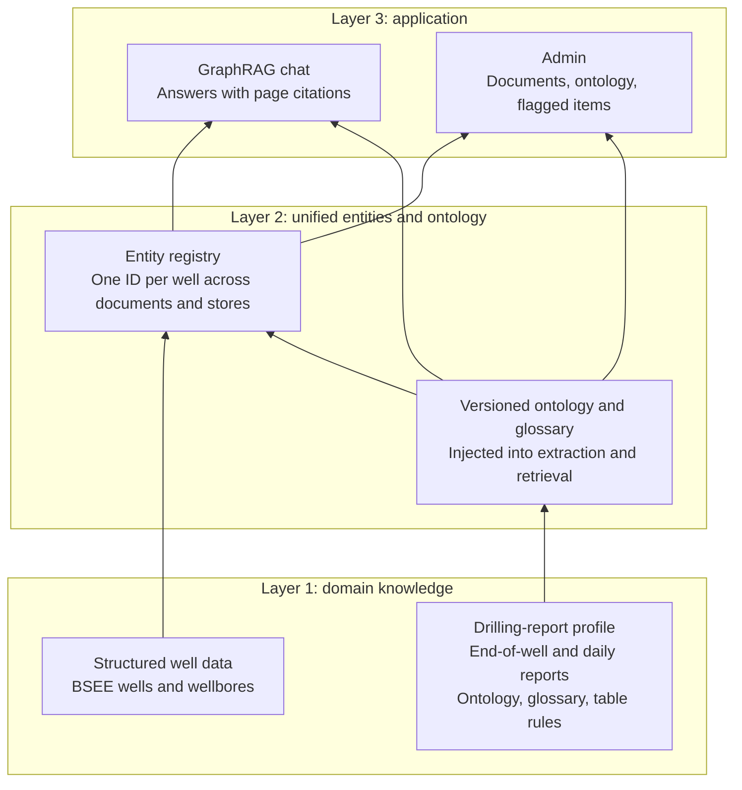
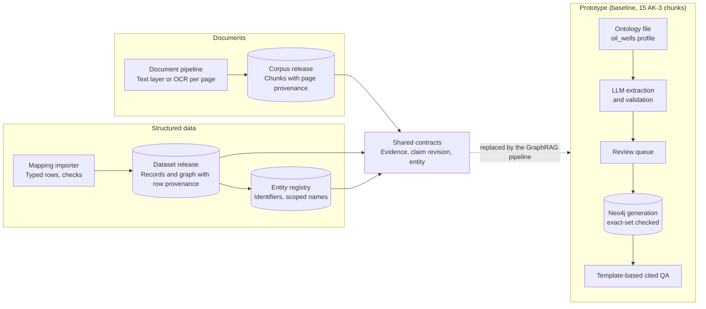
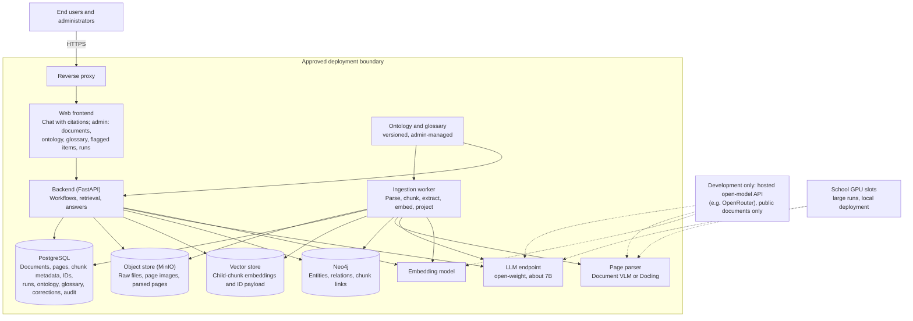
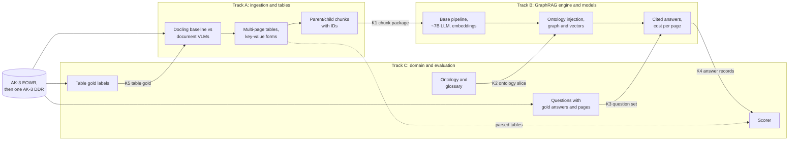
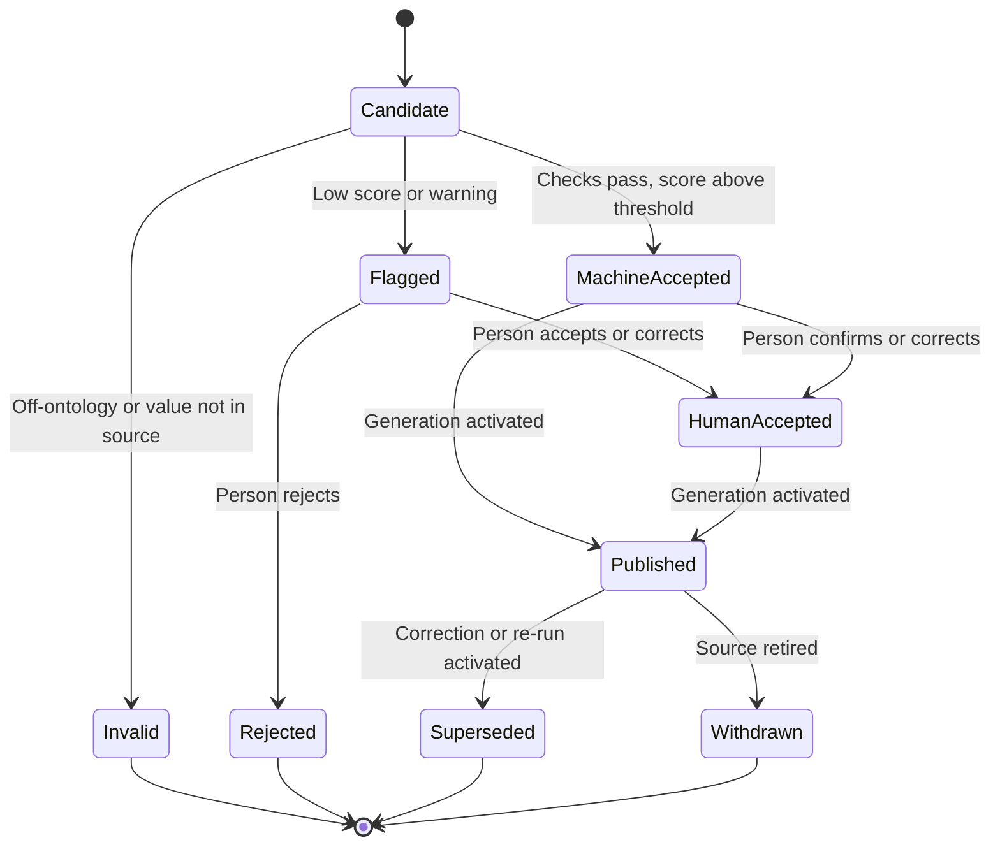
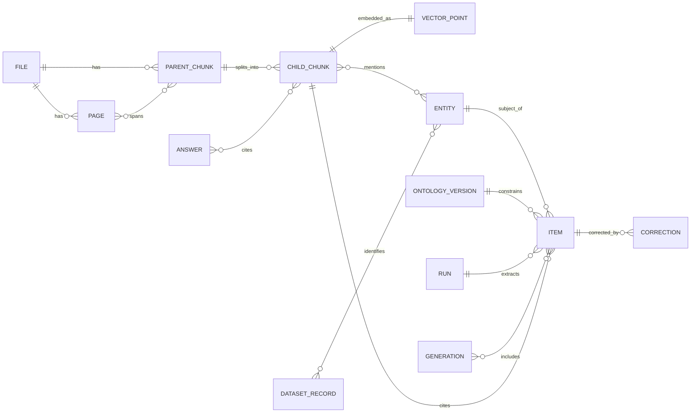
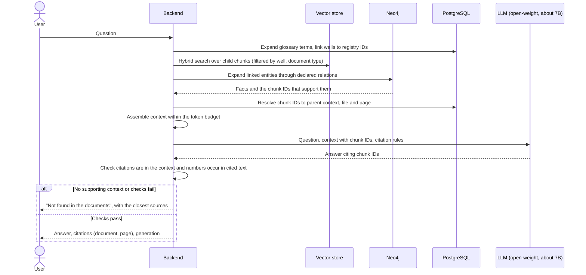

# Secure LLM and Knowledge Graph Platform

## Project specification and system design

**Document version:** 3.1 · **Baseline date:** 23 October 2026 · **Last revised:** 30 October 2026 (first build split into three tracks, §4.5)<br>
**Project context:** VPI capstone "Secure Domain-Specific LLM and Knowledge Graph Platform for Oil & Gas Technical Intelligence"; three students<br>
**Status:** design baseline for a GraphRAG application on drilling reports; ingestion, structured-data import, the entity registry and an extraction/QA prototype exist<br>
**Inputs:** [Stakeholder requirements](requirements/README.md), supervisor meetings of [7 October](requirements/supervisor-meeting-2026-10-07.md) and [28 October](requirements/supervisor-meeting-2026-10-28.md) · **Derived:** [Development plan](DEVELOPMENT_PLAN.md) · **Supporting:** [Data sources](DATA_SOURCES.md), [components](components/), [experiments](experiments/README.md)

> **This document is the project's single source of truth.** It decides what the project builds, for whom, how the parts fit together, and how completion is judged. The [stakeholder requirements](requirements/README.md) and supervisor meetings are inputs; §1.2 states how each requirement is met, narrowed or dropped. The [development plan](DEVELOPMENT_PLAN.md) schedules this specification and must not add scope of its own. Component guides describe implemented behavior, and experiment records hold measurements. If any of them disagrees with this document, this document wins until it is changed. Items still to settle with the supervisors are in [§13.2](#132-open-questions-for-supervisor-meetings).

**Version 3.0 (29 October 2026)** applies the [28 October supervisor meeting](requirements/supervisor-meeting-2026-10-28.md), decisions D-36 to D-47. The product is now a **GraphRAG application** for drilling reports, built on an existing open-source GraphRAG pipeline and delivered as a full application for administrators and end users. Models are open-weight and about 7B or smaller; commercial models are not used. Pages are parsed with vision-language models, with tables as a dedicated workstream. Content that no longer fits was **removed**, not just marked: template-only QA, per-claim approval of everything, interpretation and expert-note workflows, OCR-engine tuning, portability runs as a deliverable, and the research workstream. The digest's [§13](requirements/supervisor-meeting-2026-10-28.md#13-effect-on-the-documentation) lists each removal and its reason; superseded decisions stay in §13.1 as history. Versions 2.0–2.4 (23–27 October) introduced the three-layer target, the domain-agnostic core with an `oil_wells` profile, English-first delivery and the 7 October knowledge-graph-builder framing; their surviving parts are folded in here. **Version 3.1 (30 October)** adds §4.5. The first build is split into three tracks that are researched and built independently and joined by versioned files (D-48). The stores, API and frontend are deferred to M2.

### Reading guide

| If you need to understand… | Start here |
|---|---|
| Why the project exists and what it delivers | [1. Product](#1-product-purpose-and-scope), [2. Users](#2-users-and-workflows) |
| Which data the team builds on | [Data sources](DATA_SOURCES.md), [§1.3](#13-three-layer-target-and-what-the-capstone-delivers) |
| What is implemented today and what is missing | [3. Current baseline](#3-current-implementation-and-evidence) |
| How the system fits together and where data is stored | [4. Architecture](#4-target-architecture) |
| How documents become chunks, vectors and graph | [5. Processing](#5-document-to-graph-processing), [5.10 Tables](#510-tables-in-drilling-reports), [5.11 IDs](#511-identifiers-and-cross-store-linking) |
| How the ontology is defined, injected and verified | [6. Ontology](#6-ontology-layer-and-domain-modules) |
| How questions are answered | [8. Question answering](#8-question-answering) |
| Which models and tools, and why | [9. Technology choices](#9-technology-choices-and-alternatives) |
| Security, hosting and compute | [10. Security](#10-security-and-data-boundaries), [11. Compute and operations](#11-deployment-capacity-and-operations) |
| How completion is measured, and what is decided | [12. Acceptance](#12-quality-and-acceptance), [13. Decisions](#13-decisions-assumptions-and-change-control) |

All architecture diagrams describe the **target** unless labelled **current**. Diagrams are SVG images with expandable Mermaid source; the source is authoritative ([how to regenerate](diagrams/README.md)).

## 1. Product purpose and scope

### 1.1 Problem and intended value

The project is a capstone for the Vietnam Petroleum Institute (VPI), supervised by Dr. Le Duy Dung and MSc. Nguyen Anh Tuan. Its aim, from the [proposal](requirements/README.md#capstone-proposal-digest), is a pilot of an in-house, secure AI platform that extracts, organizes and reasons over PetroVietnam's (PVN's) technical knowledge. Commercial LLM services are not an option: the data is confidential, and the security requirements are strict.

Drilling knowledge sits in long reports, most of it in tables: end-of-well reports, daily drilling reports, casing and survey tables, time breakdowns. Finding a fact means opening several documents, matching different names for the same well, reading multi-page tables whose headers appear only on the first page, and checking which source says what. One well is mentioned in many documents, and nothing links them.

The product is a **GraphRAG application** for drilling reports (D-36). It ingests reports, parses pages and tables with a vision-language model (D-39), and has an open-weight LLM extract entities and relations under an ontology the user supplies (D-29). It stores the results as linked chunks, vectors and a knowledge graph with unified entity IDs (D-42), and answers questions with citations to the source page. Administrators manage documents, the ontology and glossary, and correct low-confidence items (D-43); end users ask questions and inspect sources. The team builds on an existing open-source GraphRAG pipeline and spends its effort where those pipelines are weak:

- drilling tables;
- injecting the ontology during ingestion;
- unified IDs across documents and stores;
- human-in-the-loop correction;
- running well on models of about 7B parameters (D-37).

This is a capstone, not a research project (D-41). Effectiveness on real drilling documents matters more than novelty. The team starts with a basic working pipeline and upgrades parts when a measured improvement is available.

### 1.2 Stakeholder requirements and how they are met

VPI's [requirement documents](requirements/README.md) define 18 stakeholder requirements. **Covered** = in the first-release scope; **Partial** = part in scope; **Later** = architecture leaves room, nothing committed; **Not in capstone** = dropped from this project.

| ID | Requirement (short) | Decision | Where |
|---|---|---|---|
| SR-01 | Secure on-premise or private-cloud deployment; data owner keeps control | Covered: open-weight models deployable on a local GPU; no commercial APIs; hosted open models only on public data during development | §10, §11, D-37, D-38 |
| SR-02 | Automated extraction of structured knowledge from unstructured documents | Covered: VLM parsing plus ontology-guided LLM extraction | §5 |
| SR-03 | A domain-specific oil-and-gas knowledge graph | Covered: drilling-report graph on a domain-agnostic core | §1.3, §6 |
| SR-04 | Customized LLM-based reasoning and question answering | Covered: GraphRAG with open ~7B models; no fine-tuning in the baseline | §8, §9 |
| SR-05 | Long-term technological independence | Covered: open-weight models and open-source stack | §9 |
| SR-06 | Separate domain knowledge graphs | Partial: versioned profile boundary; one drilling-report profile delivered | §6 |
| SR-07 | Unified entity identification and shared ontology | Covered for wells: one ID per well across documents, datasets and stores | §5.7, §5.11 |
| SR-08 | Several hypotheses with supporting and opposing evidence | Not in capstone (removed with §5.8 of version 2) | §13.1 D-20 |
| SR-09 | Deterministic system structure for midstream/downstream | Not in capstone | — |
| SR-10 | Rich relation types | Partial: relation types declared by the user's ontology; structural and conditional relations in the drilling profile | §6.3 |
| SR-11 | Synonyms and context-dependent terms | Covered: glossary and abbreviation area, scoped aliases | §6.4 |
| SR-12 | Vietnamese, English and Russian material | Partial: English first; language-tagged names retained | §6.4, D-27 |
| SR-13 | Diverse source types | Partial: drilling-report PDFs (end-of-well, daily) and structured well datasets | §1.3 |
| SR-14 | Continuous growth | Covered: incremental ingestion, versioned runs and graph generations | §4.3, §5 |
| SR-15 | Preserve expert knowledge | Partial: user corrections and glossary entries are attributed and kept; separate expert-note capture is not in the capstone | §5.3 |
| SR-16 | Retrieval by relationship, not only keyword | Covered: graph expansion in retrieval | §8 |
| SR-17 | Application layer: RAG, Graph RAG, assistant, QA | Covered: GraphRAG question answering with citations for end users | §8 |
| SR-18 | The knowledge is PVN's | Partial: VPI supplies no datasets (D-33); built and evaluated on public data; installable on a VPI-controlled host | D-33 |

### 1.3 Three-layer target and what the capstone delivers

VPI's three-layer target gives the shape:

1. domain knowledge;
2. unified entities and ontology;
3. applications.

The core stays independent of oil terminology, and a versioned profile supplies the drilling ontology, glossary and rules.


<details>
<summary>Diagram source (Mermaid)</summary>



</details>

**Figure 9 — Three layers in the capstone.** Drilling terminology and rules are profile inputs. The application layer is the full application: chat for end users, administration for the people who ingest and correct.

| Layer | Capstone delivers | Not in the capstone |
|---|---|---|
| 1. Domain knowledge | Everything in **drilling reports by document type** (D-40): end-of-well reports and daily drilling reports, including their geology sections at summary level. Structured well data (BSEE) for identity. | Other document families and other domains (optional later work) |
| 2. Unified entities and ontology | Entity registry with one ID per well across documents, datasets, vectors and graph; versioned ontology and glossary that the admin manages and the pipeline injects (§5.11, §6) | Formal ontology languages (OWL), automatic reasoning |
| 3. Applications | GraphRAG question answering with citations for end users; administration of documents, runs, ontology, glossary and flagged items (§2, §8) | Decision support, competing-hypothesis workflows, fine-tuning |

**Development data.** VPI will not supply datasets (D-33), so development uses public proxies ([Data sources](DATA_SOURCES.md)):

- the BSEE well files for well identity;
- public end-of-well reports, starting with Akutan AK-3;
- daily drilling reports, starting with the daily reports in the AK-3 appendix portfolio.

A public oil-and-gas daily-report collection for wells in a structured dataset is still to be found (§13.2 Q5). Work starts on **one document** (D-44): AK-3's end-of-well report, then one daily report. More documents come only after the result on one has been checked.

### 1.4 Meaning of "secure"

Secure means:

- document content and model inference stay inside an approved deployment boundary;
- no commercial model or API ever sees project data (D-37);
- users have authenticated, authorized access;
- changes and runs are auditable;
- backups exist.

During development the team uses hosted open-weight models through an API, **on public data only** (D-38, §10.1). That is a development convenience, not the deployment. The deployed system runs the same class of model locally. Local inference is necessary but not sufficient: access control, safe parsing and recovery are separate requirements.

### 1.5 First-release boundaries

| Included | Not included |
|---|---|
| English drilling-report PDFs: end-of-well and daily drilling reports, text and scanned pages | Vietnamese/Russian delivery; Office/email workflows; handwriting |
| VLM page parsing to Markdown/HTML, with tables as structured output; multi-page tables joined and headers carried over (§5.10) | Tuning classic OCR engines further |
| An existing open-source GraphRAG pipeline as the base, adapted for drilling reports (D-36) | Writing a GraphRAG framework from scratch; training extraction models |
| Open-weight models of about 7B parameters or smaller for extraction, answering and parsing (D-37) | Commercial models or APIs; models above the size limit as the measured configuration |
| Object storage for raw files, a metadata database, a vector store and a graph database, linked by one ID scheme (§4.2, §5.11) | Multi-region storage, high availability |
| Admin-managed versioned ontology and glossary (abbreviations), injected into extraction and retrieval (§6) | AI-generated ontologies activated automatically |
| Entity registry seeded from BSEE; one ID per well across documents | Fuzzy automatic merges |
| Confidence score on every extracted item; low-score items flagged for people to correct in the UI (D-43) | Per-item approval of everything; automatic identity merges |
| End-user chat with page citations; graph and source browsing | Arbitrary analytics, open-ended Cypher from the model |
| One shared document-access boundary; login and roles before any private data | Per-document permissions, multi-tenancy |

### 1.6 Delivery order and success measures

**Delivery order (D-45).**

1. **Ingestion, made clear and demonstrable.** VLM parsing, table handling and chunking with IDs, shown on one end-of-well report and one daily report.
2. **Data organization.** Where raw files, parsed pages, chunks, metadata, vectors and the graph live, and how IDs link them.
3. **A thin GraphRAG slice on one document.** On the chosen base pipeline: ontology injection, extraction, embeddings, graph, and cited answers to a few questions, checked by hand.
4. **Quality and control.** Glossary, entity linking across documents, confidence scores and flagged items, table extraction efficiency, and evaluation on the expert question set; then 5–10 documents.
5. **The full application.** Chat for end users, administration, governance features (versions, audit, corrections).
6. **Scale run** on booked school GPUs with a locally deployed model; **access control** and hardening.

The plan maps steps 1–5 onto the first semester. Step 6 and improvements fall in the second (D-35).

**Success measures.**

- **Answer quality** on the question set the drilling expert group provides (§12).
- **Citation correctness:** the cited page supports the answer.
- **Table fidelity** on the table evaluation set (§5.10).
- **Cost:** LLM calls, tokens and GPU time per page.
- **Correction effort:** flagged items per document, and minutes per correction.

A pilot with intended users, if one can be arranged, measures task time against reading the PDFs directly. Targets are proposals until measured.

## 2. Users and workflows

### 2.1 Roles

| Role | Responsibilities |
|---|---|
| End user | Ask questions in the chat, read answers with citations, open the source page, browse a well's facts and documents, report a wrong answer |
| Administrator / knowledge engineer | Upload documents and start runs; manage ontology versions and the glossary; work through flagged items; confirm or reject identity merges; publish graph generations; retire documents |
| Operator | Model endpoints and GPU bookings, storage, backups, logs; access to content follows policy |

One person may hold several roles; actions still record which identity performed them.

### 2.2 Primary journeys

**Define the ontology and glossary.** An administrator uploads an ontology file or edits the active version:

- entity types;
- relation names with definitions and endpoint types;
- properties and units;
- per-document-type sections.

They also maintain a **glossary**: abbreviations (TD, BOP, WOC, ROP…) with expansions and term aliases. The application validates the ontology and shows the difference from the active version. Activating a version is recorded, and the next run uses it (§6).

**Ingest a document.** An administrator uploads a PDF and records its document type (end-of-well, daily drilling report), source and permission. The file goes to object storage under a file ID. A VLM parses each page into Markdown/HTML with table structure. Multi-page tables are joined, and chunks are built with parent/child IDs. Entities and relations are extracted under the active ontology, embeddings are computed, and the graph is updated. The run page shows page coverage, tables found, items extracted, items flagged, LLM calls and tokens.

**Correct flagged items.** Every extracted item has a score. The admin view lists low-score items and items with validation warnings, each beside its source page. The administrator accepts, corrects or rejects it; a correction is versioned and attributed. Possible duplicate entities, such as two spellings of one well, are listed for a person to merge or keep apart.

**Ask a question.** An end user asks, for example, "What was the casing setting depth of the surface section in AK-3?" or "Which days had non-productive time on AK-3, and why?" The system links the well to its registry ID and retrieves chunks by vector and keyword search. It expands through the graph (the well's sections, casing, daily reports) and has the model answer from that context with citations. Each citation opens the source page. If the context does not support an answer, the system says so.

**Reprocess.** When the parser, model, prompt or ontology changes, a new run produces a comparison (added, changed, removed items). The served graph changes only when the administrator activates the new generation.

**Import well data.** An administrator imports a BSEE snapshot. Its wells and wellbores seed the registry, so report mentions of those wells link to one ID.

### 2.3 Functional requirements

"Must" applies to the first-semester application; "Should" is planned but may be cut; "Later" is outside the baseline. IDs from version 2 are kept where the requirement survives. FR-17 is removed, and FR-08 and FR-23 are rewritten.

| ID | Priority | Requirement | Observable outcome |
|---|---|---|---|
| FR-01 | Must | Register and verify source documents | File ID, hash, document type, metadata, permission and status; original stored immutably in object storage |
| FR-02 | Must | Parse documents with page provenance | Every chunk resolves to its file, version and physical page(s) |
| FR-03 | Must | Validate versioned ontologies | Invalid types, relation endpoints, units and duplicate names rejected before a run |
| FR-04 | Must | Extract locally into typed items under the ontology | Every item uses only declared types and relations, cites its chunk, or receives an explicit error |
| FR-05 | Must | Resolve entity names conservatively | Wells resolve by identifier or scoped name; uncertain matches go to a person; merges keep history |
| FR-06 | Must | Publish graph generations | A run never changes the served graph until its generation is checked and activated |
| FR-07 | Must | Browse facts and original evidence | A citation opens the correct file version and page |
| FR-08 | Must | Answer questions with GraphRAG and citations | Answers come from retrieved context only; every factual sentence cites a chunk; unsupported questions get an explicit "not found in the documents" |
| FR-09 | Must | Re-run, compare and roll back | A comparison report per re-run; the previous generation can be restored |
| FR-10 | Must | Roles and audit | Before any private data or shared deployment: login, roles, audited changes, server-side checks |
| FR-11 | Must | Retire documents | A retired document's chunks, vectors and graph items stop serving immediately |
| FR-12 | Should | Operate and recover | Backup and restore of all stores demonstrated once |
| FR-13 | Must | Report unsupported input honestly | Failed pages, unparsed tables and truncated content are visible per run |
| FR-14 | Later | More languages and document families | Separate scope and evaluation |
| FR-15 | Must | Import versioned structured well datasets with row provenance | Each record cites snapshot, file and row |
| FR-16 | Must | Shared entity registry | One opaque ID per well; dataset rows and report mentions link to it |
| FR-18 | Should | Language-tagged names and aliases | Aliases carry language and scope |
| FR-19 | Must | Manage the ontology in the admin application | Upload, edit, validate, diff and activate versions; re-run under a new version |
| FR-20 | Later | Draft an ontology with AI assistance | A draft is never active until a person edits and activates it |
| FR-21 | Must | Curate duplicates | Similar-entity search; merge, keep-apart and known-distinct decisions with history |
| FR-22 | Should | Resolve references within a document | "The well", "it" link to the named well in the same document, or the item is flagged |
| FR-23 | Must | Score every item and route low scores to people (D-43) | Each item has a score and its signals; items below the threshold or with warnings appear in the flagged list; corrections are versioned and attributed |
| FR-24 | Must | VLM page parsing | Pages are parsed by a configured VLM (or Docling) into Markdown/HTML; parser and model recorded per page |
| FR-25 | Must | Table handling | Tables keep row/column structure and merged cells; continuation pages are joined to their table with the header carried; rows never split mid-row; long rows handled without silent truncation (§5.10) |
| FR-26 | Must | Storage layout and ID linking | File → page → parent chunk → child chunk → vector point → graph evidence, one ID scheme across stores; a well has one ID across all documents (§5.11) |
| FR-27 | Must | Retrieval index | Child chunks embedded with a pinned embedding model; vector, keyword and graph retrieval combined (§8) |
| FR-28 | Must | Model endpoint configuration | Every LLM, VLM and embedding call goes through one OpenAI-compatible client; endpoint, model and version recorded per run; hosted endpoints refused for non-public documents (§10.1) |
| FR-29 | Must | Glossary and abbreviations | Admin-managed, versioned; used in name normalization, extraction prompts and query expansion |
| FR-30 | Must | Cost and volume accounting | Per run: LLM calls, input/output tokens, pages, GPU or API time, cost estimate |

## 3. Current implementation and evidence

### 3.1 What exists

Everything below was built before the 28 October direction. It remains valid as the ingestion and identity foundation; the GraphRAG parts are not built.

- **Document ingestion** ([`graph_builder.corpus`](components/corpus-ingestion.md)).
  - Registers PDFs, scans, images and Office/HTML/Markdown files into a content-addressed store with a SQLite catalog.
  - Decides per page whether to read the text layer or run OCR, using Docling with a local OCR engine.
  - Produces passage and table chunks with page, region and section provenance and quality flags; per-document, resumable and parallel ([E7](experiments/E7-corpus-pipeline-smoke.md), [E8](experiments/E8-ak3-appendices-corpus-run.md): 44 AK-3 appendix PDFs, 463 pages, 1,778 chunks).
  - Tables are exported as Markdown, and table chunks split only between rows.
  - Exports are validated and published as immutable releases behind an atomic pointer ([E11](experiments/E11-publication-and-import-fixes.md)).
- **Structured-data import** ([`graph_builder.datasets`](components/dataset-import.md)). A mapping file turns CSV/Excel/JSON-lines into typed records and a property graph with row provenance. BSEE well data is one such mapping ([E6](experiments/E6-generic-import-bsee.md)).
- **Shared contracts** ([`contracts.py`](../src/graph_builder/contracts.py), [`schemas/`](../schemas/)). Evidence, claim-revision and entity records; a chunk and a dataset row become the same kind of evidence ([E12](experiments/E12-shared-evidence-contract.md)).
- **Entity registry** ([`graph_builder.registry`](components/entity-registry.md)). 57,453 wellbores and 39,518 wells from BSEE; resolves by identifier or scoped name, never by similarity ([E13](experiments/E13-entity-registry-bsee.md)).
- **Extraction/QA prototype** ([`prototype/`](../prototype/README.md)), on 15 AK-3 chunks with an ontology file of 14 properties:
  - Qwen2.5-3B through llama.cpp on CPU;
  - one LLM call per text chunk and **one call per table row**;
  - validation, a stand-in reviewer, Neo4j generations;
  - template-based cited QA.

  Results: precision 0.968, recall 0.732, 23/31 questions correct end to end, on development data ([E10](experiments/E10-profile-driven-prototype.md)). It now serves as the **baseline** that the GraphRAG pipeline must match or beat on the same questions.

**Not built:**

- VLM parsing;
- multi-page table joining;
- object storage;
- parent/child chunk IDs across stores;
- embeddings and a vector store;
- a GraphRAG base pipeline;
- ontology injection beyond the prototype prompt;
- the glossary area;
- confidence scores and the flagged-item list;
- the frontend;
- login and roles.


<details>
<summary>Diagram source (Mermaid)</summary>



</details>

**Figure 1 — Current implementation.** Both pipelines publish validated releases and feed one evidence contract; the registry is built from the dataset release. The prototype is kept as the measured baseline. None of this is a production service.

| Responsibility | Current code |
|---|---|
| Document catalog, page analysis, conversion, OCR, chunking, validation, export | [`corpus/`](../src/graph_builder/corpus/) |
| Mapping-driven import | [`datasets/`](../src/graph_builder/datasets/) |
| Immutable releases and atomic pointer | [`publication.py`](../src/graph_builder/publication.py) |
| Evidence, claim-revision and entity records | [`contracts.py`](../src/graph_builder/contracts.py), [`schemas/`](../schemas/) |
| Entity registry and resolver | [`registry.py`](../src/graph_builder/registry.py) |
| Prototype extraction, review, generations, QA (baseline) | [`prototype/kgproto/`](../prototype/kgproto/) |
| Earlier PDF pipeline and BSEE adapter (frozen for reproduction) | [`ingestion/`](../src/graph_builder/ingestion/), [`graph/bsee.py`](../src/graph_builder/graph/bsee.py) |

### 3.2 Evidence and limits

- The committed PDF bundle has 3 documents, 155 pages and 372 chunks ([E1](experiments/E1-pdf-ingestion-configuration.md)).
- The BSEE snapshot of 18 October 2026 parses into 57,453 boreholes, 39,518 wells and 587 API-number changes with zero errors ([E3](experiments/E3-reproduction-run-2026-10-25.md)).
- Extraction and QA numbers are in-sample development results on one report.
- The test suites passed on 27 October ([E11](experiments/E11-publication-and-import-fixes.md)).
- No measurement yet covers daily drilling reports, VLM parsing, multi-page tables or retrieval quality.

### 3.3 Gaps the architecture must close

1. **Tables.** Docling parses simple tables. Daily-report tables with nested text and merged cells are not evaluated, continuation pages lose their header, and chunks of a continued table are not joined (§5.10).
2. **LLM volume.** The prototype makes one call per table row: 50 rows means 50 calls. Rows over the 1,500-character budget exceed the model's context and are cut. Extraction cost must be bounded (§5.3).
3. **Storage and IDs.** Chunks live in per-corpus files and SQLite. There is no object store, vector store, or ID scheme that links a chunk to its vector payload and graph evidence (§4.2, §5.11).
4. **Ontology control.** The prototype injects one prompt template. There is no defined injection point per stage, no slicing of a large ontology to fit the context, and no verification report (§6).
5. **Retrieval.** There are no embeddings or vector index, so questions are answered only by templates (§8).
6. **Cross-document identity.** The registry links BSEE rows, but report mentions are not yet linked to it, and no daily report is linked to its end-of-well report.
7. **Reliability and security.** Open findings from the repository review remain (cache identity, redirect checks; [E9](experiments/E9-repository-review.md)); authentication and roles are not built.

## 4. Target architecture

### 4.1 Components and trust boundary

A modular Python backend with a separate ingestion worker, a web frontend, and model endpoints behind one client. The GraphRAG base pipeline (D-36) runs inside the worker and the backend as a library, wrapped by the project's ID scheme, ontology injection and storage layout. It does not run as a separate product with its own storage rules.


<details>
<summary>Diagram source (Mermaid)</summary>



</details>

**Figure 2 — Target components and stores.** Users never reach a database or model endpoint directly. During development, model calls may go to a hosted open-model API for public documents only; large runs and the deployed system use local models on booked GPUs.

### 4.2 Which store owns what

The supervisor asked for raw files, chunk/metadata and vectors to be designed as separate stores linked by IDs (D-42).

| Store | Owns | Rule |
|---|---|---|
| Object store (MinIO, S3-compatible; a plain directory in development) | Original files, page images, the parser's per-page output (Markdown/HTML and layout JSON), run artifacts | Write once under content-addressed keys; never overwrite; back up originals |
| PostgreSQL | File and page records, parent/child chunk records and text, table records, ID mappings, runs and their cost, ontology and glossary versions, extracted items and scores, corrections, merges, generations, audit | System of record; anything else can be rebuilt from it plus the object store |
| Vector store | One point per child chunk: its embedding, plus a payload of IDs and filters (file, page, parent, document type, well IDs, ontology version, generation) | Derived; rebuildable from PostgreSQL and the pinned embedding model |
| Neo4j | Entities, relations, chunk nodes and `MENTIONS`/evidence links, per generation | Derived; rebuildable; never the only copy of a correction |

**Choosing the vector store.** Start with whatever the chosen GraphRAG base supports, provided its payload can carry the ID fields in §5.11. Candidates:

- Neo4j's built-in vector index (one store fewer);
- pgvector in PostgreSQL;
- Qdrant (payloads are first-class).

Pick one in M1; do not run two.

### 4.3 Runs and publication

Each run has an ID and pins:

- file versions;
- parser and VLM model;
- LLM and embedding model (endpoint, name, version);
- prompt templates;
- ontology and glossary versions;
- configuration.

Each graph build is a **generation**. The worker writes the generation's graph items and vectors, checks counts and that every item resolves to a chunk, then the administrator activates it. Readers pin one generation per answer. A failed or partial build never becomes active. The existing release mechanism ([E11](experiments/E11-publication-and-import-fixes.md)) and exact-set generation check carry over.

### 4.4 Core and domain-profile boundary

The core works on typed contracts and opaque IDs; drilling semantics enter through a versioned profile selected per run.

| Domain-agnostic core | Drilling-report profile and adapters |
|---|---|
| File registry, page parsing, chunking, ID scheme, storage | Document types (end-of-well, daily drilling report) and their section and table layouts |
| Entity registry, conservative resolution | Well/Wellbore types, API-number schemes, well-name scoping rules |
| Ontology loading, validation and injection; extraction runner | Entity and relation types, definitions, properties, units, glossary, extraction examples |
| Scoring, flagged items, corrections, generations | Score thresholds per item type |
| Retrieval, answer generation, citation checks | Example questions; table column mappings for known layouts |

The ontology belongs to whoever runs the system (D-29). The team writes the core and supplies the drilling-report profile as its test ontology. A synthetic second profile checks that no core code names a well type.

### 4.5 First build: three tracks joined by files

The target in §4.1 is not built in one go (D-48). The first phase (plan M1) builds the **one-document slice**: the AK-3 end-of-well report and then one AK-3 daily report, from pages to cited answers. The work is split into three tracks. Each track has its own owner for the stint, research questions, data, tools and experiment records. The tracks touch each other only through the versioned files listed below. No database, API or frontend sits between them in this phase.

| Track | Question it answers | Covers (spec sections) | Produces |
|---|---|---|---|
| **A. Ingestion and tables** | How do drilling-report pages become correct text, tables and chunks with stable IDs? | §5.1 stages 1–4, §5.10, §5.11 up to child chunks | The chunk package (K1) |
| **B. GraphRAG engine and models** | Which base pipeline, ~7B LLM and embedding model turn chunks into a graph and cited answers, and at what cost? | §5.1 stages 5, 8 and 9, §5.3, §6.2 injection, §8, §9 model and base rows, the vector store choice in §4.2 | Answer records (K4); base, model and vector-store choices with a comparison |
| **C. Domain and evaluation** | What should the system know and answer, and how good is it? | §6 ontology and glossary content, §12 measures, Q2 and Q5 | Ontology slice (K2), question set (K3), table gold (K5), the scorer and its reports |



<details>
<summary>Diagram source (Mermaid)</summary>



</details>

**Figure 10 — First build.** Arrows are files, not calls. Every contract has a version 0 built from what already exists, so no track waits for another to start.

| Contract | From → to | Content | Version 0 (exists today) |
|---|---|---|---|
| **K1 Chunk package** | A → B | Per document: the file record (`file_id`, name, document type, page count); pages (`file_id:p<n>`, parser and model); tables (`file_id:t<n>`, page span, header, cells); parent and child chunks (§5.11 IDs, text, pages, table ID and row range) | AK-3 chunks from the current corpus pipeline (`data/processed/gdr_chunks_full.jsonl`, [`corpus_chunk.schema.json`](../schemas/corpus_chunk.schema.json)), converted to K1 IDs |
| **K2 Ontology slice** | C → B | Entity and relation types with definitions, properties with units, document sections they apply to, short examples, glossary entries | [`prototype/profiles/oil_wells.json`](../prototype/profiles/oil_wells.json) (14 properties, [E10](experiments/E10-profile-driven-prototype.md)) |
| **K3 Question set** | C → B | Question ID, question, gold answer, answer type, file and page(s) holding the answer, evidence kind (text, table, multi-page table, key-value form), document type | [`prototype/gold/questions.json`](../prototype/gold/questions.json) and `ak3_facts.json` (31 questions) |
| **K4 Answer record** | B → C | Question ID, answer, cited child chunk IDs, base pipeline, models and versions, calls, tokens, cost | None; B writes the first one in week 2 |
| **K5 Table gold** | C → A | One CSV per labelled table, and a manifest with file, page span and the difficulty it tests (merged cells, continuation, key-value form) | [`data/gold/ingestion/tables/`](../data/gold/ingestion/tables/) (10 tables) and page annotations in [`data/gold/ingestion/pages/`](../data/gold/ingestion/pages/) |

The contract schemas live in `schemas/` next to the existing ones. The rules:

1. A track changes a contract only by publishing a new version. It announces the change in the group chat and keeps the previous version readable for one week.
2. The scorer belongs to Track C, so no track grades its own output.
3. Each track records its comparisons as experiment records.
4. The first full pass, A's package through B's engine to C's scorer, happens at the end of the phase. One earlier dry run in week 3 checks that the contracts fit.

**Not in the first build:**

- MinIO, PostgreSQL and the four-store deployment (§4.2), which the next milestone builds from the K1 IDs;
- the API and the frontend;
- login;
- scores and flagged items;
- registry linking;
- local GPU runs;
- more than two documents.

The tracks are the split for the current stint. The team divides the work again every one to two weeks (D-48), and uses the data/backend/frontend split (D-46) once the application work starts (plan M2).

## 5. Document-to-graph processing

### 5.1 Stages

| Stage | Input | Processing | Output / failure behavior |
|---|---|---|---|
| 1. Register | Uploaded file + document type | Check signature, size and page limits; hash; store the original in object storage; assign a file ID | File record; unsupported or corrupt files rejected with a reason |
| 2. Parse | File version + parser config | Render pages; a document VLM (or Docling) produces per-page Markdown/HTML with tables as structured cells; record parser and model per page (§5.10, FR-24) | Parsed pages in object storage; failed pages listed |
| 3. Assemble tables | Parsed pages | Join tables that continue across pages, carry the header to continuation rows, keep merged-cell spans, link each table to its pages | Table records with page spans |
| 4. Chunk | Parsed pages + tables | Parent chunks: sections and whole tables; child chunks: passages and row groups that fit the token budget, never splitting a row; header repeated in each table child (§5.11) | Parent/child chunk records with IDs and page provenance |
| 5. Extract | Child chunks + active ontology slice + glossary | The LLM extracts entities, relations and properties using only declared types; deterministic mapping for recognized table layouts; batching rows within the token budget (§5.3, §6.2) | Items with chunk citation, raw value, unit and score signals |
| 6. Validate and score | Items + ontology | Check types, endpoints, units and that the quoted value appears in the chunk; compute a score; warnings for anything odd | Valid items with scores; invalid items recorded with reasons |
| 7. Resolve | Entity mentions + registry + glossary | Normalize names and expand abbreviations; match identifiers and scoped names; suggest duplicates | Links to registry IDs, or flagged ambiguity |
| 8. Embed and index | Child chunks | Embed with the pinned embedding model; write points with ID payloads | Vector points |
| 9. Project and activate | Items, links, chunks | Build the Neo4j generation (entities, relations, chunk nodes, evidence links); check it; administrator activates | Active generation; failures leave the previous one serving |
| 10. Correct | Flagged items | People accept, correct or reject in the admin UI (§5.2) | Versioned corrections, applied in the next generation |

Dataset records skip stages 2–5 and 8. A versioned field mapping produces items with row evidence, approved per snapshot (D-14), and seeds the registry (§5.7).

### 5.2 Item lifecycle and review by exception


<details>
<summary>Diagram source (Mermaid)</summary>



</details>

**Figure 3 — Item lifecycle.** People review by exception (D-43). Items that pass validation with a score above the threshold are published, labelled machine-extracted. Flagged items wait for a person. Any published item can still be corrected from the UI; a correction creates a new version and keeps the old one.

**Score signals:**

- validation result;
- whether the value string occurs verbatim in the chunk;
- the extraction path (deterministic table mapping scores higher than free-text extraction);
- model self-check warnings;
- agreement between two extraction passes, if enabled;
- entity-resolution certainty.

The score is a ranking signal, not a calibrated probability. Set the threshold from the labelled sample (§12) so the precision of unflagged items meets the target; report the share of items flagged.

**Always a person:** identity merges, and items whose subject well cannot be resolved.

### 5.3 Extraction controls and LLM cost

**Inputs to the model.** The model receives only:

- the ontology slice for the document type and section (§6.2);
- the relevant glossary entries;
- the chunk;
- the output schema;
- the instructions.

Document text is untrusted: it cannot change the schema, call tools, or trigger queries. Output uses constrained JSON where the endpoint supports it, and is validated independently.

**Quantities.** Keep:

- the literal source value and unit;
- the normalized value only where a rule exists;
- the measurement kind (MD vs TVD), planned vs actual, and date or interval.

Missing values stay missing.

**Cost control (D-37, §3.3).** LLM extraction is the expensive part, in compute and in tokens, so:

- **Deterministic first for tables.** A daily-report table with recognized headers (date, depth from/to, hours, operation code, description) maps columns to ontology properties by a reviewed mapping, like the dataset importer. Only free-text cells (operation descriptions, remarks) go to the LLM.
- **Batch rows.** Send the header plus as many rows as fit the token budget in one call, not one call per row.
- **Token budgets, not characters.** Count tokens with the model's tokenizer; reserve room for the ontology slice and the output.
- **Long rows.** A row that does not fit is split at cell boundaries with the header repeated, or flagged as unprocessed. It is never silently truncated.
- **Account for every call** (FR-30): calls, tokens and cost per page are reported per run and compared across configurations.

### 5.4 Entity resolution and conflicts

Resolve a well by a stable identifier when available (API number), otherwise by its normalized name within its scope (project, field or operator), using glossary expansions. A string such as "AK-3" is not globally unique. Similarity only suggests duplicates; it never merges. Merges keep a reason, actor and history, and can be undone. Different values for the same property and context, for example two reports giving different depths, stay as separate items with their sources. An answer shows both.

### 5.5 Jobs, retries and reprocessing

Ingestion is a batch job per document, resumable per page and per stage. Stage outputs are keyed by input hash and the pinned versions in §4.3, so a retry does not duplicate items, and an unchanged page is not re-parsed or re-embedded. One generation build runs per workspace at a time. Large runs go to booked GPU slots (§11): the job must checkpoint, so it can stop at the end of a slot and continue in the next.

### 5.6 Worked example using an existing passage

The AK-3 end-of-well report, physical page 2, "Executive Summary", begins:

> Akutan Well AK-3 well was drilled to a vertical depth of 1,955 feet in 27 days, in contrast to the planned 1,700 feet in 30 days, including rig-up and rig-down time.

1. The file is registered, and page 2 is parsed and stored. The paragraph becomes a child chunk under the "Executive Summary" parent, with IDs linking it to the file and page (§5.11).
2. Extraction, with the ontology slice for end-of-well executive summaries, proposes:
   - actual vertical depth 1,955 ft;
   - planned vertical depth 1,700 ft;
   - actual duration 27 days;
   - planned duration 30 days.

   Each item cites the chunk. "AK-3" resolves to its registry entry within the Akutan project.
3. Validation finds every value verbatim in the chunk. Whether "including rig-up and rig-down time" applies to both durations is unclear, so the self-check warns and the duration items are flagged.
4. The chunk is embedded. The graph gets `(Well AK-3)-[:HAS_DEPTH {kind: vertical, qualifier: actual}]`-style items plus a `MENTIONS` link from the chunk node.
5. "What vertical depth did AK-3 reach?" retrieves the chunk by vector and keyword search and the depth items through the graph. The model answers "1,955 ft (planned 1,700 ft)" and cites the chunk, which opens page 2. It must not call this measured depth.

### 5.7 Structured well data and the entity registry

The **entity registry** is layer 2: canonical entities with opaque IDs, profile-declared types, scoped identifiers and aliases, and merge history.

- **Registry entries from BSEE.** Each borehole defines a *Wellbore* keyed by its 12-digit API number; each group sharing the first 10 digits defines a *Well*. Previous API numbers and lease-scoped names are aliases. Implemented: 57,453 wellbores and 39,518 wells ([E13](experiments/E13-entity-registry-bsee.md)).
- **Report mentions** link to an entry only through an exact identifier or a scoped name. Wells outside the dataset, such as AK-3, get entries from report mentions, scoped by project.
- **Daily and end-of-well reports of one well** link through the same registry ID, so a question about the well can retrieve from both.

**Identity rules in BSEE.** API numbers are exact keys. Well names are never identities on their own: they repeat across leases and change between sidetracks. Name + sidetrack suffix + lease resolves 98.6% of wellbores; the rest go to a person ([E13](experiments/E13-entity-registry-bsee.md)). Block numbers compare without leading zeros. Depths stay in feet, and coordinates keep their datum.

**Dataset review (D-14).** A snapshot is reviewed as a unit (counts, warnings, difference from the previous snapshot), not row by row.

### 5.9 Builder controls: nodes, connections and curation

The supervisor's builder questions from 7 October still apply: when two mentions are one node, which connections to make, and how a person corrects the machine.

| Kind of mention | Example | Becomes a node when |
|---|---|---|
| Listed entity | A well in the BSEE registry or a user's well list | Its identifier or scoped name matches; the registry entry is the node |
| Named entity | A rig, contractor or formation named in the text | It has a declared type and name, and matches no existing node |
| Referring expression | "the well", "it" | Never on its own; resolved to a named mention in the same document, otherwise flagged |

**Which connections are made.** An edge is created only when:

- its relation is declared in the active ontology;
- its endpoint types match the declaration;
- it is stated in a chunk or comes from a dataset mapping;
- it is not rejected.

Co-occurrence alone creates no edge. The `MENTIONS` link from a chunk to an entity is the exception: it records where an entity appears, not a domain relation.

**Curation tools.**

- Similar-entity search per type, with merge, keep-apart and known-distinct decisions.
- A list of relations whose type was removed from the ontology.
- The impact of an ontology change before activation.

**Relation normalization.** GraphRAG pipelines tend to produce many near-duplicate relation names, which is what made the larger LLM-built graph shown on 28 October hard to read. The extractor may only use declared relation names. Anything else is rejected, or mapped to a declared name through the glossary's relation aliases and recorded as such.

### 5.10 Tables in drilling reports

Tables carry most of the content of drilling reports and get their own evaluation (D-39, D-47).

**What makes them hard:**

- daily drilling reports are mostly tables;
- cells contain sentences;
- many cells are merged across rows or columns;
- one table can run for 3–4 pages, and its header appears only on the first;
- parsers may split one table into several, or misalign a row.

These are already seen in AK-3:

- its casing data comes out as two tables, and the abbreviation table has a misaligned last row;
- in the daily detail reports, the key–value header loses its pairing: the parsed text reads "Days On Location: 1700", where 1,700 ft is the proposed TD ([Data sources](DATA_SOURCES.md#daily-drilling-reports)).

Key–value forms are therefore part of the table problem.

**Parsing.** A document VLM converts each page to Markdown, or to HTML when the table has merged cells (Markdown cannot express spans). Docling's table model remains the baseline it must beat. The table evaluation set holds pages from end-of-well and daily reports, including merged cells, nested text and multi-page tables. Measure:

- cell-level accuracy;
- row and header correctness;
- merged-cell handling;
- correct joining of continued tables;
- seconds and tokens per page.

**Assembling multi-page tables.** A table that continues on the next page is detected when:

- the next page's first table has the same column count and compatible widths;
- no header row is repeated, or the header repeats verbatim;
- no section heading comes between the two.

Continued parts are joined into one table record with its page span, and the header is attached to every continuation row. Uncertain joins are flagged.

**Chunking tables.**

- The parent chunk is the whole table.
- Child chunks are groups of whole rows that fit the token budget, each with the header repeated (the current corpus pipeline already splits only between rows).
- For daily reports, the date and well from the report header are attached to every row group as context.
- A row that alone exceeds the budget is split at cell boundaries with the header repeated, or flagged (§5.3).

**Extracting from tables.** Known layouts map deterministically (§5.3); the LLM handles free-text cells; every item cites its table, row and page.

### 5.11 Identifiers and cross-store linking

The supervisor asked for an ID scheme that keeps every piece linked across files, stores and documents (D-42).

| Level | ID | Links to | Stored in |
|---|---|---|---|
| File | `file_id` = hash-based ID of the original bytes; `document_id` groups versions | Original object key; document type; metadata | PostgreSQL; object store |
| Page | `file_id:p<page>` | Page image and parsed output objects; parser and model | PostgreSQL; object store |
| Table | `file_id:t<n>` | Page span; header; merged-cell structure | PostgreSQL |
| Parent chunk | `file_id:s<n>` (section) or the table ID | Pages; section path; document type; well IDs | PostgreSQL; Neo4j `Chunk` node |
| Child chunk | `<parent_id>:c<n>` | Parent; pages; character span or row range; text | PostgreSQL; vector point ID; Neo4j `Chunk` node |
| Vector point | Child chunk ID | Payload: `file_id`, `document_id`, pages, `parent_id`, document type, well registry IDs, ontology and generation | Vector store |
| Entity | Opaque registry ID (for example from the API number) | Identifiers, scoped names, aliases | PostgreSQL registry; Neo4j node |
| Item (fact or relation) | Item ID and version | Subject/object entity IDs; child chunk ID and span or table row; run; score | PostgreSQL; Neo4j relationship properties |

The rules:

1. Every ID is derived or recorded at the stage that creates it and never reassigned.
2. Rechunking produces new child IDs under a new run; old citations keep resolving to their run.
3. From any vector hit, the system can reach its parent chunk, page, file and the entities it mentions; from any entity, every chunk and document that mentions it.
4. A page can be rebuilt as text from its child chunks in order, or directly from its stored parser output.

The existing evidence contract ([E12](experiments/E12-shared-evidence-contract.md)) and corpus chunk IDs are the starting point. Parent IDs, table page spans and vector payloads are new.

## 6. Ontology layer and domain modules

An ontology is the vocabulary the extractor may use: entity types, relation types with definitions, properties, units and rules. The glossary holds abbreviations and aliases. Both are versioned inputs from the user organization (D-29). The first release uses a JSON/YAML schema, not OWL.

### 6.1 Is there an ontology for the data?

The supervisor asked this on 28 October.

- **BSEE has no published ontology**, only record layouts. Its entity types and relations (wellbore, well, lease, block, operator, field) come from the team's mapping file ([`bsee_wells.mapping.json`](../configs/datasets/bsee_wells.mapping.json)).
- **The reports have none either.** The drilling-report ontology is **authored by the team**: assumed from the AK-3 report, the BSEE fields and the public well-engineering ontology for daily reports by Queiroz et al. ([related work](references.md)), with AI assistance, and checked against the source text.
- The prototype's [`oil_wells.json`](../prototype/profiles/oil_wells.json) holds 14 properties. The next version adds entity types, relations and per-document-type sections for end-of-well and daily reports.

A customer would replace it with their own ontology through the admin application.

### 6.2 Where the ontology enters, and how it is checked

| Stage | What is injected | How it is checked |
|---|---|---|
| Activation (admin) | The whole version | Schema validation: unknown units, missing definitions, bad endpoints, duplicates rejected; diff and impact against the active version |
| Chunk (stage 4) | Document-type sections and table layouts | Table mappings validated against the ontology's properties |
| Extract (stage 5) | An **ontology slice**: only the types and relations relevant to the document type and section, with definitions and two or three examples, plus matching glossary entries | Output schema generated from the slice; constrained decoding where available |
| Validate (stage 6) | Full type, relation and unit rules | Off-ontology items rejected or mapped through relation aliases, and counted |
| Project (stage 9) | Labels and relationship types | Graph uses only declared names; the generation check fails otherwise |
| Retrieve and answer (§8) | Relation names and definitions for graph expansion; glossary for query expansion | Only declared relations are traversed |

**Why slicing.** A large ontology does not fit the context of a ~7B model next to the chunk. That was the context-limit problem raised on 28 October. Slicing by document type and section keeps each request small. If a slice is still too large, extraction runs in passes over groups of types.

**Verification report per run.**

- Instances per declared type and relation; types that are never used point to an ontology or prompt problem.
- Off-ontology attempts by name (candidates for new relations or aliases).
- Rejection reasons.
- On the labelled sample: precision and recall per type.

### 6.3 Relation categories

| Category | Meaning | Status |
|---|---|---|
| Structural | Part of, located in, has component (well → wellbore → hole section → casing string) | Used |
| Temporal / activity | Daily operation on date, during section, at depth interval | Used for daily reports |
| Evidential | Item cites a chunk; chunk mentions entity | Used |
| Condition | Holds under stated conditions (planned vs actual, MD vs TVD) | Used, as item context |
| Causal | Caused, resulted in (for example a stuck pipe causing non-productive time) | Allowed when the report states it; no inference |
| Inheritance | Subtype of, between ontology types | Ontology level only |

### 6.4 Terms, abbreviations and languages

The glossary (FR-29) lists abbreviations and their expansions (TD = total depth, NPT = non-productive time, WOC = waiting on cement…), term aliases, and relation aliases. It is used in name normalization, in extraction prompts (relevant entries only), and to expand a user's question before retrieval. The AK-3 abbreviation table is the seed. Users extend the glossary in the admin UI. English first; names keep language tags (D-27).

### 6.5 Changes and new domains

Each run pins one ontology version. Activating a new version never relabels old data in place: a re-run produces a comparison, and the administrator activates the result. Another domain needs its own ontology, glossary, document types and evaluation. The synthetic second profile checks only that the core does not depend on drilling terms.

### 6.6 Example profile shape

This shape is illustrative. The current file format is [`prototype/profiles/oil_wells.json`](../prototype/profiles/oil_wells.json).

```yaml
profile: drilling_reports
version: "0.3"
language: en
document_types:
  end_of_well_report: {sections: [executive_summary, drilling_summary, casing, surveys, time_breakdown, geology, testing]}
  daily_drilling_report: {sections: [header, operations, mud, bit, personnel, remarks]}
entity_types: [Well, Wellbore, HoleSection, CasingString, Rig, Organization, Formation, DailyOperation]
relations:
  HAS_SECTION: {from: Wellbore, to: HoleSection, definition: "A hole section drilled in this wellbore"}
  SET_IN:      {from: CasingString, to: HoleSection, definition: "Casing run and set in this section"}
  ON_WELL:     {from: DailyOperation, to: Wellbore, definition: "The operation was performed on this wellbore"}
properties:
  total_vertical_depth: {subject: Wellbore, unit: ft, qualifiers: [planned, actual]}
  npt_hours:            {subject: DailyOperation, unit: h}
identifier_schemes:
  api12: {entity_type: Wellbore}
table_layouts:
  ddr_operations: {match_headers: [From, To, Hrs, Code, Description], map: {Hrs: duration_hours, Code: operation_code}, llm_columns: [Description]}
```

## 7. Data model and contracts

### 7.1 Source-to-answer model


<details>
<summary>Diagram source (Mermaid)</summary>



</details>

**Figure 4 — Logical model.** Every vector point is a child chunk, and every item cites a child chunk or a dataset record. Entities are registry entries shared by all documents.

### 7.2 Existing artifact contracts

The committed GDR PDF bundle (`data/processed/`: `gdr_chunks.json`, `gdr_chunks_full.jsonl`, `gdr_tables.jsonl`, `documents/`) and the BSEE bundle (`boreholes.jsonl`, `wells.jsonl`, `api_changes.jsonl`) are described in [PDF ingestion](components/pdf-ingestion.md) and [BSEE ingestion](components/bsee-ingestion.md). Corpus outputs (`chunks.jsonl`, `tables.jsonl`, `text.txt`) are in [document ingestion](components/corpus-ingestion.md). They remain inputs and regression fixtures; new work writes the records in §7.3.

### 7.3 Application records

| Record | Required fields |
|---|---|
| File | `file_id`, `document_id`, hash, size, media type, object key, document type, source metadata, permission (public / private), status |
| Page | Page ID, file, number, size, image key, parser/VLM and version, parsed output key, status and warnings |
| Table | Table ID, file, page span, header, cells with spans, continuation joins and their certainty |
| Chunk | ID, parent ID or none, file, pages, span or row range, text, token count, section path, document type, well IDs, run |
| Item | ID and version, type, subject/object entity IDs or typed value, raw value and unit, qualifiers, cited chunk and span, run, score and signals, state (§5.2) |
| Correction | Actor, time, item version before and after, action, reason |
| Entity | Opaque ID, type, display name, identifiers by scheme, scoped aliases, merge history |
| Run | ID, inputs, parser/LLM/embedding endpoints and models, prompt, ontology and glossary versions, config, counts, calls, tokens, cost, status |
| Generation | ID, included item versions, ontology version, counts, completion marker, activation history |
| Answer | Request, user, generation, retrieved chunk IDs, answer text, citations, checks passed, model |

### 7.4 Evidence rules

Every published item cites at least one chunk (with span or table row) or a dataset row. A citation resolves to the exact file version and page. An automatic check proves only that the value occurs in the cited text, not that it means what the item says. People and the labelled sample check meaning. Table items need their header and row, not just a number on the page.

### 7.5 HTTP interface (design)

| Endpoint | Behavior |
|---|---|
| `POST /v1/files` | Upload with document type and permission; returns file ID and queued run |
| `GET /v1/runs/{id}` | Stage progress, page coverage, tables, items, flagged count, calls, tokens, cost |
| `GET /v1/flagged` | Flagged items with source chunk and page |
| `POST /v1/items/{id}/corrections` | Accept, correct or reject; stale version returns `409` |
| `GET/PUT /v1/ontology`, `/v1/glossary` | Versions, validation, diff, activation |
| `POST /v1/generations/{id}/activate` | Activate a checked generation |
| `POST /v1/questions` | GraphRAG answer with citations, or an explicit "not found" |
| `GET /v1/chunks/{id}` | Text, parent, page image link, entities |
| `GET /v1/entities/{id}` | Facts, documents and chunks for an entity |
| `POST /v1/files/{id}/retire` | Stop serving immediately; clean up vectors and graph items |

## 8. Question answering

QA is GraphRAG (D-36): retrieval over chunks and graph, then a ~7B open-weight model writes the answer from the retrieved context with citations. The chosen base pipeline provides the retrieval machinery. The project adds:

- entity linking through the registry and glossary;
- ID-preserving context assembly;
- citation checks.

### 8.1 Retrieval

1. **Understand the question.** Expand abbreviations with the glossary. Link well names and identifiers to registry IDs; if a name matches several wells, ask which one.
2. **Find chunks.** Vector search over child chunks, filtered by linked well IDs and document type when known, combined with keyword search (exact numbers, codes, names). The base pipeline's hybrid retrieval is used if it has one.
3. **Expand through the graph.** From linked entities and the entities mentioned by top chunks, follow declared relations for a bounded number of hops: the well's sections, casing, daily operations, and the chunks that mention them.
4. **Assemble context.** Child chunks with their parent context (section heading, table header, report date) and graph facts with their cited chunks, ranked, deduplicated and cut to the token budget. Every piece keeps its chunk ID.
5. **Optional.** Community or document summaries (as in Microsoft GraphRAG) for broad questions, if the base pipeline provides them and they measure better.

### 8.2 Answer sequence


<details>
<summary>Diagram source (Mermaid)</summary>



</details>

**Figure 5 — GraphRAG answer flow.** The model only writes the answer; the backend controls retrieval, citations and checks.

### 8.3 Answer rules

- The model answers only from the supplied context and cites chunk IDs. Every cited ID must be in the context, and every number in the answer must occur in a cited chunk, or the answer falls back to showing the sources without a generated answer.
- "Not found in the documents" is not "does not exist".
- When sources disagree, the answer gives both values with their sources.
- The E4 template answers for property lookups remain as the baseline. Run them on the same questions; if GraphRAG is worse on exact numeric lookups, the templates may serve those questions.
- Compare against a plain vector-RAG baseline (same chunks and model, no graph) to measure what the graph adds (SR-16).

## 9. Technology choices and alternatives

Everything not yet in the repository is a proposal. Pin exact versions and licenses when adopting.

| Area | Choice | Status and notes |
|---|---|---|
| Language | Python 3.12 | Existing |
| GraphRAG base (D-36) | Chosen in M1 by Track B (§4.5) from a one-document comparison of candidates: [neo4j-graphrag-python](https://github.com/neo4j/neo4j-graphrag-python) (schema-guided KG builder, Neo4j-native, vector and hybrid retrievers), [LightRAG](https://github.com/HKUDS/LightRAG) (light, graph + vector retrieval), [Microsoft GraphRAG](https://github.com/microsoft/graphrag) (community summaries; heavy LLM use), LlamaIndex property graphs (schema-constrained extractors). Criteria: works with an OpenAI-compatible endpoint and a ~7B model; accepts a schema and lets us inject an ontology slice; keeps chunk provenance; uses Neo4j or allows it; extraction calls and tokens per page; license; maintenance | Proposed. The surveyed repositories (27 papers, 13 repositories, [progress report](reports/KNOWLEDGE_GRAPH_BUILDER_PROGRESS_2026-10-27.md) §4) are the starting list |
| LLM (D-37) | Open-weight instruction models, **about 7B or smaller**, e.g. Qwen2.5-7B-Instruct, Llama-3.1-8B-class, Qwen2.5-3B (current prototype). Measure JSON compliance, extraction precision and recall, answer quality, tokens per page | Proposed; checkpoint chosen in M1 (Track B) by measurement |
| Page parsing (D-39) | Document VLMs of about 7B or smaller, compared with Docling's table model on the table set: e.g. granite-docling / SmolDocling (inside Docling's VLM pipeline), PaddleOCR-VL, MinerU, olmOCR, Qwen2.5-VL-3B/7B | Proposed; selected in M1 (Track A) |
| Existing parser | Docling + pypdf; corpus pipeline with per-page OCR (VietOCR/RapidOCR) | Existing; Docling is the baseline; OCR engines are kept only for reproduction |
| Embeddings | Open embedding models, e.g. BAAI bge-m3, Qwen3-Embedding-0.6B, nomic-embed-text; optionally a reranker (bge-reranker-v2-m3) | Proposed; chosen on retrieval recall over the question set |
| Model client (FR-28) | One OpenAI-compatible client for LLM, VLM and embeddings. Development: hosted open models (OpenRouter) on public data. Large runs and deployment: local serving with vLLM or llama.cpp on a school GPU | Proposed |
| Object store | MinIO (S3 API); a local directory behind the same interface in development | Proposed |
| Metadata DB | PostgreSQL | Proposed |
| Vector store | Neo4j vector index, pgvector or Qdrant: one, chosen in M1 by Track B (§4.2) | Proposed |
| Graph DB | Neo4j Community | Existing in the prototype |
| Backend | FastAPI + Pydantic | Prototype API exists |
| Frontend | React + TypeScript; PDF.js for the source page | Proposed |
| Packaging | Docker Compose | Prototype compose file exists |

**Not used:**

- commercial LLM or embedding APIs (OpenAI, Gemini, Claude…), for development or deployment (D-37);
- fine-tuning;
- custom-trained NER or relation-extraction models (D-36);
- Kubernetes;
- multi-GPU serving in the baseline.

## 10. Security and data boundaries

### 10.1 Model and data boundary

| Data | Where models may run |
|---|---|
| Public documents (GDR reports, BSEE, other public drilling reports) | Hosted open-weight model APIs (OpenRouter or similar) for development and testing; local models |
| Any non-public document (a VPI document, the supervisor's evaluation document) | Local models inside the approved boundary only |
| Any data | Never a commercial model or API |

The model client enforces this rule: a file's permission field decides which endpoints may receive its content, and a hosted endpoint refuses non-public content. OpenRouter forwards requests to third-party providers. Even for public data, choose providers that do not retain or train on prompts where the option exists. Record the provider in the run.

### 10.2 Threats and controls

| Threat | Control |
|---|---|
| Private content sent to a hosted endpoint | Permission-aware model client; test that a private file cannot reach a hosted endpoint |
| Malicious or oversized PDF | Size and page limits; parsing in a separate process with time limits |
| Prompt injection in a document | Documents are data; the model has no tools; outputs validated; answers checked against citations |
| Query injection | Retrieval and graph expansion use fixed, parameterized queries; the model never writes Cypher that runs |
| Unauthorized access or edits | Login and roles before private data or shared deployment (D-45); server-side checks |
| Tampered sources or models | Hashes for files, snapshots and model weights; pinned versions |
| Lost or partial publication | Generations activated only after checks; previous generation kept |
| Retired document still answering | Retirement filters vectors, chunks and graph items at query time immediately, then cleans up |
| Sensitive content in logs | Logs carry IDs and reasons, not document text |

### 10.3 Retention

Retirement stops serving at once. Purging removes originals and derived chunks, vectors and graph items after the agreed period. Restores re-apply retirements. The durations are placeholders until agreed with the institution.

## 11. Deployment, capacity, and operations

### 11.1 Hardware baseline

| Use | Compute | Notes |
|---|---|---|
| Daily development, one-document runs | Hosted open-weight models through an API (D-38); students' laptops for code, tests, Docling and the stores | Cost is small (about US$5–10 goes a long way, per the supervisor); the supervisor supports it; track spend per run |
| Large runs (hundreds to thousands of pages), local-model evaluation | **School GPU machines**, booked by time slot; access through Dr. Le Duy Dung | Slots are time-limited and queued: runs must checkpoint and resume; prepare everything before the slot |
| Deployment target | One GPU that serves a ~7B model locally (a 16 GB-class card fits a 7B model in 4-bit, or 8B with limits) | The size limit (D-37) keeps the deployment hardware realistic |

The current laptop (no usable GPU) runs only a 3B model: one 15-chunk evaluation takes about 21 minutes, and full-corpus extraction would take about 40 hours ([E10](experiments/E10-profile-driven-prototype.md)). That is why development moves to hosted models.

### 11.2 Throughput and cost tracking

Every run reports pages, tables, chunks, LLM calls, input/output tokens, VLM seconds per page, embedding time, and API cost or GPU time (FR-30). Before a large run, extrapolate from the one-document runs: tokens per page × pages × price, or GPU-seconds per page × pages against the slot length. Targets for answer latency (for example 30 seconds at the 95th percentile on the deployment GPU) are set after the first measurements.

### 11.3 Environments

| Environment | Content |
|---|---|
| Development | Laptops plus Docker Compose (PostgreSQL, Neo4j, MinIO, vector store), hosted model endpoints, public data |
| GPU runs | School GPU slot: local model server (vLLM or llama.cpp), the worker and the stores, or the worker pointed at them |
| Demonstration | Compose on one host with local models, public data |

Production operations (independent backups, restore drills, runbooks, an operator, RPO/RTO targets) are second-semester work. They are required only if the system will hold private data or serve users beyond the team.

## 12. Quality and acceptance

### 12.1 What each evaluation shows

| Evaluation | Shows | Does not show |
|---|---|---|
| Table evaluation (§5.10) | Parser and joiner fidelity on drilling tables | Correct extraction |
| Extraction sample | Items match labelled facts per type | Answers are right |
| Retrieval | The right chunks are retrieved for each question | The answer is worded correctly |
| QA on the expert question set | Answers are correct and cited | Arbitrary questions work |
| Cost report | Calls, tokens and time per page | Quality |

### 12.2 Proposed release gates

The **question set** comes from the drilling expert group the supervisor contacted (§13.2 Q2). Until it arrives, the team writes development questions, labelled as such. Freeze a held-out set before tuning. Evaluate first on one document, then on 5–10.

| Gate | Proposed minimum |
|---|---|
| G1: Provenance and IDs | 100% of chunks, vector points and items resolve to file, page and parent; no orphan IDs across stores |
| G2: Ingestion and tables | No silently missing pages; on the table set, cell accuracy and multi-page joins reported per parser; the chosen parser beats Docling, or Docling stays |
| G3: Extraction | Labelled sample across both document types: precision ≥ 90% for unflagged items, recall reported per type; flagged share reported |
| G4: Identity | No wrong automatic merge in the labelled identity cases; daily and end-of-well reports of one well linked to one ID |
| G5: QA | On the held-out expert questions: correct and supported answers ≥ 80% (target to confirm with the supervisor); correct "not found" on unanswerable questions ≥ 90%; compared with plain vector RAG and the E4 templates |
| G6: Citations | Every factual sentence cites a chunk; ≥ 95% of citations support the sentence (human-judged sample); no number absent from its cited chunk |
| G7: Boundary and access | A private file cannot reach a hosted endpoint; login and roles in place before private data |
| G8: Cost | Calls, tokens and time per page reported for the configuration used; a full-corpus estimate made before the large run |

The thresholds are proposals for a student project. Report sample sizes. If a gate is missed, narrow the scope and record the decision rather than relabelling the result.

## 13. Decisions, assumptions, and change control

### 13.1 Decision register

**Active decisions.**

| ID | Decision | Status | Revisit trigger |
|---|---|---|---|
| D-01 | Target a usable application for one team; a pilot-grade service only if a host and owner exist | Confirmed; narrowed by D-41 | Different audience |
| D-02 | Three student developers | Confirmed | Staffing changes |
| D-04 | One shared document-access boundary | Proposed | Per-document restrictions |
| D-05 | Modular Python backend with a separate worker; no distributed platform | Proposed | Measured need |
| D-06 | PostgreSQL is the system of record; Neo4j and the vector store are derived and rebuildable | Proposed; extended by D-42 | Team cannot run the stores |
| D-09 | New sources through versioned adapters and document types | Required | — |
| D-10 | Private content stays inside the approved boundary | Confirmed by D-37/D-38 | Institution authorizes otherwise |
| D-12 | Operator, host, identity provider, budget ceiling, retention | Open | Before any private-data deployment |
| D-13 | Develop on BSEE well data and public end-of-well reports, AK-3 first | Supervisor direction, 25 Oct; extended by D-40 to daily reports | Supervisor changes focus |
| D-14 | Review datasets per snapshot, not per row | Proposed | Reviewer requires row-level review |
| D-15 | Keep BSEE raw and derived files out of Git | Proposed (unclear redistribution terms) | Terms confirmed open |
| D-16 | Three-layer shape: domain knowledge, unified entities/ontology, applications | Adopted from KGinEP | VPI revises target |
| D-18 | Public proxy data; any VPI document through the same adapters | Proposed | VPI documents arrive |
| D-21 | Domain-neutral ingestion: one document pipeline, one mapping-driven importer | Implemented | — |
| D-24 | Validate before switching a publication pointer; generations activated only after checks | Required | — |
| D-25 | Public-data demonstrator acceptance is distinct from private-data deployment acceptance | Baseline | — |
| D-26 | Domain-agnostic core; one drilling-report profile delivered | Team agreement 27 Oct; amended by D-40 | — |
| D-27 | English first; language tags kept | User direction 27 Oct | Another language prioritized |
| D-28 | The product builds a knowledge graph from documents under a user ontology; now delivered as a GraphRAG application (D-36) | Supervisor 7 Oct; reframed 28 Oct | — |
| D-29 | The ontology is a user-supplied, versioned input, managed in the admin application; the team supplies the drilling-report test ontology. A synthetic fixture checks portability; other-domain runs are optional later work | Supervisor 7 Oct; portability deliverable removed 28 Oct | — |
| D-33 | VPI supplies no datasets; the supervisor may provide one petroleum document for a joint evaluation | Supervisor 7 Oct | VPI offers data |
| D-35 | Builder, application and English QA in the first semester; improvements in the second | Supervisor 7 Oct; reporting format replaced by D-46 | Calendar shows it is infeasible |
| D-36 | **GraphRAG approach**: LLM extraction under a provided ontology plus graph-and-vector retrieval, built on an existing open-source GraphRAG pipeline; no training of custom extraction models | Supervisor direction, 28 Oct 2026 ([digest](requirements/supervisor-meeting-2026-10-28.md) §4) | Base pipeline cannot meet G3/G5 after optimization |
| D-37 | **Open-weight models only, about 7B or smaller**, for extraction, parsing and answering; no commercial models or APIs | Supervisor direction, 28 Oct (§2) | Supervisor changes the limit |
| D-38 | **Compute**: hosted open-model APIs (e.g. OpenRouter) for development on public data, cost supported by the supervisor; school GPU slots for large runs; the same code switches to local endpoints | Supervisor direction, 28 Oct (§2) | GPU access or budget changes |
| D-39 | **VLM page parsing** replaces OCR-engine work; tables emitted as Markdown/HTML; Docling's table model is the baseline | Supervisor direction, 28 Oct (§3, §7) | No VLM within the limit beats Docling on the table set |
| D-40 | **Scope by document type**: everything in end-of-well and daily drilling reports, including geology sections at summary level; supersedes the geology exclusion of D-34 | Supervisor answer, 28 Oct (§6) | Supervisor changes scope |
| D-41 | **Capstone, not research**: deliver a full application (data, ingestion, architecture, governance, application, end user); prefer measured effectiveness; start basic and upgrade parts | Supervisor direction, 28 Oct (§5) | — |
| D-42 | **Separate stores linked by one ID scheme**: object store for raw files, PostgreSQL for metadata and chunks, a vector store, Neo4j; file → page → parent → child chunk → vector point → item; one ID per well across documents | Supervisor direction, 28 Oct (§8); design in §4.2, §5.11 | — |
| D-43 | **Review by exception**: every item scored; low scores and warnings go to people; users correct in the UI; identity merges always need a person. Supersedes D-07 and D-31 | Supervisor direction, 28 Oct (§9); threshold rule proposed by the team | Unflagged precision misses G3 |
| D-44 | **One document first**: evaluate the pipeline on one short document before any large run | Supervisor direction, 28 Oct (§11) | — |
| D-45 | **Order**: ingestion, then data organization and storage, then a thin GraphRAG slice, then quality controls, then the full application; access control before private data. Supersedes the D-30 order | Supervisor direction, 28 Oct (§11) | — |
| D-46 | **Process**: weekly 30-minute supervisor check-in; short group-chat updates every few days; a light weekly plan (slides acceptable); roles split into data, backend and frontend | Supervisor direction, 28 Oct (§12) | Team or supervisor changes cadence |
| D-47 | **Tables are a dedicated workstream** with their own evaluation set: merged cells, nested text, multi-page continuation, header carry-over, row-safe chunking | Supervisor direction, 28 Oct (§7) | — |
| D-48 | **First build in three independent tracks** joined only by versioned files (§4.5): A ingestion and tables, B GraphRAG engine and models, C domain and evaluation. Stores, API and frontend wait for M2. **Work is divided again at the end of every one- to two-week stint**; the D-46 data/backend/frontend split is used once the application work starts | Team decision, 30 Oct; refines D-45 and D-46 for the first phase | Contracts keep breaking, or a track is blocked for more than a week |

**Superseded or removed decisions** (kept as history; do not follow them):

| ID | Earlier decision | Replaced by |
|---|---|---|
| D-03 | Size for a school RTX 4080 SUPER, A100 optional | D-38 (hosted open models for development, school GPU slots for runs) |
| D-07 | Human approval of every published report claim | D-43 |
| D-08 | Template-based graph queries and deterministic answers only | D-36 (GraphRAG; templates kept as a baseline) |
| D-11 | Exact model chosen by benchmark, no size rule | D-37 (≤ ~7B open-weight; checkpoint still chosen by measurement) |
| D-17, D-19 | Subsurface interpretation; Vietnamese delivery | D-26/D-27 (earlier) |
| D-20 | Preserve competing interpretations and expert notes | Removed (D-41) |
| D-22 | VietOCR + PP-OCRv6 as the OCR default; OCR benchmarking as next step | D-39 |
| D-23 | Smallest reviewed evidence-to-answer workflow first | D-44/D-45 |
| D-30 | Builder and admin first, QA second, access control after | D-45 |
| D-31 | Calibrated threshold auto-acceptance per claim type | D-43 |
| D-32 | Survey and reuse open-source tools stage by stage | D-36 (adopt a whole GraphRAG base pipeline) |
| D-34 | Wells only; geology and geophysics excluded | D-40 |

### 13.2 Open questions for supervisor meetings

| # | Question | Current assumption | Affects |
|---|---|---|---|
| Q1 | Which petroleum document will the supervisor provide for the joint final evaluation, and may it be processed on school GPUs? | Public data only until then; a private document runs on local models only | §10.1, final evaluation |
| Q2 | When will the drilling expert group's question set arrive, and how many questions, on which documents? | Requested by the supervisor on 28 Oct; team writes development questions meanwhile | G5, §12 |
| Q3 | Which GraphRAG base pipeline? | Track B compares candidates on one document in M1 and reports | D-36, §9 |
| Q4 | Which VLM and embedding models, and which ~7B LLM? | Chosen by measurement in M1 (VLM by Track A; LLM and embeddings by Track B), within D-37 | §9 |
| Q5 | Which public daily drilling reports to use, ideally for wells in a structured dataset? | AK-3 appendix daily reports first; candidates in [Data sources](DATA_SOURCES.md) | D-40, G4 |
| Q6 | How is the OpenRouter (or similar) account funded and capped, and who holds it? | Supervisor supports the cost; team sets a monthly cap | D-38 |
| Q7 | How does the team book the school GPUs (which GPUs, slot length, software allowed)? | Ask Dr. Le Duy Dung | D-38, §11 |
| Q8 | May the two VPI requirement documents be published in this public repository? | No | `docs/requirements/` |
| Q9 | The two papers (OnePetro 642469, EarthDoc DOI) | The supervisor's friend abroad will download and send them | [Related work](references.md) |
| Q10 | Is the ontology assistant (FR-20) wanted? | Later | §6 |
| Q11 | What answer accuracy should G5 target on ~7B models? | 80% proposed | §12 |
| Q12 | Who reviews flagged items and labels the extraction sample? | The team, with the expert group's help if available | D-43, G3 |

### 13.3 Change process

Update this document first when scope, interfaces, stores or gates change, then the plan. Record supervisor direction as a meeting digest in [`requirements/`](requirements/) and as decisions here. When a decision is superseded, move it to the superseded table and **remove** the old design text; do not leave both. Update §3 only after code and evidence exist. Measurements live in [experiment records](experiments/README.md).

### 13.4 Glossary

| Term | Meaning here |
|---|---|
| GraphRAG | Retrieval-augmented generation that retrieves from a knowledge graph as well as from text chunks |
| VLM | Vision-language model; here a model that reads a page image and outputs text and tables |
| Embedding / vector store | A numeric vector for a chunk, and the database that searches them by similarity |
| Parent / child chunk | A section or whole table / a passage or row group small enough to embed and give the model |
| Payload | The IDs and filter fields stored with a vector point |
| Object store (MinIO) | S3-compatible storage for files, addressed by key |
| Ontology / ontology slice | The allowed types, relations and properties / the part of it relevant to one request |
| Glossary | Abbreviations, aliases and relation aliases managed by administrators |
| Item | One extracted fact or relation, with its citation, score and state |
| Flagged item | An item whose score is below the threshold or that has a warning, waiting for a person |
| Review by exception | People check only flagged items; others are published as machine-extracted and can still be corrected |
| Generation | A checked, versioned build of the graph and vectors that answers are served from |
| Entity registry | Canonical entities with stable IDs, identifiers and aliases |
| EOWR / DDR | End-of-well report / daily drilling report |
| NPT | Non-productive time |
| API well number | U.S. well identifier; 12 digits per wellbore in BSEE, the first 10 identify the well |
| MD / TVD | Measured depth / true vertical depth |
| OpenRouter | A hosted API that serves many open-weight models through one OpenAI-compatible endpoint |
| VPI / PVN | Vietnam Petroleum Institute / PetroVietnam |
