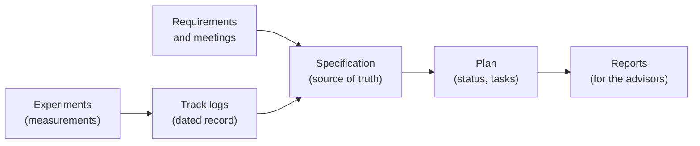

# Documentation

Start with the question you have.

| I want to know… | Read |
|---|---|
| What the system is, in pictures | [Stint report, 10 to 27 November](reports/stints/STINT_REPORT_2026-11-27.md) ([PDF](reports/stints/STINT_REPORT_2026-11-27.pdf)) |
| Where the project stands today | [Plan, current status](DEVELOPMENT_PLAN.md#current-status) |
| Who does what next | [Plan §7, the task list](DEVELOPMENT_PLAN.md#7-what-to-do-now) |
| How it is designed, and why | [Specification](PROJECT_DESIGN.md): §4 architecture, §8 question answering, §13.1 decisions |
| What the advisors asked for | [Meeting digests](requirements/README.md) |
| How to run a part of it | The README of its folder: [engine](../graphrag/README.md), [backend](../backend/README.md), [frontend](../frontend/README.md), [stores](../platform/README.md), [server](../deploy/README.md), [reading reports](components/track-a-operation.md) |
| What was measured, and how | [Experiments](experiments/README.md), one record each |
| What a track found or decided, and when | [Track records](tracks/README.md) |
| What resources the project needs | [Resource plan](reports/RESOURCE_REQUEST_2026-11-24.md) |

## How the documents fit together

Each kind of fact has one home. Other documents link to it and do not copy it.

| Kind of fact | Its home |
|---|---|
| Scope, design, decisions (D-xx), open questions (Q-xx) | [Specification](PROJECT_DESIGN.md) |
| Status, milestones, tasks, risks | [Plan](DEVELOPMENT_PLAN.md) |
| A number from a run | Its [experiment record](experiments/README.md) |
| What a track found, decided or built on a given day | That track's log: [A, reading reports](tracks/A-ingestion/log.md) · [B, engine](tracks/B-graphrag/log.md) · [C, stores](tracks/C-storage/log.md) |
| How to run something | The README or guide next to the code |
| What was sent to the advisors | [Reports](reports/README.md) |

## Everything else

| Folder or file | Holds |
|---|---|
| [requirements/](requirements/README.md) | VPI's requirement documents (SR-01 to SR-18) and the meeting digests: [9 November](requirements/supervisor-meeting-2026-11-09.md), [28 October](requirements/supervisor-meeting-2026-10-28.md), [7 October](requirements/supervisor-meeting-2026-10-07.md) (partly superseded) |
| [components/](components/) | Guides to each implemented part of reading reports and importing data, and the [dependencies](components/dependencies.md) with their licences |
| [tracks/](tracks/README.md) | Each track's log, its notes to the other tracks, and working plans |
| [experiments/](experiments/README.md) | Experiment records and the register |
| [EXPERT_PILOT.md](EXPERT_PILOT.md) | How a person's answers become a test the engine runs: marks in the application, a sheet, one command |
| [reports/](reports/README.md) | [Stint reports](reports/stints/README.md), the [project report of 9 November](reports/PROJECT_REPORT_2026-11-09.md), slides, the resource plan |
| [DATA_SOURCES.md](DATA_SOURCES.md) | The public data: BSEE well files, end-of-well and daily drilling reports |
| [references.md](references.md) | Papers, GraphRAG repositories and model candidates |
| [diagrams/](diagrams/README.md) | SVG exports of the specification's diagrams, and how to regenerate them |
| [REPOSITORY_REVIEW_2026-10-27.md](REPOSITORY_REVIEW_2026-10-27.md) | A snapshot from before the current direction |

New to the project? Read the stint report, then the specification's §1 and §3, then the plan's §7 for your role.

## Conventions

- **Implemented** means code, tests and a record exist in this repository. **Planned** means design intent only.
- Change the specification first, then the plan. A plan or guide must not introduce scope the specification does not contain.
- When the direction changes, **remove** the superseded text instead of keeping old and new side by side, and say what was removed in the track log.
- Log every finding, decision, design choice and experiment the same day in the track log. Project-level decisions also go into specification §13.1; unanswered questions into §13.2.
- Do not copy numbers between documents; link to the experiment that owns them.
- A request to a teammate is a dated note in that teammate's track folder (`note-from-track-<x>-<date>.md`), not only said in chat.
- Reporting to the advisors is light: short group-chat updates, and one short [stint report](reports/stints/README.md) at the end of each stint (D-46).
- Diagram sources are the Mermaid blocks in the documents; the SVGs are generated from them ([how](diagrams/README.md)).
