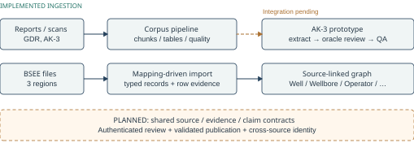
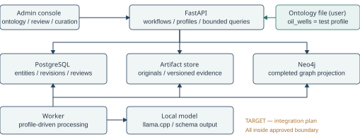
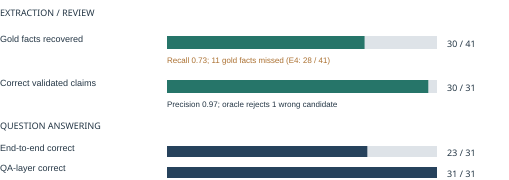
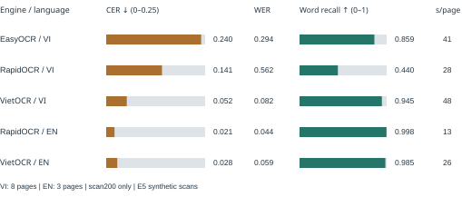
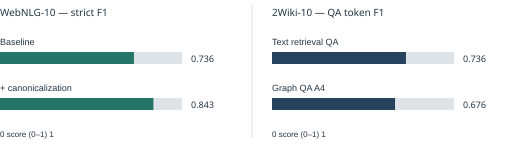
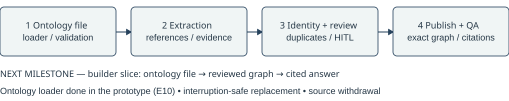

# Knowledge Graph Builder

**Báo cáo tiến độ và kết quả nghiên cứu thực nghiệm**

Kỳ báo cáo: 20–27 October 2026 · Cập nhật kỹ thuật: 27 October 2026  
Sản phẩm: Knowledge Graph Builder (pipeline + admin application, ontology do người dùng cung cấp) · Use case: oil wells (drilling, production) · Ngôn ngữ giai đoạn đầu: English · Case study: BSEE, End-of-Well reports và AK-3 · Môi trường: local/on-prem · Định hướng: buổi họp với anh Tuấn ngày 07/10

[Bản PDF](../../output/pdf/KNOWLEDGE_GRAPH_BUILDER_PROGRESS_2026-10-27.pdf)

## 1. Tóm tắt tiến độ

Theo định hướng ở buổi họp ngày 07/10, sản phẩm là một **Knowledge Graph Builder**. Đó là pipeline kèm admin application, chuyển tài liệu kỹ thuật và structured data thành Knowledge Graph (KG) có evidence traceability, chạy bằng local LLM. Ontology là input do người dùng cung cấp; nhóm xây pipeline và application, không tự xây ontology chuyên ngành. Dầu khí là use case: giếng khoan (drilling, production), không đi vào geology/geophysics. Thứ tự thực hiện: graph builder trước, gồm extraction, entity identity, kiểm soát liên kết, human-in-the-loop review và curation; question answering sau; phân quyền để sau admin layer. Giai đoạn đầu dùng English.

Trong kỳ báo cáo, ingestion, graph từ structured data và prototype extraction–review–QA đã chạy được. Nhóm đã làm literature review và khảo sát open-source theo yêu cầu, rồi kiểm chứng từng thành phần. Sau khi đối chiếu với buổi họp, prototype đã chuyển ontology từ code sang file profile: cùng code chạy được với một ontology khác.

| Hạng mục | Tiến độ nổi bật và trạng thái |
|---|---|
| PDF/OCR ingestion | 3 technical reports, 155 trang, 372 chunk; tái chạy toàn bộ PDF ingestion trên CPU cho kết quả byte-identical. EasyOCR đã chạy trên scan Việt–Anh. Pipeline hiện tại bổ sung VietOCR/PP-OCRv6, per-page OCR và quality flags; đã xử lý 44 PDF phụ lục AK-3, 463 trang. |
| BSEE graph | Ingestion dữ liệu 3 vùng, có source tracking. Source-linked graph: 113.384 nodes / 398.263 edges. Expanded graph đã được nạp vào Neo4j, gồm 336.265 nodes kể cả metadata / 551.254 edges. Generic importer đã đối chiếu cùng record và graph counts với adapter. |
| Extraction và QA | Prototype AK-3 trên 15 chunk: precision 0.97, recall 0.68; QA end-to-end đúng 19/31 câu. Thử nghiệm canonicalization trên WebNLG-10 tăng strict F1 từ 0.736 lên 0.843. |
| Nghiên cứu và đánh giá | 27 papers và code 13 repos được nghiên cứu; đã có ablation, đối chứng text RAG, quy trình AI-gold hai annotator và thử nghiệm extraction trên 49 đoạn EOR BSEE. Method suite có 354 tests pass; ingestion/application có 136 main tests và 14 prototype tests pass. |
| Builder theo buổi họp ngày 07.10 | Ontology chuyển thành file profile có validation (`oil_wells` 14 properties); synthetic ontology thứ hai chạy cùng code, không sửa code. Thêm reference rule ("it", "the well"), duplicate search và chặn impossible dates. Chạy lại: extraction 0.968 / 0.732, end-to-end 23/31 (E4: 19/31), không có câu trả lời sai giá trị (mục 3.2). |
| Điểm nghẽn | Missed facts (recall), chất lượng OCR, expert validation cho gold và held-out evaluation cho prototype AK-3. Bước tiếp theo là builder slice: ontology management, identity/curation, human review và publication chịu interruption. |

Các số liệu ở trên đến từ những dataset, configuration và graph scope khác nhau. Đây là tiến độ của các hạng mục nghiên cứu và phát triển trong cùng một dự án; mỗi thí nghiệm giữ metric và artifact tương ứng. Các thành phần đang được nối qua source–claim–review–graph contract.

## 2. Mục tiêu, dữ liệu và kiến trúc hệ thống

### 2.1 Phạm vi và processing flow

Luồng thiết kế đã thống nhất gồm hai nửa.

- **Nửa đầu, graph builder:** ontology (người dùng upload/chỉnh, có thể nhờ AI soạn nháp) → PDF ingestion → text/table extraction → chunking/source tracking → entity/relation extraction theo ontology → validation → entity identity và curation → human-in-the-loop review → Knowledge Graph.
- **Nửa sau, question answering:** LLM đọc câu hỏi cùng schema của ontology, tạo query plan; hệ thống kiểm tra plan rồi trả lời có citation.

Admin application bao quanh pipeline để kiểm soát từng bước. VPI không cung cấp dataset vì quy chế bảo mật, nên nhóm dùng public data: BSEE Wells Information và English End-of-Well reports, với AK-3 là development proxy (geothermal). Hai nguồn được phát triển độc lập. Well/wellbore là đối tượng chính; operator, lease, block và field hỗ trợ identity và context của giếng.

*Hình 1. Document ingestion và structured-data import là hai source paths của dự án. Prototype đọc legacy chunks; dashed arrow thể hiện bước integration với corpus pipeline.*

Traceability: document/source version, page/bounding box/offset, source file/row, quote, run/model/ontology version, processing bundle và review history.

Stack dự kiến và đang thử nghiệm: Docling, VietOCR/PP-OCRv6, EasyOCR, FastAPI, PostgreSQL, Neo4j và llama.cpp; React/TypeScript dự kiến cho review UI. Các thí nghiệm phương pháp cũng sử dụng local model và các thư viện mã nguồn mở, theo source–claim–review–graph contract của kiến trúc chính. VietOCR/PP-OCRv6 là default OCR hiện tại; EasyOCR giữ làm đối chứng.

### 2.2 Các thành phần kỹ thuật đã triển khai

- **Kiến trúc/tài liệu:** sơ đồ data flow, catalog nguồn hiện có; ánh xạ section AK-3 sang actual/planned depth, casing, temperature, drilling time; cập nhật backlog, specification và development plan.
- **PDF extraction:** lưu document ID, physical page, bounding box và content offset; hỗ trợ text/table chunk, scan-page coverage, file integrity và cache khi nguồn/cấu hình thay đổi. Corpus pipeline bổ sung content-addressed catalog, per-page OCR, quality flags, parallel processing và resume.
- **BSEE ingestion:** tải dữ liệu Gulf, Pacific và Alaska; kiểm SHA256 từng file; lưu file/row nguồn; gộp well theo 10 chữ số đầu API number; nối wellbore–well–operator–lease–block–field và API number changes. Generic mapping tái tạo record và graph counts của adapter riêng.
- **Prototype kiến trúc AK-3:** Qwen2.5-3B qua llama.cpp trên CPU; LLM tạo fact và quote → validator → review queue → Neo4j theo generation → FastAPI trả lời có citation hoặc abstain khi thiếu fact. Generation checks so sánh chính xác tập (claim, evidence) đã accept với graph đã project; projection thiếu claim không được activate (E11).
- **Các module được khảo sát và kiểm chứng theo bước:** open/schema-guided extraction, canonicalization, entity resolution, temporal/provenance, validation, graph storage và retrieval; các module có artifact, metric và replay riêng để phục vụ quyết định integration.

### 2.3 Kiến trúc và phạm vi integration tiếp theo

Giữ modular Python application, worker riêng và local model server trên approved host. Core quản lý source, evidence, entity, claim, review, curation, publication và bounded query execution. PostgreSQL giữ authoritative state; artifact store giữ originals/evidence; Neo4j là rebuildable projection; SQLite của corpus giữ processing state cục bộ.

Ontology là file profile có version: người dùng upload, chỉnh trong admin application, activate, rồi chạy lại extraction. `oil_wells` là test profile của use case, gồm entity/relation types, units, MD/TVD và planned/actual context, extraction rules và query templates. Ingestion đã domain-neutral; extraction và validation trong prototype nay cũng đọc ontology từ file.

Các vấn đề builder được nêu ở buổi họp và cách thiết kế xử lý:

- **Một thực thể, một node:** normalize tên (khoảng trắng, hoa/thường, dấu câu) trước khi resolve. Duplicate search liệt kê các cặp nghi trùng để người duyệt merge hoặc giữ riêng.
- **Ba loại mention:** tên có trong danh mục người dùng cung cấp (ví dụ file Excel tên giếng); tên riêng khác; đại từ và cụm chỉ định ("it", "the well") phải resolve về tên trong cùng tài liệu.
- **Chỉ nối khi có căn cứ:** relation phải có trong ontology, có định nghĩa, có evidence và được chấp nhận. Không nối theo co-occurrence hay "bạn của bạn".
- **Human in the loop:** review queue sắp theo confidence. Auto-accept theo threshold chỉ bật cho từng claim type sau khi calibration trên held-out data đạt precision target, và không áp dụng cho entity merge.

*Hình 2. Target architecture cho integration. Publication activate sau khi exact accepted set và evidence được kiểm đủ.*

Workload ban đầu gồm 5–10 English well reports; triển khai 3 question intents trước và thống nhất 5–8 intents. Kiểm tra portability trước bằng synthetic ontology; sau khi luồng oil-well chạy ổn, thử builder trên 1–2 public datasets thuộc domain khác. Subsurface interpretation, expert-note workflows và Vietnamese/Russian rollout chuyển sang giai đoạn sau. Kết quả Vietnamese OCR đã làm được giữ trong phần thực nghiệm.

Theo kỳ vọng của anh Tuấn, kỳ này hoàn thành builder, admin application và English QA; kỳ sau cải thiện từng hạng mục. Authentication/roles được làm sau admin layer. Trước đó hệ thống chỉ chạy localhost và không nạp dữ liệu riêng. Private-data pilot vẫn cần authentication/roles, approved data boundary, independent backup/restore và operator.

## 3. Kết quả ingestion, OCR và prototype AK-3

### 3.1 Dữ liệu thử nghiệm và kết quả ingestion (25–27/10)

| Chỉ số | Kết quả |
|---|---|
| Bộ tài liệu | 3 public technical reports: tổng 155 trang, 372 chunk (237 text, 135 table). |
| BSEE snapshot | 57.453 boreholes / 39.518 wells; 587 API number change records. |
| BSEE linked graph | 113.384 nodes / 398.263 edges; mỗi edge có row-level provenance. |
| Automated tests | 136 main tests pass và 14 prototype tests pass (gồm regression tests cho các lỗi E9, xem E11). Cached PDF regression pass; lượt review chạy main suite trong 17.191 giây, lượt kiểm sau cập nhật tài liệu trong 13.703 giây. |
| PDF rerun | Khoảng 13,5 phút trên CPU; output byte-identical với bộ đã publish. |
| Quantity recall | 334/335 = 0.997 đối với drilling value kèm units. |
| Word-level quality | Recall median 0.954, min 0.442 (dense directional survey tables); precision 1.0 trong phạm vi phép chấm. |
| Locator và BSEE validation | Offset/bounding box hợp lệ 100% trong tập kiểm; BSEE có 0 malformed rows và 0 duplicate API numbers. Lượt cached regression ghi nhận Docling coordinate-clamping warnings. |
| Generic structured-data import | 58.040 records gồm boreholes và API changes khớp adapter; cùng node/edge counts. Mapping bổ sung wrapper/helper fields và biểu diễn former API numbers qua edges. |
| Corpus pipeline | 44 PDF phụ lục AK-3, 463 trang, 1.778 chunks, 336 tables; hai workers, resume và export đủ corpus. |

### 3.2 Prototype AK-3: extraction, review và question answering

Prototype dùng 15 chunk / 41 gold facts / 31 câu hỏi. Sau extraction, precision là 0.97 và recall 0.68. QA-layer đúng 31/31 theo rubric cho phép honest no-answer khi graph thiếu fact; đánh giá end-to-end đúng 19/31. Lượt reviewed có 11/11 answered responses kèm citation/quote khớp chunk. Hai prompt injection giữ nguyên node/edge counts trong phép kiểm đã chạy.

*Hình 3. Development slice của E4: recovered gold facts, correct validated claims và QA dùng denominator tương ứng. QA-layer rubric chấp nhận honest no-answer khi graph thiếu fact.*

Vai trò của review: accept-all review để lọt một wrong value vào câu trả lời; oracle reviewer dựa trên gold set loại được trường hợp đó. Prompt đã chỉnh trên chính 15 chunk dùng để chấm, nên đây là in-sample evaluation. Human review và document-level held-out evaluation là bước tiếp theo. Tốc độ CPU khoảng 15 giây mỗi extraction passage và 4–6 giây mỗi câu hỏi trong môi trường thử nghiệm.

Sau buổi họp 07/10, prototype được chỉnh để ontology là input (E10). 14 properties chuyển sang file `profiles/oil_wells.json`, có validation. Prompt, output schema, validator và gold matcher được sinh từ file đó; synthetic ontology thứ hai chạy cùng code mà không sửa code. Kết quả chạy lại trên cùng 15 chunk:

- Prompt ghép tự động từ file (v5) giảm precision từ 0.97 xuống 0.87.
- Chạy lại đúng nguyên văn prompt v4 qua code mới cho precision 0.968, recall 0.732. Như vậy đưa ontology ra file không làm giảm chất lượng; nguyên nhân là cách diễn đạt prompt.
- Profile `oil_wells` giữ nguyên văn prompt v4 dưới dạng template; test kiểm tra từng byte.
- Sau oracle review, graph có 30/41 facts. End-to-end đúng 23/31 câu (E4: 19/31); QA-layer 31/31; 15/15 câu trả lời có citation, không có giá trị sai.
- Thêm bước kiểm tra deterministic từ chối câu hỏi yêu cầu sửa/xóa dữ liệu, sau khi câu injection q30 bị planner biến thành lookup. Kết quả này là in-sample.
- Generation mới qua exact-set check (30 claims, 30 evidence links).

Chi tiết ở E10.

### 3.3 OCR trang scan Việt–Anh (24–27/10)

EasyOCR đã chạy end-to-end trên một trang có tiếng Việt, tiếng Anh, số và units: khoảng 52 giây/trang trên CPU. CER ≈10.5%, WER ≈19.5% so với reference của trang này. Output còn lỗi mất title, sai ký hiệu độ và punctuation.

Benchmark E5 bổ sung 11 born-digital pages render thành scans: 8 Vietnamese, 3 English. VietOCR được chạy chủ yếu ở scan200 và một clean page. So sánh cùng scan200 condition cho kết quả dưới đây.

*Hình 4. CER thấp hơn là tốt hơn; word recall cao hơn là tốt hơn. Runtime đo trên shared CPU; mỗi engine giữ cùng language/condition trong phép so sánh.*

Default OCR hiện tại là VietOCR/PP-OCRv6. Với English oil-well workload, ưu tiên benchmark RapidOCR trên real scans, dense forms và degraded pages; pin cấu hình theo kết quả. VietOCR còn thiếu symbols như “°”.

### 3.4 Corpus run trên phụ lục AK-3

Đã xử lý 44 PDF, 463 trang bằng hai workers, export 1.778 chunks và 336 tables. Page modes gồm 359 text-layer, 71 full-page OCR và 33 hybrid; tổng cộng 104 pages có OCR. Năm pages flagged (4 `missing`, 1 `review`) đã kiểm bằng mắt. Dense Permit to Drill p.62 mất thông tin và bị nhận sai English thành Vietnamese; một contents page bị `missing` do text filter sau OCR.

Run 1 dừng chủ động ở 40/44: 35 done, 5 validation errors và 4 pending. Sau sửa rotated-page coordinates và table row range, run tiếp skip 35 documents đã hoàn tất, xử lý 9 documents còn lại trong khoảng 6 phút và export đủ 44. Hai runs có code change; single-run throughput và gold OCR transcription nằm trong bước đánh giá tiếp theo.

## 4. Nghiên cứu phương pháp xây dựng Knowledge Graph

### 4.1 Literature review và câu hỏi kỹ thuật

Theo yêu cầu ở buổi họp 07/10 (làm literature review và chạy thử các open-source implementations trước khi tự xây), nhóm đã đọc 27 papers, kiểm tra code của 13 repos mã nguồn mở và khảo sát bổ sung các thư viện liên quan. Mục tiêu là kiểm tra: (i) mức phụ thuộc của extractor vào ontology; (ii) tác động của entity merging và relation canonicalization; (iii) evidence, temporal context và review status của fact; (iv) hiệu quả KG QA so với text retrieval; (v) khả năng chạy hoàn toàn local.

| Vấn đề | Phương pháp đã tìm hiểu | Kết luận thực nghiệm / thiết kế |
|---|---|---|
| Extraction | KGGen (open extraction), EDC (schema-aware), GLiNER; đọc GenIE và các hướng khác | EDC phù hợp khi có target ontology; KGGen linh hoạt với free-form predicates. GLiNER nhanh trên CPU; accuracy là điểm cần cải thiện. |
| Ontology | EDC Define/Canonicalize, AutoSchemaKG | Canonicalize nhiều cách diễn đạt về một canonical relation; automatically generated ontology là gợi ý để người duyệt. |
| Entity resolution | SemHash/embedding, exact matching, domain rules | Similarity có thể merge nhầm số thứ tự/sidetrack. Match API number, lease và sidetrack trước; ambiguous cases chuyển review. Approximate search giữ cấu hình reproducible. |
| Grounding / temporal | Source offset và quote, version, temporal attributes; khảo sát Graphiti | Lưu evidence theo fact, phân biệt valid time và planned/actual; thiếu sentence context có thể khiến fact đúng bị loại. |
| Validation/review | Deterministic rules, LLM-as-judge, human review | Validator/judge từng loại nhầm fact đúng và làm giảm QA quality. Giữ candidates/risk flags để review; evidence cần sentence context, units, MD/TVD, planned/actual và negation. |
| Retrieval | Text RAG, graph retrieval; khảo sát GraphRAG, LightRAG, HippoRAG | Đo cùng model/câu hỏi và đối chiếu với text retrieval baseline. |

### 4.2 Cấu hình thí nghiệm và phương pháp đánh giá

Các thí nghiệm phương pháp dùng local LLM Qwen3.6-35B-A3B (quantized MoE) trên CPU, kết hợp KGGen và EDC với các bước tự viết: provenance, temporal, normalization, validator, graph export và QA. Ablation bật dần thành phần: A0 baseline extractor; A1 thêm entity resolution; A2 thêm relation canonicalization; A3 thêm temporal; A4 thêm flag-based validation; A5 thêm LLM judge. Configuration, dữ liệu và model responses được lưu để offline replay và so sánh trên cùng input. SHA256, locator và model/ontology version được lưu theo run; replay 589/589 recorded calls cho cùng graph output. Method-evaluation suite có 354 tests pass, 0 skip. Code của các thí nghiệm phương pháp (WebNLG-10, 2Wiki-10, ablation, BSEE EOR, expanded graph) hiện nằm ở repository riêng của Khải và sẽ được đưa vào thư mục `experiments/` của repo chung, kèm config, script tải data, scorer và kết quả từng lượt chạy. Ingestion/application suite có 136 main tests và 14 prototype tests pass.

Các bộ đánh giá: WebNLG-10 (triples có ontology), 2Wiki-10 (multi-hop QA), showcase nhỏ (alias, temporal, provenance), BSEE EOR (văn bản giếng khoan thực) và structured BSEE data. WebNLG-10/2Wiki-10 là mẫu nhỏ, có yếu tố in-sample; EOR dùng AI-gold và held-out test set. Mỗi bộ giữ metric và matching rubric riêng.

## 5. Kết quả ablation, QA và đánh giá domain BSEE

*Hình 5. Method evaluation của dự án trên WebNLG-10 và 2Wiki-10; mỗi panel giữ metric và dataset tương ứng.*

### 5.1 WebNLG-10: canonicalization là bước có lợi rõ nhất

Trên cùng 10 tài liệu WebNLG, strict F1 tăng từ 0.736 lên 0.843 khi bổ sung relation canonicalization theo EDC. Kết quả 0.843 tương đương EDC chạy riêng trên mẫu đó. Thí nghiệm chọn extractor khi đã có schema cũng cho kết quả cao hơn dùng KGGen cố định. Auto-routing cần thêm controlled comparisons. Các lượt WebNLG hiện là in-sample evaluation.

### 5.2 QA benchmark: text retrieval dẫn về token F1

Trên 2Wiki-10, cách tìm đoạn văn rồi dùng LLM trả lời đạt token F1 0.736, còn graph QA A4 đạt 0.676. Recall@5 của text retrieval đạt 0.975 trên tập văn bản nhỏ này. Kết quả cho thấy cần baseline text RAG mạnh và đánh giá theo nhóm câu hỏi multi-hop, cross-document và temporal. Evaluation hiện có 10 câu; bước tiếp theo mở rộng từng nhóm câu hỏi với cùng model và input corpus.

### 5.3 BSEE EOR: extraction trên dữ liệu thực

Đã xây bộ AI-gold 100 đoạn bằng hai AI annotators độc lập và adjudication, với evidence, dev/test split, freeze và hash. Trên 75 đoạn test, annotator agreement là 0.883 (value matching), 0.795 (full matching). Trong 50 đoạn được chọn chạy model, 49 đoạn chấm được; gold có 222 facts cho 49 đoạn. Lượt chạy có 489 model calls mới, 0 lỗi, mất 117.5 phút trên CPU.

| Cấu hình | L1 Precision / Recall / F1 | L2 F1 | L3 F1 |
|---|---|---:|---:|
| A0 (KGGen, free-form relations) | 0.142 / 0.207 / 0.168 | 0.000 | 0.000 |
| A4 (canonicalization, temporal, flags) | 0.356 / 0.162 / 0.223 | 0.208 | 0.085 |
| A4 sau strict filtering | 0.365 / 0.153 / 0.215 | 0.201 | 0.088 |

Định nghĩa: L1 match value; L2 thêm ontology relation name; L3 thêm subject và attributes. A0 dùng free-form relation names, trong khi L2/L3 yêu cầu canonical ontology relations. Ở L1, A4 tăng precision nhưng giảm recall. ΔF1 L1 so A0 khoảng +0.054, bootstrap CI 95% [−0.0004, 0.125], khoảng ước lượng bao gồm 0. Ở L2/L3 tín hiệu rõ hơn và phụ thuộc ontology matching cùng AI-generated labels. Agreement hai annotators trên đúng 49 đoạn ở L1 là 0.879; recall A4 chỉ 0.162, vì vậy missed facts là điểm nghẽn chính.

### 5.4 Graph BSEE và kiểm tra Neo4j thực

Bên cạnh source-linked graph ở mục 3, đã thử expanded BSEE graph cho các bảng và EOR records, sinh 336.264 data nodes và 551.254 edges. Bulk import CSV qua `neo4j-admin database import` vào database mới mất 633 giây (≈10.5 phút); kiểm lại Neo4j có 336.265 nodes (gồm 1 metadata node) và 551.254 edges, khớp manifest. Hai configurations giữ table/node scope và manifest riêng.

Trong thí nghiệm liên kết statements với bảng, có 61 links matched, 0 ambiguous và 94 unmatched; manual audit các links là bước tiếp theo. Bulk import thích hợp để dựng database mới; thêm claim từng lần và quản lý review cần parameterized writer, idempotency và data state.

## 6. Vấn đề, giới hạn và kế hoạch tiếp theo

| Hạng mục | Vấn đề / giới hạn hiện tại | Việc tiếp theo |
|---|---|---|
| Recall / evaluation | AK-3 bỏ sót depth/temperature facts; prompt tune trên 15 chunks. WebNLG/2Wiki là mẫu nhỏ; EOR dùng AI-gold. | P0: freeze held-out split, expert adjudication; trace false negatives từ extraction đến validation; đối chứng text RAG. |
| OCR | Dense forms, directional survey tables và symbols còn lỗi. E5 dùng synthetic scans; E8 có visual checks qua hai runs. | Gold transcription trên English well-report scans và low-quality pages; benchmark RapidOCR/VietOCR theo loại trang. |
| Ontology do người dùng cung cấp | Prototype đã đọc ontology từ file profile có validation. Chưa có ontology editor, activation diff hay AI-assisted draft; ontology AK-3 và 21 EOR relations cần thống nhất. | P0: thống nhất profile format, gộp EOR relations vào `oil_wells`; P1: editor + re-run trong admin application; ontology assistant nếu kịp. |
| Identity / curation | Entity registry dựng từ BSEE bằng config (E13): 57.453 wellbores, 39.518 wells. Chỉ tên + lease xác định được 53% wellbores vì sidetracks trùng tên; thêm sidetrack suffix thì được 98,6%, phần còn lại chuyển review, 0 trường hợp resolve nhầm. Đại từ chưa được resolve có kiểm chứng; duplicate search mới ở dạng CLI. | P0: normalization, reference resolution có test cases, duplicate search trong admin console; API–lease–sidetrack matching qua profile/adapters. |
| Publication / validation | Đã sửa (E11): export/dataset publish thành immutable release sau validation, pointer chuyển atomic nên interruption không làm mất bản đang dùng; duplicate record IDs và duplicate headers bị chặn; generation kiểm exact accepted set; invalid dates đã sửa (E10). Còn mở: cache identity và redirect checks. | P0: idempotent retry và source withdrawal; P1: cache identity đầy đủ. |
| Review / security | Human review và admin console chưa có. Authentication, parser isolation và independent recovery làm sau admin layer, theo định hướng 07/10. | P1: confidence-routed review queue với source viewer; ba cited question intents. Sau đó server-derived actor/roles, egress/log policy và restore test. |
| Compute / máy | Toàn bộ thử nghiệm chạy trên một laptop cá nhân: i5-1340P, 16 GB RAM, không có GPU dùng được; Docker chỉ có 8 GB. Vì vậy chỉ chạy được model 3B (Qwen2.5-3B, 4-bit). Lượt E10 mất 21 phút cho 15 chunks (39 model calls, trung vị 22 giây/call); mỗi câu hỏi mất khoảng 9 giây. EOR 50 đoạn mất 117.5 phút CPU. Ước tính thô theo tốc độ E10: extraction toàn bộ 1.778 chunks phụ lục AK-3 sẽ mất khoảng 40 giờ. Tốc độ còn dao động theo tải máy: cùng model có lúc chậm gấp 10 lần do cách Docker đọc file model, đã khắc phục. Model 7–8B, held-out evaluation đủ lớn và việc chạy lặp để so sánh cấu hình hầu như không khả thi trên máy này. | Đề xuất được dùng máy lớn hơn: GPU của trường (RTX 4080 SUPER hoặc A100) hoặc một máy có GPU ≥16 GB VRAM, 32–64 GB RAM. Khi có máy: benchmark 3B và 7–8B, đo latency/memory/storage và reviewer time. |

Review workload minh họa: 5.000 pages × 3 candidates/page × 30 seconds/candidate = **125 reviewer-hours** trước corrections. Capacity cũ là 720 person-hours (576 delivery + 144 reserve); cần re-estimate phần còn lại theo một English oil-well profile, core interfaces và workload review.

*Hình 6. Builder slice: ontology file → extraction có evidence → identity và human review → publication và cited QA; kiểm interruption và source withdrawal cùng luồng.*

**Đã rõ sau buổi họp 07/10:**

- Sản phẩm là graph builder; dầu khí là use case.
- Ontology do người dùng cung cấp.
- Thứ tự: builder trước, QA sau, phân quyền sau admin layer.
- Không có dataset từ VPI; dùng public data; anh có thể cung cấp một tài liệu dầu khí để cùng đánh giá cuối kỳ.
- Phạm vi là giếng khoan, bỏ geology/geophysics.
- English trước.
- Báo cáo hằng tuần.

**Cần thầy và anh xác nhận thêm:**

- Ontology assistant (AI soạn ontology) có cần nằm trong sản phẩm kỳ này không.
- Ai duyệt auto-accept threshold.
- Domain nào dùng cho portability runs.
- Paper OnePetro/EarthDoc.
- **Có thể cho nhóm dùng máy lớn hơn không** (GPU của trường RTX 4080 SUPER/A100, hoặc máy có GPU ≥16 GB VRAM)? Hiện mọi thử nghiệm chạy trên laptop không GPU nên chỉ dùng được model 3B và mỗi lượt đánh giá mất hàng chục phút (xem bảng trên).
- Budget.
- Expert reviewer.
- English oil-well question catalogue.

## 7. Đề xuất quy trình nghiệm thu bước tiếp theo

Để các kết quả ở những hạng mục hiện tại có thể được so sánh và tái kiểm tra trong cùng hệ thống, nhóm đề xuất quy trình đánh giá có input conditions và acceptance criteria định trước, kèm artifact của từng bước.

| Thí nghiệm | Thiết kế tối thiểu | Artifact cần lưu |
|---|---|---|
| PDF/OCR | Phân tầng text PDF, scanned page, dense tables; kiểm word/quantity recall và source locator; báo số pages chấm | Original file và hash, text/chunk, locator, reference, error log |
| Extraction | Ontology đã duyệt; freeze gold/dev/test trước tuning, second annotator và expert review; chấm depth, temperature, casing, status cùng subject, units và context | Gold/annotation guide, raw output, agreement, P/R/F1, stage-level errors |
| Identity/claims | Giữ riêng khác API/lease/sidetrack; biến thể khoảng trắng/hoa thường và đại từ; seeded duplicates cho duplicate search; fact có quote và review status; rerun idempotent | Test cases, identity mapping, review decisions, duplicate-search recall, graph counts |
| Ontology/portability | Cùng code chạy với `oil_wells`, synthetic ontology và 1–2 public datasets domain khác; ontology lỗi bị từ chối trước extraction | Profile files, validation errors, per-domain report những gì chạy không cần sửa code |
| Question answering | Cùng gold Q&A/model: text RAG, graph QA, hybrid; kiểm EM/F1, wrong answers, abstention và citation/quote | EM/F1, Recall@k, citation audit, runtime |
| Reproducibility | Freeze dataset/ontology bằng SHA256; lưu model/config và replay; deterministic output comparison | Manifest, fixture record/replay, test results, delta giữa hai runs |
| Publication/security | Exact graph membership, completion marker, direct-route roles; crash/retry, withdrawal và independent restore | Expected IDs, fault tests, role checks, active-generation record, restore log và tombstones |

Release gates dùng English oil-well workload: 200 held-out claims trên ít nhất 10 documents, 60 held-out questions, cùng identity/evidence/access/recovery checks. Scope và nguồn lực được chốt với domain reviewer và operator.

## 8. Tài liệu tham chiếu

Tài liệu dự án: `docs/requirements/supervisor-meeting-2026-10-07.md` (tóm tắt buổi họp 07/10), `docs/PROJECT_DESIGN.md` (v2.4, D-28 đến D-35), `docs/DEVELOPMENT_PLAN.md`, experiment register E1–E13, component guides và repository review. E1–E3 ghi ingestion/reproduction; E4 ghi AK-3 prototype; E5 ghi OCR benchmark; E6 ghi generic importer; E7/E8 ghi corpus pipeline; E9 ghi local verification và reproduced defects; E10 ghi prototype chạy từ ontology file; E11 ghi các lỗi E9 đã sửa thành regression tests; E12 ghi shared evidence/claim/entity contract trên dữ liệu thật; E13 ghi entity registry từ BSEE. Method evaluation gồm WebNLG-10, 2Wiki-10, BSEE EOR, ablation, graph import và record/replay.
