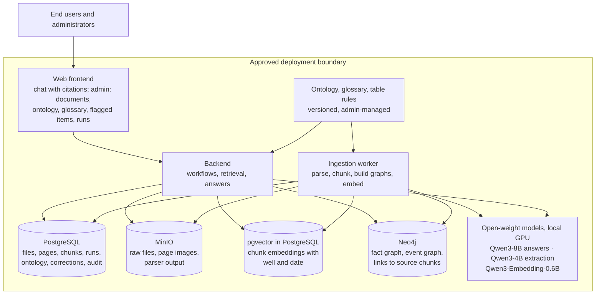
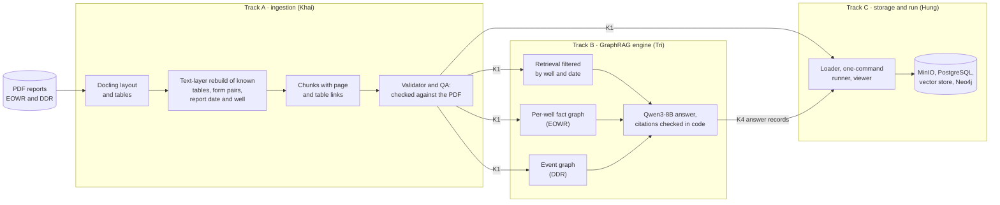
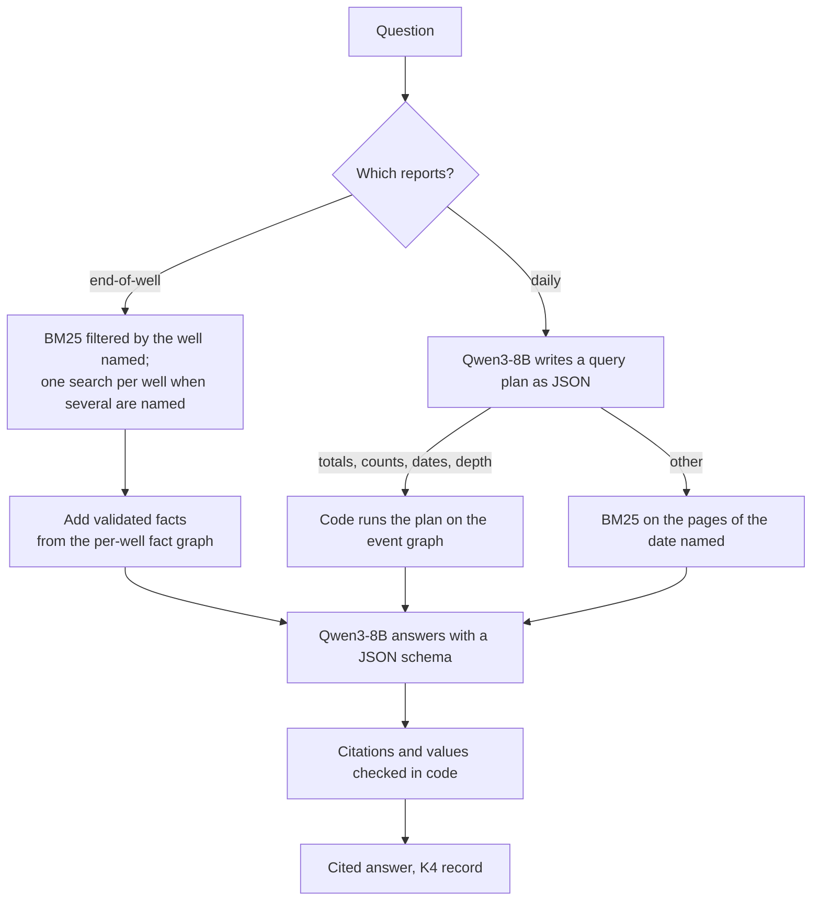

# A GraphRAG application for drilling reports: design, architecture and progress

**Kind:** project report for the supervisors · **For:** Dr. Le Duy Dung and MSc. Nguyen Anh Tuan · **Team:** Thai Huu Tri, Tran Quang Khai, Nguyen Le Hung · **Status date:** 9 November 2026 · **Shared copy:** [web page](https://claude.ai/artifact/J3cK4LfXiAfKD7J3ZSt3CE)

The project builds an in-house GraphRAG application that turns drilling reports into a linked knowledge base and answers questions with citations to the source page, using only open-weight models of 8B or smaller on local hardware. The foundation (document ingestion, structured well data, a well registry and an extraction prototype) was built before the 28 October direction. Since then the first build has delivered a working GraphRAG pipeline with two graphs, an ingestion stage whose tables can be checked against the source, and stores into which the ingested reports load with every page rebuilt. Joining the engine to the stores and the end-user application come next.

Scores in this report are on one well (AK-3) and AI-written questions, so they are development checks, not expert validation.

| Headline | Value |
|---|---|
| Prototype questions answered with citations (prototype: 23/31) | **28/31**; 30/31 with the fact graph |
| "Totals over time" daily-report questions, event graph against plain RAG | **22/35** against 5/35 at best |
| Non-productive marks read into the right column after table rebuild | **92/92** (Docling alone: 76/92) |
| Experiments, each with a record of data, method, cost and limits | **30** |

## 1. Purpose and scope

Drilling knowledge sits in long reports, most of it in tables: end-of-well reports, daily drilling reports, casing and survey tables, time breakdowns. Finding one fact means opening several documents, matching different names for the same well, reading tables that run over pages without repeated headers, and checking which source says what. The data is confidential, so commercial LLM services are not an option.

| Aspect | What the project commits to |
|---|---|
| Product | A **GraphRAG application**: ingest reports, parse pages and tables, extract entities and relations under an ontology the user supplies, store chunks, vectors and graph linked by one ID scheme, and answer with page citations. Administrators manage documents, ontology and glossary and correct low-confidence items; end users ask and inspect sources |
| Documents | By document type: **end-of-well reports (EOWR)** and **daily drilling reports (DDR)**, including their geology sections at summary level |
| Models | Open-weight, about 7B (8B allowed); no commercial models or APIs, also during development. Hosted open models only on public data; large runs on the school's GPUs |
| Data | VPI supplies no data, so development uses public proxies: the Akutan AK-3 geothermal well reports and appendices (EOWR and 27 days of DDRs), other public end-of-well reports, and BSEE well data for well identity |
| Approach | A capstone, not research: reuse open-source GraphRAG work, start on one document, measure every change against a baseline, report cost next to quality |

VPI's three-layer target gives the overall shape. **Layer 1** is domain knowledge (the drilling-report profile and structured well data). **Layer 2** is unified entities and ontology (one ID per well across documents and stores, a versioned ontology injected into extraction). **Layer 3** is the application (GraphRAG chat with citations, and administration). The core stays independent of oil terminology; a profile supplies the drilling ontology, glossary and table rules.

## 2. How the project got here

| When | What |
|---|---|
| Before 23 Oct | **Foundation.** Document ingestion (text layer or OCR per page, chunks with page provenance; 44 AK-3 appendix PDFs, 463 pages, 1,778 chunks). Structured-data import of BSEE (58,040 records) and an entity registry of 57,453 wellbores and 39,518 wells. An extraction prototype on 15 AK-3 chunks: Qwen2.5-3B on CPU, precision 0.97, recall 0.73, **23/31 questions** correct. That prototype is the baseline every later design must beat |
| 7 Oct | **First supervisor direction:** build a knowledge-graph builder and apply it to oil and gas; the ontology is the user's input, entities need unified IDs, people stay in the loop, reuse open source |
| 28 Oct | **Current direction:** a GraphRAG application on existing open-source pipelines; open models of about 7B, no commercial APIs; vision-language parsing with tables as their own workstream; a store and ID design linking files, pages, chunks, vectors and graph; human review of low-confidence items; ingestion first, start on one document; a full application at the end |
| 30 Oct | **First build (M1) split into three tracks** joined by versioned files: ingestion (A), GraphRAG engine (B), storage and the end-to-end run (C). Owners are redone every one to two weeks |
| 30 Oct – 5 Nov | **GraphRAG engine built and measured** (E14 to E29): model choice, two GraphRAG bases tried, the per-well fact graph, the date filter, the event graph, table rules tested on reports from other authors |
| 6 – 9 Nov | **Ingestion rebuilt for correctness** (E30): hybrid table parsing, form pairing, report dates, quality layers. Merged into the shared code; the engine reads the new package. **Stores** stood up and the AK-3 package loaded with every page rebuilt. Agreed: one ID scheme (D-54), the chunk-package interface (D-57), pgvector as the vector store (D-56) |

## 3. Target architecture

The finished system is a backend with a separate ingestion worker, a web frontend for users and administrators, model endpoints behind one client, and four stores with clear ownership. Everything runs inside the approved deployment boundary.

**Figure 1.** Target components and stores. PostgreSQL is the system of record; the vector store and Neo4j are derived and can be rebuilt from it. Users never reach a store or a model directly.

| Store | Owns | Rule |
|---|---|---|
| **MinIO** | Original PDFs, page images, the parser's per-page output | Write once, never overwrite, so every answer leads back to its page |
| **PostgreSQL** | File, page, table and chunk records; runs with models, calls, tokens and cost; ontology versions; corrections and audit | System of record |
| **Vector store** (pgvector, inside PostgreSQL) | One point per chunk: its embedding, with IDs, well and report date | Derived; retrieval filters by well and date in the same query |
| **Neo4j** | The per-well fact graph and the event graph, each fact and event linked to the chunks it came from | Derived; never the only copy of a correction |

## 4. The first build: three tracks joined by files

The first build (milestone M1) takes one end-of-well report and one set of daily reports from pages to cited answers. It is split into three tracks that meet only through versioned files, so each can be researched, built and measured on its own: **K1** the chunk package, **K2** the thin ontology with table-reading rules, **K3** the question set, **K4** the answer record with citations and cost, **K5** the table gold data.

**Figure 2.** The first build. A and B run end to end on files, and A's package already loads into C's PostgreSQL with every page rebuilt; B reading from the store, the graphs in Neo4j and the one-command runner are next.

Drilling-report questions come in kinds, and each kind breaks the simple "retrieve five passages and ask the model" approach in its own way. This drove the design of the engine:

| Question kind | Example | Why plain RAG struggles | How it is handled |
|---|---|---|---|
| Lookup, one well | At what depth was the 4-1/2 in. casing set in AK-3? | Works, if the table survived parsing | Retrieval filtered to the well's documents |
| Lookup by date (DDR) | What was the mud weight on 18 August? | 27 daily reports look alike; retrieval mixes the days | Retrieval limited to the pages of that date |
| Across wells | Which well was drilled deeper, 56-32 or 68-32? | Five passages rarely cover both wells | One search per well, plus the per-well fact graph |
| Totals over time (DDR) | How many non-productive hours were logged in total? | The answer is in no passage; it must be added up over 27 days | Event graph: the model plans, code computes |

## 5. Track A: from PDF pages to checked chunks

Khai · AK-3 end-of-well report and four daily-report attachments, 174 pages · in the shared code ([E30](../experiments/E30-k1-version-1-candidate.md), [progress report](../experiments/TRACK_A_PROGRESS.md))

### The problem: valid structure is not correct content

The first chunk package passed every structural check: schemas, references, and rebuilding each page from its chunks. Compared with the original PDFs, the content was still wrong in places. In the daily Operations Summary, Docling missed tables, merged headers, dropped rows and shifted the Non-Prod mark into the wrong column; those marks are what non-productive time is computed from. The validators only checked that the package agreed with itself: when its content was changed on purpose and its checksums updated, **11 of 11 planted errors passed**.

### Hybrid parsing: Docling plus a rebuild from the PDF text layer

- **Docling stays the general parser.** A benchmark against pdfplumber, Camelot and PyMuPDF kept it as the default: it found all 10 gold tables, the other libraries 4 to 9. A comparison with document vision-language models is still to run.
- **Known table formats are rebuilt from the PDF text layer** using the position of every word. The rule recognises a table by its header and column anchors rather than by page, rebuilds the rows and checks itself. If the format is not recognised or a check fails, it **falls back to Docling and records why**; 807 deliberately corrupted inputs all fell back rather than passing.
- **Forms are read as key-value pairs** by matching labels to values on the text layer, which fixes header boxes such as "Days On Location: 1700" (really 17): 141/141 pairs on development forms, 93/93 held out.
- **Every daily-report chunk carries its report date and well**, from the form and checked against the page text: 979 of 979 chunks.
- **Data that repeats on every page is no longer dropped** as a running header (the weather line), while real headers and page numbers still are.

| Operations Summary (81 tables, 481 rows) | Docling alone | Rebuild, held-out days | Rebuild, all days (seen) |
|---|---:|---:|---:|
| Tables found | 77/81 | 27/27 | 81/81 |
| Header correct | 51/81 | 26/27 | 81/81 |
| Rows kept | 475/481 | 205/205 | 481/481 |
| Non-Prod marks in the right column | 76/92 | 33/41 | 92/92 |

The "all days" column is on data used in development, so it shows regression, not generalisation; the held-out column is the independent result. Other tables are unchanged, and Track B's event builder gives the same values on its six key fields.

### Quality layers: catching wrong data that passes the schema

Rather than keep tuning the parser, Track A added checks that compare the package with the source and record what they cannot verify, kept beside each release as a separate report.

| Layer | What it does | On planted errors |
|---|---|---|
| **Quality ledger** | Status, warnings and "why not verified" for every page, table, form and chunk | — |
| **Source fidelity** | Compares words and numbers with the PDF text layer | Inserted text with a number 158/158; changed digit 141/157; reordered text 0/155 |
| **Cross-representation** | Checks tables, forms, chunks and their references against each other | Error in one place 60/60; the same error in both places 0/60 |
| **Operations margin** | Warns when a Non-Prod mark sits near a column boundary | Flags part of the cases where position noise could move a mark |

Output is judged at three levels: **structural validity** (well formed), **source fidelity** (agrees with the PDF) and **semantic correctness** (means the right thing). The QA layers raise the second; none of them proves the third.

## 6. Track B: the GraphRAG engine

Tri · experiments [E14](../experiments/E14-plain-rag-baseline.md) to [E29](../experiments/E29-table-mappings-across-reports.md), each recording calls, tokens, time and cost · [track log](../tracks/B-graphrag/log.md)

| Method | How it works | Role |
|---|---|---|
| **Plain RAG** | BM25 finds a few passages, filtered to the well named and, on daily reports, to the pages of the date named; the model answers from them | The baseline every setup is measured against, and the fallback |
| **Per-well fact graph** | Facts that hold for a well (total depth, casing sizes and depths, rig, spud date...) are taken from tables by rule and from text by an LLM, validated in code, and given to the model next to the passages | End-of-well reports; facts across wells |
| **Event graph** | Each row of a DDR operations table is an event (date, hours, activity code, non-productive code, depth). The model turns the question into a query plan, code computes the result on the graph, and the model writes the answer; questions that do not fit fall back to plain RAG | Daily reports; questions over time |

**Figure 3.** How a question is answered. Which reports a question is about is chosen per run today, not yet detected automatically.

### How each part is handled

- **Routing before retrieval.** Wells and dates named in the question restrict the search before ranking. With three reports in the pool, routing by well gives 28/31 against 26/31 for fusion retrieval over all reports. On daily reports the date filter raised lookups from 7/26 to 14/26 with no extra model call.
- **Fact graph in three steps.** (1) Table rows are mapped to properties by rules in K2, with no model call, finding headers from the content because parsed header counts are often wrong. (2) Prose is read by Qwen3-4B through neo4j-graphrag. (3) Every fact is validated in code: the value must appear in its chunk, name one well, not be zero, not contradict another fact, and in strict mode sit in the right context. Only the facts most relevant to the question are shown (about 1,800 prompt tokens).
- **Event graph built with no LLM.** Operations rows from the four daily-report attachments are merged by date and time, because each attachment loses some rows, and joined with the separate non-productive-time report; all 161 events match the PDF. The planner chooses from fixed operations: total hours, count events or days, list dates, first or last date, top group, depth on a date, first date past a depth, depth gained.
- **Answers are checked, not trusted.** The model cites and quotes a passage; code keeps the citation only if the quote is in a retrieved passage, otherwise reattaches it by quote or value, or marks the answer unsupported. Dates and numbers are normalised in code.

### Results (correct answers)

| Question set (none expert-reviewed) | Reports | Plain RAG (best setup) | With a graph |
|---|---|---:|---:|
| 31 single-value lookups, prototype set (prototype 23/31); used to design the fact graph | EOWR | 28/31 | 30/31 fact graph |
| 40 mixed questions: lookups, comparisons, no-answer | EOWR | 31/40 | 31/40 fact graph |
| 36 questions, many about two wells, written after the fact graph | EOWR | 23/36 | 23/36 fact graph |
| 26 lookups by date | DDR | 14/26 | 17/26 event graph |
| 35 totals over time, e.g. hours per activity code, NPT, depth by day | DDR | 5/35 | **22/35** event graph |
| 23 more of the same kind, written to recheck after a planner fix | DDR | 4/23 | **19/23** event graph |

### What we learned

1. **The graph has to match the question.** The event graph wins clearly on totals over time, because retrieval sees five to ten passages and cannot add up 27 days. The fact graph ties retrieval on the lookup questions we have; questions that combine facts across wells, which the expert set should bring, are where it is expected to pay off. Both stay in the design.
2. **Filtering by well and date is the cheapest gain.** It doubled daily-report lookups with no extra model call.
3. **Tables can be read by rule, with no LLM.** The rules were first written from one consultant's reports. On five other reports, including another author and metric units, they read 4/16 casing strings correctly; after fixes made on a separate report, 13/16 with no wrong value.

| Choice | Decision and evidence |
|---|---|
| Answer model | **Qwen3-8B**, thinking off, llama.cpp on one local RTX 4080 SUPER: 28/31. Qwen3-4B 21/31. Qwen2.5-7B and Llama-3.1-8B refused almost everything (8/31, 10/31) |
| Embeddings | **Qwen3-Embedding-0.6B**, for questions about several wells and for ranking facts |
| Open-source GraphRAG bases | **neo4j-graphrag-python** and **LightRAG** (also with our ontology) were run on our reports: 25 to 26 of 31, below retrieval. Neither is adopted wholesale; neo4j-graphrag is kept as the fact extractor, and ideas are taken from llm-graph-builder, RAGFlow and others |
| Cost | Retrieval: 1 LLM call and ~2,200 prompt tokens per question. Event graph: 2 calls, ~3,100 tokens. Fact graph: 2.48 LLM calls per page, once, at build time. Table rules and the event graph need no LLM |

## 7. Track C: storage and the end-to-end run

Hung · from 5 November · [track log](../tracks/C-storage/log.md)

Track C turns the two tracks above into one system: every piece stored where Figure 1 says, linked by one ID scheme, and runnable with one command. The ID scheme ties a file (by a hash of its bytes) to its pages, tables, parent sections and child chunks, so any vector hit or graph fact leads back to its page.

### How it is handled

- **Stores in Docker Compose:** PostgreSQL 16 with pgvector and Neo4j 5.26, both images pinned by digest; MinIO is optional in development, where the specification allows a plain directory.
- **The database enforces the ID scheme.** One table per record type (files, pages, parents, tables, forms, chunks, releases), each keeping its IDs and filter fields as columns and the full record as JSON, so a package loads without loss. A file ID must match the PDF's hash, a page ID its page number, and every chunk must point to an existing parent and file. A check of nine cases passes: valid rows load, six kinds of wrong row are refused, a chunk traces back to its file and page, and deleting a release removes its rows. A separate table will map old chunk IDs to new ones, so earlier gold data still resolves, once a package ships Track A's legacy ID map; the AK-3 package does not have one yet.
- **The loader is all or nothing.** It refuses a package that fails Track A's validator, loads one release in a single transaction, then reads it back: row counts must equal the package's manifest, and every page must rebuild from the stored chunks to the package's digest. Any difference rolls the load back.

### Result

Track A's AK-3 package (5 files, 174 pages, 930 parents, 195 tables, 81 forms, 1,042 chunks) loads into the Docker PostgreSQL; every count matches and **all 174 pages rebuild from the database**. This is the first link of the dry run: Track A's package into Track C's store.

- **Vector store: pgvector** inside the same PostgreSQL, as Track C proposed and the team agreed (D-56). It adds no service, filters by well and report date in the same query, and is rebuilt from the system of record; at a few thousand chunks an exact search drops no matches. BM25 stays alongside it.
- **Chunk-package interface agreed:** Track A's K1 version 1 (schemas, forms, report context, a QA sidecar beside each release) is the format every track builds on (D-57).
- **Next:** Track B reading chunks from the store; both graphs in Neo4j with links to their source chunks; one command that parses, builds the graphs, answers and stores; a viewer that shows a page next to its chunks and the answers citing it.

## 8. Roadmap and status

Weeks are counted from 2 November 2026 and revised at each check-in.

| Milestone | Exit demo | Status |
|---|---|---|
| **M0** Plan and access | Weekly plan, tracks assigned, file contracts at version 0 | Done |
| **M1** First build (weeks 1–5) | AK-3 EOWR and DDRs from pages to cited answers; parser, models and base chosen by comparison; stores loaded and run by one command | **In progress:** engine and ingestion done; stores up and AK-3 loaded; the engine on the stores, the one-command run and the VLM comparison open |
| **M2** Integration on the stores (weeks 5–7) | Upload a new report and it runs end to end; API drafted; frontend started | Next |
| **M3** Quality and control (weeks 7–10) | Glossary in use; wells linked to registry IDs; confidence scores and flagged items; 5–10 documents; expert questions | Planned |
| **M4** Full application (weeks 7–11) | A non-developer uploads, corrects flagged items, edits the glossary, asks and opens the cited page | Planned |
| **M5** Scale run (weeks 10–13) | Local model on a booked school GPU; the corpus in checkpointed runs; cost and throughput report | Planned |
| **M6** Access control (second semester) | Login and roles; backup and restore | Planned |

## 9. Limits, risks and what we need

**Known limits**

- **One well, one form.** Table rebuild, QA thresholds and the event graph are tuned on AK-3's daily-report form; on four unseen PDFs only 8 of 20 sampled QA warnings were real.
- **Questions are AI-written** and partly chosen to suit each setup; none is expert-reviewed.
- **Open in parsing:** tables that continue across pages, forms outside the template, section context, scanned pages, the VLM comparison.
- **Open in answering:** comparisons across wells on EOWR are 0/5; the last model step sometimes misstates a total the graph computed correctly.
- **Integration:** the new chunk package is shared within the team as a file rather than kept in the repository. On it, BM25 finds the gold passage in the top 5 for 91% of prototype questions (100% before), as expected after rechunking; answers not yet rerun. The engine does not yet read from the stores.

**Next, in order**

1. **Finish the dry run:** the package is in the store; next the engine reads from it, embeddings go into pgvector, and one command runs it all.
2. Both graphs into Neo4j; rerun all question sets on the new package.
3. A second well's reports, to test the table rebuild, the table rules and the event graph beyond AK-3.
4. Then M2: upload a report and have it run end to end, with the API and frontend started.

**What we need from you**

1. The expert question set, or a short specification we can write development questions from.
2. Whether users ask questions over time on daily reports, and questions that combine wells: those are what each graph is built for, and they decide how much weight each gets.
3. Access to the school GPUs when the scale run (M5) approaches.

Sources in the repository: specification [`docs/PROJECT_DESIGN.md`](../PROJECT_DESIGN.md) (architecture §4, tables §5.10, IDs §5.11, question answering §8, decision register §13.1), development plan [`docs/DEVELOPMENT_PLAN.md`](../DEVELOPMENT_PLAN.md), experiment records E1 to E30 in [`docs/experiments/`](../experiments/README.md), and the track logs in [`docs/tracks/`](../tracks/).
