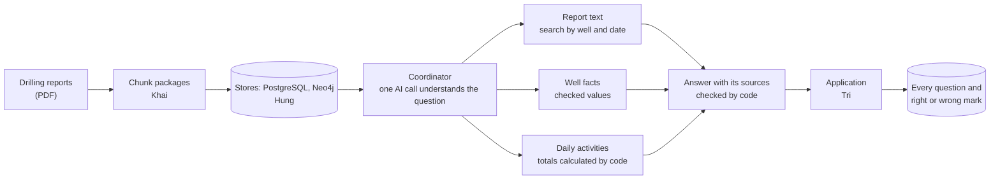

# Stint report: 10 to 24 November 2026

**For:** MSc. Nguyen Anh Tuan · **From:** Tri, Khai, Hung · **Covers:** the work since the [9 November meeting](../../requirements/supervisor-meeting-2026-11-09.md) · **Previous:** [project report, 9 November](../PROJECT_REPORT_2026-11-09.md)

## In short

You asked for three things on 9 November: a coordinator that routes questions, the three tracks connected behind a simple UI that domain experts can touch, and reasoning questions as a target. This stint designed all three and built the first two as far as one laptop allows.

There is now an application: a person types a question about the drilling reports and sees the answer, a label saying how far to trust it, and the page or the activities it rests on. It runs today on prepared example answers. **It has not yet been run with a real model, and the three tracks are still joined by files, not by the shared stores.** Those are the next two steps.

Most of this was built on one day, 24 November. Between 12 and 24 November there was little recorded work, and we did not contact you; that is ours to fix.

## What you asked for, and where each stands

| You asked (9 November) | Now |
|---|---|
| Keep a coordinator that routes questions; later it uses tools and connectors | **Built, not yet measured.** One model call understands the question; code then picks where to look. Each place it can look has the same interface, so it can later be called as a tool. It is adopted only if it scores as well as choosing by hand |
| A switch for exact answers only | **Built.** "Verified data only" in the application: answers from checked facts and calculated totals, with no AI reading of the text |
| A simple UI early, on the connected tracks, to show domain experts | **Built on example answers.** The backend and the application exist. Connecting them to the shared stores and a real model is next |
| Reasoning about the causes of a drilling problem | **Designed.** A small trial on AK-3's own non-productive events is planned, to show you a concrete answer and what a useful one would need |
| The model can be swapped | **Built.** Which model does which job is one settings file |
| People review part of the machine-made data | **Started.** The application lets a reader mark an answer right or wrong, and every question is logged |
| State the node and relationship logic clearly | **Written down** in the [specification, §8.5](../../PROJECT_DESIGN.md#85-the-graph-nodes-and-relationships): one graph with two regions, joined at the well |

## The system in one picture

Solid today: each box exists. Not yet: the arrows from the stores to the coordinator. The coordinator still reads the same data from files.

## One question, start to finish

**"How many hours of non-productive time did AK-3 have?"**

1. **Understood** as a total over a period, about the daily reports.
2. **Looked up** in the daily activities: 28 activities marked non-productive, on 10 days.
3. **Calculated by code**, not written by an AI: **115 hours**.
4. **Shown** with a green label, "Calculated from the reports", a timeline of those 10 days, the list of the 28 activities, and the reports they came from.

The end-of-well report's own time table also says 115 hours. This example needs no model at all once the question is understood, which is why a calculated answer cannot be a typing mistake.

For a question such as "What total depth did well AK-3 reach?", an AI reads the report text and writes the answer; code then confirms the value is in the text, and the application highlights it on the page ("1,955").

## What was done

| Who | Done this stint |
|---|---|
| **Khai** (data) | Options for joining tables across pages, section context, form recognition, label repair, page orientation and resumable runs, added on 17 November. All are off by default and their effect is not yet reported |
| **Hung** (stores) | 1,042 passages with search vectors in PostgreSQL, and the daily activities of AK-3 in Neo4j, each checked against the source, on 10 November. He agreed to the new design and to the backend role |
| **Tri** (engine, application) | The design of the second build, written into the specification and the plan. The coordinator and its three lanes. The well facts exported as a graph for Neo4j. The backend service and its question log, on Hung's behalf. The application for non-developers, with a guide and explanations on hover |

Roles for the next stint are agreed: Khai data, Hung backend and stores, Tri engine and application.

## What we learned

- **Letting code report a calculated total, instead of an AI retyping it, would have fixed nine wrong answers.** Replaying the earlier experiment's recorded plans this way gives 33 of 35 and 22 of 23, against 27 and 19. This replays old plans with no model; it is not a new measurement, and the questions were written by us to suit this kind of answer.
- **An independent review of the new code found eight real faults**, all fixed. One would have mattered to users: a date range such as "20-22 August" was read as a well name and turned a right answer into "not stated".
- **The application showed us a wrong fact in seconds** that we had missed in the files: AK-3 listed with 3 days from spud to rig release, beside report text that says 19. Our checks pass it because a "3" appears nearby. Two more doubts about the stored facts are logged.

## Weak points

- **No real model has run through the new parts.** The coordinator's quality is unknown until it does.
- **Not connected.** The stores are on one laptop and the application reads files.
- **Every question we test with is written by us.** No expert has reviewed them.
- **One well, one report family.** AK-3 and its contractor's layout. Other authors' reports are untested or fail.
- **No domain expert has seen the application.** We made it as plain as we could; whether it is clear to them is not known.
- **Some stored facts are wrong** (above), and they are shown to the AI when it answers.

## What we need from you

1. **Who can try the application**, even one or two people from the expert group. Their questions are logged, which gives us real ones.
2. **What it is for:** which report types stay in scope, and which kinds of question users ask.
3. **US$10** for a hosted open-weight model so the demo answers at any hour, on public data only. The [resource request](../RESOURCE_REQUEST_2026-11-24.md) has the detail; the server comes from student credits.
4. **How to book the school GPUs.**

## Next stint, to 12 December

1. Run the coordinator with the real model on Tri's desktop, on all 221 of our development questions, and decide whether to keep it.
2. Put the stores on a shared server and have the application read them.
3. A chunk package for the demo that includes the non-productive-time report.
4. The reasoning trial on AK-3.
5. Show you one question going through the whole system, live, and hand the application to whoever you name.

Detail: [development plan](../../DEVELOPMENT_PLAN.md#7-what-to-do-now), [Track B log](../../tracks/B-graphrag/log.md), [Track C log](../../tracks/C-storage/log.md).
