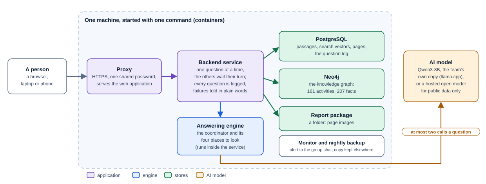
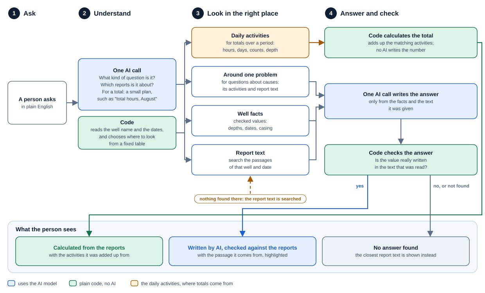
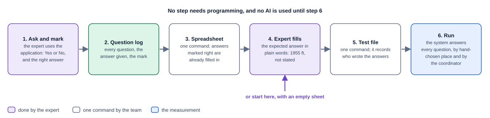

# Stint report: 10 to 27 November 2026

**Status: draft.** The stint ends on 27 November; this report is updated until then. 
**For:** MSc. Nguyen Anh Tuan · **From:** Thai Huu Tri, Nguyen Le Hung, Tran Quang Khai 
**Follows:** the [9 November meeting](../../requirements/supervisor-meeting-2026-11-09.md) and the [project report of 9 November](../PROJECT_REPORT_2026-11-09.md)

## 1. In short

- On 9 November anh Tuấn asked for three things: a **coordinator** that routes questions, the three parts **connected behind a simple application** that domain experts can use, and **reasoning questions** as a target. All three are designed and built.
- **There is one application.** A person types a question about the drilling reports and sees the answer, a label saying how far to trust it, and the page or the activities it rests on.
- **It has run from end to end with the real AI model** (Qwen3-8B, the team's own copy): from the public PDF reports, through the stores (PostgreSQL and Neo4j), to answers behind a password. The earlier baseline result came out the same, answer for answer.
- **Three wells are loaded:** the end-of-well reports of AK-3, 56-32 and 68-32, and AK-3's daily reports.
- **A total is calculated by code and never written by an AI**, so it cannot be a guess.
- **The coordinator is measured:** on 119 of the team's own questions it answers 102, against 87 when a person chooses where to look, with the same number of AI calls (§8).
- **Answers about the cause of a problem are measured once.** The system finds the cause the reports state, in the report's own words, but also lists nearby events as causes. Not ready to show as a finding (§8).
- **An expert's input becomes a test without programming** (§6).
- **What is left needs people or money, not code:** experts to try it, a server others can reach, and a graphics card to run the experts' questions (§10).

## 2. What anh Tuấn asked for on 9 November, and where each stands

| Asked | State | What exists |
|---|---|---|
| A coordinator that routes each question; later it uses tools and connectors | **Built and measured** on the team's questions (§8); to be confirmed on an expert's | One AI call understands the question; code decides where to look. Every place it can look has the same interface, so each can later be offered as a tool |
| A switch for exact answers only | **Built** | "Verified data only" in the application |
| A simple application early, on the connected parts, for domain experts | **Built and run with the real model**; not yet on a server others reach | A backend service and a web application for people who are not developers, reading the stores |
| Reasoning about the causes of a drilling problem | **Built and measured once:** good in one part, not ready in another | A fourth place to look, for causes, tried on twenty trial questions about AK-3 (§8) |
| The model can be swapped | **Built** | One small file names a model and where it runs; one command checks it and measures it |
| People review part of the machine-made data | **Built, first form** | Every answer can be marked right or wrong, with the right answer typed in; the marks become a test (§6) |
| State the node and relationship logic of the graph | **Written down** | §5 |

## 3. The system now

**Figure 1. The four parts and who owns each.** Every arrow works today, on one machine. The engine reads the same data from files or from the stores.

| Part | State at the end of this stint |
|---|---|
| 1. Reading the reports (Khai) | One command builds the package for the demo: 302 pages, about 1,430 passages, each with an ID that points back to its page. Each new reading option was measured; three are on (§7) |
| 2. Stores (Hung) | One command loads a package and checks every step: the passages with a search vector each, 161 daily activities, 207 well facts. The stores restart by themselves after a failure |
| 3. Answering engine (Tri) | The coordinator and its four places to look. With the real model: the baseline reproduced, the coordinator and the answers about causes measured (§8) |
| 4. Application (Tri and Hung) | A backend service and a web application behind one password. Besides asking: a page per well and a page of the questions people asked |

**Figure 2. How it runs.** Everything inside the dashed box starts with one command. The model answers one question at a time, so questions take turns. Run this way on one machine, with the real model, a check from outside passed 6 of 6 steps. A real address and its certificate have not been tried.

## 4. How a question is answered

**Figure 3. The path of a question.** Blue boxes use the AI model; green boxes are plain code. The AI is used at most twice: once to understand the question, once to write an answer. It never chooses where to look, and it never writes a query that runs.

| Kind of question | Example | Where it looks | Who produces the answer |
|---|---|---|---|
| A total over a period | How many hours of non-productive time did AK-3 have? | Daily activities | Code |
| A fact about a well | What total depth did well AK-3 reach? | Well facts, then report text | AI, then checked by code |
| What happened on one day | What was the mud weight on AK-3 on 20 August 2016? | Report text of that well and day | AI, then checked by code |
| A comparison between wells | Which of AK-3, 56-32 and 68-32 was drilled deepest? | Well facts and report text of each well | AI, then checked by code |
| The cause of a problem | What caused the stuck pipe on AK-3 on 20 August 2016? | The activities around the problem and the report text of those days | AI, in parts; code removes any cause without a source |

- **The check:** code confirms that every value in an AI-written answer appears in the text that was read. If not, the answer is not shown as confirmed.
- **"Verified data only":** no AI writes from report text. The answer comes from the daily activities or the checked facts, or the application says the verified data holds no answer.

### The application's screens

**Figure 4. A total, calculated by code.** "How many hours of non-productive time did AK-3 have?" gives 115 hours with a green label, *Calculated from the reports*. Each row on the right is one day; each amber bar is an activity the reports marked as non-productive. The end-of-well report's own summary also gives 115 hours. (Example data in the screenshot; the activities and the total are real.)

**Figure 5. A fact, written by AI and checked.** A real answer from the team's copy of the model, in the application running on the stores. The label is blue: *Written by AI, checked against the reports*. The value is highlighted where the report writes it, and "Open page" shows the printed page beside the answer.

**Figure 6. No answer.** With "Verified data only" on, a question about a well that is not loaded gets "Not in the verified data" and the closest report text. The system says it does not know instead of guessing.

**Figure 7. The cause of a problem.** The application shows the problem it found (66 hours of non-productive time from 20 to 23 August at 176 ft), then, apart: what the reports say caused it, in the report's words; other possible factors, marked *Possibility, not a finding*; and what a real judgement would still need. When a question fits several problems, it asks which one. (The answer shown is a prepared example; the problem, the activities and the report's words are real. What the real model answered is in §8.)

**Figure 8. A page for each well.** What the reports say about the well, planned beside actual, each value opening the page it was read from; and every day of reports as a bar, non-productive time in amber.

The application is written for people who read drilling reports: nothing on screen names a part of the system. It has a guide on first visit, an explanation beside each term, plain messages when it is busy or down, and it works on a phone and by keyboard alone.

## 5. The knowledge graph

**Figure 9. One graph, two regions, joined at the well.** Every fact and every activity points to the passage it was read from, so any answer can be traced to a page.

| Region | Built from | By | State |
|---|---|---|---|
| Activities (amber) | The operations tables of the daily reports and the non-productive-time report | Code only, no AI | 161 activities on 27 days for AK-3 |
| Facts (blue) | Tables of the end-of-well reports by fixed rules, and their text by an AI, then checked | Code, and AI then code | 207 checked facts for 5 wells; 202 of them point to a passage in the store |

Activities answer "how many hours" and "on which days". Facts answer "how deep" and "which casing". A relationship the report does not state, such as a cause, is never stored.

## 6. From an expert's input to a test

**Figure 10. The path.** Every question set so far was written by the team, so no number in this report is an evaluation. This path is ready for the first expert.

**Figure 11. The questions people asked,** with the answer each got and how it was marked. (Example entries.)

- **In the application:** under each answer, "Was this answer right?" Yes, or No with the right answer typed in.
- **In a spreadsheet:** one row per question, the expected answer in plain words: "1955 ft", "13 August 2016", "not stated".
- **The test records who wrote its answers,** so a set written by the team can never be presented as an expert's.
- Guide: [EXPERT_PILOT.md](../../EXPERT_PILOT.md).

## 7. What each person built

### Tri: answering engine and application

- **The design of the second build**, in the specification and the plan.
- **The coordinator and four places to look behind one interface**: report text, well facts, daily activities, causes of a problem. Totals are reported by code.
- **Answers about causes**: code finds the problem and gathers what surrounds it; the AI answers in parts; code removes any cause whose source it cannot find.
- **The well facts as a graph**: 207 checked facts for 5 wells, after a stricter check removed nine wrong ones.
- **A bench for models**: one command checks a model, one runs every measurement and resumes if interrupted, one compares runs.
- **The web application**, with 178 automated tests.
- **The first runs with the real model**, on a machine without a graphics card (§8).
- **The path for an expert's input** (§6).
- **Three reviews before anyone uses it, made with AI review tools**: design, code and security. About fifty points raised; those code can fix are fixed, most with a test.

### Hung: stores and backend

- **Passages and search vectors in PostgreSQL**; searching the store gives the same results as searching in memory (67 of 67 searches).
- **Daily activities and well facts in Neo4j**, read back identical to the source; 58 of 58 recorded queries give their recorded results.
- **A reader for the store**, so the engine takes passages from PostgreSQL in the form it already reads.
- **The stores made ready to share**: passwords out of the repository, a script that sets up a server, a nightly backup, a step-by-step guide.

### Tri and Hung together: the backend and the connection

- **The service the application talks to**, with a written contract and an example response for each call.
- **The engine reads the stores**: one setting switches it from files to PostgreSQL and Neo4j, with the same results.
- **The question log in PostgreSQL**: every question, its answer and every mark; listed, filtered, counted and downloaded.
- **One command from a report package to a loaded store**, each step checked.
- **The whole application as containers** (Figure 2): questions take turns, a failed question is still logged, a monitor alerts the group chat, the backup can be checked by restoring it.
- **A guard on where report text may go**: the application refuses to start with an outside AI service unless the loaded package is named as public.
- **Automatic tests on every change.**

### Khai: reading the reports

- **New reading options**: joining tables that continue across pages, carrying a passage's heading, form recognition and label repair, page orientation, quarantine of bad pages, runs that stop and resume, and more checks on the output.
- **Each option measured on the demo package, by rules written before the numbers.** An option is on only if the package still passes its checks, no existing ID changes, and a sample read against the page images shows nothing made worse.
- **The outcome:** section context and the recovery of table grids are on. Table joining stays as shipped, though on this package it joined none of ten real continuations. The others stay off, each with its reason.
- These decisions rest on the eight files of the demo package and are not tested on other reports.

### Khai and Tri together: the package for the demo

- **One package holding everything the demo needs**, built by one command, and built a second time from nothing on another machine: the same pages, one passage more in one scanned report.
- **The daily activities are built from this package alone.**
- **The well facts moved onto the package's passages without an AI**: 202 of 207 moved; 5 have no matching passage.

## 8. What was measured

All questions below were written by the team. None is reviewed by an expert, so these numbers describe behaviour and are not an evaluation. All runs used the real model on a machine without a graphics card, one question at a time.

### The coordinator against choosing by hand

| Kind of question | Questions | Chosen by hand | Coordinator |
|---|---:|---:|---:|
| A fact in an end-of-well report | 31 | 29 | 28 |
| A fact in one day's report | 30 | 17 | 17 |
| A total over many days | 58 | 41 | 57 |
| **All** | **119** | **87** | **102** |

- **Both ways cost 1.5 AI calls a question.** The coordinator spends one call more on a simple fact and one fewer on a total.
- **Why totals improved:** all 17 answers lost by hand were the AI copying a calculated number wrongly; the plan was right every time. The coordinator has code report the number.
- **Not a clean test:** the coordinator's checks were written while looking at these questions. One check was too broad twice and had to be narrowed. The test that counts is an expert's questions, answered both ways.
- Detail: [experiment E33](../../experiments/E33-coordinator.md).

### The baseline, and the new report package

- **The earlier baseline is reproduced on a second machine:** 28 of 31, the same three wrong.
- **On the new package: 26 of 31.** In both lost cases the right table was found and the model answered "not stated". It is the casing table; the reading rule written for it is left off for now because it renames IDs.

### Answers about causes

Twenty trial questions about AK-3 in two sets of ten, each fixed before it was run. The first set was used to find and fix faults.

| | First set | Second set, unseen |
|---|---:|---:|
| The right problem was found | 8 of 10 | 6 of 10 |
| The cause the reports state was found, with the report's words | 8 of 10 | 5 of 10 |
| Things stated as a cause that the reports do not give as one | 17 | 8 |
| Right on every count, first run | 2 of 10 | 3 of 10 |
| Right on every count, after the changes below | 7 of 10 | 6 of 10 |

- **The good part:** when the right problem was reached, the model named the cause the reports state and quoted it. "What caused the stuck pipe on 20 August?" gave "plugged inner barrel", with the words "due to plugged inner barrel".
- **The weak part:** beside the true cause it listed other things from the same days as causes: "high torque", "crews at lodge for night". Each has a real quote, so the source check passed them.
- **What was changed, in code and not in the model:** a stated cause must rest on words that give a reason ("due to", "because", "waiting on"); and "the problem" is the activity asked about, not a whole incident of several days.
- **"Other possible factors" are mostly generic** ("inadequate communication"). An expert should say whether that part is worth keeping.
- **Cost:** two AI calls and about three times the text of a simple lookup. Detail: [experiment E34](../../experiments/E34-reasoning-probe.md).

### What was learned

1. **The real model makes mistakes that scripted stand-ins never made**: a code the question never mentioned, a wrong year on a date, "1955 in" for a depth written as "1,955 in contrast to the planned 1,700'". Each can be seen by comparing with the question or the report, so code now checks it. The rule: what code can read outranks what the model says.
2. **A real quote is not a reason.** Checking that a quote exists is not checking that it is a cause.
3. **The check on facts was weaker than thought.** It accepted digits inside a longer number: an elevation of 150 read out of "1500'". Nine of 216 facts were wrong this way; 207 remain.
4. **Reviews found what tests did not**: nothing limited how long a question could wait; a failed question left no trace; the stores would not come back after a restart.
5. **Showing the data to a person exposes errors fast.** The well page shows AK-3 with 3 days from spud to rig release beside report text that says 19. This is the human review asked for, in its first form.
6. **A rule tuned on one kind of question must be run on the others.** A rule written to fix totals sent simple daily facts to the calculation: 13 of 30 right, not 17, until it was narrowed.

## 9. Weak points

- **Every test question is written by the team.** The scoring is also lenient in one known way: a number within half a percent counts as right.
- **No domain expert has used the application.**
- **The coordinator's checks were written on the questions it is scored on.** On a simple fact it costs one AI call more than choosing by hand and is no better.
- **Answers about causes over-state.** Not ready to show as findings.
- **No graphics card and no server of the team's own.** The runs were made on a cloud machine without a graphics card, on public data only. A private document cannot go on a rented machine without VPI's agreement.
- **Not on a server others can reach.**
- **Three wells from two projects, one report author.** Other authors' reports are untested or fail.
- **One stored fact is known to be wrong** (AK-3, days from spud to rig release), and five facts point to passages the store does not hold.

## 10. What the team needs from anh Tuấn

1. **Who can try the application:** one or two people from the expert group is enough. Their questions and marks become the first real test (§6). One of them is also asked to read ten answers about causes and say whether that kind of answer is useful.
2. **What it is for:** which report types stay in scope, and which kinds of question users ask.
3. **Support for a budget for rented compute: 5 million VND for three months**, from the capstone funding, requested through the school as Dr. Dung said. A graphics card by the hour, a small server that stays on, and pay-per-use hosted models for a demo. Detail: [resource request](../RESOURCE_REQUEST_2026-11-24.md).
4. **If a private VPI document is to be used later:** where it may be processed.

## 11. What comes next

Everything code and the team's own machines can do for this build is done. Each next step starts with a person or with the budget.

| When | Who | What |
|---|---|---|
| By 27 November | Tri | Send the request for rented compute, and this report |
| By 27 November | Hung | Say whether his machine hosts the application until there is a server |
| By 27 November | Khai | Review the demo package; add the four benchmark files his scripts read |
| Next stint, with a server | Team | The application at one address behind the password, monitored, with its backup copied elsewhere |
| Next stint, with experts | Team | The application in their hands; their questions and marks turned into a test |
| Next stint, with a graphics card | Team | The experts' questions answered both ways; the coordinator confirmed or not |
| Meanwhile | Tri | In answers about causes: recognise a reason given as a purpose ("to stop flow"), and ask back when a question fits several problems |

## Where the detail is

[Specification](../../PROJECT_DESIGN.md) · [development plan](../../DEVELOPMENT_PLAN.md#7-what-to-do-now) · track records: [engine](../../tracks/B-graphrag/log.md), [stores](../../tracks/C-storage/log.md), [reading the reports](../../tracks/A-ingestion/log.md) · [experiment register](../../experiments/README.md) · [running it on a server](../../../deploy/README.md)
