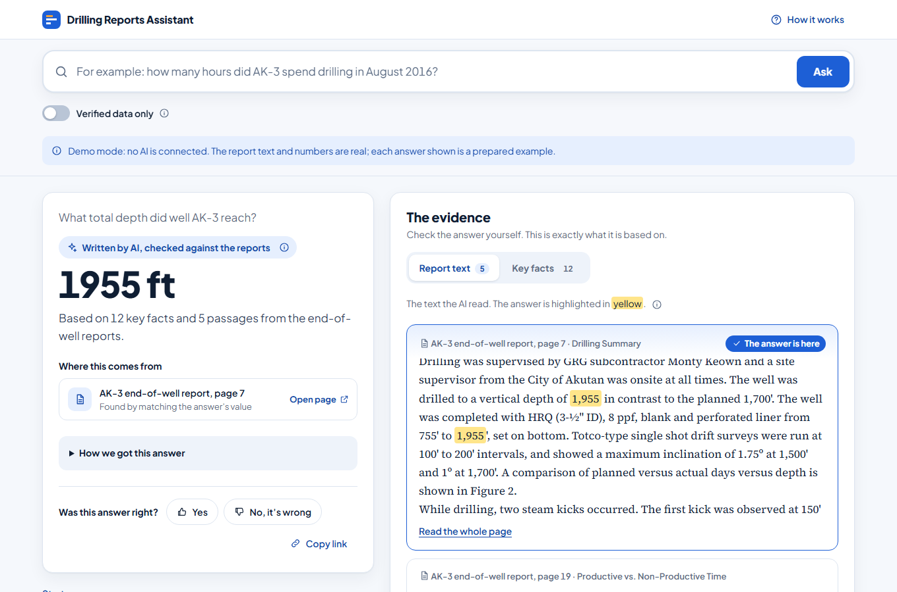
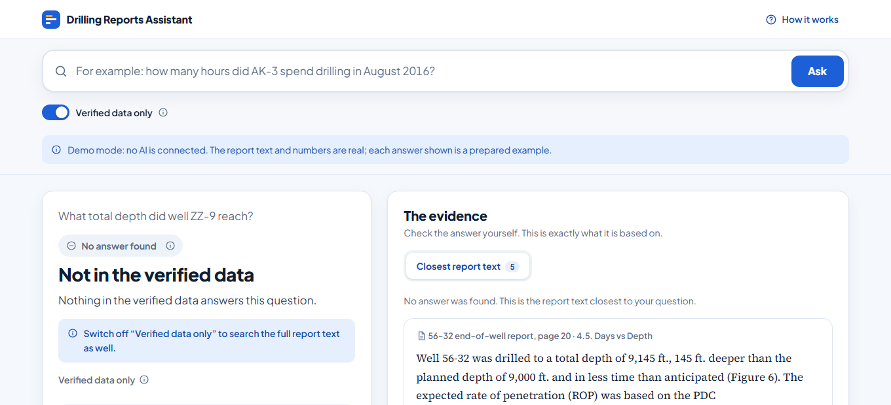
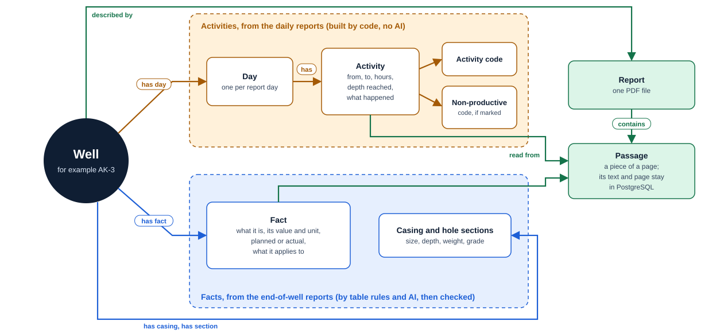
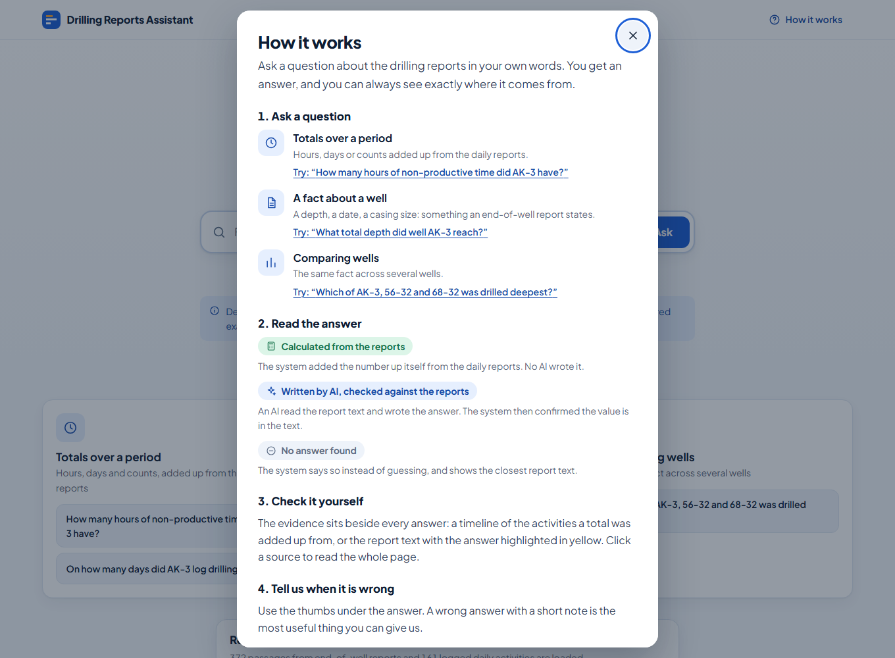

# Stint report: 10 to 27 November 2026

**Status: draft.** The stint ends on 27 November; this report is updated until then. 
**For:** MSc. Nguyen Anh Tuan · **From:** Thai Huu Tri, Nguyen Le Hung, Tran Quang Khai 
**Follows:** the [9 November meeting](../../requirements/supervisor-meeting-2026-11-09.md) and the [project report of 9 November](../PROJECT_REPORT_2026-11-09.md)

## 1. In short

- On 9 November you asked for a **coordinator** that routes questions, the three parts **connected behind a simple application** that domain experts can touch, and **reasoning questions** as a target.
- This stint we designed all three and built the first two. There is now an application: a person types a question about the drilling reports and sees the answer, a label that says how far to trust it, and the page or the activities it rests on.
- A total such as "hours of non-productive time" is now **calculated by code and never written by an AI**, so it cannot be a guess.
- **Still to do before the stint ends:** run the new parts with the real model, and move the application from files onto the shared stores.

## 2. What you asked for, and where each stands

| You asked on 9 November | State | What exists |
|---|---|---|
| A coordinator that routes each question; later it uses tools and connectors | **Built**, to be measured | One AI call understands the question; code then decides where to look. Each place it can look has the same interface, so it can later be offered as a tool |
| A switch for exact answers only | **Built** | "Verified data only" in the application |
| A simple application early, on the connected parts, for domain experts | **Built** on prepared answers; connection to the stores is next | A backend service and a web application, written for people who are not developers |
| Reasoning about the causes of a drilling problem | **Designed** | A trial on AK-3's own non-productive events is planned (§10) |
| The model can be swapped | **Built** | Which model does which job is one settings file |
| People review part of the machine-made data | **Started** | Every answer can be marked right or wrong; every question is logged |
| State the node and relationship logic of the graph | **Written down** | §6 below |

## 3. The system now

**Figure 1. The four parts and who owns each.** Solid arrows work today. Dashed arrows are being connected: the engine reads the same data from files for now, and will read it from the stores.

| Part | What it does | State at the end of this stint |
|---|---|---|
| 1. Reading the reports | Turns a PDF into passages, tables and forms, each with a stable ID that points back to its page | Works on AK-3's end-of-well report and four daily-report attachments (174 pages). New options for tables that run across pages, section context and form recognition were added; their effect is still to be measured |
| 2. Stores | Keeps passages and their search vectors in PostgreSQL, and the knowledge graph in Neo4j | 1,042 passages with vectors, and AK-3's daily activities, loaded and checked against their source. On one laptop; a shared server is next |
| 3. Answering engine | Understands the question, looks in the right place, answers, and checks the answer | The coordinator and its three places to look are built and tested with stand-in models. A run with the real model is next |
| 4. Application | Lets a person ask, read the answer, check its sources and mark it right or wrong | Backend service and web application built; they run on prepared example answers |

## 4. How a question is answered

**Figure 2. The path of a question.** Blue boxes use the AI model. Green boxes are plain code. The AI is used at most twice: once to understand the question, once to write an answer. It never chooses where to look, and it never writes a query that runs.

1. **Understand.** One AI call returns the kind of question, the reports it concerns and, for a total over time, a small plan (for example: total hours, non-productive, August). Code reads the well name and the dates itself.
2. **Choose where to look.** Code decides from a fixed table. If the first place has nothing, it falls back to the report text.
3. **Produce the answer.**
   - *A total over time:* code runs the plan on the daily activities and reports the result. No AI is involved, so the number cannot be mistyped.
   - *Anything else:* one AI call writes the answer, using only the facts and passages it was given.
4. **Check.** Code confirms that every value in an AI-written answer really appears in the text that was read. If it does not, the answer is not shown as confirmed.

**"Verified data only".** With this switch on, the report text is not searched and no AI writes from it. The answer comes from the daily activities or the checked facts, or the application says that the verified data holds no answer.

| Kind of question | Example | Where it looks | Who produces the answer |
|---|---|---|---|
| A total over a period | How many hours of non-productive time did AK-3 have? | Daily activities | Code |
| A fact about a well | What total depth did well AK-3 reach? | Well facts, then report text | AI, then checked by code |
| What happened on one day | What was the mud weight on AK-3 on 20 August 2016? | Report text of that well and day | AI, then checked by code |
| A comparison between wells | Which of AK-3, 56-32 and 68-32 was drilled deepest? | Well facts and report text of each well | AI, then checked by code |
| The causes of a problem | AK-3 lost time on 2 September. What are the likely causes? | Designed, not built (§10) | — |

## 5. Three questions, as the application shows them

### A total, calculated by code

**Figure 3.** "How many hours of non-productive time did AK-3 have?" The answer, 115 hours, carries a green label: *Calculated from the reports*. On the right, each row is one day from midnight to midnight, and each amber bar is an activity the reports marked as non-productive. Hovering a bar says what happened; the full list is below it. The end-of-well report's own summary table also gives 115 hours.

### A fact, written by AI and checked

**Figure 4.** "What total depth did well AK-3 reach?" The label is blue: *Written by AI, checked against the reports*. The passage the answer comes from is listed first and flagged, and the value is highlighted where the report writes it. The reader can open the whole page. In this screenshot the answer itself is a prepared example; the report text, the page and the highlight are real.

### No answer

**Figure 5.** With "Verified data only" on, a question about a well that is not loaded gets "Not in the verified data", advice on what to try, and the closest report text. The system says it does not know instead of guessing.

## 6. The knowledge graph

**Figure 6. One graph, two regions, joined at the well.** Every fact and every activity points to the passage it was read from, so any answer can be traced to a page.

| Region | Built from | By | State |
|---|---|---|---|
| Activities (amber) | The operations tables of the daily reports and the non-productive-time report | Code only, no AI | 161 activities on 27 days for AK-3, in Neo4j |
| Facts (blue) | Tables of the end-of-well reports by fixed rules, and their text by an AI, then checked | Code, and AI then code | 216 checked facts for 5 wells, exported as a file; loading into Neo4j is next |

The two regions answer different questions. Activities answer "how many hours" and "on which days". Facts answer "how deep" and "which casing". A relationship that the report does not state, such as a cause, is never stored.

## 7. The application

**Figure 7.** The guide that opens on a first visit. It can be closed at once and reopened from "How it works".

It is written for people who read drilling reports, not for developers. Nothing on screen names a part of the system.

| A user can | How |
|---|---|
| Ask in plain English | One search box, with example questions to click |
| See how far to trust an answer | A coloured label: calculated, written by AI and checked, written by AI and not confirmed, or no answer found |
| Check the answer | The evidence beside it: a timeline of activities, the report text with the answer highlighted, the key facts; any source opens its page |
| Get an explanation | A small "i" beside each term, shown on hover or tap |
| Ask for verified data only | One switch |
| Say it is wrong | "Was this answer right?" Yes, or No with a note. Both are saved |
| Learn how it works | A guide on first visit and from the top bar |

Every question, how it was answered, and every right or wrong mark is logged. When domain experts use it, that log gives us their real questions.

## 8. What each of us built

### Tri: answering engine and application

- **The design of the second build**, written into the specification and the plan: the coordinator, the knowledge graph's structure, the reasoning questions, the application.
- **The coordinator**: one AI call to understand the question; routing, fallback and "verified data only" in code.
- **Three places to look, behind one interface**: report text, well facts, daily activities. The shared interface is what lets them be offered as tools later.
- **Totals reported by code.** The daily-activities path now returns the number itself, so no AI retypes it.
- **The well facts exported as a graph** for loading into Neo4j: 216 checked facts for 5 wells.
- **A settings file for models**, so a stronger model replaces the current one without a code change.
- **The web application** (§7), with 49 automated tests.
- **An independent review** of the new engine code, which found eight faults; all are fixed, each with a test.

### Hung: stores and backend

- **Passages and search vectors in PostgreSQL**: 1,042 passages of AK-3's reports, each with its well and report date, and a check that searching the store gives the same results as searching in memory (67 of 67 searches).
- **The daily activities in Neo4j**: 27 days and 161 activities for AK-3, read back identical to the source, with 58 of 58 recorded queries giving their recorded results.
- **A reader for the store**, so the engine can take passages from PostgreSQL in the form it already reads.

### Tri and Hung together: the backend service

- **The service the application talks to**: asking a question, marking an answer, reading a passage, a page, a well and its activities, and a health check.
- **A written contract** between the service and the application, with an example response for each call, so both sides can be built and tested apart.
- **The question log**: every question, how it was answered, and every mark.
- **A design for the rest**: shared hosting, the graph in Neo4j, one command that loads a new report package, page images, and a password in front of the demo. 21 automated tests cover the service.

### Khai: reading the reports

- **Tables that continue across pages**: an option to join them and carry the header.
- **Section context**: the heading a passage belongs to, carried onto the passage.
- **Form recognition and label repair**: candidate settings for reading form areas and for pairing a label with its value.
- **Page orientation, quarantine of bad pages, and runs that can stop and resume.**
- **More checks** on the output: tables against their passages, labels against values, conflicts between forms, structure across pages.
- All of these are options that are off by default. Measuring each and deciding which to switch on comes next.

## 9. What we learned

- **Reporting a calculated total in code, instead of letting an AI retype it, repairs nine answers.** Replaying the plans recorded in the earlier experiment this way gives 33 of 35 and 22 of 23 right, against 27 and 19. This replays recorded plans without a model, and the questions were written by us to suit this kind of answer, so it is an indication and not a new measurement.
- **A second pair of eyes found what tests did not.** The review found, for example, that "20-22 August" was read as a well name, which turned a right answer into "not stated". Wells are now recognised only if the system holds them.
- **Showing the data to a person exposes errors fast.** The application's list of facts showed AK-3 with 3 days from spud to rig release, beside report text that says 19. Our automatic check passes it, because a "3" appears nearby. Two more doubtful facts are logged. This is the human review you asked for, in its first form.

## 10. Reasoning about causes: the design

For "a problem happened here; what are the likely causes?" the system will do what an engineer does, with code doing the gathering:

1. **Find the problem** in the daily activities: by date, depth, non-productive code, or words such as "stuck".
2. **Gather what surrounds it**: the activities of the days before and after, the non-productive-time report's own description, that day's report text, and the end-of-well report's account.
3. **Answer in two parts**: what the reports state as the cause, and other possible factors, each with its source and labelled as a possibility. Nothing without a source.
4. **Say what is missing** for a real judgement.

A first trial uses about ten questions on AK-3's own 28 non-productive events. One well's reports do not hold offset wells, formation pressures or lessons learned, so the trial's purpose is to show you a concrete answer and learn what a useful one needs.

## 11. Weak points

- **The new parts have not run with the real model yet.** How well the coordinator chooses is unknown until they do.
- **Not connected yet.** The stores are on one laptop, and the application reads files.
- **Every test question is written by us.** None is reviewed by an expert.
- **One well and one report family.** Other authors' reports are untested or fail.
- **No domain expert has used the application.** Whether it is clear to them is not known.
- **Some stored facts are wrong** (§9), and they are shown to the AI when it answers.

## 12. What we need from you

1. **Who can try the application**: one or two people from the expert group is enough. Their questions are logged, which gives us real ones.
2. **What it is for**: which report types stay in scope, and which kinds of question users ask.
3. **US$10** for a hosted open-weight model, so the demo answers at any hour, on public data only. The server comes from student credits. Detail: [resource request](../RESOURCE_REQUEST_2026-11-24.md).
4. **How to book the school GPUs.**

## 13. What comes next

**Before this stint ends, 27 November**

| Who | What |
|---|---|
| Tri | Run the coordinator with the real model on all 221 development questions and decide whether to keep it |
| Hung | Stores on a shared server that all three of us reach |
| Khai | A report package for the demo that includes the non-productive-time report |

**Next stint, to 12 December**

1. The application reads the shared stores, and one command loads a new report package.
2. The well facts in Neo4j, beside the activities.
3. The reasoning trial on AK-3.
4. One question shown to you going through the whole system, live, and the application handed to whoever you name.

## Where the detail is

[Specification](../../PROJECT_DESIGN.md) (design, §4.6 and §8) · [development plan](../../DEVELOPMENT_PLAN.md#7-what-to-do-now) (tasks) · track records: [engine](../../tracks/B-graphrag/log.md), [stores](../../tracks/C-storage/log.md), [reading the reports](../../tracks/A-ingestion/README.md) · [backend design](../../tracks/C-storage/backend-design.md)
