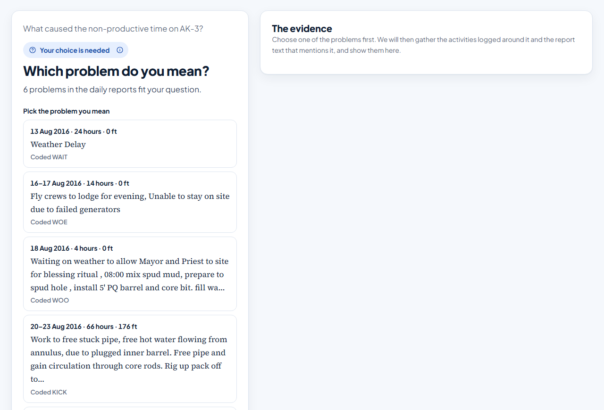
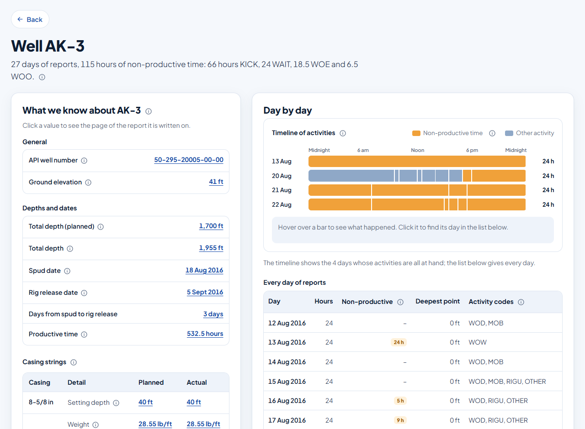
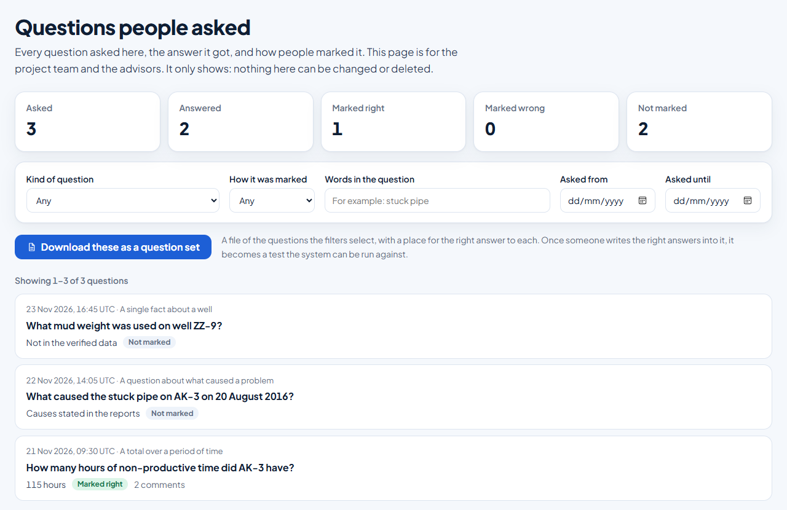

# Stint report: 10 to 27 November 2026

**Status: draft.** The stint ends on 27 November; this report is updated until then. 
**For:** MSc. Nguyen Anh Tuan · **From:** Thai Huu Tri, Nguyen Le Hung, Tran Quang Khai 
**Follows:** the [9 November meeting](../../requirements/supervisor-meeting-2026-11-09.md) and the [project report of 9 November](../PROJECT_REPORT_2026-11-09.md)

## 1. In short

- On 9 November you asked for a **coordinator** that routes questions, the three parts **connected behind a simple application** that domain experts can touch, and **reasoning questions** as a target.
- This stint we designed and built all three. There is now one application: a person types a question about the drilling reports and sees the answer, a label that says how far to trust it, and the page or the activities it rests on.
- **The parts are connected.** The application answers from the stores (PostgreSQL and Neo4j), behind one shared password, and one command loads a new report package into them. It ran end to end on a laptop, with a stand-in in place of the AI model.
- **Three wells are loaded:** the end-of-well reports of AK-3, 56-32 and 68-32, and AK-3's daily reports. Each well has its own page, and every question people ask is kept and can be downloaded as a test set.
- A total such as "hours of non-productive time" is **calculated by code and never written by an AI**, so it cannot be a guess.
- A question about **the cause of a problem** now gets an answer in parts: what the reports state, other possible factors labelled as possibilities, and what is missing for a real judgement.
- **Ready to measure, not yet measured.** Trying a model is now one command: it checks the model, runs every test question and prints a comparison. We have no graphics card and no server of our own, so the measurements with our usual model wait for rented compute (§12). A first check with a smaller model on a laptop is described in §11.

## 2. What you asked for, and where each stands

| You asked on 9 November | State | What exists |
|---|---|---|
| A coordinator that routes each question; later it uses tools and connectors | **Built**, to be measured | One AI call understands the question; code then decides where to look. Each place it can look has the same interface, so it can later be offered as a tool |
| A switch for exact answers only | **Built** | "Verified data only" in the application |
| A simple application early, on the connected parts, for domain experts | **Built and connected** on a laptop; not yet on a server | A backend service and a web application, written for people who are not developers, reading the stores |
| Reasoning about the causes of a drilling problem | **Built**, to be measured | A fourth place to look, for causes (§10), and ten trial questions on AK-3's own non-productive events |
| The model can be swapped | **Built** | One small file names a model and where it runs. One command checks that model and measures it on all our questions |
| People review part of the machine-made data | **Built, first form** | Every answer can be marked right or wrong. A page lists every question asked with its marks, and downloads them as a test set |
| State the node and relationship logic of the graph | **Written down** | §6 below |

## 3. The system now

**Figure 1. The four parts and who owns each.** All arrows work today, on one laptop. The engine can read the same data from files or from the stores.

| Part | What it does | State at the end of this stint |
|---|---|---|
| 1. Reading the reports | Turns a PDF into passages, tables and forms, each with a stable ID that points back to its page | A package for the demo, built by one command: the end-of-well reports of AK-3, 56-32 and 68-32, AK-3's four daily-report attachments and its non-productive-time report (302 pages, 1,431 passages). New reading options exist; their effect is still to be measured |
| 2. Stores | Keeps passages and their search vectors in PostgreSQL, and the knowledge graph in Neo4j | One command loads a package and checks every step: 1,431 passages, 161 daily activities, 216 well facts. Search by meaning runs inside the database. The question log is in PostgreSQL. On laptops; a shared server is next |
| 3. Answering engine | Understands the question, looks in the right place, answers, and checks the answer | The coordinator and its four places to look are built and tested with stand-in models, reading files or the stores. A bench checks any model and runs the whole measurement in one command |
| 4. Application | Lets a person ask, read the answer, check its sources and mark it right or wrong | Backend service and web application run together behind one password, as containers that start with one command. Besides asking: a page per well, and a page of the questions people asked |

## 4. How a question is answered

**Figure 2. The path of a question.** Blue boxes use the AI model. Green boxes are plain code. The AI is used at most twice: once to understand the question, once to write an answer. It never chooses where to look, and it never writes a query that runs. A question about a cause takes the same path: code finds the problem and gathers what surrounds it, and one AI call writes the answer in parts (§10).

1. **Understand.** One AI call returns the kind of question, the reports it concerns and, for a total over time, a small plan (for example: total hours, non-productive, August). Code reads the well name and the dates itself.
2. **Choose where to look.** Code decides from a fixed table. If the first place has nothing, it falls back to the report text.
3. **Produce the answer.**
   - *A total over time:* code runs the plan on the daily activities and reports the result. No AI is involved, so the number cannot be mistyped.
   - *Anything else:* one AI call writes the answer, using only the facts and passages it was given.
4. **Check.** Code confirms that every value in an AI-written answer really appears in the text that was read. If it does not, the answer is not shown as confirmed.

**"Verified data only".** With this switch on, the report text is not searched and no AI writes from it. The answer comes from the daily activities or the checked facts, or the application says that the verified data holds no answer.

| Kind of question | Example | Where it looks | Who produces the answer |
|---|---|---|---|
| A total over a period | How many hours of non-productive time did AK-3 have? | Daily activities | Code |
| A fact about a well | What total depth did well AK-3 reach? | Well facts, then report text | AI, then checked by code |
| What happened on one day | What was the mud weight on AK-3 on 20 August 2016? | Report text of that well and day | AI, then checked by code |
| A comparison between wells | Which of AK-3, 56-32 and 68-32 was drilled deepest? | Well facts and report text of each well | AI, then checked by code |
| The cause of a problem | What caused the stuck pipe on AK-3 on 20 August 2016? | The daily activities around the problem, and the report text of those days | AI, in parts; code removes any cause without a source |

## 5. Four questions, as the application shows them

### A total, calculated by code

**Figure 3.** "How many hours of non-productive time did AK-3 have?" The answer, 115 hours, carries a green label: *Calculated from the reports*. On the right, each row is one day from midnight to midnight, and each amber bar is an activity the reports marked as non-productive. Hovering a bar says what happened; the full list is below it. The end-of-well report's own summary table also gives 115 hours.

### A fact, written by AI and checked

**Figure 4.** "What total depth did well AK-3 reach?" The label is blue: *Written by AI, checked against the reports*. The passage the answer comes from is listed first and flagged, and the value is highlighted where the report writes it. The reader can open the whole page. In this screenshot the answer itself is a prepared example; the report text, the page and the highlight are real.

### No answer

**Figure 5.** With "Verified data only" on, a question about a well that is not loaded gets "Not in the verified data", advice on what to try, and the closest report text. The system says it does not know instead of guessing.

### The cause of a problem

**Figure 6.** "What caused the stuck pipe on AK-3 on 20 August 2016?" The application first shows the problem it found in the daily activities: 66 hours of non-productive time from 20 to 23 August at 176 ft. Then, apart: what the reports say caused it, with the report's own words; other possible factors, in a dashed box marked *Possibility, not a finding*; and, below what is shown here, what a real judgement would still need. On the right are the activities before, during and after the problem. In this screenshot the answer is a prepared example; the problem, the activities and the report's words are real.

**Figure 7.** When a question fits several problems, the application asks which one is meant instead of guessing.

## 6. The knowledge graph

**Figure 8. One graph, two regions, joined at the well.** Every fact and every activity points to the passage it was read from, so any answer can be traced to a page.

| Region | Built from | By | State |
|---|---|---|---|
| Activities (amber) | The operations tables of the daily reports and the non-productive-time report | Code only, no AI | 161 activities on 27 days for AK-3, in Neo4j |
| Facts (blue) | Tables of the end-of-well reports by fixed rules, and their text by an AI, then checked | Code, and AI then code | 216 checked facts for 5 wells, in Neo4j beside the activities; 202 of them point to a passage in the store |

The two regions answer different questions. Activities answer "how many hours" and "on which days". Facts answer "how deep" and "which casing". A relationship that the report does not state, such as a cause, is never stored.

## 7. The application

**Figure 9.** The guide that opens on a first visit. It can be closed at once and reopened from "How it works".

It is written for people who read drilling reports, not for developers. Nothing on screen names a part of the system.

| A user can | How |
|---|---|
| Ask in plain English | One search box, with example questions to click |
| See how far to trust an answer | A coloured label: calculated, written by AI and checked, written by AI and not confirmed, or no answer found |
| Check the answer | The evidence beside it: a timeline of activities, the report text with the answer highlighted, the key facts; any source opens its page, as an image of the printed page when one has been made |
| Ask what caused a problem | The answer comes in parts (Figure 6); if several problems fit, the application asks which |
| Get an explanation | A small "i" beside each term, shown on hover or tap |
| Ask for verified data only | One switch |
| Say it is wrong | "Was this answer right?" Yes, or No with a note. Both are saved |
| Look up a well | A page per well (Figure 10) |
| See what people asked | A page of every question and its marks, with a download (Figure 11) |
| Learn how it works | A guide on first visit and from the top bar |

Every question, how it was answered, and every right or wrong mark is logged in the database. If the server is slow, unreachable or the password is wrong, the application says so in plain words and offers to try again. When domain experts use it, that log gives us their real questions.

### A page for each well

**Figure 10.** The page of well AK-3. On the left, what the reports say about the well, in plain words with units, planned beside actual; each value opens the page it was read from. On the right, every day of reports as a bar from midnight to midnight, with non-productive time in amber. It also shows a fact we know to be wrong (§9): the page shows the data as it is, which is how such errors get found.

### The questions people asked

**Figure 11.** Every question asked, the answer it got, and how it was marked. The button downloads the selected questions as a file with a place for the right answer to each. Once an expert fills those in, the file is a test the system can be run against. This is how the application turns use into the real questions we are waiting for. The entries shown are examples.

## 8. What each of us built

### Tri: answering engine and application

- **The design of the second build**, written into the specification and the plan: the coordinator, the knowledge graph's structure, the reasoning questions, the application.
- **The coordinator**: one AI call to understand the question; routing, fallback and "verified data only" in code.
- **Four places to look, behind one interface**: report text, well facts, daily activities, and the causes of a problem. The shared interface is what lets them be offered as tools later.
- **Totals reported by code.** The daily-activities path returns the number itself, so no AI retypes it.
- **Answers about causes**: code finds the problem and gathers the activities and report text around it; the AI answers in parts; code removes any cause whose source it cannot find. Ten trial questions are written and fixed before any run.
- **The well facts exported as a graph**: 216 checked facts for 5 wells.
- **A bench for models**: a small file names a model and where it runs; one command checks it (does it answer in the required form, with reasoning switched off, and does our longest prompt fit), one runs every measurement and can resume if interrupted, one prints the comparison. It works with any server that speaks the common interface, on our own machine or rented.
- **The web application** (§7), with 140 automated tests: the answer screens, the cause screens, the page view, a page per well, the questions people asked, and plain messages when the server cannot be reached.
- **An independent review** of the new engine code, which found eight faults; all are fixed, each with a test.

### Hung: stores and backend

- **Passages and search vectors in PostgreSQL**, each with its well and report date, and a check that searching the store gives the same results as searching in memory (67 of 67 searches).
- **The daily activities in Neo4j**: 27 days and 161 activities for AK-3, read back identical to the source, with 58 of 58 recorded queries giving their recorded results.
- **The well facts in Neo4j**, beside the activities: 216 facts, read back identical, the activities untouched.
- **A reader for the store**, so the engine can take passages from PostgreSQL in the form it already reads.
- **The stores made ready to share**: passwords kept out of the repository, a script that sets up a server, a nightly backup, and a step-by-step guide. Until a server is found, one team machine hosts the stores on a private network.

### Tri and Hung together: the backend and the connection

- **The service the application talks to**: asking a question, marking an answer, reading a passage, a page and its image, a well and its activities, and a health check, with a written contract and an example response for each call.
- **The engine reads the stores.** One setting switches it from files to PostgreSQL and Neo4j; on the same data it holds the same passages, activities and facts either way. Search by meaning runs inside the database and returns the same results as the search in memory, on test data.
- **The question log in PostgreSQL**: every question, how it was answered, and every mark; it can be listed, filtered, counted and downloaded as a test set.
- **One command from a report package to a loaded store**, each step checked, each run recorded. Run twice, it changes nothing the second time.
- **The whole application as containers**: the service, a proxy that serves the web application over HTTPS behind one shared password, and a guide from a new server to a running application. A check that asks a question from outside passes on a laptop.
- **Automatic tests on every change** pushed to the repository.

### Khai: reading the reports

- **Tables that continue across pages**: an option to join them and carry the header.
- **Section context**: the heading a passage belongs to, carried onto the passage.
- **Form recognition and label repair**: candidate settings for reading form areas and for pairing a label with its value.
- **Page orientation, quarantine of bad pages, and runs that can stop and resume.**
- **More checks** on the output: tables against their passages, labels against values, conflicts between forms, structure across pages.
- All of these are options that are off by default. Measuring each and deciding which to switch on comes next.

### Khai and Tri together: the package for the demo

- **One package holding everything the demo needs**, built by one command: the end-of-well reports of AK-3, 56-32 and 68-32, AK-3's four daily-report attachments and its non-productive-time report. 302 pages, 1,431 passages, each end-of-well passage carrying its well's name. It passes the package checks.
- **The daily activities are built from this package alone**: 161 activities, every one pointing to a passage that is in the store.
- **The well facts moved onto the package's passages without an AI**: each fact's source was matched to the same text in the new package and its value checked there again. 202 of 216 moved; 14 could not, because two source passages have no match.
- **A dated record** of the work on reading the reports, as a draft for Khai to correct.

## 9. What we learned

- **Reporting a calculated total in code, instead of letting an AI retype it, repairs nine answers.** Replaying the plans recorded in the earlier experiment this way gives 33 of 35 and 22 of 23 right, against 27 and 19. This replays recorded plans without a model, and the questions were written by us to suit this kind of answer, so it is an indication and not a new measurement.
- **A second pair of eyes found what tests did not.** The review found, for example, that "20-22 August" was read as a well name, which turned a right answer into "not stated". Wells are now recognised only if the system holds them.
- **Showing the data to a person exposes errors fast.** The application's list of facts showed AK-3 with 3 days from spud to rig release, beside report text that says 19. Our automatic check passes it, because a "3" appears nearby. Two more doubtful facts are logged. This is the human review you asked for, in its first form.
- **Building in parallel exposed mismatches early.** With the stores as the source, "Verified data only" could show no passage, because the well facts pointed to passages by an older ID than the store holds. Moving the facts onto the new package fixed it: a question about AK-3's casing now shows six passages where it showed none.

## 10. Reasoning about causes

For "a problem happened here; what caused it?" the system does what an engineer does, with code doing the gathering:

1. **Find the problem** in the daily activities: by date, depth, non-productive code, or words such as "stuck". AK-3's 28 non-productive activities form 6 problems, 115 hours together. If several fit the question, the application asks which.
2. **Gather what surrounds it**: the activities of the days before and after, that day's report text, and the end-of-well report's account. The amount is limited, so one question costs about twice a simple lookup.
3. **Answer in two parts**: what the reports state as the cause, and other possible factors, each with its source and labelled as a possibility. Code removes anything whose source it cannot find. With "Verified data only" on, the possible factors are hidden.
4. **Say what is missing** for a real judgement.

Ten trial questions on AK-3's own non-productive events are written and fixed. One well's reports do not hold offset wells, formation pressures or lessons learned, so the trial's purpose is to show you a concrete answer and learn what a useful one needs. It has not run with the real model yet.

## 11. Weak points

- **The new parts have not been measured.** How well the coordinator chooses, and how good an answer about a cause is, are unknown. Everything in this report was tested with stand-ins for the model, with one exception: a smaller open model (Qwen3-4B) running on a laptop's processor passed the bench's check, answering in the required form with reasoning switched off, at about two minutes an answer. That shows the parts work with a real model; it is not a score.
- **We have no graphics card of our own.** Every earlier result came from a borrowed machine. As you advised, we plan to rent a GPU by the hour from a cloud provider instead of using the school's machines, and run our own copy of the model there, so new results stay comparable with the earlier ones. All of it holds public data only: a private document cannot go on a rented machine without VPI's agreement.
- **Connected on laptops, not on a server.** The steps for a real server with a real address are written but have not been run.
- **No search vectors in the laptop's store.** Search by meaning in the database has only run on test data.
- **14 of the 216 well facts** still point to passages the store does not hold.
- **Every test question is written by us.** None is reviewed by an expert.
- **Three wells from two projects, one report author.** Other authors' reports are untested or fail.
- **No domain expert has used the application.** Whether it is clear to them is not known.
- **Some stored facts are wrong** (§9), and they are shown to the AI when it answers.

## 12. What we need from you

1. **Who can try the application**: one or two people from the expert group is enough. Their questions are logged, which gives us real ones.
2. **What it is for**: which report types stay in scope, and which kinds of question users ask.
3. **A budget for rented compute: 5 million VND for the next three months**, from the capstone funding. A GPU by the hour (about 10 hours a week) for measurements and experiments, a small server that stays on for the application, and pay-per-use hosted models for a demo that answers at any hour. We are asking through the school, as Dr. Dung said; your support for the request would help. Detail: [resource plan](../RESOURCE_REQUEST_2026-11-24.md).
4. **If a private VPI document is to be used later:** where it may be processed, since we will have no machine of our own.

## 13. What comes next

**Before this stint ends, 27 November**

| Who | What |
|---|---|
| Tri | Send the request for rented compute. Once a GPU can be rented, one command runs it all: the coordinator on the 221 development questions, the answers on the new package, the ten questions about causes. Then decide whether to keep the coordinator |
| Hung | Review the loading command and the container setup; host the stores where all three of us reach them |
| Khai | Review the demo package and the record written for him; decide which reading options go on |

**Next stint, to 12 December**

1. The application on a server, at one address, behind the password.
2. The measurements, and the changes they call for.
3. Search vectors on the shared store.
4. One question shown to you going through the whole system, live, and the application handed to whoever you name.

## Where the detail is

[Specification](../../PROJECT_DESIGN.md) (design, §4.6 and §8) · [development plan](../../DEVELOPMENT_PLAN.md#7-what-to-do-now) (tasks) · track records: [engine](../../tracks/B-graphrag/log.md), [stores](../../tracks/C-storage/log.md), [reading the reports](../../tracks/A-ingestion/log.md) · [backend design](../../tracks/C-storage/backend-design.md) · [running it on a server](../../../deploy/README.md)
