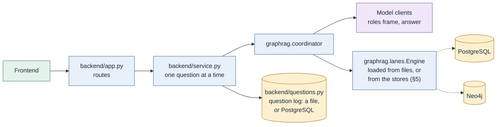

# Backend of the second build: what is done, and the design of the rest

**For:** Hung · **Written by:** Track B (Tri, with Claude) on 24 November 2026, after Hung agreed to the design and asked for help with part of the backend (Track B log B-D39) · **Scope:** plan tasks B1 to B8 ([plan §7](../../DEVELOPMENT_PLAN.md#7-what-to-do-now)); design in [specification §4.6](../../PROJECT_DESIGN.md#46-second-build-one-connected-application) and [§7.5](../../PROJECT_DESIGN.md#75-http-interface-design)

This is a proposal for your part of the work. Anything here can change; say so in the Track C log and change it.

## Where each task stands

**The table says where each task stands today. The sections after it are the design as written on 24 November, before the build:** they are kept as the reasons behind the code, and their numbers and file names are those of that day (the fact graph then had 216 facts in `E27_fact_graph.graph.json`; today it has 207 in `E32_fact_graph.graph.json`, and Neo4j runs without APOC). Where the code differs, the Track C log says so.

| Task | State | Where |
|---|---|---|
| B4. The API contract | **Done** | `backend/openapi.json`, sixteen example responses in `backend/fixtures/` |
| B5. The FastAPI service | **Done**, reading files or the stores | `backend/`; `BACKEND_SOURCE=stores` (§5) |
| B6. The question log | **Done** in PostgreSQL | `platform/sql/002_questions.sql`, `backend/questions.py` (§3) |
| B1. Shared hosting | **Prepared and run on a cloud machine; no server others reach yet** | `platform/server/`, the [server runbook](server-runbook.md); interim host to agree (C-D06, C-D07) |
| B3. The graph in Neo4j | **Done** | `platform/load_facts_neo4j.py`, `load_events_neo4j.py` (§4). 202 of the 207 facts cite the package's chunk IDs; 5 keep old IDs (Track C log C-F09) |
| B2. The runner | **Done**, with vectors (Track C log C-F09) | `platform/run_release.py` (§6) |
| B7. Page images | **Done**; no highlight on the image | `platform/render_pages.py`, the image route (§7) |
| B8. Compose file and access gate | **Done**; run as containers on a cloud machine with the real model, checked from outside (Track C log C-F10) | `--profile app`, [deploy/README.md](../../../deploy/README.md) (§8) |
| Vector search in SQL inside the engine (§5, last row) | **Done** | `graphrag.retrieval.PgVector` (Track B log B-C61) |
| Waiting, failures, readiness, the monitor and the backup copy | **Done** | Specification §4.6 and §11.4; Track B log B-C65 to B-C67 |

**What is left for Hung:** review the code against these designs, agree a host (B1), and run the server steps for real.

To run what exists: [backend/README.md](../../../backend/README.md).

## 1. Shared hosting (B1)

**Goal.** One place all three of us reach, so no data moves through chat (Track B log B-D35). Public data only: AK-3 and the Utah FORGE reports.

**Proposal: one small server running your compose file.** Not managed databases: PostgreSQL with pgvector and Neo4j with APOC are both awkward or costly as managed services, and one server keeps `platform/docker-compose.yml` as the single description of the stores.

| Choice | Proposal | Why |
|---|---|---|
| Size | 4 vCPU, 8 GB memory, 80 GB disk | Neo4j is set to a 2 GB heap and 1 GB page cache in the compose file; PostgreSQL, the backend and the frontend share the rest |
| Provider | DigitalOcean or Azure, from GitHub Student Developer Pack credits | No cost to the team. Prices and the fallback are in the [resource request](../../reports/RESOURCE_REQUEST_2026-11-24.md) |
| Operating system | Ubuntu LTS with Docker and the compose plugin | Same images as on your Mac, pinned by digest |
| Network | Only ports 22 and 443 open to the internet. PostgreSQL (5434) and Neo4j (7474, 7687) stay bound to `127.0.0.1`, as in the compose file | The databases must not face the internet |
| How teammates reach the databases | An SSH tunnel (`ssh -L 5434:127.0.0.1:5434 -L 7687:127.0.0.1:7687 <server>`), each with their own SSH key | No extra software. Tailscale is the alternative if tunnels are a nuisance |
| Passwords | New ones, in a `.env` file on the server that the compose file reads; never the `platform-dev` defaults, never in the repository | The repository is public |
| K1 releases | A folder on the server, `/srv/k1/<release>/`, copied with `scp` or `rsync` | Replaces the zip in chat. MinIO stays optional (C-C04) |
| Backup | A nightly `pg_dump` kept for 7 days. Neo4j and the vectors are derived and can be rebuilt | Only PostgreSQL holds something that cannot be regenerated: the question log |

**Changes to `platform/docker-compose.yml`:** read the two passwords from the environment (`${POSTGRES_PASSWORD:?}`, `${NEO4J_PASSWORD:?}`) so the same file serves a laptop and the server.

**Done when:** Tri and Khai each open a tunnel with their own key, `platform/k1_store.py compare` passes from Tri's machine against the server, and no password is in the repository.

**Yours to decide:** the provider, and tunnel or Tailscale.

## 2. What the service is today



- `Service` takes an engine, two model clients and a question log. Tests give it a small engine and stand-in models.
- The engine is the only part that knows where data comes from. Today `Engine.load()` reads the committed bundle and local files, and `GET /v1/health` says `"source": "files"`.
- One question runs at a time (a lock in `Service.ask`), because the model server has one slot.

## 3. The question log in PostgreSQL (B6)

The log holds every question asked, how it was answered, and feedback. It is the route to real questions (specification Q2, Q13), so it must survive a redeploy and be queryable. The file version is for one machine.

**Tables.** Proposed as `platform/sql/002_questions.sql`. It is not added to the folder yet, because files there run on the database's first start and this one has not been run against PostgreSQL.

```sql
CREATE TABLE questions (
    question_id    text PRIMARY KEY,                 -- uuid4 hex, made by the service
    asked_at       timestamptz NOT NULL DEFAULT now(),
    question       text NOT NULL CHECK (length(question) BETWEEN 1 AND 500),
    mode           text NOT NULL CHECK (mode IN ('allow_fallback', 'exact')),
    forced_lane    text CHECK (forced_lane IN ('passages', 'well_facts', 'events')),
    kind           text NOT NULL,                    -- the frame's kind, for counting question types
    report_type    text NOT NULL,                    -- the frame's report type
    lanes          text[] NOT NULL,                  -- the lanes that gave evidence
    fallback       boolean NOT NULL,
    answered_from  text CHECK (answered_from IN ('end_of_well', 'daily')),
    status         text NOT NULL,
    answer_text    text,
    calls          integer NOT NULL,
    seconds        real NOT NULL,
    record         jsonb NOT NULL                    -- the whole log entry, as backend/service.py writes it
);
CREATE INDEX questions_asked_at ON questions (asked_at);
CREATE INDEX questions_kind ON questions (kind);

CREATE TABLE question_feedback (
    feedback_id   bigserial PRIMARY KEY,
    question_id   text NOT NULL REFERENCES questions ON DELETE CASCADE,
    at            timestamptz NOT NULL DEFAULT now(),
    verdict       text NOT NULL CHECK (verdict IN ('right', 'wrong')),
    comment       text NOT NULL DEFAULT '' CHECK (length(comment) <= 2000)
);
```

This follows `001_k1.sql`: filter fields as columns, the whole record in `jsonb`, so the log can grow without a migration.

**Code.** A class with the three methods of `QuestionLog` in `backend/questions.py`:

| Method | SQL |
|---|---|
| `add_question(entry)` | One `INSERT INTO questions`, columns taken from `entry` (`entry["frame"]["kind"]`, `entry["cost"]["calls"]`, …) and `record` set to the entry |
| `add_feedback(question_id, verdict, comment)` | One `INSERT INTO question_feedback` |
| `has_question(question_id)` | `SELECT 1 FROM questions WHERE question_id = %s` |

`backend/app.py`'s `default_service()` then picks the PostgreSQL log when `BACKEND_DSN` is set, else the file.

**The query the log exists for:**

```sql
SELECT kind, count(*) AS asked, count(*) FILTER (WHERE status = 'answered') AS answered,
       count(f.*) FILTER (WHERE f.verdict = 'wrong') AS marked_wrong
FROM questions q LEFT JOIN question_feedback f USING (question_id)
GROUP BY kind ORDER BY asked DESC;
```

**Done when:** `tests/test_backend.py`'s log tests pass against the PostgreSQL class as they do against the file class, and the query above runs.

## 4. The graph in Neo4j (B3)

Two regions of one graph, joined at `Well` and `Chunk` ([specification §8.5](../../PROJECT_DESIGN.md#85-the-graph-nodes-and-relationships)). The event region is your `platform/load_events_neo4j.py`. The fact region is new.

### 4.1 The fact region

**Input:** [`graphrag/results/E27_fact_graph.graph.json`](../../../graphrag/results/E27_fact_graph.graph.json), written by `python -m graphrag.factgraph` (shape and counts in [Tri's note](../B-graphrag/note-for-track-C-storage.md#the-fact-graph-ready-to-load-24-november-2026)).

**Property names.** The file gives each node a `label` and a `key`. Keep your existing names where a label already exists, so the two regions meet on the same nodes:

| Label | Key property | Value of the key | Other properties |
|---|---|---|---|
| `Well` | `name` (as you have it) | `AK-3` | — |
| `Chunk` | `chunk_id` (as you have it) | `gdr882_ak3_eowr#c0013` | `id_format`, set as your loader sets it |
| `Document` | `file_id` | `gdr882_ak3_eowr` | `doc_id` |
| `Fact` | `fact_id` | the file's key | `property`, `value`, `unit`, `qualifier`, `context` (JSON text), `source` |
| `CasingString` | `casing_id` | `AK-3\|8-5/8` | `casing_size_in`, `depth`, `weight`, `grade` |
| `HoleSection` | `section_id` | `AK-3\|12-1/4` | `hole_size_in` |

Add a uniqueness constraint on each new key, as your `CONSTRAINTS` list does.

**Loading, in one write transaction, as your event loader does:**

1. **Clear** the fact region only: `MATCH (n) WHERE n:Fact OR n:CasingString OR n:HoleSection DETACH DELETE n`, then delete `Document` nodes and any `Chunk` left with no relationship. Do not touch `Well`, `ReportDay` or `Event`.
2. **Nodes.** One statement per label, for example:

   ```cypher
   UNWIND $nodes AS n
   MERGE (f:Fact {fact_id: n.key})
   SET f += n.properties
   ```

   `MERGE` for `Well` and `Chunk` (they may already exist from the event region), and for the others too, so a second load changes nothing.
3. **Relationships.** One statement per type, matching both ends by their key property, for example:

   ```cypher
   UNWIND $rels AS r
   MATCH (w:Well {name: r.from[1]}), (f:Fact {fact_id: r.to[1]})
   MERGE (w)-[:HAS_FACT]->(f)
   ```

   Six types: `HAS_FACT`, `FROM` (Fact to Chunk), `DESCRIBED_BY`, `HAS_CHUNK`, `HAS_CASING`, `HAS_SECTION`.
4. **Check, and roll back on any difference:**
   - node counts per label and relationship counts per type equal the file's `nodes` and `relationships` summaries (216 facts, 5 wells, 38 chunks, 3 documents, 11 casing strings; 216 `HAS_FACT`, 216 `FROM`);
   - every `Fact` has exactly one `HAS_FACT` in and one `FROM` out;
   - reading the facts back gives the file's facts, field by field;
   - the event region's counts are unchanged (27 days and 161 events for AK-3).

**Known doubts in the data,** not for the loader to fix (Track B log B-F60): 13 facts are about TG-2 and TG-4, wells the AK-3 report only describes; one 68-32 casing string may be a hole size.

### 4.2 Both regions on K1 version 1 chunk IDs

Today both regions cite K1 version 0 chunk IDs (`…#c0013`), which are not in your `chunks` table. Two ways to fix it, and they are not exclusive:

| Region | Fix | Needs |
|---|---|---|
| Events | Load the graph built from K1: `python -m graphrag.events build --k1 --name E31_events_k1`, then your loader with that file. [E31](../../experiments/E31-event-graph-on-k1.md) showed the 161 events are identical; only the chunk IDs differ | A `--events` argument on your loader (the path is a constant today). The non-productive report (appendix 23) is not in the K1 package, so its 28 events keep old IDs until Khai adds it (plan task D1) |
| Facts | Run the fact runs on a K1 version 1 package, or map IDs through `chunk_id_map` | Track B, after Khai's demo release (D1) |

**Check to add to both loaders:** every `Chunk` whose `id_format` is `K1 version 1` exists in PostgreSQL's `chunks`. Report the others by count, do not fail on them yet.

**Done when:** both regions are in the hosted Neo4j, `MATCH (w:Well {name:'AK-3'})-[:HAS_FACT|HAS_DAY]->() RETURN count(*)` covers both, and the 58 recorded plans still replay.

## 5. The engine reads the stores (plan task E2, with Tri)

The backend does not change. `graphrag.lanes.Engine` gains a second way to be built:

| The engine needs | From the stores |
|---|---|
| `eow_chunks`, `daily_chunks`: lists of `graphrag.data.Chunk` | `platform/k1_store.py`'s `read_chunks(release)`. `graphrag.data.load_chunks` already reads K1 version 1 records from a file, so the first version can export and read (C-C09); the direct version maps each record to a `Chunk` in memory. Daily chunks are those of daily-report files |
| `events`: list of `graphrag.events.Event` | Your `READ_BACK` query, which already returns the fields of `Event` in order |
| `facts`: list of fact records | A read-back query on the fact region, returning the fields `graphrag/factgraph.py` took in: `well`, `property`, `value`, `unit`, `qualifier`, `context` (parsed from JSON), `chunk`, and `source` |
| Vectors for questions naming several wells | `chunk_vectors`, with the well filter in SQL (C-C10). This replaces the in-memory `Dense` retriever and is the last step, since BM25 serves one-well questions |

`platform/` is a folder of scripts, not a package (C-C02), so `graphrag` cannot import from it by name. Proposal: the store-reading functions the engine needs move to a small importable module, `graphrag/stores.py`, which your scripts then use too. Yours to accept or refuse.

**Done when:** `GET /v1/health` says `"source": "stores"`, and the baseline scores from the stores equal those from files (plan task E2).

## 6. The runner (B2)

**One command from a K1 release to a store the application can answer from.**

```
python platform/run_release.py <release folder> [--skip-vectors] [--skip-graphs]
```

| Step | Uses | Check that stops the run |
|---|---|---|
| 1. Validate | Track A's validator, as `load_k1.py` does | Any validator error |
| 2. Load chunks | `load_k1.py` | Row counts against the manifest; every page rebuilds |
| 3. Embed | `embed_k1.py embed`, then `check` | Vectors equal chunks; the SQL and in-memory searches agree |
| 4. Build the event graph | `python -m graphrag.events build --k1` | At least one event per daily-report file |
| 5. Load the event region | `load_events_neo4j.py` | Its own read-back and plan replay |
| 6. Build the fact graph | `python -m graphrag.tables`, then `python -m graphrag.factgraph` | No dangling relationship |
| 7. Load the fact region | §4.1 | Its own counts and read-back |
| 8. Record the run | One row in a `runs` table | — |

- Steps are functions called in order; a failed check exits non-zero and names the step. Each loader already rolls back its own transaction, so a failed run leaves the previous state of that store.
- **The run record** (specification §4.3): release name and its `SHA256SUMS` digest, the git commit, the embedding model, counts per step, seconds per step, start and end time. Proposed table `runs (run_id, release, started_at, finished_at, status, record jsonb)`.
- No model call is needed for steps 1 to 5 and 7. Step 6's table mappings need none; its LLM extraction (Qwen3-4B) is optional and off by default, since it needs the GPU.
- Run twice on the same release, the second run must report the same counts and change nothing.

**Done when:** the demo release loads with one command on the server, twice, with the same result.

## 7. Page images (B7)

The application shows the cited passage beside its page. `GET /v1/files/{file_id}/pages/{n}` returns the page's chunks as text, and `image_url` when the page has been rendered.

- **Render at load time, not at request time:** one PNG per page, 150 dpi, with `pypdfium2`, which is already in the lock file and is permissively licensed. Not PyMuPDF: it is AGPL and must stay out of anything deployed ([dependencies](../../components/dependencies.md)).
- **Store** as `<file store>/pages/<file_id>/p<n>.png`. On the server the file store is a folder (§1).
- **Serve** with a new route, `GET /v1/files/{file_id}/pages/{n}/image`, returning the PNG; `PageOut.image_url` then holds that path. Validate `file_id` against the loaded files and `n` as an integer before touching the disk, so no path from the request reaches the file system.
- **Highlighting the cited passage** needs the chunk's region on the page. K1's records carry regions for tables; whether passages do is to check with Khai. Until then the frontend shows the page and the passage side by side without a highlight.
- The source PDFs are public (CC BY 4.0, [README](../../../README.md#data)), so serving their pages is allowed with the credit shown.

**Done when:** a citation in the application opens the right page image.

## 8. The compose file and the access gate (B8)

Add three services to `platform/docker-compose.yml`, under a profile (`--profile app`) so the stores still start alone:

| Service | Image | Notes |
|---|---|---|
| `backend` | Built from a small `backend/Dockerfile`: Python 3.12, `requirements.lock.txt` without the OCR extras, `backend/requirements.txt` | `uvicorn backend.app:app --host 0.0.0.0 --port 8000`; reads `BACKEND_DSN`, the Neo4j address and the model endpoint from the environment |
| `frontend` | The built React files, served by the proxy | No Node at run time |
| `proxy` | Caddy | Terminates HTTPS, serves the frontend, forwards `/v1/` to `backend`, and asks for one shared password (`basic_auth`) |

- **The gate.** One shared user name and password in front of everything, given to the domain experts with the link. It is not login: every question in the log is anonymous. Login and roles are a later milestone (FR-10, plan M6).
- **The model endpoint** is outside the compose file: Tri's desktop over a private network, or a hosted open-weight endpoint for public data (specification Q15, [resource request](../../reports/RESOURCE_REQUEST_2026-11-24.md)). The backend takes it from `configs/graphrag/endpoints.json`; the server needs its own copy of that file, or environment variables that override it.
- **CORS** is only for the frontend's development server. Behind the proxy the frontend and the API share one origin; set `BACKEND_CORS_ORIGINS` to empty there.
- **Health.** The proxy and compose `healthcheck` use `GET /v1/health`.

**Done when:** `docker compose --profile app up -d` on the server gives the application at one HTTPS address, behind the password, and a question asked there appears in the `questions` table.

## Open points for you

1. Provider, and tunnel or Tailscale (§1).
2. Whether store-reading code moves to an importable module (§5).
3. Whether the question-log tables above suit you before they go into `platform/sql/` (§3).
4. Anything in `backend/` you would have built differently: it was written without you, and it is your area.
