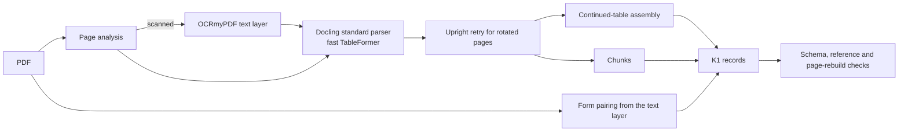

# Document ingestion exploration

A survey of open-source document-parsing tools and a local prototype that turns drilling-report PDFs into the K1 chunk package: files, pages, logical tables, key/value forms, and parent/child chunks with stable IDs and page provenance. The prototype wraps the repository's `graph_builder.corpus` pipeline without modifying it. Everything runs locally, on CPU or a local OpenAI-compatible endpoint, with models of at most 7B parameters.



## Results

| Area | Result | Detail |
| --- | --- | --- |
| Parser choice | Docling standard with fast TableFormer: 85.1% mean data-cell accuracy on nine annotated tables, versus 68.9% for accurate TableFormer and 72.7% for a local 1.2B document VLM | [Parser comparison](docs/evaluation.md#parser-comparison) |
| Local VLM | Not used automatically: no tested page-selection or text-support rule met its criterion, and the VLM inserted text absent from the page | [Hard-page selection](docs/evaluation.md#hard-page-selection), [VLM text support](docs/evaluation.md#vlm-text-support) |
| Key/value forms | Template pairing on the text layer: 141/141 development and 93/93 held-out pairs exact, every pair with key and value boxes | [Form pairing](docs/evaluation.md#form-pairing) |
| Scanned pages | OCRmyPDF (Tesseract) then text-mode conversion: 29/33 critical tokens with typographic quotes normalized (26/33 raw) | [Scanned-page OCR](docs/evaluation.md#scanned-page-ocr) |
| Continued tables | 3 of 4 annotated tables joined with headers on every part; the rotated 68-32 activity table is not | [Continued tables](docs/evaluation.md#continued-tables) |
| Structure and determinism | 817 pages in two corpora: schemas, references and page rebuild pass; independent and interrupted-then-resumed runs give identical checksums | [Resume and determinism](docs/evaluation.md#resume-identity-and-structural-checks) |

All annotations are single-annotator and AI-assisted, with a second review against the source renders. The samples are small and English only. Limits and open next steps are listed in [known issues](docs/known-issues.md#next-steps).

## Contents

| Path | Content |
| --- | --- |
| [docs/design.md](docs/design.md) | Prototype architecture, K1 record formats, IDs and decisions |
| [docs/evaluation.md](docs/evaluation.md) | Each experiment: question, criterion, result and error examples |
| [docs/tool-survey.md](docs/tool-survey.md) | Tool verdicts; one note per tool in [docs/tools/](docs/tools/); [papers](docs/papers.md) |
| [docs/known-issues.md](docs/known-issues.md) | Open problems and limits |
| [docs/usage.md](docs/usage.md) | Setup, running, evaluation and tests |
| [src/ingest_prototype/](src/ingest_prototype/) | The prototype package |
| [configs/](configs/) | Prototype settings, corpora, form template, document types, input lock |
| [schemas/](schemas/) | JSON Schemas for the K1 records |
| [annotations/](annotations/README.md) | Development and held-out annotations |
| [experiments/](experiments/) | Replays of the parser, page-selection and text-support decisions |
| [results/](results/) | Evaluation, pipeline checks and per-experiment scores |
| [scripts/](scripts/) | Setup, run and evaluation commands; study tool runners |
| [tests/](tests/) | Unit tests |

## Quick start

From the repository root in PowerShell, with the environments and assets described in [usage](docs/usage.md):

```powershell
./explorations/ingestion/scripts/run.ps1 -Corpus ak3
./explorations/ingestion/scripts/run.ps1 -Corpus reports
./explorations/ingestion/scripts/evaluate.ps1
```

Generated corpora, caches, renders, model files and upstream checkouts stay in ignored local folders. Source and model licences are in [NOTICE](NOTICE.md).
