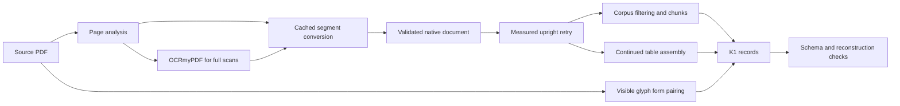

# Local ingestion prototype

The prototype imports the repository corpus analyzer, Docling converter, filters and chunker at commit `2258b4dd9152b108903420ba298bbc452917e83d`. The repository implementation remains unchanged. The additional conversion, table, form and export behavior lives in [one package](../src/ingest_prototype/cli.py); its configuration is [explicit](../configs/prototype.json). Source PDFs, model assets and upstream revisions are pinned in [one input lock](../configs/inputs.lock.json). Structural checks are reported in [the pipeline results](../results/pipeline-checks.json), and extraction accuracy in [the annotation evaluation](../results/evaluation.json).

## Conversion boundary

[The segment wrapper](../src/ingest_prototype/convert.py) serializes a fresh result, then returns `DoclingDocument.model_validate_json` from that cache. Cache hits use exactly the same read and validation path. There is no failed-document retry workaround. This addresses the asymmetric return paths in `src/graph_builder/corpus/process.py:86-108`: revalidation clamps native provenance boxes, which can also change margin filtering. [Diagnosis and regression evidence](../results/cache-normalization.json).

The default parser uses CPU, the Heron layout model and fast TableFormer. Full-scan English pages use [OCRmyPDF](../src/ingest_prototype/ocr.py), pinned Windows Tesseract, English data, forced OCR, deskew, page rotation detection and optimize=0. The derivative is explicitly converted in text mode, even if analysis calls its invisible text layer hybrid. The original source file hash and physical page identity remain the record identity. Each page records the OCR engine, versions, asset hashes, settings and effective conversion mode. Hybrid image regions retain the corpus RapidOCR path. The corpus VietOCR, RapidOCR and EasyOCR options remain configurable for other language workloads; this evaluation supplies no Vietnamese accuracy evidence.

## Upright retry

[Rotation handling](../src/ingest_prototype/rotation.py) retries every page with nonzero PDF rotation, plus landscape pages holding a table. It isolates and rotates a page, converts it, then maps table and cell boxes back into the displayed physical frame. Acceptance requires both a larger nonempty-cell count and higher same-page text-layer word recall, using the repository fidelity function (`src/graph_builder/ingestion/evaluation.py:108`). Every attempt, including refusals, appears on the page record.

The condition can reject a visibly better grid when it drops source words. The activity grid on 68-32 p30 is such a case; p31 improves both measurements. [Concrete attempt scores](../results/rotation-review.json). Alignment uses upright coordinates internally, while exported provenance retains physical page coordinates. These frames are tested separately.

## Logical tables

[The assembler](../src/ingest_prototype/tables.py) applies the aligned-column rule with header cleaning: last/first body table position, continuation margins, aligned horizontal edges, compatible headings, no intervening body heading and an overlap-based column map. A nonidentity map is marked uncertain. Repeated heading selection uses same-page text outside the table as furniture evidence and preserves data cells.

A header-only fragment may also join the next page when column count and horizontal alignment agree. **This extension is informed by reviewed held-out failures. Its evaluation is descriptive, not independent held-out validation.** It joins the coordinates heading on 16A pp7–8, but does not establish reliable continuation on all rotated tables. [Continuation results](../results/evaluation.json).

Logical records contain the assembled grid, cells, physical regions, native parts, column maps and `join.status` of `joined`, `uncertain` or `single`. Child text retains native serialization and repeated headers; each native table child refers to its logical table parent and logical row interval. No row-text repair or cross-page event deduplication is inferred from annotation values.

## Forms and report context

[Form extraction](../src/ingest_prototype/forms.py) reads visible PDFium glyphs and vector rulings directly. The [RIMBase template](../configs/rimbase_form_template.json) supplies only labels and value directions learned from development pages. A page matches when at least 40% of distinct template labels occur and it contains the Operations Summary boundary. Otherwise colon-label extraction may emit `method: generic`, `verified: false`. Template applicability is a heuristic, not verification of unseen layouts. [Form accuracy and source-absent flags](../results/evaluation.json).

Each form has a `<file_id>:f<n>` record and one child containing `key: value` lines. Keys, values and their source boxes remain separate fields. When report date and well are available, [child mapping](../src/ingest_prototype/chunking.py) attaches them as `context.report_date` and `context.well` to all children on that page. It never prefixes context to text. Cross-page passages are split into source substrings when report context differs. Generic extraction does not carry a verified accuracy claim.

## K1 records and validation

| Record | Meaning |
| --- | --- |
| `files.jsonl` | Content-derived file ID, source digest, original name, type, licence and canonical text path |
| `pages.jsonl` | Physical page ID, dimensions, analyzed/effective modes, engine provenance, upright attempts, quality and reconstruction digest |
| `tables.jsonl` | Logical grid, native parts, column mappings, physical regions and join status |
| `forms.jsonl` | Paired fields, key/value boxes, method and applicability evidence |
| `parents.jsonl` | Section, table and form parents with page and file lineage |
| `chunks.jsonl` | Child ID, text, offsets, source spans, regions, parent, logical table/form reference and separate context |

[IDs](../src/ingest_prototype/ids.py) use `f` plus the first 16 SHA256 hex characters; pages use `:p<n>`, sections `:s<n>`, tables `:t<n>`, forms `:f<n>` and zero-based children `:c<n>` within parents. Duplicate IDs fail validation. [Schemas](../schemas/k1_file.schema.json) specify each record namespace; the [form schema](../schemas/k1_form.schema.json) is separate from the [chunk schema](../schemas/k1_chunk.schema.json).

Geometry is rounded to 0.01 PDF point only at canonical serialization. Text, integer offsets and native caches retain their values. Run-specific elapsed times remain outside `SHA256SUMS`. [Validation](../src/ingest_prototype/validate.py) checks schemas, unique IDs, file/page/parent/table/form references, contiguous child indices, canonical offsets, source-span bounds, physical regions and file digests.

Page reconstruction compares the independent pre-ID extracted stream, including derived form serialization, with the source-span projection of exported children. A 100% rebuild proves that mapping and serialization preserve that stream; it does not prove complete extraction of the PDF text. Cell, form and OCR accuracy are measured separately in [evaluation](evaluation.md).

## Future option

A local model of at most 7B could supply a second opinion on selected pages. No automatic VLM replacement or second-opinion service is implemented. The parser comparison favors fast TableFormer on this sample, and the evaluated hard-page and text-support rules fail their pre-registered criteria. [Decision evidence](evaluation.md).
