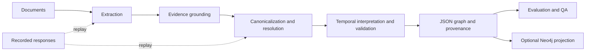

# kg-builder

Build evidence-grounded knowledge graphs from text and public well-operation records. The Python pipeline integrates KGGen extraction, EDC relation canonicalization, deterministic validation, optional evidence judging, and graph-based question answering. Recorded responses support offline replay without a running LLM.



## Quick start

Windows PowerShell is the supported entry point. Supply the pinned Python runtimes, offline wheels and model assets described in [usage](docs/usage.md). Dependencies and assets are not bundled.

```powershell
.\scripts\setup.ps1 -VerifyOnly
.\scripts\reproduce.ps1 --quick
.\scripts\reproduce.ps1 --full
```

Quick reproduction recomputes score tables from shipped evaluation inputs. Full reproduction also rebuilds published configurations with recorded responses. Neither mode calls an LLM. Generated output goes under ignored `runs/`.

For an interactive recorded demo:

```powershell
.\kgb.ps1 run --config configs/experiments/demo.yaml --mock
```

For a new live run, start the configured model in a local LM Studio server at `127.0.0.1:1234`, verify the runtime configuration, and omit `--mock`:

```powershell
.\kgb.ps1 run --config configs/experiments/demo.yaml
```

Live operation uses compute and generates new responses. Published results refer to recorded configurations, not arbitrary model replacements. See [usage](docs/usage.md) for setup, command options and optional BSEE table rebuilding.

## Results

<!-- results:start -->

| Dataset | Configuration | Metric | Value | L2 IAA |
| --- | --- | --- | --- | --- |
| WebNLG-10 | EDC with window grounding, A4 | Strict F1 | 0.8428571428571429 | not applicable |
| MINE-3 | Recorded extraction and judge | Accuracy (29/45, source precision) | 0.6444 | not applicable |
| 2Wiki-10 | Text retrieval | Answer F1 | 0.7357142857142857 | not applicable |
| BSEE text v1 base | A4 full | L2 F1 | 0.2085889570552147 | 0.8790697674418605 |
| BSEE text v1 guided | A4 full | L2 F1 | 0.3450479233226837 | 0.8790697674418605 |
| BSEE text v2 guided | A4 full | L2 F1 | 0.4533715925394548 | 0.8538622129436325 |
| BSEE text v2 guided + recall | A4 full | L2 F1 | 0.5005714285714286 | 0.8538622129436325 |

<!-- results:end -->

The BSEE labels are an **LLM-annotated benchmark**, produced by two independent LLM annotators from different model families and an LLM adjudicator; they are not human expert labels. The adjudicator shares annotator A's family. On v2 partial disagreements, family participation was 91 for A, 27 for B, with 9 edited decisions; accepting both contributes to both counts. IAA measures agreement, not correctness. `time` is unscored. Unlisted date forms remain partial with no inferred date or borrowed year. **v1 and v2 scores are not comparable.** Both primary guided-improvement comparisons are **not confirmed** by their pre-registered confidence-interval rule.

WebNLG and QA use ten examples each; MINE uses three essays. These small samples, one local extraction model, and correlated annotation errors limit generalisation. Full scores, scope-matched IAA and confidence intervals are in [results](docs/results.md).

## Documentation

- [Overview](docs/overview.md), [architecture](docs/architecture.md) and [design decisions](docs/adr/README.md)
- [Evaluation](docs/evaluation.md), [BSEE domain](docs/bsee-domain.md) and [annotation methodology](docs/annotation-guideline.md)
- [Development history](docs/project-history.md), [datasets and licences](docs/datasets-and-licenses.md)

## Acknowledgements and licence

KGGen, EDC, AutoSchemaKG, GraphJudge and HippoRAG inform the integrations, prompts and metrics. BSEE, WebNLG, 2WikiMultiHopQA and MINE provide evaluation material. [NOTICE](NOTICE.md) lists pinned sources and their recorded licences. No upstream repositories or papers are bundled. Project licence: **TBD by repository owner**.
