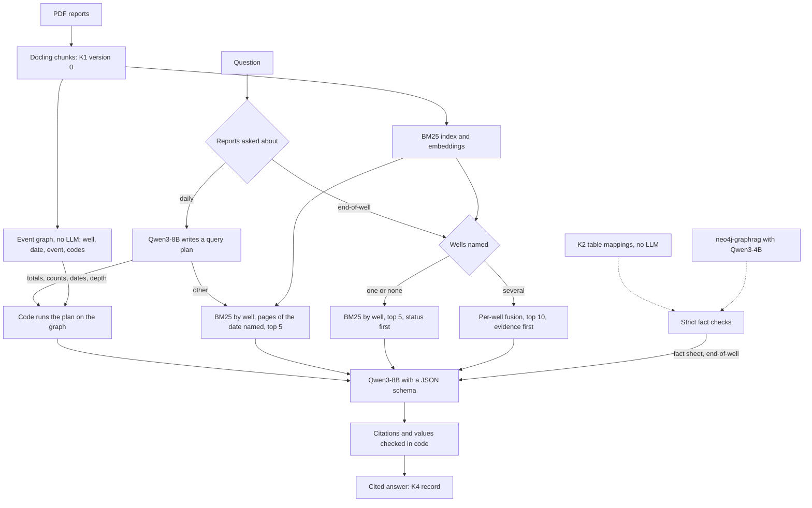

# graphrag: Track B code

Track B's code for the first build: the model client, the baseline, and the GraphRAG candidates we compared with it (specification §4.5, §8.4). Findings, decisions and runs are logged in [docs/tracks/B-graphrag/log.md](../docs/tracks/B-graphrag/log.md).

## Architecture

Solid lines are what runs (B-D23, B-D26). The fact sheet from the per-well fact graph is part of the end-of-well path (B-D29). Which reports are asked about is chosen per run, by the command you use.



| Module | What it does |
|---|---|
| `client.py` | One OpenAI-compatible client for hosted (OpenRouter) and local (llama.cpp) endpoints. It provides chat with JSON-schema output, embeddings, a cache keyed by the full request, a per-run ledger (calls, tokens, seconds, cost) and the private-data guard |
| `data.py` | The inputs: K1 version 0 chunks (`data/processed/gdr_chunks_full.jsonl`), the AK-3 daily-report chunks, and every question set with its gold data |
| `retrieval.py` | BM25, dense embeddings from an endpoint, and reciprocal-rank fusion. Every retriever takes an `allowed` chunk set (a payload filter). `wells:<retriever>` searches only the documents that name a well the question names (B-C11, E18); `dates:<retriever>` only the pages of the report dates it names (E27) |
| `scoring.py` | The prototype's value-matching and answer rules, so results compare with E10; `normalize` puts dates and numbers in one form after the call |
| `citations.py` | Checks each model citation against the retrieved chunks and attaches a verified one in code (B-C08) |
| `baseline.py` | Command line for retrieval and answer runs; it writes `graphrag/results/<name>.json`. `--facts` adds a graph's extracted facts under each passage; `--withhold-unsupported` drops answers without a supported citation |
| `validate.py` | Checks extracted facts before they reach an answer: value written in its chunk, one well named in its document, no zeros, no contradictions (B-C15, E20). `baseline.py --fact-sheet <graph> --validate` puts each named well's validated facts before the passages; `--strict-facts` also checks their context (E26) |
| `tables.py` | Facts from table rows by K2's `table_mappings`, with no model call (B-C16, E22, E29): `python -m graphrag.tables --pool three --name my_tables` |
| `table_eval.py` | Scores table facts on unseen reports against independent gold, raw and after validation (E29) |
| `k4.py` | K4 answer records for Track C (B-C18): `python -m graphrag.k4 <run>` writes `<run>.k4.jsonl`, valid against `schemas/k4_answer_record.schema.json` |
| `events.py` | The event graph for questions over time on daily reports (E28, B-D26): built with no model call; the model plans, code runs the plan |
| `oracle.py` | Answers with retrieval bypassed, to separate parsing, retrieval and model failures (E24). A diagnostic: it reads the gold data |
| `lightrag_run.py` | LightRAG 1.5.7 (MIT, as a library, `.venv-lightrag`) on our chunks, client and answer harness (E19) |
| `ontology.py` | K2 ontology slice: glossary from the reports' tables, rendering as extractor guidance |
| `neo4j_kg.py` | neo4j-graphrag-python (Apache-2.0, used as a library) on the K1 chunks: the ontology profile as its schema, our client as its LLM and embedder, facts read back from Neo4j and scored against the gold facts (E16) |

Endpoints are listed in [`configs/graphrag/endpoints.json`](../configs/graphrag/endpoints.json). Hosted endpoints read their key from the environment, for example `OPENROUTER_API_KEY`. Local endpoints refuse no data class; hosted ones accept public data only.

## The UI (D-60)

```powershell
python -m graphrag.ui        # then open http://127.0.0.1:8765
```

- **Recorded runs:** pick a question set and a run (E19 to E28); each question shows its path through the pipeline, the answer and whether it is correct, the cited passage with its page, and, for the event graph, the query plan and the events the total was computed from. "Compare with" puts a second run of the same questions beside it, for example the event graph against plain RAG. Needs no model, so it works on a laptop; passage text shows only where that corpus is on the machine.
- **Ask a question:** answers a new question with the same code as the runs: retrieval routed by well with the fact sheet for end-of-well questions, the event graph with its fallback for daily-report questions. The lane is chosen from the question's words, or by hand. Needs llama.cpp on port 8080; hosted endpoints are off in the UI.
- Standard library only, listening on 127.0.0.1. Tests: `tests/test_graphrag_ui.py`.

## Running locally

Models live in ignored `data/interim/models/`. Start the servers with llama.cpp's `llama-server`. On an Nvidia GPU, use the CUDA build from the [llama.cpp releases](https://github.com/ggml-org/llama.cpp/releases) (E15 used b12015, `win-cuda-12.4-x64` plus its `cudart` zip, unpacked into ignored `data/interim/llama.cpp/`) and `-ngl 99`. On a laptop with an integrated GPU, use `--device none -ngl 0` instead: the Vulkan backend runs out of device memory.

```powershell
llama-server -m data/interim/models/Qwen3-Embedding-0.6B-Q8_0.gguf --embedding --pooling last --port 8081 -c 8192 -b 2048 -ub 2048 -ngl 99 --alias qwen3-embedding-0.6b
# The answer model (E17). Thinking stays off. One slot, 32k: LightRAG needs it, and the baseline scores the same (E19).
llama-server -m data/interim/models/Qwen3-8B-Q4_K_M.gguf --port 8080 -c 32768 -np 1 -ngl 99 --jinja --chat-template-kwargs '{"enable_thinking":false}' --alias qwen3-8b

python -m graphrag.baseline retrieval --pool ak3 --retrievers bm25 dense:qwen3-embedding-0.6b fusion:bm25+dense:qwen3-embedding-0.6b --name my_run
python -m graphrag.baseline answer --pool ak3 --retriever bm25 --k 5 --endpoint local-llama --model qwen3-8b --name my_answers
```

Pools:

- `slice`: the 15 prototype chunks;
- `ak3`: the whole AK-3 end-of-well report, 60 chunks;
- `three`: AK-3 plus two other end-of-well reports as distractors, 372 chunks;
- `ak3_daily`: the four AK-3 daily-report attachments, 898 chunks, used with `--questions ak3_daily`. The chunks are ignored by git; to regenerate them, see [next-runs.md](../docs/tracks/B-graphrag/next-runs.md).

Measurement runs send one request at a time: parallel requests make llama.cpp results non-repeatable (B-F19).

## neo4j-graphrag-python (E16)

It needs Neo4j with APOC and its own environment, because it requires a newer `pypdf` than the main lock file allows (B-C09):

```powershell
docker compose -f configs/graphrag/docker-compose.yml up -d
py -3.12 -m venv .venv-graphrag
.venv-graphrag\Scripts\python -m pip install -r requirements-graphrag.lock.txt
.venv-graphrag\Scripts\python -m graphrag.neo4j_kg --pool ak3 --model qwen3-8b --prompt library --name my_graph
python -m graphrag.baseline answer --pool ak3 --retriever bm25 --k 5 --endpoint local-llama --model qwen3-8b --facts my_graph --name my_answers_with_facts
```

Each build clears the Neo4j database first. Neo4j Browser is at http://127.0.0.1:7474 (user `neo4j`, password `graphrag-dev`, local only).

Tests: `python -m unittest discover -s tests -p "test_graphrag.py"`. The tests make no model calls; the `neo4j_kg` tests run only in `.venv-graphrag`.

## The baseline

Adopted in B-D23 and B-D26: retrieval routed by well and date, and the event graph for questions over time on daily reports.

```powershell
# End-of-well reports: BM25 by well; questions naming several wells use per-well fusion and evidence first (E26)
python -m graphrag.baseline answer --pool three --retriever wells:bm25 --k 5 --multi-well-retriever perwell:fusion:bm25+dense:qwen3-embedding-0.6b --endpoint local-llama --model qwen3-8b --name my_answers
# Daily reports: also filtered by the report date the question names (E27)
python -m graphrag.baseline answer --pool ak3_daily --questions ak3_daily_heldout --retriever dates:wells:bm25 --k 5 --endpoint local-llama --model qwen3-8b --name my_daily_answers
# Daily reports, questions over time: the event graph, which falls back to retrieval (E28)
python -m graphrag.events answer --questions ak3_events_heldout --endpoint local-llama --model qwen3-8b --name my_event_answers
# K4 answer records for Track C
python -m graphrag.k4 my_answers
```

## The per-well fact graph and its fact sheet (E22, E26, E27; B-D29)

A per-well fact graph from two sources, checked in code before it reaches the answer model. Part of the design and of the end-of-well answer path (B-D29). On new lookup questions it ties the baseline so far; the expert questions are to show where it helps. Use `--strict-facts` with it.

```powershell
# 1. Table facts by K2's mappings (no model call)
python -m graphrag.tables --pool three --name my_tables
# 2. Prose facts by neo4j-graphrag with Qwen3-4B (llama-server on port 8082, endpoint local-llama-2; Neo4j running)
.venv-graphrag\Scripts\python -m graphrag.neo4j_kg --pool three --endpoint local-llama-2 --model qwen3-4b --prompt library --name my_graph
# 3. Answers: both fact sources, validated, the 3 most relevant K2 properties per question
python -m graphrag.baseline answer --pool three --retriever wells:bm25 --k 5 --multi-well-retriever perwell:fusion:bm25+dense:qwen3-embedding-0.6b --fact-sheet my_graph my_tables --validate --strict-facts --sheet-properties 3 --endpoint local-llama --model qwen3-8b --name my_answers
```

The cross-report probe runs with `--questions probe`.

## LightRAG (E19, E21)

```powershell
py -3.12 -m venv .venv-lightrag
.venv-lightrag\Scripts\python -m pip install -r requirements-lightrag.lock.txt
python -m graphrag.ontology guidance --out data/interim/k2_eowr_v1_guidance.txt
.venv-lightrag\Scripts\python -m graphrag.lightrag_run index --pool three --model qwen3-8b --guidance data/interim/k2_eowr_v1_guidance.txt --name my_index
.venv-lightrag\Scripts\python -m graphrag.lightrag_run answer --index my_index --mode mix --budget small --name my_lightrag_answers
```

LightRAG's prompts need a 32k slot: run the Qwen3-8B server with `-c 32768 -np 1`.
